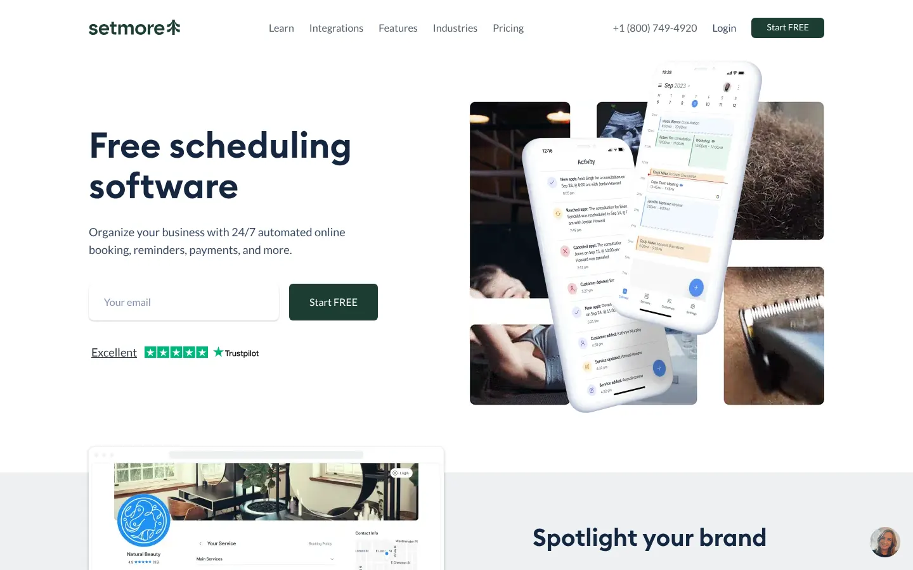
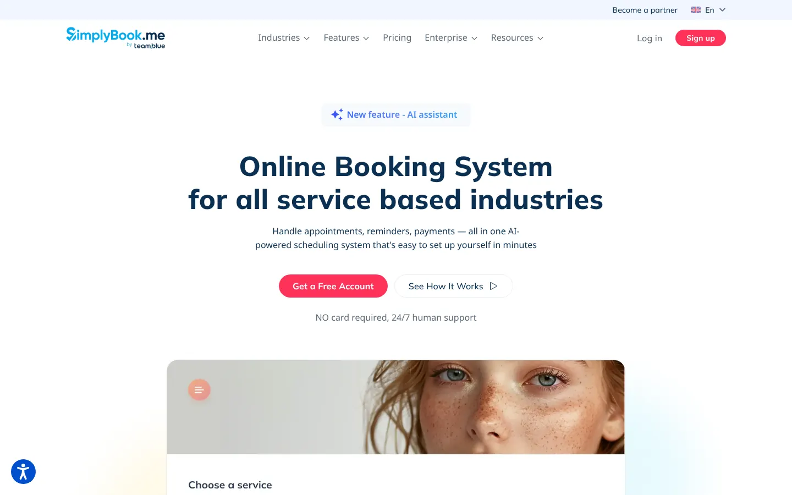
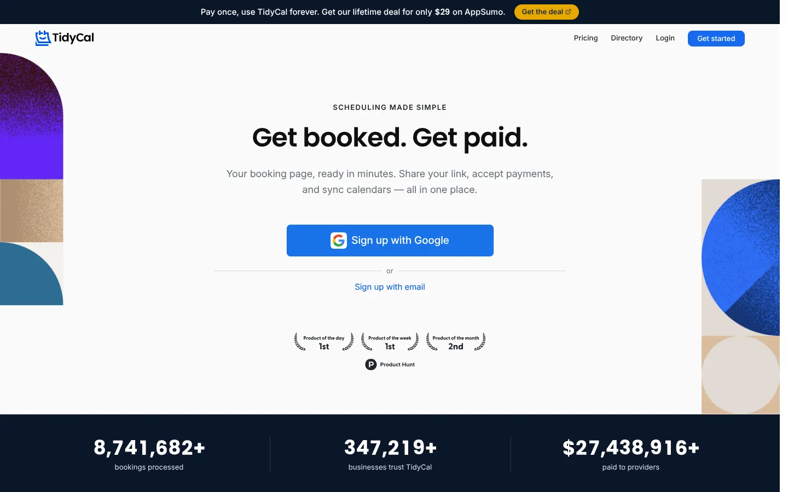

Acuity Scheduling works well for appointment businesses. Clients book, fill in an intake form and pay on one page. But there's no free plan, Starter covers only one calendar, and text reminders, packages and a waitlist wait on Standard. Removing the Acuity footer or signing a HIPAA agreement means Premium.

For a salon, a studio or a coach with a few staff, those limits add up. Find the one that bothers you most, then pick the tool that fixes it.

> **[Try Claritia free](https://app.tryclaritia.com/signup)** to ask your intake questions and book the appointment on the same page, on a free plan with no time limit.

Below, we compare 8 Acuity Scheduling alternatives on free plans, prices, payments, reminders and team booking, and say what you give up with each.

## Main points

- Acuity has no free plan. Its paid plans run from $16 to $55 a month billed yearly, priced by number of calendars.
- For a free plan with staff, [Setmore](https://www.setmore.com/) lets up to four people take bookings for $0, with payments included.
- For classes, memberships and a full booking website, look at [SimplyBook.me](https://simplybook.me/).
- Top picks: [Claritia](/), [Setmore](https://www.setmore.com/), [SimplyBook.me](https://simplybook.me/), [Calendly](https://calendly.com/), [Zoho Bookings](https://www.zoho.com/bookings/), [YouCanBookMe](https://youcanbook.me/), [TidyCal](https://tidycal.com/) and [Cal.com](https://cal.com/).
- Pick [Claritia](/) if your bookings start on your website and you want a form in front of the calendar for free.

## What is an Acuity Scheduling alternative?

An Acuity Scheduling alternative is a booking tool you use in place of Acuity. Clients see your open times on a booking page, pick a slot, and the appointment lands on your calendar. Most also send reminders and take payment.

People switch for a few reasons. They want a free plan, a lower price for a small staff, a feature Acuity keeps on a higher plan, or tools for booking meetings with leads, like round robin.

Most of them have:

- A booking page you can brand and embed on your site.
- Sync with Google Calendar, Outlook or Apple Calendar.
- Intake questions or a form before the booking.
- Email and text reminders.
- Payments or deposits at booking.
- Staff calendars, classes or group sessions.

## How to choose an Acuity Scheduling alternative

Start with what you sell and who books it. Then check these five things:

- **How it charges.** Acuity prices by calendar. Most others charge per user, per booking or one time. Work out the price for your real staff count.
- **Intake questions.** Can you ask what you need before the visit, and on which plan?
- **Payments.** Which payment providers it supports, whether deposits work, and if the tool adds its own fee.
- **Reminders.** Check if text reminders are included or cost extra credits.
- **Packages and classes.** If clients prepay for sessions or join group classes, check that the tool sells them.

## The 8 best Acuity Scheduling alternatives in 2026

Prices checked November 2026.

| Tool | Best for | Free plan | Paid from | Payments |
|---|---|---|---|---|
| [Claritia](/) | Intake questions and booking on one page | Yes, 1 seat and 250 submissions a month | $12 a seat a month, billed yearly | Stripe, Square or PayPal on Starter |
| [Setmore](https://www.setmore.com/) | A small staff on a free plan | Yes, up to 4 users | $5 a user a month, billed yearly | Square, Stripe and PayPal on free |
| [SimplyBook.me](https://simplybook.me/) | Classes, memberships and a booking website | Yes, 50 bookings a month | $11.90 a month, billed yearly | From Basic |
| [Calendly](https://calendly.com/) | Client calls and simple paid sessions | Yes, 1 event type | $10 a seat a month, billed yearly | Stripe and PayPal from Standard |
| [Zoho Bookings](https://www.zoho.com/bookings/) | Businesses on Zoho apps | Yes, 1 user | $6 a user a month, billed yearly | On Premium |
| [YouCanBookMe](https://youcanbook.me/) | Detailed booking forms | Yes, 30 bookings a month | $8.10 a month, billed yearly | Stripe on free |
| [TidyCal](https://tidycal.com/) | Paying once instead of monthly | Yes, unlimited bookings | $29 one time | Stripe or PayPal on free, with a 1% fee |
| [Cal.com](https://cal.com/) | Unlimited free links, or hosting it yourself | Yes, 1 user | $12 a user a month, billed yearly | Stripe and PayPal on free |

## 1. Claritia

[Claritia](/) is a forms, scheduling and follow-up app built for small B2B teams that want every lead from their website to reach the right rep and book a meeting before they leave the page.

It builds forms from a sentence or one of 840 templates, opens the right person's calendar the moment the form is sent, routes each lead by its answers, and drafts follow-up emails in your brand's voice for you to approve.

For a service business, that means your intake questions and your calendar sit on one page. A client answers, picks a time and gets a confirmation with a calendar invite. All of this works on the free plan.

> **[Try Claritia free](https://app.tryclaritia.com/signup)** with no card, and add booking to your first intake form today.

### Key features

- **Booking inside forms:** On the free plan, with conditional logic, file uploads and 840 [form templates](/templates).
- **Reminders on free:** Email reminders a day and an hour before, with reschedule and cancel links.
- **Paid meetings:** Stripe, Square or PayPal on Starter. See the [Square integration](/integrations/square).
- **Text reminders:** On Starter, through your own Twilio number, only to people who said yes.
- **Round robin and routing:** On Pro, with weights, caps and away days.

*Caption: A Claritia form asks its questions, then ends on a time picker, so the booking happens inside the form.*

### Pros

- **A real free plan:** No trial clock, and the free plan books real clients.
- **Questions before the booking:** You learn what each client needs before they arrive.
- **Free teammates:** People who only build forms or read answers never need a seat.

### Cons

- **No packages or memberships:** It doesn't sell session packs, memberships or gift certificates the way Acuity does.
- **Per seat pricing:** A business with many bookable staff pays for each one.
- **Newer tool:** No native mobile app, a smaller marketplace, and Zapier and Make apps aren't listed yet.

### Price and plans

You can start on the free plan with no card. Paid plans are priced per seat, and a seat is a teammate people can book a meeting with.

- **Free:** $0 for 1 seat, 1 meeting type, 1 calendar and 250 submissions a month.
- **Starter:** $15 a seat a month ($12 billed yearly). Adds unlimited meeting types, 6 calendars per seat, group meetings and paid meetings.
- **Pro:** $39 a seat a month ($31 billed yearly). Adds round robin, routing and removes Claritia branding.
- **Business:** $79 a seat a month ($63 billed yearly). Adds your own domain for forms and booking pages.

## 2. Setmore

[Setmore](https://www.setmore.com/) is an online appointment scheduling app for service businesses and teams that want customers to book and pay without back-and-forth calls. Each business gets a branded booking page with its services, real-time availability and reviews, which it can share on its website, Facebook, Instagram or a QR code.

Setmore books one-on-one appointments and group classes, sends email and text reminders, adds Zoom or Google Meet links, syncs with Google Calendar and takes card payments. Its free plan covers up to four users with unlimited appointments and payments, which beats Acuity Starter's single calendar for a small shop.

### Key features

- **Four users free:** Each with their own login and booking page.
- **Payments on free:** Online and in-person payments, with Square, Stripe and PayPal.
- **Pro extras:** Booking forms, SMS reminders, deposits, recurring appointments and two-way calendar sync.
- **HIPAA:** Pro includes a signed BAA.

### Pros

- **A free plan for a team:** Up to four people book clients at $0.
- **Low paid price:** Pro is $5 a user a month billed yearly.
- **Help any time:** Setmore lists 24/7 support from real people on every plan.

### Cons

- **No booking forms on free:** Intake questions need Pro.
- **No two-way sync on free:** Two-way calendar sync is on Pro.
- **Text credits:** Pro includes 500 SMS credits a month per user, with more bought in the app.

### Price and plans

- **Free:** $0 for up to 4 users.
- **Pro:** $5 a user a month billed yearly, or $12 billed monthly.
- **Live Receptionist:** A $99 a month add-on, US only.

## 3. SimplyBook.me

[SimplyBook.me](https://simplybook.me/) is an online booking system for service businesses in fields like beauty, health, education, fitness, and public services that want clients to book at any hour. It gives each business a booking website and lets clients also book through Facebook, Instagram, Google, or a branded client app.

It sends reminders by email, SMS and WhatsApp, and takes payments online or in person through its POS. You can add classes, memberships, intake forms and gift cards. You pay by the number of bookings and providers, not per user.

### Key features

- **Booking website:** A full site plus a widget for your own site, on every plan.
- **Custom features:** 1 on free, 3 on Basic, 8 on Standard and no limit on Premium.
- **Payments and POS:** From Basic, including deposits and tips.
- **HIPAA:** From Standard.

### Pros

- **Flat plan prices:** Basic covers up to 5 providers for one price.
- **Lots of options:** Classes, memberships, gift cards and a client app.

### Cons

- **Booking caps:** 50 bookings a month on free and 100 on Basic.
- **Texts cost extra:** SMS comes in packs, at $8 for 100 credits.
- **More to learn:** The long list of add-ons takes time to set up.

### Price and plans

- **Free:** $0 for 1 provider and 50 bookings a month.
- **Basic:** $11.90 a month billed yearly ($13.90 monthly), with 5 providers and 100 bookings.
- **Standard:** $24.90 a month billed yearly ($29.90 monthly), with 15 providers and 500 bookings.
- **Premium:** $49.90 a month billed yearly ($59.90 monthly), with 30 providers and 2,000 bookings.

## 4. Calendly

[Calendly](https://calendly.com/) is scheduling software for professionals and teams who want people to book meetings without trading emails. You connect your calendars, set hours, buffers, and daily limits, and share booking links for one-on-one, multi-host, or group meetings.

It sends email and text reminders, has routing forms that send website leads to the right teammate, and collects payments. Newer additions include an AI assistant that finds times over email and a notetaker that writes meeting recaps. For service work, its paid plans also list payment links, prepaid meeting packages and invoices.

### Key features

- **Free plan:** One event type and one calendar, with unlimited one-on-one meetings.
- **Payments:** Stripe and PayPal at booking from Standard.
- **Reminders and automations:** From Standard.
- **Team booking:** Round robin and routing forms on Teams.

### Pros

- **Familiar to clients:** Many people have booked through it before.
- **Strong for consultants:** Paid calls, packages and invoices on paid plans.

### Cons

- **Small free plan:** One event type and no automated reminders.
- **Per seat:** Every host pays, so a staff of five costs five seats.
- **Less for salons and studios:** No waitlist or gift certificates listed.

### Price and plans

- **Free:** $0, with 1 event type.
- **Standard:** $10 a seat a month billed yearly ($12 monthly).
- **Teams:** $16 a seat a month billed yearly ($20 monthly).
- **Enterprise:** From $15,000 a year.

## 5. Zoho Bookings

[Zoho Bookings](https://www.zoho.com/bookings/) is appointment scheduling software for businesses of any size that want meetings to land on their calendar without back and forth. It has one-on-one, group, collective and resource-based event types, with workspaces for branches or departments, staff roles, and booking limits.

Routing forms qualify leads before they book, workflows send email and SMS and update records, and it connects with Zoho CRM, Zoho Desk, and other Zoho apps. Its per-user prices are low, and Premium adds online payments.

### Key features

- **Free plan:** One user, with email reminders and two-way sync for Zoho, Google and Microsoft calendars.
- **Round robin:** Four ways to share bookings across staff.
- **Premium extras:** Payments, SMS workflows, routing forms, white labeling and 3 workspaces.
- **Zoho ties:** Syncs with Zoho CRM and Bigin.

### Pros

- **Low prices:** $6 to $9 a user a month billed yearly.
- **Good for branches:** Workspaces split locations or departments.

### Cons

- **Payments need Premium:** Basic doesn't connect payment providers.
- **Rooms cost extra:** Resources like rooms and equipment are paid add-ons.

### Price and plans

- **Free:** $0 for 1 user.
- **Basic:** $6 a user a month billed yearly ($8 monthly).
- **Premium:** $9 a user a month billed yearly ($12 monthly).

## 6. YouCanBookMe

[YouCanBookMe](https://youcanbook.me/) is an online scheduling tool for small and midsize businesses that want a branded booking page tied to their calendars. It syncs with Google, Apple, Outlook, and Fastmail calendars, and has booking forms with conditional questions, approval of requests before they are confirmed, password protected pages, and paid bookings through Stripe.

It sends confirmations, reminders, and follow-ups by email and SMS, triggers webhooks, and reports on bookings, no-shows, and revenue. Its free plan already includes booking form questions and Stripe payments, which suits a solo provider who wants intake questions at $0.

### Key features

- **Booking form questions:** On the free plan, with unlimited questions on Professional.
- **Stripe payments:** Cards, Apple Pay and Google Pay on free.
- **Approval:** Accept or decline requested bookings on Professional.
- **Team booking:** Round robin on Team.

### Pros

- **Intake on free:** Questions and payments without paying for a plan.
- **Free trial:** Two weeks to test paid features.

### Cons

- **Free cap:** 30 bookings a month on one booking page.
- **Reminders cost extra:** Reminder emails and SMS start on Individual.

### Price and plans

- **Free:** $0, with 1 calendar, 1 booking page and 30 bookings a month.
- **Individual:** $8.10 a month billed yearly ($9 monthly).
- **Professional:** $11.70 a month billed yearly ($13 monthly).
- **Team:** $16.20 a member a month billed yearly ($18 monthly).

## 7. TidyCal

[TidyCal](https://tidycal.com/) is a booking tool for coaches, consultants, and solo service providers who want a simple booking page that also takes payment. You list each service as a booking type and connect a Google, Microsoft, or Apple calendar to avoid double bookings.

Clients can pay through Stripe or PayPal when they book, buy session packages or recurring sessions, and get automated email and SMS reminders. It is made by Sumo Group, the company behind AppSumo. Packages and recurring sessions are on the free plan, which Acuity keeps for Standard.

### Key features

- **Free plan:** Unlimited bookings and booking types, paid bookings, packages and group bookings.
- **Lifetime plans:** Pay once on AppSumo instead of every month.
- **Team booking:** Round robin and a team page on Agency Lifetime.
- **Pro extras:** No branding, a custom domain and no platform fee.

### Pros

- **Packages for free:** Session bundles without a paid plan.
- **One payment:** The lifetime plans avoid a monthly bill.

### Cons

- **Platform fee:** 1% on paid bookings below Pro, on top of Stripe's fees.
- **Few texts:** SMS reminders are 10 a month on Agency Lifetime, US and Canada only.
- **One calendar on free:** More calendars need a paid plan.

### Price and plans

- **Free:** $0.
- **Individual Lifetime:** $29 one time.
- **Agency Lifetime:** $79 one time.
- **Pro:** $12 a month billed monthly, or $99 a year.

## 8. Cal.com

[Cal.com](https://cal.com/) is scheduling software for individuals and companies that want booking links they can shape around their own process. It syncs calendars, detects time zones, sends reminders, and runs video calls through Zoom, Google Meet, Microsoft Teams, or its own Cal Video.

Teams can use round robin, collective events where every host must be free, routing forms, and workflows, plus admin tools such as SAML SSO and audit logs. Its source code is published on GitHub. Its Organizations plan lists HIPAA compliance, which matters to health practices.

### Key features

- **Free plan:** One user, unlimited links and calendars, email and SMS notifications.
- **Payments on free:** Stripe and PayPal.
- **Teams:** Round robin, collective events and routing forms.
- **Self-hosting:** Run it on your own servers if you want to.

### Pros

- **A lot for free:** Unlimited links, calendars and payments for one person.
- **Easy move from Calendly:** A one-click import of Calendly events.

### Cons

- **Built for meetings:** No packages, memberships or gift certificates listed.
- **Many settings:** The long list of options takes time to learn.

### Price and plans

- **Free:** $0 for 1 user.
- **Teams:** $12 a user a month billed yearly.
- **Organizations:** $28 a user a month billed yearly.
- **Enterprise:** Custom pricing.

## Which Acuity Scheduling alternative should you pick?

- If your bookings start on your website and you want intake questions in front of the calendar, pick [Claritia](/).
- If you have up to four staff and want to pay nothing, pick [Setmore](https://www.setmore.com/).
- If you sell classes, memberships and gift cards, pick [SimplyBook.me](https://simplybook.me/).
- If you sell paid calls and sessions as a consultant, pick [Calendly](https://calendly.com/).
- If you want to pay once and sell packages, pick [TidyCal](https://tidycal.com/).
- If Acuity Standard covers your staff and features, staying is fine. See [Acuity Scheduling pricing](/blog/acuity-scheduling-pricing) to check the plan math.

## Questions

### Is there a free alternative to Acuity Scheduling?

Yes. Claritia, Setmore, SimplyBook.me, Calendly, Zoho Bookings, YouCanBookMe, TidyCal and Cal.com all have free plans. Setmore's covers up to four users, and TidyCal's includes paid bookings and packages.

### Why do people switch from Acuity Scheduling?

Usually it's the lack of a free plan, the single calendar on Starter, and features like text reminders, packages and HIPAA support sitting on higher plans.

### What is cheaper than Acuity Scheduling?

For a small staff, Setmore Pro is $5 a user a month billed yearly and Zoho Bookings Basic is $6. TidyCal sells lifetime plans from $29 one time.

### Is Calendly better than Acuity?

For meetings with leads, clients or candidates, Calendly usually fits better. For appointment businesses that need intake forms, packages and memberships, Acuity often does. See our [Calendly vs Acuity](/blog/calendly-vs-acuity) comparison.

### Which Acuity alternative supports HIPAA?

Setmore Pro includes a signed BAA, SimplyBook.me lists HIPAA from Standard, and Cal.com lists it on Organizations. Check each vendor's terms for your practice before you switch.

## Get started

If you want your intake questions and your calendar on one page, you can start on Claritia for free. Build a form from a template, connect your calendar and share the link.

> **[Try Claritia free](https://app.tryclaritia.com/signup)** to book your first client from a form today, with no card needed.

You can also compare plans in [Acuity Scheduling pricing](/blog/acuity-scheduling-pricing) or see how the two big names compare in [Calendly vs Acuity](/blog/calendly-vs-acuity).
