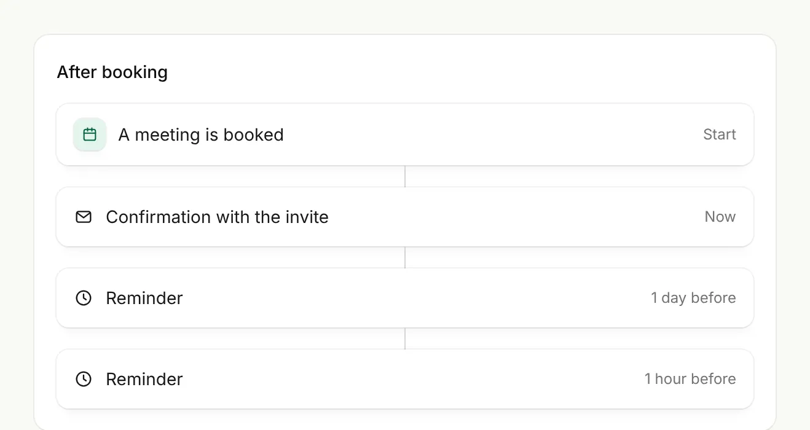
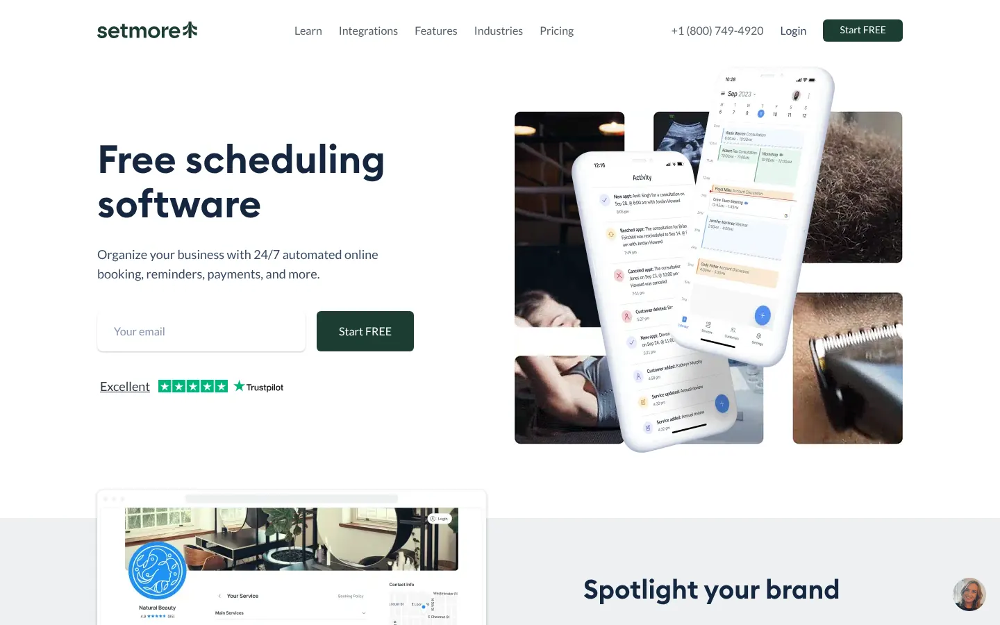

A client books a consultation two weeks out. By the day itself, the time has slipped their mind, or the email with the address is buried under newer ones. The slot sits empty, and nobody had the chance to give it to someone else.

A short reminder fixes most of this. It tells the client when and where, and it makes moving the time easy if their plans changed. The hard part is writing a good one for each kind of visit, in a form that fits both an inbox and a phone screen.

> **[Try Claritia free](https://app.tryclaritia.com/signup)** to send email reminders a day and an hour before every appointment, on the free plan too.

Below are reminder templates for email and text, when to send each one, and tools that send them for you.

## Main points

- An appointment reminder tells the client what, when and where, and gives them an easy way to move the time.
- Send one a day before and one an hour before. Add one a week out for visits booked far ahead.
- Keep reminder texts under 160 characters, so each one goes out as a single message.
- After a no-show, send the reschedule link the same day, kindly and without blame.
- Tools that send reminders for you: [Claritia](/), [Acuity Scheduling](https://acuityscheduling.com/), [Setmore](https://www.setmore.com/) and [Calendly](https://calendly.com/).

## What is an appointment reminder?

An appointment reminder is a short email or text sent to a client before a booked visit. It confirms the date, time and place, says what to bring, and links to reschedule or cancel. Its job is to get the client there, or to free the slot early if they can't make it.

Most businesses send two. Email suits the details, like an address, parking or a list of what to bring. A text suits the last nudge, since it's short and lands on the phone in the client's pocket.

## What a good appointment reminder includes

- **Who it's from.** Your business name first, so the client knows the message is real.
- **What and when.** The kind of appointment, the day, the date and the time. Add the time zone for online visits.
- **Where.** The address, the room or the video link.
- **What to bring or do.** Forms to fill in, papers to bring, or how early to arrive.
- **A way to change it.** A reschedule or cancel link, or a phone number.
- **A short length.** A few lines for an email, one or two sentences for a text.

## When to send appointment reminders

| Reminder | When to send it | Best channel |
|---|---|---|
| A week before | For visits booked a month or more ahead | Email |
| A day before | Every appointment | Email or text |
| An hour before | Every appointment, or 2 to 3 hours ahead if the client travels | Text or email |
| Reschedule nudge | When a client hasn't confirmed or says plans changed | Email or text |
| No-show follow-up | Within an hour or so of the missed time | Email or text |

Send reminders in the client's time zone, and stop them as soon as a visit is moved or canceled. A reminder for a time that no longer exists confuses people.

## Appointment reminder email templates

Each template says when to send it and why it works. Swap the words in curly brackets for your own details.

### 1. Consultation reminder

**When to send it:** A day before a first consultation.

> **Subject:** Your consultation tomorrow at {time}
>
> Hi {first name},
>
> This is a reminder of your consultation with {provider name} at {business name}.
>
> **When:** {day}, {date} at {time}
>
> **Where:** {address or video link}
>
> To make the most of the time, please have {documents or questions} ready. The consultation takes about {length}.
>
> Need a different time? Pick one here: {reschedule link}
>
> {your name}

**Why it works:** The subject line holds the time, so the client sees it without opening the email. Saying what to prepare means the first minutes aren't spent looking for papers.

### 2. Service visit reminder

**When to send it:** A day before you visit a client's home or site.

> **Subject:** {business name} visit tomorrow, {start time} to {end time}
>
> Hi {first name},
>
> {technician name} from {business name} will visit tomorrow, {date}, between {start time} and {end time}, for {service}.
>
> Before we arrive, please {clear the area, leave the gate open, keep pets in another room}.
>
> Can't be home? Move the visit here: {reschedule link}, or call us at {phone}.
>
> {your name}

**Why it works:** An arrival window sets a fair expectation, and the prep note saves a wasted trip for your team.

### 3. Class reminder

**When to send it:** A day before a class, workshop or group session.

> **Subject:** {class name} starts tomorrow at {time}
>
> Hi {first name},
>
> You're booked for {class name} tomorrow, {date}, at {time}, at {location}.
>
> Please arrive {number} minutes early and bring {what to bring}.
>
> If you can't come, cancel here so someone else can take your spot: {cancel link}
>
> {your name}

**Why it works:** Classes have a fixed number of places. Asking people to cancel early, and saying why, frees spots for others.

### 4. A day before

**When to send it:** About 24 hours before any appointment.

> **Subject:** Reminder: {appointment type} tomorrow at {time}
>
> Hi {first name},
>
> A quick reminder of your {appointment type} with {business name} tomorrow, {date}, at {time}.
>
> **Where:** {address or video link}
>
> If the time no longer works, you can move it here: {reschedule link}
>
> {your name}

**Why it works:** It's plain and short, so it fits almost any business. The reschedule link gives a way out that doesn't leave you with an empty slot.

### 5. An hour before

**When to send it:** One hour before, or two to three hours if the client has to travel.

> **Subject:** See you at {time}
>
> Hi {first name},
>
> Your {appointment type} starts in an hour, at {time}.
>
> {Address and a parking tip, or: Join here: {video link}}
>
> Running late? Reply to this email and we'll let {provider name} know.
>
> {your name}

**Why it works:** It arrives while the client is planning their next hour. The parking tip or the link is the one thing they need right then.

### 6. Reschedule nudge

**When to send it:** When a client hasn't confirmed, or tells you their plans changed.

> **Subject:** Still good for {day} at {time}?
>
> Hi {first name},
>
> You're booked for {appointment type} on {day} at {time}. We wanted to check the time still works for you.
>
> If it does, there's nothing to do. If not, pick a new time here: {reschedule link}
>
> Moving it now lets us offer the slot to someone else.
>
> {your name}

**Why it works:** It makes changing the time feel normal. A client who moves the visit is better than one who quietly doesn't come.

### 7. No-show follow-up

**When to send it:** Within an hour or so after the missed appointment.

> **Subject:** We missed you today
>
> Hi {first name},
>
> We had you down for {appointment type} at {time} today and didn't see you. We hope all is well.
>
> When you're ready, pick a new time here: {reschedule link}
>
> {If you charge for missed visits, one short, friendly line on your policy.}
>
> {your name}

**Why it works:** It's kind, and it puts the reschedule link in front of the client while the missed visit is still on their mind.

## Appointment reminder text templates

Every text below is under 160 characters as written. Names, dates and links add length, so count again once you fill them in. A single SMS holds 160 plain characters. Longer texts split into parts, and an emoji or a curly quote can cut the limit to 70.

Only text clients who agreed to get texts from you, and tell them how to stop, for example with "Reply STOP to opt out." Start each text with your business name, so it doesn't read like spam.

### 8. Text a day before

**When to send it:** About 24 hours before the appointment.

> {business}: Hi {first name}, see you tomorrow at {time} for your {appointment type}. Need to change it? {link}

**Why it works:** One line with the time and one link. Nothing to scroll.

### 9. Text an hour before

**When to send it:** An hour before the appointment.

> {business}: Your {appointment type} starts at {time}, in about an hour. {address or link}. Running late? Call {phone}.

**Why it works:** It gives the place and a number to call, which is all a client on the move needs.

### 10. Consultation text

**When to send it:** A day before a first consultation.

> {business}: Hi {first name}, your consultation with {provider} is on {day} at {time}. Please bring {item}. Reschedule: {link}

**Why it works:** It names the person they'll see and the one thing to bring.

### 11. Service visit text

**When to send it:** The evening before or the morning of the visit.

> {business}: {tech name} will arrive tomorrow between {start} and {end}. Please {prep}. Can't be home? {link}

**Why it works:** The arrival window and one prep step fit in a single message.

### 12. Class text

**When to send it:** A day before the class.

> {business}: {class name} is tomorrow at {time}. Please arrive 10 minutes early. Can't come? Free your spot: {link}

**Why it works:** "Free your spot" tells the client that canceling helps someone else.

### 13. Reschedule nudge text

**When to send it:** Two or three days before, when a client hasn't confirmed.

> {business}: Hi {first name}, still good for {day} at {time}? If not, pick a new time here: {link}

**Why it works:** A yes or no question is easy to answer from a lock screen.

### 14. No-show text

**When to send it:** Within an hour or so after the missed time.

> {business}: Sorry we missed you today, {first name}. Book a new time whenever it suits you: {link}

**Why it works:** No blame, no fee talk, and one link. The longer conversation can happen by email if it's needed.

## Tools that send appointment reminders for you

Sending each reminder by hand works for a few clients a week. Past that, some get missed. Scheduling tools send them on a timer from the booking, and stop them when the visit moves. Prices checked November 2026.

### Claritia

[Claritia](/) is a forms, scheduling and follow-up app for small B2B teams. It gets each website lead to the right rep and booked into a meeting before they leave the page.

It builds forms from a sentence or one of 840 templates, opens the right person's calendar the moment the form is sent, routes each lead by its answers, and drafts follow-up emails in your brand's voice for you to approve.

For reminders, here's what each plan includes:

- **Every plan, free included:** A confirmation email with the calendar invite, email reminders a day and an hour before, and emails when a meeting moves or is canceled.
- **Starter, $15 a seat a month ($12 billed yearly):** Your own wording and times for each email.
- **Pro, $39 a seat a month ($31 billed yearly):** A no-show follow-up with the reschedule link, and a thank-you after a held meeting.
- **Texts through your own Twilio:** On Starter and up, only to people who said yes.
- **Built-in SMS reminders (soon):** 100 a month on Pro and 300 on Business, at no extra cost when they ship.

*After each booking, Claritia sends the confirmation with the invite, then reminders a day and an hour before.*

Claritia has limits too. It's newer, with a smaller marketplace, its Zapier and Make apps aren't listed yet, and its built-in SMS reminders haven't shipped yet. For now, texts go through your own Twilio number. See [Claritia meetings](/products/meetings) for how booking and reminders fit together.

### Acuity Scheduling

[Acuity Scheduling](https://acuityscheduling.com/) is appointment scheduling software for service businesses such as salons, coaches, wellness providers, fitness studios, and tutors that want clients to book and pay on their own. Clients pick times on a branded booking page, fill out intake forms, and get automatic confirmations and reminders.

Owners can take deposits or full payments through Stripe, Square, or PayPal, sell packages, subscriptions, and gift certificates, run waitlists, and manage staff calendars across locations.

Confirmation, reminder and follow-up emails come with every plan, from Starter at $16 a month billed yearly. Text reminders start on Standard at $27 a month billed yearly, and Acuity says to check whether they work in your country. There's a 7-day free trial and no free plan.

### Setmore

[Setmore](https://www.setmore.com/) is an online appointment scheduling app for service businesses and teams that want customers to book and pay without back-and-forth calls. Each business gets a branded booking page with its services, real-time availability and reviews, which it can share on its website, Facebook, Instagram or a QR code.

Setmore books one-on-one appointments and group classes, sends email and text reminders, adds Zoom or Google Meet links, syncs with Google Calendar and takes card payments.

Its free plan covers up to 4 users with email reminders and confirmations. The Pro plan, at $5 a user a month billed yearly, adds SMS reminders, recurring appointments and two-way calendar sync.

### Calendly

[Calendly](https://calendly.com/) is scheduling software for professionals and teams who want people to book meetings without trading emails. You connect your calendars, set hours, buffers, and daily limits, and share booking links for one-on-one, multi-host, or group meetings.

It sends email and text reminders, offers routing forms that send website leads to the right teammate, and collects payments. Newer tools include an AI assistant that finds times over email and a notetaker that writes meeting recaps.

Calendly's free plan doesn't send automatic reminders. They start on Standard, at $10 a seat a month billed yearly, which also adds unlimited event types. For more options side by side, see our list of the [best appointment scheduling software](/blog/best-appointment-scheduling-software).

## Questions

### How do you write an appointment reminder?

Start with your business name, then give the kind of appointment, the day, the time and the place. Add anything the client should bring, and finish with a link to reschedule or cancel. Keep it to a few lines.

### What should an appointment reminder text say?

Your business name, the time, the place or link, and a way to change it. For example: "{business}: Hi {first name}, see you tomorrow at {time}. Need to change it? {link}"

### How long should an appointment reminder text be?

Under 160 characters, so it goes out as one message. Count again after you fill in names and links, and leave out emoji, since they can cut the limit to 70.

### When should you send an appointment reminder?

A day before and an hour before work for most visits. For appointments booked weeks ahead, add one a week out. If the client travels, send the last one two to three hours ahead.

### What do you send when a client misses an appointment?

A short, kind note within an hour or so, with a link to book a new time. If you charge for missed visits, mention it in one friendly line. On Pro, Claritia sends a no-show follow-up with the reschedule link for you.

### Can you automate appointment reminders?

Yes. Claritia sends email reminders a day and an hour before on every plan, free included. Acuity, Setmore and Calendly send reminders too, with text reminders on their paid plans.

## Get started

Pick the two reminders you'll send every time, a day before and an hour before, and set them up once. Then add the no-show follow-up, so a missed visit has a path to a new booking.

> **[Try Claritia free](https://app.tryclaritia.com/signup)** to send reminders a day and an hour before every appointment, starting today.

Running sales calls rather than client visits? See our [meeting reminder email templates](/blog/meeting-reminder-email), or start from a free [appointment form template](/templates/category/appointment).
