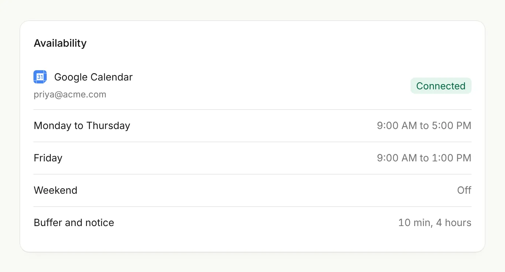
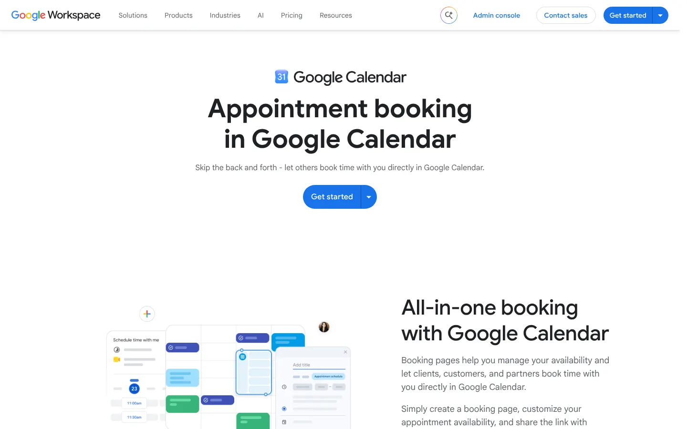

If your day runs in Google Calendar, you want bookings to land there on their own. A client picks a time, the event shows up with a Google Meet link, and nobody can grab a slot you already filled. For that, you need a booking tool that reads your Google Calendar closely and writes back to it fast.

Google now has its own booking pages, so you may not need anything else. But the free version is small. Other tools add more on top of Google Calendar, such as more calendars checked, reminders, team booking or questions before the time. Which one you need depends on how people reach you.

> **[Try Claritia free](https://app.tryclaritia.com/signup)** to connect Google Calendar in one click and book each lead from your form, with a Google Meet link on every meeting.

Below, we compare 8 appointment scheduling tools that work with Google Calendar, Google's own appointment schedules among them. For each, we look at what it checks, what it adds and the price.

## Main points

- [Google Calendar appointment schedules](https://workspace.google.com/resources/appointment-scheduling/) give a personal Google account one free booking page. Reminders, more pages and checks across calendars need an eligible paid plan.
- Every tool here connects to Google Calendar, so bookings land on it. The big differences are how many calendars each plan checks and what happens before and after the booking.
- For Google Meet links on every booking at $0, look at [Claritia](/), [Calendly](https://calendly.com/), [Zcal](https://zcal.co/) and [YouCanBookMe](https://youcanbook.me/).
- Top picks: [Claritia](/), [Google Calendar appointment schedules](https://workspace.google.com/resources/appointment-scheduling/), [Calendly](https://calendly.com/), [Cal.com](https://cal.com/), [Zcal](https://zcal.co/), [YouCanBookMe](https://youcanbook.me/), [Acuity Scheduling](https://acuityscheduling.com/) and [SavvyCal](https://savvycal.com/).
- Pick [Claritia](/) if people find you through your website and you want their answers and the booking in one step.

## What is appointment scheduling software for Google Calendar?

Appointment scheduling software for Google Calendar is a booking tool that connects to your Google account. It reads your busy times, shows only open slots on a booking page, and adds each booking to your calendar, usually with a Google Meet link. People pick a time themselves, so there's no email chain about when to meet.

Typical features include:

- A booking page or link that hides the times you're busy.
- Sync with one or more Google calendars, so work and personal events both block time.
- A Google Meet link created for each booking.
- Confirmation emails, reminders and links to move or cancel.
- Questions before the booking, and on some tools, payments.
- Team booking, such as round robin, on paid plans.

## How to choose a meeting scheduler for Google Calendar

Start with how people find you, then check these five things:

- **Calendars checked.** How many Google calendars the plan reads before it shows a time. Many free plans check one.
- **Meet links.** Whether each booking gets its own Google Meet link without extra setup.
- **Reminders.** Whether reminders go out on the plan you'd use. Google's free booking page doesn't send them.
- **Questions before the time.** A booking form, or a full form in front of the calendar.
- **Team booking.** Round robin and shared pages, and what each extra person costs.

## The 8 best appointment scheduling software tools for Google Calendar in 2026

Prices checked November 2026.

| Tool | Best for | Free plan | Paid from | Google calendars checked on free |
|---|---|---|---|---|
| [Claritia](/) | Booking leads from a form on your site | Yes, 1 meeting type | $12 a seat a month, billed yearly | 1 (6 on paid plans) |
| [Google Calendar appointment schedules](https://workspace.google.com/resources/appointment-scheduling/) | Solo users who want nothing new to learn | Yes, 1 booking page | An eligible paid Workspace or Google One plan | Checks across calendars is a premium feature |
| [Calendly](https://calendly.com/) | The booking link most people know | Yes, 1 event type | $10 a seat a month, billed yearly | 1 (6 on paid plans) |
| [Cal.com](https://cal.com/) | Unlimited calendars for one person | Yes, 1 user | $12 a user a month, billed yearly | Unlimited |
| [Zcal](https://zcal.co/) | A full free plan with polls | Yes | $7 a user a month, billed yearly | Unlimited |
| [YouCanBookMe](https://youcanbook.me/) | Running your hours from Google Calendar | Yes, 30 bookings a month | $8.10 a month, billed yearly | 1 |
| [Acuity Scheduling](https://acuityscheduling.com/) | Client businesses that take payment | No, 7-day trial | $16 a month, billed yearly | No free plan |
| [SavvyCal](https://savvycal.com/) | Guests who compare calendars | No, setup only | $10 a user a month, billed yearly | No free plan |

## 1. Claritia

[Claritia](/) is a forms, scheduling and follow-up app built for small B2B teams that want every lead from their website to reach the right rep and book a meeting before they leave the page.

It builds forms from a sentence or one of 840 templates, opens the right person's calendar the moment the form is sent, routes each lead by its answers, and drafts follow-up emails in your brand's voice for you to approve.

It connects Google Calendar in one click on every plan. Google tells Claritia as soon as your calendar changes, so a taken time never shows, and each booking lands on your calendar with its own Google Meet link.

> **[Try Claritia free](https://app.tryclaritia.com/signup)** with no card, and connect Google Calendar from Meetings in a minute.

### Key features

- **Google Calendar on every plan:** Free connects 1 calendar per seat, and paid plans connect 6. See the [Google Calendar integration](/integrations/google-calendar).
- **Private by design:** Claritia reads only the start and end of busy times, never event titles, guests or notes.
- **Google Meet links:** Pick Google Meet as the location and every booking gets its own link. A moved meeting keeps it. See the [Google Meet integration](/integrations/google-meet).
- **One invite, in your words:** Guests get Claritia's invite, so Google doesn't send them a second one.
- **Booking inside forms:** The calendar opens right after the form, with name and email filled in.
- **Team booking on Pro:** Round robin and meetings with everyone free read each person's Google Calendar.

*Caption: In Claritia, you connect Google Calendar and set your working hours, buffer and notice in one place.*

### Pros

- **You know who's booking:** Your questions come before the calendar.
- **Reminders for free:** A confirmation with the invite, then reminders a day and an hour before.
- **Fair seat pricing:** Teammates who only build forms or read answers are free.

### Cons

- **One meeting type on free:** A second meeting type and more calendars need Starter.
- **Branding stays until Pro:** Claritia branding comes off on Pro.
- **Newer tool:** Its marketplace is smaller, and Zapier and Make apps aren't listed yet.

### Price and plans

You can start on the free plan with no card. Paid plans are priced per seat, and a seat is a teammate people can book a meeting with.

- **Free:** $0 for 1 seat, with 1 meeting type on 1 calendar and 250 submissions a month.
- **Starter:** $15 a seat a month ($12 billed yearly). Adds unlimited meeting types, 6 calendars per seat and booking pages for each person and the team.
- **Pro:** $39 a seat a month ($31 billed yearly). Adds round robin, meetings with everyone free and routing.
- **Business:** $79 a seat a month ($63 billed yearly). Adds owner first and Salesforce.

## 2. Google Calendar appointment schedules

[Google Calendar appointment schedules](https://workspace.google.com/resources/appointment-scheduling/) is a booking feature built into Google Calendar for people who want others to pick an open time without leaving their own calendar. You set the length, hours, buffers, and daily limits, add booking form questions, and share a booking page link or embed it on a website.

It checks your calendars to prevent double bookings, sends confirmation emails, and on eligible paid accounts adds reminders, guest email checks, and Stripe payments. A personal Google account or Workspace Business Starter gets a single booking page. Each booking can use Google Meet, an in-person spot or a phone call.

### Key features

- **Built into Calendar:** Create a schedule from the Create button in Google Calendar on a computer.
- **Booking form:** First name, last name and email are required, and you can add more fields.
- **Limits:** Buffer time, a daily maximum, and how far ahead or how soon people can book.
- **Reminders:** Up to 5 reminders on eligible paid plans, though you can't edit their text.

### Pros

- **Nothing to sign up for:** It's already in your Google account.
- **Meet links built in:** Google Meet is one of the location choices.

### Cons

- **Small free version:** More than one schedule, email reminders and checks across calendars are premium features.
- **Few setup options:** You can't create a schedule in the phone app, and other video tools need a link added by hand.

### Price and plans

- **Personal Google account or Business Starter:** Free, with one booking page.
- **Eligible paid plans:** Google lists Google One Premium, Google AI Pro and Ultra, Workspace Individual, and Business and Enterprise Standard and Plus for premium features. See Google's pricing page.

## 3. Calendly

[Calendly](https://calendly.com/) is scheduling software for professionals and teams who want people to book meetings without trading emails. You connect your calendars, set hours, buffers, and daily limits, and share booking links for one-on-one, multi-host, or group meetings. It sends email and text reminders, offers routing forms that send website leads to the right teammate, and collects payments.

Newer tools include an AI assistant that finds times over email and a notetaker that writes meeting recaps. Its free plan connects one Google calendar and adds Google Meet details to meetings. Paid plans check up to 6 calendars.

### Key features

- **Google Calendar sync:** 1 calendar on free and 6 on paid plans.
- **Video links:** Google Meet, Zoom and Microsoft Teams on every plan.
- **Automations:** Automations and reminders from Standard.
- **Team booking:** Round robin and routing on Teams.

### Pros

- **Familiar to guests:** Many people have booked through Calendly before.
- **Browser extension and phone app:** Share times from where you work.

### Cons

- **One event type on free:** A second kind of meeting needs Standard.
- **No reminders on free:** Automated reminders start on Standard.

### Price and plans

- **Free:** $0, with one event type and one calendar.
- **Standard:** $10 a seat a month billed yearly ($12 monthly).
- **Teams:** $16 a seat a month billed yearly ($20 monthly).
- **Enterprise:** Starts at $15,000 a year.

## 4. Cal.com

[Cal.com](https://cal.com/) is scheduling software for individuals and companies that want booking links they can shape around their own process. It syncs calendars, detects time zones, sends reminders, and runs video calls through Zoom, Google Meet, Microsoft Teams, or its own Cal Video.

Teams can use round robin, collective events where every host must be free, routing forms, and workflows, plus admin tools such as SAML SSO and audit logs. Its source code is published on GitHub. The free plan doesn't cap links or calendars, so you can check every Google calendar you own at $0.

### Key features

- **Unlimited calendars:** For one user on free.
- **Notifications:** Email and SMS notifications on free.
- **CRM sync:** Two-way Salesforce and HubSpot sync on free.
- **Calendly import:** Bring Calendly events over in one click.

### Pros

- **No calendar cap at $0:** Work, personal and shared calendars all count.
- **Lots of settings:** Booking questions, confirmations and private links on free.

### Cons

- **One user on free:** Round robin and shared availability need Teams.
- **Branding stays:** Removing it is a Teams feature.

### Price and plans

- **Free:** $0 for one user.
- **Teams:** $12 a user a month billed yearly ($16 monthly), with a 14-day trial.
- **Organizations:** $28 a user a month billed yearly.

## 5. Zcal

[Zcal](https://zcal.co/) is a scheduling app for individuals, teams, and class hosts who want booking pages and meeting polls in one place. Booking pages can carry custom fonts, colors, layouts, welcome videos, and custom questions, and they sync with Google, Outlook, and Apple calendars.

Teams can use round robin and collective events, while group events, sign-up sheets, and polls handle classes and groups. It sends confirmations and reminders and connects to Zoom, Stripe, and Zapier. Its free plan lists Google Calendar and Google Meet, with unlimited links and unlimited calendar accounts.

### Key features

- **Unlimited calendar accounts:** Google, Outlook and Apple, on free.
- **Email reminders:** Automated, on free.
- **Polls and group events:** Group events take up to 5 people per slot on free.
- **Payments:** Stripe on free, with a 3% fee.

### Pros

- **A lot at $0:** Links, calendars, reminders and polls without paying.
- **Low team price:** Pro adds round robin for $7 a user a month billed yearly.

### Cons

- **Branding stays on free:** Removing it needs Pro.
- **One reminder on free:** More reminders and follow-up emails are on Pro.

### Price and plans

- **Free:** $0 for one person.
- **Pro:** $7 a user a month billed yearly ($10.50 monthly).
- **Business:** $12 a user a month billed yearly ($18 monthly).

## 6. YouCanBookMe

[YouCanBookMe](https://youcanbook.me/) is an online scheduling tool for small and midsize businesses that want a branded booking page tied to their calendars. It syncs with Google, Apple, Outlook, and Fastmail calendars, and offers booking forms with conditional questions, approval of requests before they are confirmed, password protected pages, and paid bookings through Stripe.

It sends confirmations, reminders, and follow-ups by email and SMS, triggers webhooks, and reports on bookings, no-shows, and revenue. Its Google Calendar sync runs both ways, and you can open or close times by adding or deleting events in Google Calendar, without logging in to YouCanBookMe.

### Key features

- **Two-way Google sync:** Bookings land on your calendar, and new events close times on your page.
- **Google Meet:** Plus Zoom and Microsoft Teams, on free.
- **Questions and payments:** Custom booking questions and Stripe, on free.
- **Workflows:** Reminders, follow-ups and no-show handling on Professional.

### Pros

- **Run it from your calendar:** Block or open time without opening another app.
- **Fine control:** Notice periods, daily limits and approval of requests.

### Cons

- **30 bookings a month on free:** A busy week can reach the cap.
- **One calendar on free:** Checking a second calendar needs Individual.

### Price and plans

- **Free:** $0, with 1 calendar and 30 bookings a month.
- **Individual:** $8.10 a month billed yearly ($9 monthly), with 2 calendars.
- **Professional:** $11.70 a month billed yearly ($13 monthly), with 6 calendars.
- **Team:** $16.20 a member a month billed yearly ($18 monthly).

## 7. Acuity Scheduling

[Acuity Scheduling](https://acuityscheduling.com/) is appointment scheduling software for service businesses such as salons, coaches, wellness providers, fitness studios, and tutors that want clients to book and pay on their own.

Clients pick times on a branded booking page, fill out intake forms, and get automatic confirmations and reminders. Owners can take deposits or full payments through Stripe, Square, or PayPal, sell packages, subscriptions, and gift certificates, run waitlists, and manage staff calendars across locations.

It syncs with Google Calendar and can create a Google Meet meeting for each appointment, updating it when the time moves or the client cancels. Reserve with Google lets customers start a booking from Google Search and Maps.

### Key features

- **Google Calendar sync:** Appointments show on your existing Google Calendar.
- **Google Meet:** Meetings are created, moved and canceled with the appointment.
- **Intake forms and payments:** On every plan.
- **Staff calendars:** 1 on Starter, 6 on Standard and 36 on Premium.

### Pros

- **Built for client work:** Intake, payment and packages in one place.
- **Found on Google:** Reserve with Google brings bookings from Search and Maps.

### Cons

- **No free plan:** Only a 7-day trial, with no card needed.
- **Text reminders cost more:** They start on Standard.

### Price and plans

- **Starter:** $16 a month billed yearly ($20 monthly).
- **Standard:** $27 a month billed yearly ($34 monthly).
- **Premium:** $55 a month billed yearly ($69 monthly).

## 8. SavvyCal

[SavvyCal](https://savvycal.com/) is a scheduling tool for professionals and teams who want booking links that feel easy for both the host and the guest. Guests see a full week of open times and can lay their own calendar over the link to spot a match.

Hosts set buffers, limits, preferred times, and time blocks, put links on their own domain, and take Stripe payments. It also supports round robin, collective, and group links, meeting polls, and reminder workflows. Both plans check unlimited calendars, from Google to Microsoft, iCloud and Fastmail.

### Key features

- **Calendar overlay:** Guests can lay their own calendar over your open times.
- **Unlimited calendars:** Every connected calendar is checked for conflicts.
- **Team links:** Round robin and collective links on both plans.
- **Reminders and workflows:** On both plans.

### Pros

- **Easy for guests:** Finding a shared time takes one look.
- **Low risk:** A 30-day money-back guarantee.

### Cons

- **Paid plan to share links:** You can set up free, but people can only book once you pay.
- **Branding and payments cost more:** Both need Premium.

### Price and plans

- **Basic:** $10 a user a month billed yearly ($12 monthly).
- **Premium:** $17 a user a month billed yearly ($20 monthly).

## Which appointment scheduling software for Google Calendar should you pick?

- If people reach you through your website and you want their answers before the booking, pick [Claritia](/).
- If you need one simple booking page and nothing else, start with [Google Calendar appointment schedules](https://workspace.google.com/resources/appointment-scheduling/).
- If you have several Google calendars and want them all checked for free, pick [Cal.com](https://cal.com/) or [Zcal](https://zcal.co/).
- If you run a client business that takes payment at booking, pick [Acuity Scheduling](https://acuityscheduling.com/).
- If you like to manage your hours from inside Google Calendar, pick [YouCanBookMe](https://youcanbook.me/).

## Questions

### Does Google Calendar have appointment scheduling?

Yes. Appointment schedules are built into Google Calendar. A personal Google account gets one booking page for free. More pages, email reminders and checks across calendars need an eligible paid plan.

### Is Google Calendar appointment scheduling free?

The basic version is. With a personal account or Workspace Business Starter, you can make a single booking page. Premium features need an eligible Workspace or Google One plan.

### Can Google appointment schedules add a Zoom link?

Not on their own. Google offers Meet, in person, phone or none. For Zoom, Google says to pick none and add the link to the event by hand after someone books. Tools like Claritia and Calendly add a Zoom link to each booking.

### What is the best meeting scheduler for Google Calendar?

It depends on how people find you. Claritia suits bookings that start on your website. Google's own booking page suits one person with simple needs. Cal.com and Zcal suit people with many calendars on a budget.

### Can a scheduler check more than one Google calendar?

Yes. Claritia checks 6 calendars per seat on paid plans. Cal.com, Zcal and SavvyCal check unlimited calendars. Google's own booking page checks across calendars only on premium plans.

### Do guests need a Google account to book?

No. In Claritia, guests book from any browser and get an invite that works in Google, Outlook and Apple Calendar. Calendly and Google's own booking page don't need a guest account either.

## Get started

Connect Google Calendar, pick your hours and share one link. If your bookings start on your website, put the calendar at the end of a form.

> **[Try Claritia free](https://app.tryclaritia.com/signup)** to connect Google Calendar, add a Google Meet link to every booking and take your first meeting today.

You can also compare more [appointment scheduling software](/blog/best-appointment-scheduling-software) or see how [Claritia Meetings](/products/meetings) works.
