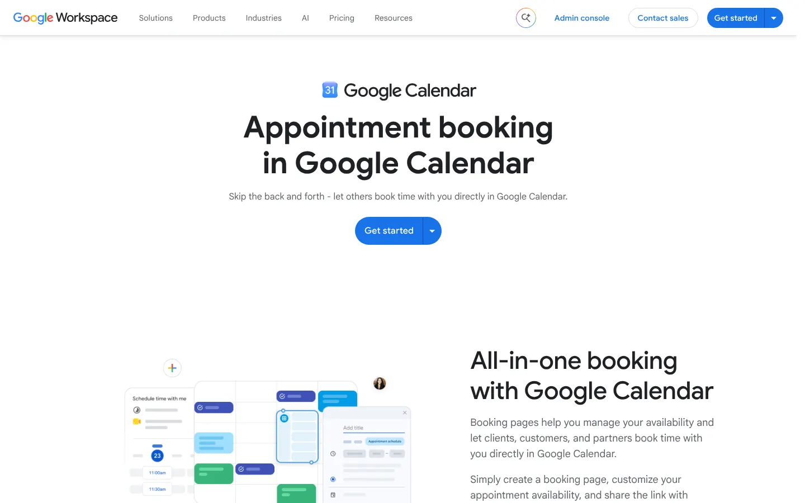
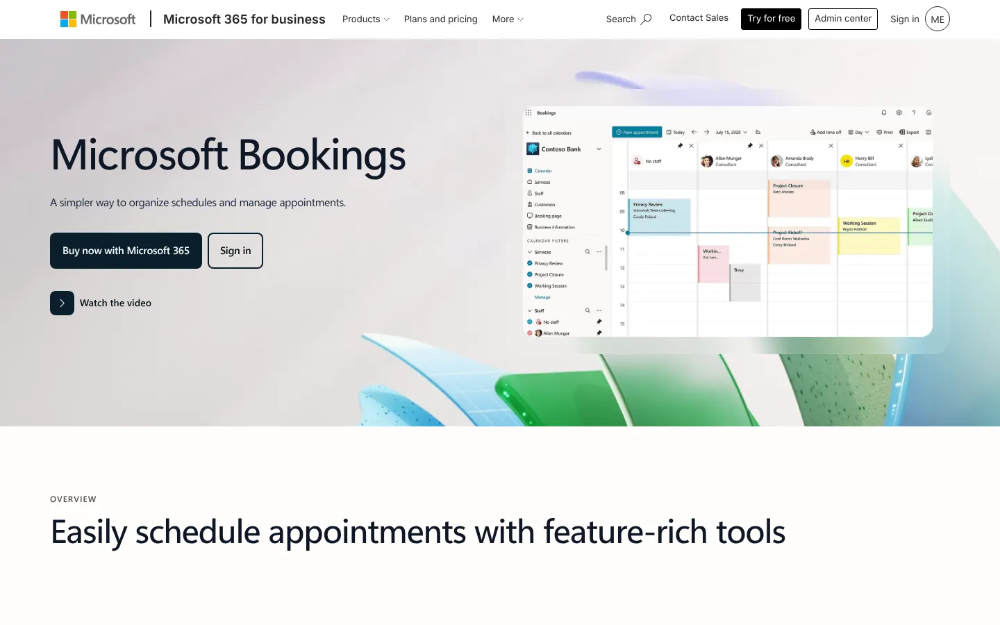
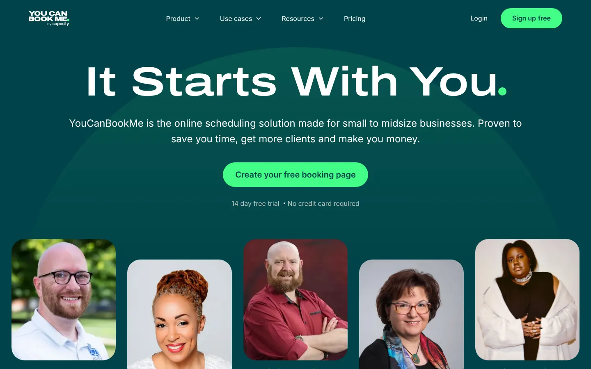
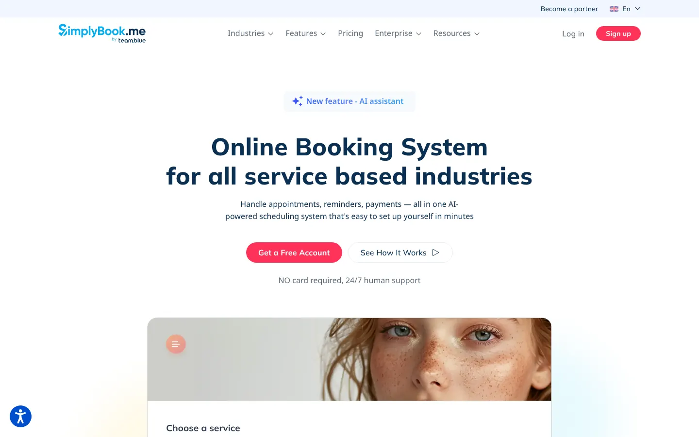
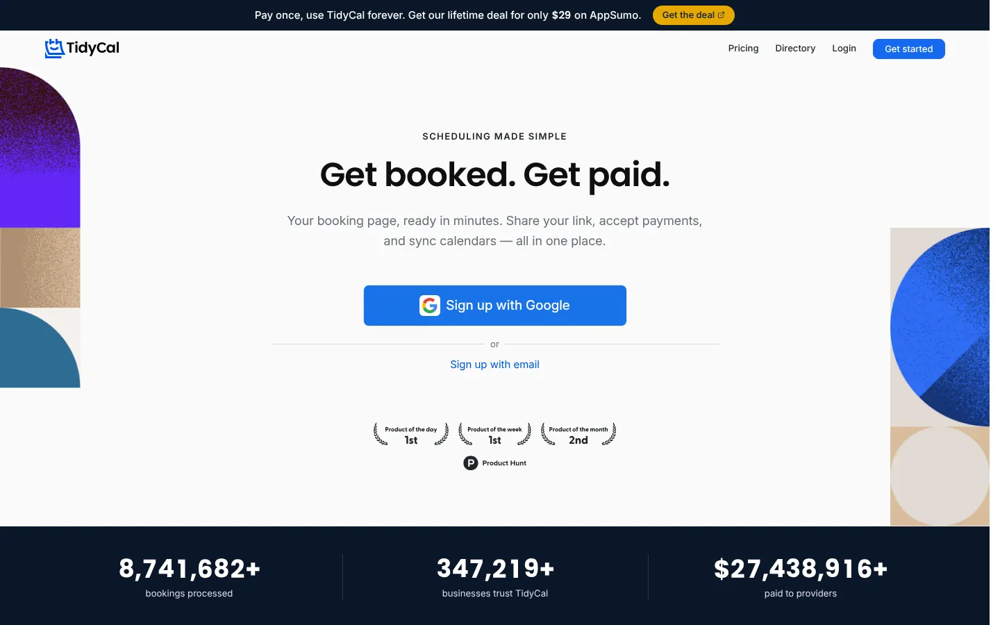

Appointment software has one job: get the right client into the right slot, and make sure they show up. Everything else on the feature list serves that job. A booking page saves the phone calls, and reminders cut down on empty chairs.

This guide is for anyone who books clients by the hour, from a solo coach to a small practice with a front desk. As you read, picture two moments in each tool: the day before the visit, and the moment a client needs to move it. The best tool handles both without you stepping in.

> **[Try Claritia free](https://app.tryclaritia.com/signup)** to ask your intake questions and book the appointment in one form, with email reminders a day and an hour before.

In this post, we compare 8 appointment scheduling tools on reminders, intake questions, payments and price, and show where each one falls short.

## Main points

- Good appointment software lets clients book on their own and sends the reminders that get them through the door.
- Look at two moments in each tool: the day before the visit, and the moment a client needs to move it.
- Free plans differ a lot. Acuity Scheduling has only a 7-day trial, while Google Calendar's appointment schedules are free with a Google account.
- Top picks: [Claritia](/), [Acuity Scheduling](https://acuityscheduling.com/), [Google Calendar appointment schedules](https://workspace.google.com/resources/appointment-scheduling/), [Microsoft Bookings](https://www.microsoft.com/en-us/microsoft-365/business/scheduling-and-booking-app), [YouCanBookMe](https://youcanbook.me/), [SimplyBook.me](https://simplybook.me/), [Zcal](https://zcal.co/) and [TidyCal](https://tidycal.com/).
- Pick [Claritia](/) if clients find you on your website and you want their answers and the booking in one form.

## What is appointment scheduling software?

Appointment scheduling software shows your open times on a booking page. Clients pick a slot, and the tool adds it to your calendar and sends reminders. It takes the place of phone calls and long email threads about when to meet.

Typical features include:

- A booking page that shows only the times you are free.
- Calendar sync, so new bookings don't clash with what's already there.
- Email or text reminders before each visit.
- Reschedule and cancel links clients can use on their own.
- Intake questions that collect what you need before the visit.
- Payments or deposits taken when the client books.

## How to choose appointment scheduling software

Price matters, but these five checks tell you more about how a tool will run your day:

- **Reminders.** Email or text, and how far ahead they go out.
- **Self-service changes.** Clients can reschedule or cancel from a link.
- **Intake questions.** Collect what you need before the appointment.
- **Payments.** Take a fee or deposit when the client books.
- **Staff and calendars.** What it costs to add a second person or room.

## The 8 best appointment scheduling software tools in 2026

| Tool | Best for | Free plan | Paid from | Reminders |
|---|---|---|---|---|
| [Claritia](/) | Booking clients straight from a website form | Yes | $12 a seat a month billed yearly | Email a day and an hour before, on free |
| [Acuity Scheduling](https://acuityscheduling.com/) | Practices that need intake forms and payment | No, 7-day trial | $16 a month billed yearly | Email on every plan, SMS from Standard |
| [Google Calendar appointment schedules](https://workspace.google.com/resources/appointment-scheduling/) | Solo pros who live in Google Calendar | Yes, with a Google account | See their pricing page | Up to 5 reminders |
| [Microsoft Bookings](https://www.microsoft.com/en-us/microsoft-365/business/scheduling-and-booking-app) | Offices on Microsoft 365 | Comes with some plans | See their pricing page | Email and SMS notifications |
| [YouCanBookMe](https://youcanbook.me/) | Simple pages with plenty of settings | Yes, 30 bookings a month | See their pricing page | Email and SMS from Individual |
| [SimplyBook.me](https://simplybook.me/) | Service menus with many providers | Yes, 50 bookings | $11.90 a month billed yearly | Basic email reminders on free |
| [Zcal](https://zcal.co/) | Free email reminders for one person | Yes | $7 a user a month | Email on free, SMS on Pro |
| [TidyCal](https://tidycal.com/) | Paying once with no monthly bill | Yes, 1 calendar | $29 one time | SMS on Agency Lifetime and Pro |

## 1. Claritia

[Claritia](/) is a forms, scheduling and follow-up app built for small B2B teams that want every lead from their website to reach the right rep and book a meeting before they leave the page. It builds forms from a sentence or one of 840 templates, opens the right person's calendar the moment the form is sent, routes each lead by its answers, and drafts follow-up emails in your brand's voice for you to approve. Your client picks an appointment inside a short form, so you get their answers and the booking together, and reminders then go out on their own.

> **[Try Claritia free](https://app.tryclaritia.com/signup)** and send reminders a day and an hour before every appointment, free plan included.

### Key features

- **Booking inside the form:** Intake questions come before the time slot.
- **Confirmation and reminders:** A confirmation email with a calendar invite, plus reminders a day and an hour before.
- **Self-service changes:** Reschedule and cancel links on every booking, free plan included.
- **Day controls:** Working hours, buffers, notice and daily caps keep each day under control.
- **Paid meetings:** Starter adds paid meetings with Stripe or PayPal, plus e-signatures on forms. See [Claritia Meetings](/products/meetings) for the booking side.

### Pros

- **Intake and booking together:** You get the client's answers and the appointment in one step.
- **Reminders without the work:** They go out on their own, on every plan.
- **Fair seat pricing:** Teammates who only build forms or read answers are free.

### Cons

- **Email reminders only for now:** Text reminders on Pro and Business are coming soon.
- **No native mobile app:** Your front desk works in the browser.

### Price and plans

You can start on the free plan with no card. Paid plans are priced per seat, and a seat is a teammate people can book a meeting with.

- **Free:** $0 for 1 seat, with 1 meeting type on 1 calendar.
- **Starter:** $15 a seat a month ($12 billed yearly). Adds paid meetings with Stripe or PayPal, plus e-signatures on forms.
- **Pro:** $39 a seat a month ($31 billed yearly). Adds a no-show follow-up that sends the reschedule link, and a thank-you after a held meeting.
- **Business:** $79 a seat a month ($63 billed yearly). Adds your own domain for forms and booking pages.

## 2. Acuity Scheduling

[Acuity Scheduling](https://acuityscheduling.com/) is appointment scheduling software for service businesses such as salons, coaches, wellness providers, fitness studios, and tutors that want clients to book and pay on their own. Clients pick times on a branded booking page, fill out intake forms, and get automatic confirmations and reminders. Owners can take deposits or full payments through Stripe, Square, or PayPal, sell packages, subscriptions, and gift certificates, run waitlists, and manage staff calendars across locations. Acuity has served appointment businesses for years, and every plan includes intake forms and online payments. Higher plans add the waitlist and HIPAA support, which makes it a strong fit for therapists and clinics that take payment at booking.

### Key features

- **Intake forms:** Custom client intake forms on every plan.
- **Payments:** Through Stripe, Square, PayPal and Venmo.
- **Standard extras:** SMS reminders, a waitlist, packages and memberships.
- **HIPAA support:** Premium includes a signed HIPAA agreement and up to 36 calendars.

### Pros

- **Intake and payment on every plan:** You don't need an upgrade for either one.
- **Many ways to pay:** Clients can pay through Stripe, Square, PayPal or Venmo.
- **Ready for health practices:** A signed HIPAA agreement on Premium.

### Cons

- **No free plan:** You get a 7-day trial with no card needed.
- **Text reminders cost more:** They start on Standard at $27 a month billed yearly.

### Price and plans

- **Starter:** $16 a month billed yearly ($20 monthly).
- **Standard:** $27 a month billed yearly ($34 monthly).
- **Premium:** $55 a month billed yearly ($69 monthly).

## 3. Google Calendar appointment schedules

[Google Calendar appointment schedules](https://workspace.google.com/resources/appointment-scheduling/) is a booking feature built into Google Calendar for people who want others to pick an open time without leaving their own calendar. You set the length, hours, buffers, and daily limits, add booking form questions, and share a booking page link or embed it on a website. It checks your calendars to prevent double bookings, sends confirmation emails, and on eligible paid accounts adds reminders, guest email checks, and Stripe payments. You can make one with a personal Google account or a Workspace account, though some features need an eligible Workspace or Google One plan. It suits solo pros who already run their day in Google Calendar.

### Key features

- **Clash checks:** It checks your other calendars so slots don't clash.
- **Reminders:** Up to five reminders per booking.
- **Email checks:** Bookings get an email check.
- **Payments:** Stripe payments on bookings.

### Pros

- **Nothing new to learn:** It works inside the calendar you already use.
- **Free to start:** The basics come with a Google account.

### Cons

- **Browser only for setup:** You can't create a schedule in the phone app.
- **Some features cost extra:** Some sit behind a paid Workspace or Google One plan, and Workspace Business Starter doesn't include booking pages.

### Price and plans

- **Google account:** Free for the basics.
- **Workspace or Google One:** Some features need an eligible paid plan. See their pricing page.

## 4. Microsoft Bookings

[Microsoft Bookings](https://www.microsoft.com/en-us/microsoft-365/business/scheduling-and-booking-app) is a scheduling app included with many Microsoft 365 business subscriptions, built for organizations that want customers or colleagues to book time without the back and forth. It offers personal booking pages for one person's availability and shared booking pages where teams define services, staff, and business hours. Bookings works with Outlook calendars, creates a Microsoft Teams link for online appointments, sends email and text reminders, and stores its data in Exchange Online. It's a good fit for offices that already pay for Microsoft 365.

### Key features

- **Notifications:** Email and text notifications to cut down on no-shows.
- **Shared booking pages:** Pages that list your services and staff.
- **Teams links:** Each online appointment gets a Teams meeting link.
- **Works where you work:** Inside Outlook and Teams as well as on the web.

### Pros

- **Already in your plan:** It's included with Business Basic, Business Standard, Business Premium and Teams Essentials.
- **Text notifications:** Email and text both help cut no-shows.

### Cons

- **Needs the right plan:** You need a Microsoft 365 plan that includes it.
- **Best for Outlook users:** Google Calendar shops will get less out of it.

### Price and plans

- **Microsoft 365 business plans:** Included with some plans. See their pricing page.

## 5. YouCanBookMe

[YouCanBookMe](https://youcanbook.me/) is an online scheduling tool for small and midsize businesses that want a branded booking page tied to their calendars. It syncs with Google, Apple, Outlook, and Fastmail calendars, and offers booking forms with conditional questions, approval of requests before they are confirmed, password protected pages, and paid bookings through Stripe. It sends confirmations, reminders, and follow-ups by email and SMS, triggers webhooks, and reports on bookings, no-shows, and revenue. It's known for its long list of settings, such as notice periods you can tune, and the free plan is enough to try it. It suits solo pros and small teams who want fine control over their booking page.

### Key features

- **Free booking page:** With your logo and Stripe payments.
- **Reminders:** Individual adds email and SMS reminders, plus group sessions.
- **Notice periods:** Minimum and maximum notice, plus password-protected pages.
- **Workflows:** Professional adds automated workflows and a daily meeting cap.

### Pros

- **Fine control:** Plenty of settings for each booking page.
- **Payments on free:** Take Stripe payments without a paid plan.

### Cons

- **Booking cap on free:** 30 bookings a month, with a "Powered for free" button.
- **SMS costs extra:** It's charged on top of the plan.

### Price and plans

- **Free:** $0, with 30 bookings a month.
- **Individual:** Adds email and SMS reminders and group sessions. See their pricing page.
- **Professional:** Adds automated workflows and a daily meeting cap. See their pricing page.

## 6. SimplyBook.me

[SimplyBook.me](https://simplybook.me/) is an online booking system for service businesses in fields like beauty, health, education, fitness, and public services that want clients to book at any hour. It gives each business a booking website and lets clients also book through Facebook, Instagram, Google, or a branded client app. It sends reminders by email, SMS, and WhatsApp, takes payments online or in person through its POS, and adds options such as classes, memberships, intake forms, and gift cards. Along with the booking website you get a widget for your own site, and you pay by the number of bookings and providers. It's a good fit for studios and service shops with a menu of services and several providers.

### Key features

- **Booking website:** A booking site of your own, plus a WordPress widget.
- **Email reminders on free:** Basic email reminders on the free plan.
- **Room for staff:** Standard covers 15 providers and Premium 30.
- **Service menus:** Built for many services across several providers.

### Pros

- **Free start:** 50 bookings on the free plan.
- **Price follows use:** You pay by your number of bookings and providers.

### Cons

- **Booking caps:** A busy month can push you past your cap.
- **One provider on free:** A second person means a paid plan.

### Price and plans

- **Free:** 50 bookings and one provider.
- **Basic:** $11.90 a month billed yearly ($13.90 monthly).
- **Standard:** $24.90 a month billed yearly ($29.90 monthly), for 500 bookings and 15 providers.
- **Premium:** $49.90 a month billed yearly ($59.90 monthly), for 2,000 bookings and 30 providers.

## 7. Zcal

[Zcal](https://zcal.co/) is a scheduling app for individuals, teams, and class hosts who want booking pages and meeting polls in one place. Booking pages can carry custom fonts, colors, layouts, welcome videos, and custom questions, and they sync with Google, Outlook, and Apple calendars. Teams can use round robin and collective events, while group events, sign-up sheets, and polls handle classes and groups. It sends confirmations and reminders and connects to Zoom, Stripe, and Zapier. A solo user gets email reminders and payments without a paid plan, which makes it a good fit for one person who books a mix of calls and sessions. Paid plans add text reminders and team scheduling.

### Key features

- **Email reminders on free:** Automated email reminders at no cost.
- **Custom questions:** Plus multiple durations on free.
- **Payments:** Stripe payments on free, with a 3% fee.
- **Pro extras:** Follow-up emails and 750 SMS credits a month per user.

### Pros

- **A lot for $0:** Reminders, questions and payments on the free plan.
- **Low paid price:** Pro is $7 a user a month.

### Cons

- **Free plan limits:** One reminder, and Zcal branding stays on.
- **File uploads cost more:** File uploads on bookings start on Pro.

### Price and plans

Both paid plans come with a 14-day free trial.

- **Free:** $0, with one reminder and Zcal branding.
- **Pro:** $7 a user a month.
- **Business:** $12 a user a month.

## 8. TidyCal

[TidyCal](https://tidycal.com/) is a booking tool for coaches, consultants, and solo service providers who want a simple booking page that also takes payment. You list each service as a booking type and connect a Google, Microsoft, or Apple calendar to avoid double bookings. Clients can pay through Stripe or PayPal when they book, buy session packages or recurring sessions, and get automated email and SMS reminders. It is made by Sumo Group, the company behind AppSumo. You can pay once and keep booking, and the free plan already handles group and package bookings. Paid plans add SMS reminders and drop the fee on paid bookings, so it suits solo pros who want to avoid a monthly bill.

### Key features

- **Unlimited booking types:** On every plan.
- **Paid bookings:** Stripe and PayPal on free, with a 1% fee.
- **Repeat clients:** Package and recurring bookings.
- **Agency Lifetime extras:** Round robin and 10 SMS reminders a month in the US and Canada.

### Pros

- **No monthly bill:** Lifetime plans are paid once.
- **Payments on free:** Take paid bookings without a paid plan.

### Cons

- **One calendar on free:** The free plan connects one calendar.
- **Full SMS needs Pro:** Unlimited SMS and no platform fee need Pro.

### Price and plans

- **Free:** $0, with one calendar.
- **Individual Lifetime:** $29 once.
- **Agency Lifetime:** $79 once.
- **Pro:** $12 a month or $99 a year.

## Which appointment scheduling software should you pick?

- If clients find you on your website and you want their answers and the booking in one form, pick [Claritia](/).
- If you run a health or wellness practice that needs intake forms and a HIPAA agreement, pick [Acuity Scheduling](https://acuityscheduling.com/) on Premium.
- If you work alone and already live in Google Calendar, start with its [appointment schedules](https://workspace.google.com/resources/appointment-scheduling/).
- If you sell many services across several providers, compare [SimplyBook.me](https://simplybook.me/)'s booking caps with your volume.
- If you want text reminders without a monthly plan, look at [TidyCal](https://tidycal.com/)'s Agency Lifetime deal.

## Questions

### What is appointment scheduling software?

It's a tool that shows your open times on a booking page. Clients pick a slot, and the tool adds it to your calendar and sends reminders.

### Can clients reschedule on their own?

In most of these tools, yes. Claritia puts reschedule and cancel links in every confirmation, free plan included.

### Is Google Calendar enough for booking appointments?

For one person with simple needs, often yes. Once you need intake questions before the slot or several staff members, a dedicated tool like Claritia or Acuity fits better.

### Which tools send text reminders?

Acuity sends them from Standard, and Microsoft Bookings sends text notifications. Zcal includes SMS credits on Pro. Claritia sends email reminders today, with text reminders on Pro and Business coming soon.

### Can you take payment when a client books?

Yes. Claritia takes payment for meetings from Starter. Acuity takes payment on every plan. TidyCal and Zcal take payments on their free plans for a small fee.

## Start booking clients

Set up a booking form with intake questions in a few minutes.

> **[Try Claritia free](https://app.tryclaritia.com/signup)** to build your booking form and take your first appointment today.

You can also browse [form templates](/templates) to start from one built for your kind of business.
