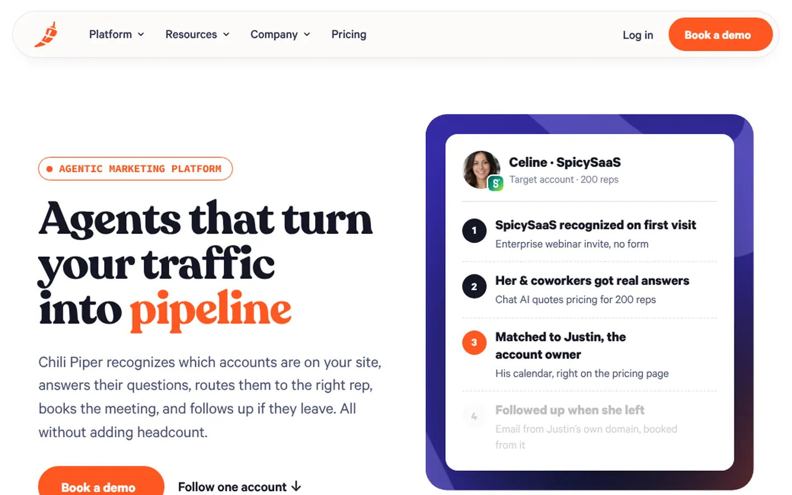
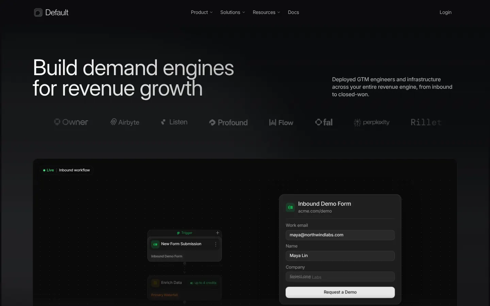
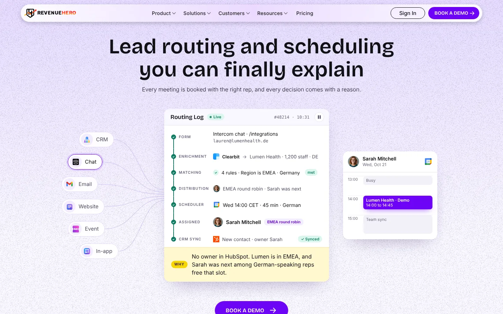
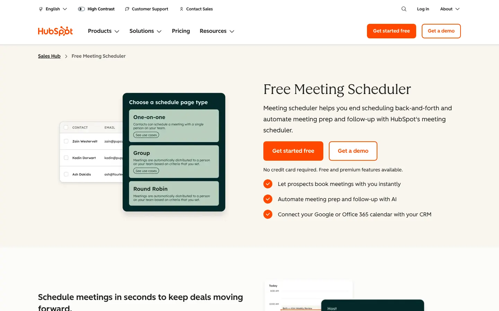

A sales team loses meetings in the gaps. A lead fills in the demo form and waits for a reply. Someone has to check whose turn it is, send the invite, remind the lead the day before and chase them when they don't show. Each step is small, and each one slips on a busy day.

Automated scheduling software closes those gaps. The lead books on the spot, the right rep gets the meeting, and reminders and follow-ups go out without anyone pressing send. The tools differ in how much of that chain they run, and in what they charge for a team.

> **[Try Claritia free](https://app.tryclaritia.com/signup)** to book leads from your form and send reminders a day and an hour before each meeting, with follow-ups that run on their own.

In this post, we compare 8 automated scheduling tools for sales and client-facing teams on booking, reminders, round robin, routing and follow-ups.

## Main points

- Automated scheduling software books the meeting, picks the rep, sends reminders and follows up, so no one does those steps by hand.
- Check which steps each plan runs on its own. Reminders are often on a paid plan, and routing is often on the plan above that.
- Prices range from free plans for one person to yearly contracts of $15,000 or more on [Chili Piper](https://www.chilipiper.com/).
- Top picks: [Claritia](/), [Calendly](https://calendly.com/), [Chili Piper](https://www.chilipiper.com/), [Default](https://www.default.com/), [RevenueHero](https://www.revenuehero.io/), [HubSpot Meetings](https://www.hubspot.com/products/sales/schedule-meeting), [OnceHub](https://www.oncehub.com/) and [Cal.com](https://cal.com/).
- Pick [Claritia](/) if your meetings start from a form on your site and you want booking, reminders and follow-ups in one place.

## What is automated scheduling software?

Automated scheduling software books meetings and runs the steps around them without a person in the loop. A lead picks a time from a link or a form, the tool assigns the right rep, adds the meeting to their calendar, and sends confirmations, reminders and follow-ups on a set schedule.

For a sales team, the chain usually looks like this:

- **Booking:** The lead picks an open time from a booking page or right after a form.
- **Assignment:** Round robin shares meetings across reps, or routing sends the lead to a set rep by their answers or their owner in the CRM.
- **Reminders:** Emails, and on some tools texts, go out before the meeting.
- **Follow-ups:** A nudge to leads who didn't book, a reschedule link after a no-show, or a thank-you after the call.
- **Logging:** The meeting is written to your CRM, so nobody copies it over.

## How to choose automated scheduling software

Ask which parts of the chain run on their own on the plan you'd buy. Then check these five things:

- **Booking from forms.** Leads who book on the same page they fill in don't wait for a reply.
- **Round robin with limits.** Weights, daily caps and away days keep the split fair.
- **Routing rules.** Send leads by answer, territory or CRM owner, with a record of why.
- **Follow-ups.** Reminders, no-show follow-ups and nudges to book, and whether you can change their wording.
- **Price for your team.** What five to ten reps cost, including platform fees and seat minimums.

## The 8 best automated scheduling software tools in 2026

Prices checked November 2026.

| Tool | Best for | Free plan | Paid from | What runs on its own |
|---|---|---|---|---|
| [Claritia](/) | Small teams booking from forms | Yes | $12 a seat a month, billed yearly | Reminders on free, follow-ups on Starter, round robin and routing on Pro |
| [Calendly](https://calendly.com/) | Reps who share booking links | Yes, 1 event type | $10 a seat a month, billed yearly | Reminders on Standard, round robin and routing on Teams |
| [Chili Piper](https://www.chilipiper.com/) | Larger teams with SDR to AE handoffs | No | $15,000 a year with 15 seats | Routing, booking from forms and follow-ups after missed meetings |
| [Default](https://www.default.com/) | RevOps teams that want enrichment too | No | $12,000 a year, plus seats | Enrichment, routing, booking and workflows |
| [RevenueHero](https://www.revenuehero.io/) | Inbound teams that want a reason for every match | No | $79 a month plus $25 a seat, billed yearly | Qualification, routing and CRM write-back |
| [HubSpot Meetings](https://www.hubspot.com/products/sales/schedule-meeting) | Teams that run sales in HubSpot | Yes, 1 personal link | Sales Hub Starter | Logging in the CRM, sequences on Professional |
| [OnceHub](https://www.oncehub.com/) | Routing forms and chatbots | Yes, 1 booking link | $10 a seat a month, billed yearly | Text notices on Schedule, routing on Route |
| [Cal.com](https://cal.com/) | Teams that want open source | Yes, 1 user | $12 a user a month, billed yearly | Workflows on free, round robin and routing on Teams |

## 1. Claritia

[Claritia](/) is a forms, scheduling and follow-up app built for small B2B teams that want every lead from their website to reach the right rep and book a meeting before they leave the page.

It builds forms from a sentence or one of 840 templates, opens the right person's calendar the moment the form is sent, routes each lead by its answers, and drafts follow-up emails in your brand's voice for you to approve.

Its workflows send the confirmation with the invite, then reminders a day and an hour before, and they stop on their own if the meeting moves or is canceled. Paid plans add follow-ups for leads who didn't book or didn't show.

> **[Try Claritia free](https://app.tryclaritia.com/signup)** and turn on reminders for your first meeting type in a minute.

### Key features

- **Booking inside forms:** The calendar opens right after the form, on every plan. See [Claritia Meetings](/products/meetings).
- **Reminders on free:** A confirmation with a calendar invite, then reminders a day and an hour before.
- **Follow-ups:** On Starter, a follow-up the next day until the lead books. On Pro, a no-show follow-up with the reschedule link and a thank-you after a held meeting.
- **Round robin on Pro:** With weights and priority, daily and weekly limits, and away days.
- **Routing on Pro:** Route by any answer to a meeting and a person, with a log of why. See [Claritia Routing](/products/routing).
- **Owner first on Business:** Known leads book with their owner in your CRM.

### Pros

- **The whole chain in one app:** Form, booking, reminders and follow-ups live together.
- **Reminders without paying:** They come on the free plan.
- **Seats only for people who meet:** Teammates who only build forms, edit workflows or read results are free.

### Cons

- **Email only for now:** SMS reminders on Pro and Business are coming soon.
- **Newer tool:** Its marketplace is smaller, and Zapier and Make apps aren't listed yet.
- **No native mobile app:** Reps work in the browser.

### Price and plans

You can start on the free plan with no card. Paid plans are priced per seat, and a seat is a teammate people can book a meeting with.

- **Free:** $0 for 1 seat, with 1 meeting type and 1,000 workflow emails.
- **Starter:** $15 a seat a month ($12 billed yearly). Adds your own wording and times, the next-day follow-up and HubSpot.
- **Pro:** $39 a seat a month ($31 billed yearly). Adds round robin, routing and the no-show follow-up.
- **Business:** $79 a seat a month ($63 billed yearly). Adds owner first, double round robin and Salesforce.

## 2. Calendly

[Calendly](https://calendly.com/) is scheduling software for professionals and teams who want people to book meetings without trading emails. You connect your calendars, set hours, buffers, and daily limits, and share booking links for one-on-one, multi-host, or group meetings. It sends email and text reminders, offers routing forms that send website leads to the right teammate, and collects payments.

Newer tools include an AI assistant that finds times over email and a notetaker that writes meeting recaps. Automations and reminders start on Standard. Teams adds round robin and forms that qualify, route and book leads, including from HubSpot, Pardot or Marketo forms.

### Key features

- **Automations and reminders:** From Standard.
- **Round robin:** On Teams.
- **Lead routing:** Qualify and route from Calendly forms or your HubSpot, Pardot or Marketo forms, on Teams.
- **Callie:** An AI assistant that schedules over email, on the Standard Plus and Teams Plus add-on plans.

### Pros

- **Familiar to leads:** Many have booked through Calendly before.
- **CRM routing:** Route by HubSpot or Salesforce assignment on Teams.

### Cons

- **No reminders on free:** Automated reminders need Standard.
- **Follow-up drafts cost extra:** Pre-drafted follow-up emails come with the Notetaker add-on plans.

### Price and plans

- **Free:** $0, with one event type.
- **Standard:** $10 a seat a month billed yearly ($12 monthly).
- **Teams:** $16 a seat a month billed yearly ($20 monthly).
- **Enterprise:** Starts at $15,000 a year, from 50 seats.

## 3. Chili Piper

[Chili Piper](https://www.chilipiper.com/) is a meeting booking and lead routing platform for B2B revenue teams that want inbound buyers to book with the right rep right away.

When someone submits a form, it qualifies them, routes them by rules such as company size, region or account owner, and shows that rep's calendar on the spot. It also routes Salesforce records by rep workload, identifies visiting companies, runs an AI chat, blocks fake bookings and sends reps a brief before each meeting.

Its Growth plan follows up on buyers who miss a meeting or leave a form, with a note from their own rep. It also lets SDRs book the right AE in one click.

### Key features

- **Form to meeting:** Form fills become booked meetings before the buyer leaves the page.
- **Follow-ups:** Buyers who miss a meeting or abandon a form get a follow-up from their own rep.
- **Fair distribution:** Leads are shared fairly across reps, with rules kept in one table.
- **Agents:** AI agents filter spam and prep reps for each meeting, using credits included with the plan.

### Pros

- **Built for handoffs:** SDRs book AEs in one click, for inbound and outbound.
- **Runs from many places:** Booking from forms, marketing emails and third-party tools.

### Cons

- **High entry price:** Growth starts at $15,000 a year with 15 seats.
- **Yearly contracts:** Longer contracts bring discounts, and there's no free plan.

### Price and plans

- **Growth:** $1,250 a month ($15,000 a year) with 15 seats, then $45 a seat a month.
- **Scale:** $3,500 a month ($42,000 a year) with 30 seats, then $50 a seat a month.
- **Enterprise:** From 250 seats, with volume pricing.

## 4. Default

[Default](https://www.default.com/) is a go-to-market platform for B2B revenue and RevOps teams that want inbound leads qualified, routed, and booked without manual work. When a visitor submits a demo form, it enriches the record from a chain of data providers, checks it against ideal customer rules, assigns a rep by round robin or territory, and opens that rep's branded scheduler.

It also offers a Chrome extension, two-way CRM sync, an API, and access for AI agents through MCP. Its Growth plan includes 200,000 workflow runs a year for steps after the booking, plus 24,000 enrichment credits.

### Key features

- **Enrichment before routing:** Records are filled in from several data providers.
- **Routing and queues:** Round robins, object routing and handoffs on Routing + Scheduling seats.
- **Workflows:** 200,000 runs a year on Growth.
- **Scheduling seats:** For SEs and managers who join booking links or book on an AE's calendar.

### Pros

- **More than scheduling:** Enrichment, routing and workflows in one contract.
- **Cheaper seats for helpers:** Scheduling-only seats cost less than full seats.

### Cons

- **Large starting price:** Growth is $12,000 a year before seats.
- **No free plan:** It's built for revenue teams with a budget.

### Price and plans

- **Growth:** $12,000 a year.
- **Enterprise:** $25,000 a year.
- **Seats:** $540 a user a year for Routing + Scheduling, or $240 a user a year for Scheduling.

## 5. RevenueHero

[RevenueHero](https://www.revenuehero.io/) is a lead routing and scheduling tool for B2B demand gen, sales, and RevOps teams that want each qualified lead booked with the right rep. It matches leads to accounts and owners already in the CRM, routes the rest by territory and other rules, and runs round robin with weights, caps, and paired AE and SE booking.

It logs the reason behind every assignment, returns credit for no-shows, and syncs meetings to HubSpot, Salesforce, or Attio. Backup reps cover time off without anyone losing their turn, and meeting outcomes go back to your CRM on every plan.

### Key features

- **Qualification:** Only leads who fit see a calendar, based on their form answers.
- **Routing Log:** The reason behind every assignment, on every plan.
- **Limits and backups:** Meeting limits per rep and backup reps for time off.
- **Handoff seats:** On Advanced, SDRs book AEs, with reminders and automatic follow-ups.

### Pros

- **No seat minimum:** Admins are free, and you pay for reps who take meetings.
- **No caps:** Unlimited meetings and form submissions.

### Cons

- **No free plan:** You start with a demo.
- **Add-ons add up:** Handoff seats, spam prevention and enrichment cost extra on Advanced.

### Price and plans

- **Essentials:** $79 a month plus $25 a seat, billed yearly.
- **Advanced:** $159 a month plus $35 a seat, billed yearly.

## 6. HubSpot Meetings

[HubSpot Meetings](https://www.hubspot.com/products/sales/schedule-meeting) is the meeting scheduler inside HubSpot's CRM, built for sales and service teams that want prospects to book time and have every meeting recorded. You connect a Google or Office 365 calendar, then share a booking link or embed it on a web page or in live chat.

It supports round robin and group meeting links, logs booked meetings on contact records, can start email sequences, and uses AI to prepare meeting context and follow-ups. The free CRM gives one personal meetings link, and paid Sales Hub plans give up to 1,000 personal and team links.

### Key features

- **Logged meetings:** Every booking lands on the contact record.
- **Team links:** Round robin and group links on paid plans.
- **Sequences:** Automated email sequences on Professional.
- **AI meeting assistant:** On Professional and Enterprise, for prep and follow-ups.

### Pros

- **No setup for logging:** The meeting is in the CRM already.
- **One place for the pipeline:** Meetings, contacts and sequences together.

### Cons

- **Small free version:** One personal link, with HubSpot branding.
- **Costs climb:** Sequences need Professional, which has a $1,500 onboarding fee.

### Price and plans

- **Free:** $0 for up to 2 users.
- **Starter:** Listed at $20 a seat a month, with lower prices for new customers.
- **Professional:** $90 a seat a month billed yearly ($100 monthly), plus onboarding.
- **Enterprise:** $150 a seat a month.

## 7. OnceHub

[OnceHub](https://www.oncehub.com/) is a scheduling and engagement platform for sales, service, support, and recruiting teams that want to screen visitors and book them with the right person. It offers branded booking pages, booking hubs, routing forms that qualify people before they book, and AI chat and phone agents that answer questions and schedule calls.

Its scheduling engine handles one-on-one, multi-host, and group meetings, creates video links and reminders, and connects to CRMs and Zapier. Its Route plan books inside the form and can assign meetings to the CRM contact owner.

### Key features

- **Notifications:** Custom email and text notifications on Schedule.
- **Routing forms:** With booking inside the form, on Route.
- **Distribution:** Round robin, maximum availability and priority, on Route.
- **Chatbots:** AI chatbots with live handoff, on Engage.

### Pros

- **Steps you can grow into:** From a free link to routing and chat.
- **Phone booking:** Paid plans include dedicated booking phone numbers.

### Cons

- **Round robin costs more:** It needs Route.
- **One link on free:** The Basic plan has one user, one calendar and one booking link.

### Price and plans

- **Basic:** Free.
- **Schedule:** $10 a seat a month billed yearly.
- **Route:** $19 a seat a month billed yearly.
- **Engage:** $39 a seat a month billed yearly.

## 8. Cal.com

[Cal.com](https://cal.com/) is scheduling software for individuals and companies that want booking links they can shape around their own process. It syncs calendars, detects time zones, sends reminders, and runs video calls through Zoom, Google Meet, Microsoft Teams, or its own Cal Video.

Teams can use round robin, collective events where every host must be free, routing forms, and workflows, plus admin tools such as SAML SSO and audit logs. Its source code is published on GitHub. Workflows and booking notifications are on the free plan.

### Key features

- **Workflows on free:** Email and SMS notifications for one user.
- **CRM sync:** Two-way Salesforce and HubSpot sync on free.
- **Team booking:** Round robin, managed events and routing forms on Teams.
- **Attribute routing:** Route by custom variables on Organizations.

### Pros

- **Automation at $0:** A solo rep gets workflows without paying.
- **Low team price:** Teams is $12 a user a month billed yearly.

### Cons

- **One user on free:** Round robin needs Teams.
- **Setup takes time:** Its many settings take a while to get right.

### Price and plans

- **Free:** $0 for one user.
- **Teams:** $12 a user a month billed yearly ($16 monthly).
- **Organizations:** $28 a user a month billed yearly.

## Which automated scheduling software should you pick?

- If your meetings start from a form on your site and you want booking, reminders and follow-ups together, pick [Claritia](/).
- If your reps mostly send booking links by email, pick [Calendly](https://calendly.com/).
- If you have SDRs handing meetings to AEs and budget for a yearly contract, look at [Chili Piper](https://www.chilipiper.com/) or [Default](https://www.default.com/).
- If you need a written reason for every assignment, look at [RevenueHero](https://www.revenuehero.io/).
- If your whole pipeline lives in HubSpot, start with [HubSpot Meetings](https://www.hubspot.com/products/sales/schedule-meeting).

## Questions

### What is automated scheduling software?

It's a tool that books meetings and runs the steps around them on its own. Leads pick a time, the tool assigns the rep, and confirmations, reminders and follow-ups go out on a schedule.

### What can you automate in scheduling?

Booking, rep assignment by round robin or rules, reminders, follow-ups for leads who didn't book or didn't show, and logging the meeting in your CRM. Claritia runs all of these, with round robin and routing on Pro.

### How does automated scheduling cut no-shows?

Reminders before the meeting and an easy way to move it. Claritia sends reminders a day and an hour before, with reschedule and cancel links, and Pro adds a no-show follow-up with the reschedule link.

### Is there free automated scheduling software?

Yes. Claritia sends confirmations and reminders on its free plan. Cal.com includes workflows for one user on free. Calendly's free plan doesn't include automated reminders.

### What's the difference between round robin and routing?

Round robin takes turns across a team. Routing picks a set meeting or person from the lead's answers or CRM owner. Many teams use both: route first, then round robin within the team. See our guide to [round robin scheduling software](/blog/best-round-robin-scheduling-software).

### Does automated scheduling software log meetings in the CRM?

Most tools here do. Claritia sends bookings to HubSpot and many other CRMs on Starter, and to Salesforce on Business.

## Get started

Set up the chain once: a form that books, a fair split across reps, and reminders that send themselves.

> **[Try Claritia free](https://app.tryclaritia.com/signup)** to build your demo form, turn on reminders and book your first meeting today.

You can also compare [scheduling software for sales teams](/blog/best-scheduling-software-for-sales-teams) or see how [Claritia Meetings](/products/meetings) works.
