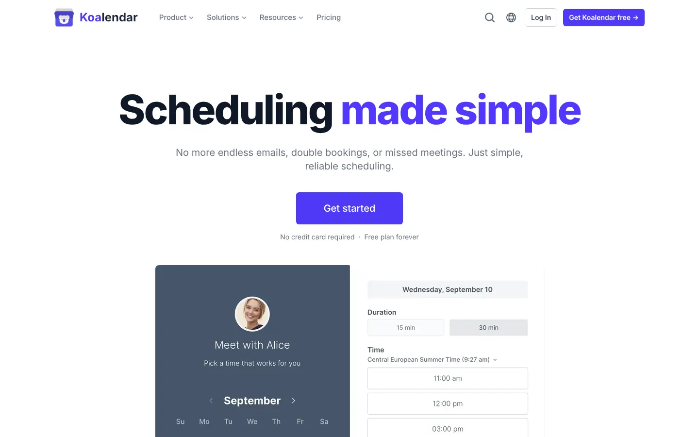

Cal.com does a lot right. Its source code is on GitHub, with guides for hosting it yourself. Its free plan gives one user unlimited links and calendars, with SMS notifications, and the Teams plan adds round robin and routing forms at $12 a user a month billed yearly ($16 monthly).

People still look elsewhere. Some teams have no one to run or tune a scheduler. Others want the booking to start from a lead form, or want round robin without paying for every person on the team.

A good Cal.com alternative is hosted for you, so setup takes a sign-up and a calendar connection. It also shows the price of team scheduling up front.

> **[Try Claritia free](https://app.tryclaritia.com/signup)** to let form answers pick the meeting and the person, with nothing to host yourself.

Below are 8 hosted scheduling tools, compared on round robin, routing, free plans and price, with the strengths and limits of each.

## Main points

- Cal.com is hard to beat for a developer or a solo user, and its Teams plan adds round robin and routing forms at $12 a user a month billed yearly ($16 monthly).
- Teams often switch when they want a fully hosted tool with no setup work, or a different way to route and price team booking.
- Check where team scheduling starts. Round robin begins at $7 a user a month on Zcal Pro and at $16 a seat billed yearly on Calendly Teams.
- Top picks: [Claritia](/), [Calendly](https://calendly.com/), [SavvyCal](https://savvycal.com/), [OnceHub](https://www.oncehub.com/), [Zcal](https://zcal.co/), [Koalendar](https://koalendar.com/), [Zoho Bookings](https://www.zoho.com/bookings/) and [YouCanBookMe](https://youcanbook.me/).
- Pick [Claritia](/) if your meetings start from a form and you want the answers to pick the meeting and the person.

## What is a Cal.com alternative?

A Cal.com alternative is a scheduling tool you use in place of Cal.com. It shows your open times on a booking page and puts each booking on your calendar. No one on your team has to run servers or install updates.

Typical features include:

- A booking page that shows your open times.
- Calendar sync, so taken times stay hidden.
- Round robin that shares bookings across a team.
- Routing that sends a booking to the right person based on answers.
- Reminders before each meeting.
- Help moving your bookings or event types over.

## How to choose a Cal.com alternative

Most of these tools cover the basics. These five checks show where they differ:

- **Round robin price.** The plan and price where team scheduling starts.
- **Routing.** Whether answers can send a booking to the right person.
- **Free plan.** What one person gets at $0.
- **Setup.** How fast a small team can go live with no developer.
- **Switching.** Help moving bookings or event types over.

## The 8 best Cal.com alternatives in 2026

| Tool | Best for | Free plan | Paid from | Round robin from |
|---|---|---|---|---|
| [Claritia](/) | Teams that book leads from forms | Yes | $12 a seat a month billed yearly | Pro, $31 a seat billed yearly |
| [Calendly](https://calendly.com/) | A polished, widely known booking link | Yes, 1 event type | $10 a seat a month billed yearly | Teams, $16 a seat billed yearly |
| [SavvyCal](https://savvycal.com/) | A booking page built around the invitee | No booking on free | $10 a user a month billed yearly | Basic, $10 a user billed yearly |
| [OnceHub](https://www.oncehub.com/) | Routing with forms and chatbots | Yes, 1 user | $10 a seat a month billed yearly | Route, $19 a seat billed yearly |
| [Zcal](https://zcal.co/) | A full free plan for one person | Yes | $7 a user a month | Pro, $7 a user a month |
| [Koalendar](https://koalendar.com/) | A flat price for a team of three | Yes | $6.99 a seat a month billed yearly | Business, $29 a month for 3 seats billed yearly |
| [Zoho Bookings](https://www.zoho.com/bookings/) | Teams on Zoho apps | Yes, 1 user | $6 a user a month billed yearly | See their pricing page |
| [YouCanBookMe](https://youcanbook.me/) | Fine control over each booking page | Yes, 30 bookings a month | See their pricing page | Team plan |

## 1. Claritia

[Claritia](/) is a forms, scheduling and follow-up app built for small B2B teams that want every lead from their website to reach the right rep and book a meeting before they leave the page.

It builds forms from a sentence or one of 840 templates, opens the right person's calendar the moment the form is sent, routes each lead by its answers, and drafts follow-up emails in your brand's voice for you to approve.

The visitor books inside the form. Their answers decide which meeting they see and who on your team they meet.

> **[Try Claritia free](https://app.tryclaritia.com/signup)** and bring your Cal.com answers and bookings in on Starter while you switch.

### Key features

- **Routing by answer:** On Pro, route by any answer to a meeting and a person, with a routing log that shows why each lead went where it did. See [routing](/products/routing).
- **Round robin:** Weights and priority, plus daily and weekly limits for each person.
- **Team tools:** Pro adds team pools and away days. Business adds owner-first routing from your CRM and double round robin.
- **Cal.com import:** Starter takes in answers and bookings from Cal.com, which helps while you switch. See [Claritia and Cal.com](/integrations/cal-com).

*Caption: Claritia's routing rules pick a meeting or a rep from the lead's answers, and everyone else goes to the sales round robin.*

### Pros

- **Booking starts from the form:** Visitors never leave the form to find a time.
- **Seats only for people who meet:** Only people others book with need a seat. Form builders and readers are free.
- **Easy switch:** You can run both tools while you move your pages over.

### Cons

- **Newer tool:** Its app marketplace and community are smaller than Cal.com's.
- **Built for small teams:** It suits small teams more than large enterprises.
- **No Zapier or Make apps yet:** They're still on the way.

### Price and plans

You can start on the free plan with no card. Paid plans are priced per seat, and a seat is a teammate people can book a meeting with.

- **Free:** $0 for 1 seat, with 1 meeting type on 1 calendar.
- **Starter:** $15 a seat a month ($12 billed yearly). Adds booking pages for each person and the team, and takes in answers and bookings from Cal.com.
- **Pro:** $39 a seat a month ($31 billed yearly). Adds routing by any answer, round robin, team pools and away days.
- **Business:** $79 a seat a month ($63 billed yearly). Adds owner-first routing from your CRM and double round robin.

## 2. Calendly

[Calendly](https://calendly.com/) is scheduling software for professionals and teams who want people to book meetings without trading emails. You connect your calendars, set hours, buffers, and daily limits, and share booking links for one-on-one, multi-host, or group meetings. It sends email and text reminders, offers routing forms that send website leads to the right teammate, and collects payments.

Newer tools include an AI assistant that finds times over email and a notetaker that writes meeting recaps. It's the booking link most people already know, so clients rarely need help with it. Round robin and lead routing sit on its Teams plan.

### Key features

- **Free plan:** One event type and a booking page you can shape.
- **Standard:** Unlimited event types and reminders.
- **Teams:** Round robin and lead routing, plus Salesforce meeting sync.
- **Enterprise:** Salesforce lookup routing for larger teams.

### Pros

- **Familiar to clients:** Most people already know how to use it.
- **Fully hosted:** There's nothing for your team to run.

### Cons

- **Small free plan:** One event type and one calendar.
- **Team features cost more:** Round robin and routing need Teams at $16 a seat a month billed yearly.

### Price and plans

- **Free:** $0, with one event type and one calendar.
- **Standard:** $10 a seat a month billed yearly.
- **Teams:** $16 a seat a month billed yearly.
- **Enterprise:** From $15,000 a year.

## 3. SavvyCal

[SavvyCal](https://savvycal.com/) is a scheduling tool for professionals and teams who want booking links that feel easy for both the host and the guest. Guests see a full week of open times and can lay their own calendar over the link to spot a match.

Hosts set buffers, limits, preferred times, and time blocks, put links on their own domain, and take Stripe payments. It also supports round robin, collective, and group links, meeting polls, and reminder workflows. You can rank your open times so your favorite slots show first, which suits founders and consultants who book many calls with outside people.

### Key features

- **Calendar overlay:** Invitees can lay their own calendar over your link.
- **Team links:** Round robin and collective links on the Basic plan.
- **Ranked availability:** Plus frequency limits.
- **Reminders and workflows:** On every paid plan.
- **Premium extras:** Your own domain and emails from your own address.

### Pros

- **Built for the invitee:** Finding a time is easy for the person booking.
- **Round robin on the first plan:** Basic includes it at $10 a user billed yearly.

### Cons

- **No booking on free:** People can book you only on a paid plan.
- **No listed routing:** The pricing page doesn't list routing by form answers.

### Price and plans

- **Basic:** $10 a user a month billed yearly ($12 monthly).
- **Premium:** $17 a user a month billed yearly ($20 monthly).

## 4. OnceHub

[OnceHub](https://www.oncehub.com/) is a scheduling and engagement platform for sales, service, support, and recruiting teams that want to screen visitors and book them with the right person. It offers branded booking pages, booking hubs, routing forms that qualify people before they book, and AI chat and phone agents that answer questions and schedule calls.

Its scheduling engine handles one-on-one, multi-host, and group meetings, creates video links and reminders, and connects to CRMs and Zapier. It's built for teams whose main need is routing. Its Route plan includes routing forms with booking inside the form, and Engage adds chatbots that hand visitors to a live meeting.

### Key features

- **Routing:** By form answers and contact details on Route.
- **Round robin:** Plus a mode that favors whoever has the most open time.
- **Chatbots:** Live chat and instant meeting handoff on Engage.
- **Free plan:** A free Basic plan for one person.

### Pros

- **Booking inside the routing form:** Leads are routed and booked in one place.
- **Chat to meeting:** Chatbots hand website visitors to a live meeting.

### Cons

- **Routing costs more:** Routing and round robin start on Route at $19 a seat billed yearly.
- **Security add-ons:** SSO and HIPAA agreements are a paid add-on below Enterprise.

### Price and plans

- **Basic:** Free for one person.
- **Schedule:** $10 a seat a month billed yearly ($12 monthly).
- **Route:** $19 a seat a month billed yearly ($23 monthly).
- **Engage:** $39 a seat a month billed yearly ($47 monthly).

## 5. Zcal

[Zcal](https://zcal.co/) is a scheduling app for individuals, teams, and class hosts who want booking pages and meeting polls in one place. Booking pages can carry custom fonts, colors, layouts, welcome videos, and custom questions, and they sync with Google, Outlook, and Apple calendars.

Teams can use round robin and collective events, while group events, sign-up sheets, and polls handle classes and groups. It sends confirmations and reminders and connects to Zoom, Stripe, and Zapier.

Like Cal.com's, its free plan gives one person plenty at no cost. Pro adds round robin at a low price, which gives a solo user a cheap path to team scheduling.

### Key features

- **Unlimited links:** Unlimited links and calendar accounts on free.
- **Polls and reminders:** Meeting polls and email reminders on free.
- **Team events:** Pro adds round robin and collective events.
- **SMS credits:** 750 SMS credits a month per user on Pro.

### Pros

- **Full free plan:** A lot for one person at $0.
- **Low-cost round robin:** Pro adds it at $7 a user a month.

### Cons

- **Branding on free:** Zcal branding stays on the free plan.
- **One team on Pro:** More teams need Business.

### Price and plans

Both paid plans come with a 14-day free trial.

- **Free:** $0 for one person.
- **Pro:** $7 a user a month.
- **Business:** $12 a user a month.

## 6. Koalendar

[Koalendar](https://koalendar.com/) is a scheduling app for small businesses, consultants, educators, and teams that want a simple booking page clients can use from any device. You create booking pages with your logo and colors, connect Google, Outlook, or iCloud calendars, and add custom questions.

It detects time zones, sends email and SMS reminders, supports group, collective, and round robin bookings, takes Stripe payments, and offers booking pages in many languages.

Its Business plan bundles three seats with round robin, and the free plan has unlimited booking pages and event types, so it suits teams of two or three that want one flat price.

### Key features

- **Unlimited event types:** On free, in more than 30 languages.
- **Calendly import:** Bring your events over in one click.
- **Business seats:** Three seats with round robin and collective scheduling.
- **Business extras:** A waitlist and SMS credits.

### Pros

- **One flat bill:** Three seats for one price on Business.
- **Easy move from Calendly:** The one-click import saves setup time.

### Cons

- **No reminders on free:** Reminders start on Pro.
- **Unclear top price:** The pricing page lists more than one figure for its top tier, so confirm before you buy.

### Price and plans

- **Free:** $0, with unlimited booking pages and event types.
- **Pro:** $6.99 a seat a month billed yearly ($9.99 monthly).
- **Business:** $29 a month billed yearly for three seats ($36 monthly).

## 7. Zoho Bookings

[Zoho Bookings](https://www.zoho.com/bookings/) is appointment scheduling software for businesses of any size that want meetings to land on their calendar without back and forth. It offers one-on-one, group, collective, and resource-based event types, with workspaces for branches or departments, staff roles, and booking limits.

Routing forms qualify leads before they book, workflows send email and SMS and update records, and it connects with Zoho CRM, Zoho Desk, and other Zoho apps. It fits teams already on Zoho CRM or Bigin. Round robin comes with four ways to spread bookings, and per-user prices stay low on yearly billing.

### Key features

- **Free plan:** One person, with two-way calendar sync.
- **Round robin:** Four distribution methods.
- **Zoho ties:** Works with Zoho CRM and Bigin.
- **Workspaces:** Premium includes three workspaces.

### Pros

- **Low prices:** Per-user prices are low on yearly billing.
- **Fits Zoho teams:** Bookings tie into the Zoho apps you already use.

### Cons

- **One person on free:** The free plan covers one person.
- **Unclear round robin plan:** The pricing page doesn't make clear which plan includes round robin.

### Price and plans

- **Free:** $0 for one user.
- **Basic:** $6 a user a month billed yearly ($8 monthly).
- **Premium:** $9 a user a month billed yearly ($12 monthly).

## 8. YouCanBookMe

[YouCanBookMe](https://youcanbook.me/) is an online scheduling tool for small and midsize businesses that want a branded booking page tied to their calendars. It syncs with Google, Apple, Outlook, and Fastmail calendars, and offers booking forms with conditional questions, approval of requests before they are confirmed, password protected pages, and paid bookings through Stripe.

It sends confirmations, reminders, and follow-ups by email and SMS, triggers webhooks, and reports on bookings, no-shows, and revenue. It gives you fine control over each booking page, such as notice periods, and its Team plan adds round robin with one dashboard for everyone.

### Key features

- **Free booking page:** With your logo and Stripe payments.
- **Notice periods:** Minimum and maximum notice on paid plans.
- **Workflows:** Professional adds automated workflows and a HubSpot link.
- **Team plan:** Round robin and roles for each member.

### Pros

- **Fine control:** Detailed settings on every page.
- **One team dashboard:** The Team plan puts everyone in one place.

### Cons

- **Booking cap on free:** 30 bookings a month with a "Powered for free" button.
- **SMS costs extra:** It's charged on top of the plan.

### Price and plans

- **Free:** $0, with 30 bookings a month.
- **Professional:** Adds automated workflows and a HubSpot link. See their pricing page.
- **Team:** Adds round robin and roles for each member. See their pricing page.

## Which Cal.com alternative should you pick?

- If your meetings start from a form and you want the answers to pick the meeting and the person, pick [Claritia](/).
- If you want a hosted tool your clients already know, pick [Calendly](https://calendly.com/).
- If you need routing plus website chat, pick [OnceHub](https://www.oncehub.com/).
- If you work alone today but expect to add a teammate, pick [Zcal](https://zcal.co/).
- If you're a team of three and want one flat bill, look at [Koalendar](https://koalendar.com/) Business.

## Questions

### Why switch from Cal.com?

Most want a tool someone else hosts, or a different way to route and price team booking. Cal.com stays a good pick if you want to host it yourself.

### Which Cal.com alternative has routing forms?

Claritia routes by any form answer on Pro. OnceHub includes routing forms on Route. Calendly includes lead routing on Teams.

### Can you bring Cal.com bookings into Claritia?

Claritia's Starter plan takes in answers and bookings from Cal.com. That lets you run both while you move your pages over.

### Which alternative is cheapest for round robin?

Zcal Pro adds round robin at $7 a user a month. SavvyCal includes it on Basic at $10 a user billed yearly. Koalendar Business bundles three seats for $29 a month billed yearly.

### Do any of these need a developer to set up?

No. All eight are hosted, so you sign up, connect a calendar and start.

## Try Claritia

Set up a form that books the right person in a few minutes.

> **[Try Claritia free](https://app.tryclaritia.com/signup)** to build your first booking form and book your first meeting today.

You can also see how [Claritia Meetings](/products/meetings) handles team booking.
