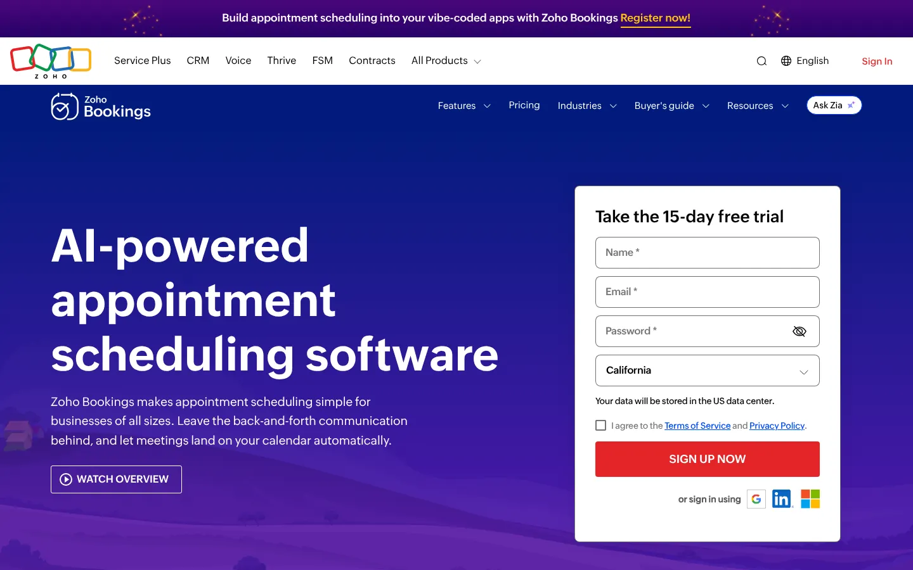
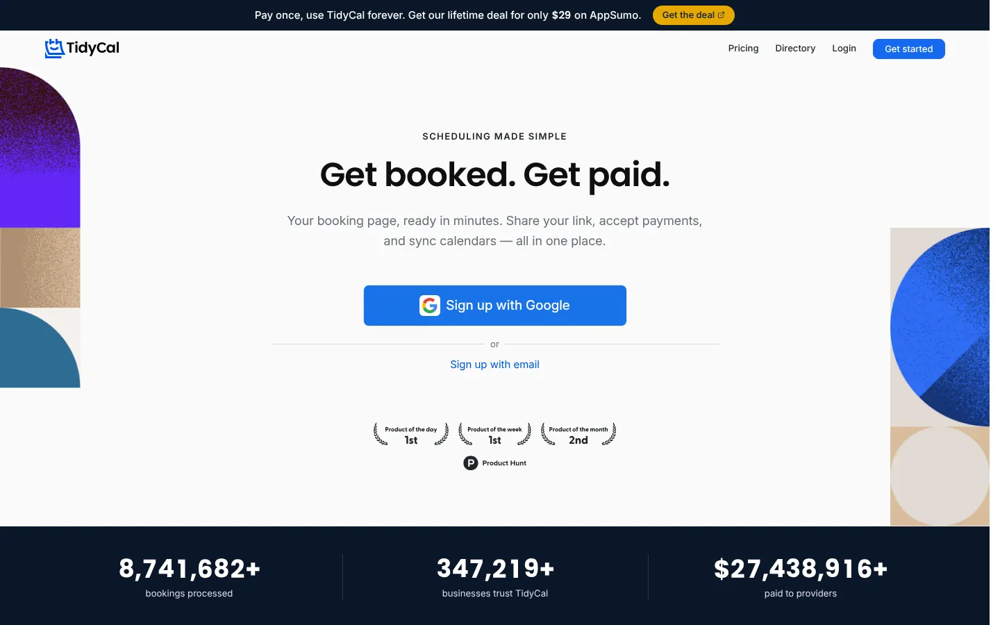
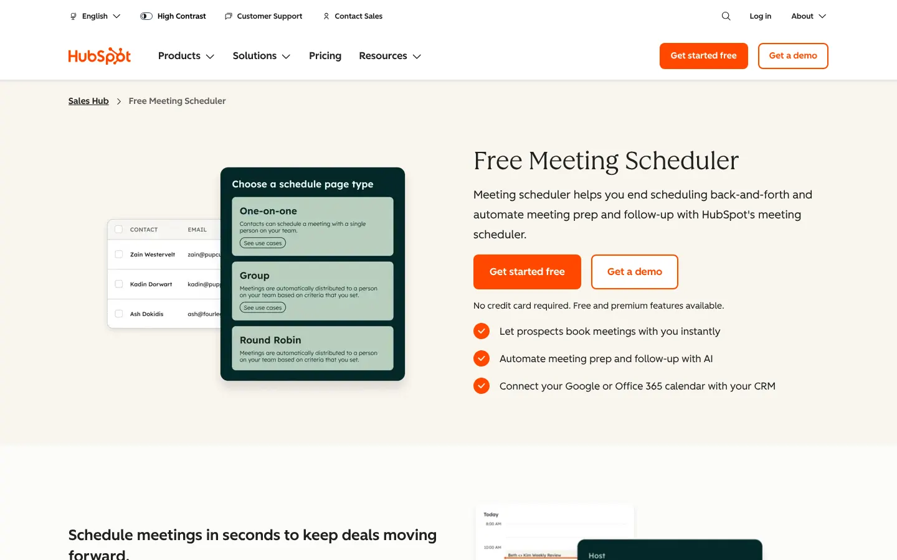

Calendly made the booking link normal, and it still does the basics well. Its free plan gives one person one event type and a clean booking page. The Standard plan adds unlimited event types for $10 a seat a month billed yearly. Teams usually start looking around when they need lead routing or a form in front of the calendar, since those sit on the Teams plan at $16 a seat.

This guide is for small teams choosing a replacement this week. Two questions matter most. How does the tool send each booking to the right person? And what will a team of five pay once the features you need are switched on?

> **[Try Claritia free](https://app.tryclaritia.com/signup)** to put a form in front of the calendar, with booking inside forms on the free plan.

In this post, we compare 9 Calendly alternatives on free plans, team booking, routing and price, with the strengths and limits of each.

## Main points

- Calendly's free plan gives one person one event type. Lead routing and a form in front of the calendar sit on Teams at $16 a seat.
- Ask two things of every tool: how it sends each booking to the right person, and what a team of five pays with the features it needs.
- For one person, Zcal and Cal.com give more on free than Calendly's single event type.
- Top picks: [Claritia](/), [Cal.com](https://cal.com/), [SavvyCal](https://savvycal.com/), [OnceHub](https://www.oncehub.com/), [Zcal](https://zcal.co/), [Zoho Bookings](https://www.zoho.com/bookings/), [TidyCal](https://tidycal.com/), [HubSpot Meetings](https://www.hubspot.com/products/sales/schedule-meeting) and [YouCanBookMe](https://youcanbook.me/).
- Pick [Claritia](/) if your leads come from a website form and you want the answers to pick the meeting and the person.

## What is a Calendly alternative?

A Calendly alternative is a scheduling tool you use in place of Calendly. It gives you a booking link, shows your open times, and puts each booking on your calendar. Small teams switch to get routing, a form before the calendar, or a lower price for the plan they really need.

Typical features include:

- A booking page or link that shows your open times.
- Google Calendar and Outlook sync.
- Round robin and shared booking pages for a team.
- Routing that sends a lead to the right teammate based on answers.
- Questions or a form before the calendar.
- Reminders before each meeting.

## How to choose a Calendly alternative

Most of these tools handle a single booking link well. These five checks show the real differences:

- **Free plan.** What one person can do before paying anything.
- **Team booking.** Round robin and shared booking pages for the whole team.
- **Routing.** Whether a form answer can send a lead to the right teammate.
- **Questions before the calendar.** A form that qualifies a visitor before they book.
- **Price for a small team.** The per-seat price on the plan you would really need.

## The 9 best Calendly alternatives in 2026

| Tool | Best for | Free plan | Paid from | Team routing |
|---|---|---|---|---|
| [Claritia](/) | Small teams that book leads from forms | Yes, 1 calendar and 1 meeting type | $12 a seat a month billed yearly | Route by any answer on Pro |
| [Cal.com](https://cal.com/) | Teams that want code they can host | Yes, 1 user | $12 a user a month | Routing forms on Teams |
| [SavvyCal](https://savvycal.com/) | Outside calls where the booking feel matters | No booking on free | $10 a user a month billed yearly | Round robin on Basic |
| [OnceHub](https://www.oncehub.com/) | Qualifying leads with forms and chat | Yes, 1 user | $10 a seat a month billed yearly | Routing forms on Route |
| [Zcal](https://zcal.co/) | Solo users who want a lot for free | Yes | $7 a user a month | Round robin on Pro |
| [Zoho Bookings](https://www.zoho.com/bookings/) | Teams already on Zoho apps | Yes, 1 user | $6 a user a month billed yearly | Round robin with four methods |
| [TidyCal](https://tidycal.com/) | Paying once instead of monthly | Yes, 1 calendar | $29 one time | Round robin on Agency Lifetime |
| [HubSpot Meetings](https://www.hubspot.com/products/sales/schedule-meeting) | Teams on HubSpot's CRM | Yes, 1 personal link | See their pricing page | Team links on paid plans |
| [YouCanBookMe](https://youcanbook.me/) | Plain booking pages with a free start | Yes, 30 bookings a month | See their pricing page | Round robin on Team |

## 1. Claritia

[Claritia](/) joins forms and meetings in one tool for small teams, with workflows that follow up after each booking. A visitor fills in a form and picks a time inside it, and the booking goes to the right teammate based on their answers. It suits small teams that turn website visitors into booked meetings.

> **[Try Claritia free](https://app.tryclaritia.com/signup)** and keep your Calendly links live on Starter while you move your pages over.

### Key features

- **Booking inside forms:** On the free plan, shown in the visitor's own time zone and language.
- **Routing by answer:** On Pro, route by any answer to a meeting and a person.
- **Round robin:** Weights and priority on Pro.
- **AI form builder:** Tia writes a form from a plain sentence.
- **Calendly import:** Starter takes in answers and bookings from Calendly, so both tools run side by side while you swap the links on your site. See [Claritia and Calendly](/integrations/calendly).

### Pros

- **Form and booking in one step:** The visitor answers and books on the same page.
- **Seats only for people who meet:** Teammates who build forms or read answers are free.
- **Switch in steps:** Old Calendly links can stay live while you move pages over one at a time.

### Cons

- **Newer tool:** Its app marketplace and community are smaller than Calendly's.
- **No native mobile app:** You manage bookings in the browser.
- **No Zapier or Make apps yet:** They're still on the way.

### Price and plans

You can start on the free plan with no card. Paid plans are priced per seat, and a seat is a teammate people can book a meeting with.

- **Free:** $0 for 1 seat, with 1 meeting type on 1 calendar.
- **Starter:** $15 a seat a month ($12 billed yearly). Adds booking pages for each person and the team, and takes in bookings from Calendly.
- **Pro:** $39 a seat a month ($31 billed yearly). Adds routing by any answer and round robin with weights and priority.
- **Business:** $79 a seat a month ($63 billed yearly). Adds owner first, double round robin and Salesforce.

## 2. Cal.com

[Cal.com](https://cal.com/) is a scheduling tool with its source code on GitHub and a guide for hosting it yourself. The free plan is generous for one person, and the Teams plan adds round robin and routing forms. It suits technical teams that want to host or extend their scheduler.

### Key features

- **Free for one user:** Unlimited links and calendars.
- **Notifications:** Email and SMS notifications on the free plan.
- **Calendly import:** Helps you switch.
- **Teams plan:** Round robin and routing forms.

### Pros

- **Open code:** You can host it yourself or build on it.
- **Generous free plan:** A lot for one person at $0.

### Cons

- **Teams costs extra:** Any team feature means the paid Teams plan, so a group of people can't share it for free.
- **Self-hosting is work:** Hosting it yourself means your team owns the servers and the updates.

### Price and plans

- **Free:** $0 for one user.
- **Teams:** $12 a user a month, 25% less billed yearly.
- **Organizations:** $28 a user a month.

## 3. SavvyCal

[SavvyCal](https://savvycal.com/) puts the person booking first. Invitees can lay their own calendar over yours to spot a good time, and you can rank your times so the best ones show up first. It suits consultants and founders who book many calls with outside people.

### Key features

- **Ranked availability:** Plus frequency limits to protect your week.
- **Polls and round robin:** Meeting polls and round robin on the Basic plan.
- **Premium extras:** Booking pages on your own domain and emails from your own address.
- **Money-back guarantee:** 30 days on every plan.

### Pros

- **Built for the invitee:** Finding a time is easy for the person booking.
- **Team booking on the first plan:** Round robin comes with Basic.

### Cons

- **No free booking:** People can only book you on a paid plan.
- **No listed routing:** The pricing page doesn't list routing by form answers.

### Price and plans

- **Basic:** $10 a user a month billed yearly ($12 monthly).
- **Premium:** $17 a user a month billed yearly ($20 monthly).

## 4. OnceHub

[OnceHub](https://www.oncehub.com/) is built around routing. Its Route plan sends leads by form answers and contact details, and its Engage plan adds web chatbots that hand a visitor straight to a meeting. It suits sales teams that qualify inbound leads with forms and chat.

### Key features

- **Routing forms:** With booking inside the form, on the Route plan.
- **Round robin:** Including a mode that favors whoever has the most open time.
- **Chatbots:** Live chat on Engage.
- **Free plan:** A free Basic plan for one person with one booking link.

### Pros

- **Routing first:** Leads go by form answers and contact details.
- **Chat to meeting:** Chatbots hand a visitor straight to a meeting.

### Cons

- **Routing costs more:** It starts on Route, at $19 a seat a month billed yearly.
- **Security add-ons:** SSO and HIPAA agreements are a paid add-on below Enterprise.

### Price and plans

- **Basic:** Free for one person with one booking link.
- **Schedule:** $10 a seat a month billed yearly ($12 monthly).
- **Route:** $19 a seat a month billed yearly ($23 monthly).
- **Engage:** $39 a seat a month billed yearly ($47 monthly).

## 5. Zcal

[Zcal](https://zcal.co/) gives one person a lot for free, including unlimited links and meeting polls. Its paid plans add team features and text reminders. It suits solo users who want polls and reminders at no cost.

### Key features

- **Unlimited links:** Unlimited links and calendar accounts on the free plan.
- **Group events:** Up to five people per time slot, free.
- **Payments:** Stripe payments on free, with a 3% fee.
- **Pro extras:** Round robin and 750 SMS credits a month per user.

### Pros

- **Full setup at $0:** A lot for one person without a bill.
- **Low paid price:** Pro is $7 a user a month.

### Cons

- **Branding on free:** Zcal branding stays on the free plan.
- **Some tools cost more:** Webhooks and analytics tags start on Pro.

### Price and plans

Both paid plans come with a 14-day free trial.

- **Free:** $0 for one person.
- **Pro:** $7 a user a month.
- **Business:** $12 a user a month.

## 6. Zoho Bookings

[Zoho Bookings](https://www.zoho.com/bookings/) is part of the Zoho suite, so it fits teams that already use Zoho CRM or Bigin. It offers round robin with four ways to share bookings out, and prices are low when billed yearly.

### Key features

- **Free plan:** One user with two-way calendar sync.
- **Round robin:** Four methods for spreading bookings across a team.
- **Zoho ties:** Works with Zoho CRM and Bigin.
- **Workspaces:** Premium includes three workspaces.

### Pros

- **Low prices:** Per-user prices are low on yearly billing.
- **Fits Zoho teams:** Bookings tie into the Zoho apps you already use.

### Cons

- **One person on free:** The free plan is for one person only.
- **Add-on costs:** Rooms and equipment cost extra as add-ons.

### Price and plans

- **Free:** $0 for one user.
- **Basic:** $6 a user a month billed yearly ($8 monthly).
- **Premium:** $9 a user a month billed yearly ($12 monthly).

## 7. TidyCal

[TidyCal](https://tidycal.com/) is for people who would rather skip monthly fees. You can buy a lifetime plan once, and the free plan already has unlimited booking types. It suits solo users who want to pay one time.

### Key features

- **Unlimited booking types:** On every plan, free included.
- **Group and package bookings:** On the free plan.
- **Lifetime plans:** $29 for Individual or $79 for Agency, which adds round robin.
- **No booking fee on Pro:** Pro drops the 1% fee on paid bookings.

### Pros

- **Pay once:** Lifetime plans skip the monthly bill.
- **Strong free plan:** Unlimited booking types plus group and package bookings.

### Cons

- **One calendar on free:** The free plan connects one calendar.
- **Team features cost more:** They need the Agency Lifetime plan or Pro.

### Price and plans

- **Free:** $0, with one calendar.
- **Individual Lifetime:** $29 once.
- **Agency Lifetime:** $79 once, with round robin.
- **Pro:** $12 a month or $99 a year.

## 8. HubSpot Meetings

[HubSpot Meetings](https://www.hubspot.com/products/sales/schedule-meeting) books straight into HubSpot's CRM, so it fits teams whose contacts already live there. The free version gives you one personal meeting link, and paid Sales Hub plans add team links.

### Key features

- **CRM bookings:** Bookings land in the same place as the rest of your contact history.
- **Free link:** Free to start with one personal link.
- **Team links:** Paid plans add team meeting links and remove HubSpot branding.
- **Many links:** Up to 1,000 personal and team links on paid plans.

### Pros

- **One record:** Meetings sit next to each contact's history.
- **Free start:** One personal link costs nothing.

### Cons

- **Branding on free:** The free link carries HubSpot branding.
- **Best inside HubSpot:** It makes the most sense if you use the rest of HubSpot.

### Price and plans

- **Free:** One personal link, with HubSpot branding.
- **Sales Hub plans:** Team links, no HubSpot branding and up to 1,000 links. See their pricing page.

## 9. YouCanBookMe

[YouCanBookMe](https://youcanbook.me/) keeps booking simple, with a free plan to get started. Paid plans add SMS reminders, and the Team plan brings round robin and one shared dashboard. It suits small teams that want plain booking pages.

### Key features

- **Free booking page:** With your logo and Stripe payments.
- **Video links:** Zoom and Google Meet on the free plan.
- **Workflows:** Professional adds automated workflows and a HubSpot link.
- **Team plan:** Round robin and roles for each member.

### Pros

- **Simple free start:** A branded page with payments and video links at $0.
- **One team dashboard:** The Team plan puts everyone in one place.

### Cons

- **Booking cap on free:** 30 bookings a month, with a "Powered for free" button.
- **SMS costs extra:** It's charged on top of the plan.

### Price and plans

- **Free:** $0, with 30 bookings a month.
- **Professional:** Adds automated workflows and a HubSpot link. See their pricing page.
- **Team:** Adds round robin and roles for each member. See their pricing page.

## Which Calendly alternative should you pick?

- If your leads come from a website form and you want the answers to pick the meeting and the person, pick [Claritia](/).
- If you want to host your scheduler yourself or build on its code, pick [Cal.com](https://cal.com/).
- If most of your calls are with outside clients and the booking feel matters most, pick [SavvyCal](https://savvycal.com/).
- If your sales team lives in HubSpot, start with [HubSpot Meetings](https://www.hubspot.com/products/sales/schedule-meeting), or connect [Claritia](/) to HubSpot on Starter.
- If you would rather pay once and be done, pick [TidyCal](https://tidycal.com/).

## Questions

### What is the best free alternative to Calendly?

For one person, Zcal and Cal.com both give more on free than Calendly's single event type. If you also need a form in front of the calendar, Claritia's free plan has unlimited forms with booking inside them.

### Which Calendly alternative has lead routing?

Claritia routes by any form answer on Pro. OnceHub routes on its Route plan. Cal.com includes routing forms on Teams.

### Can you switch from Calendly to Claritia in steps?

Yes. Claritia's Starter plan takes in bookings from Calendly, so you can keep old links live while you move pages over one at a time.

### Which Calendly alternative costs the least for a team?

On list price, Zoho Bookings Basic is $6 a user a month billed yearly. Claritia only charges for people others book with, so a team where most members build forms or read answers pays for fewer seats.

### Do these tools work with Google Calendar and Outlook?

Claritia's free plan includes both Google Calendar and Outlook. Most tools on this list support both as well. Check each tool's page for its exact calendar list.

## Start booking with Claritia

Set up a form that books the meeting in a few minutes.

> **[Try Claritia free](https://app.tryclaritia.com/signup)** to build your first booking form and book your first meeting today.

You can also see how [Claritia Meetings](/products/meetings) and [routing](/products/routing) fit together.
