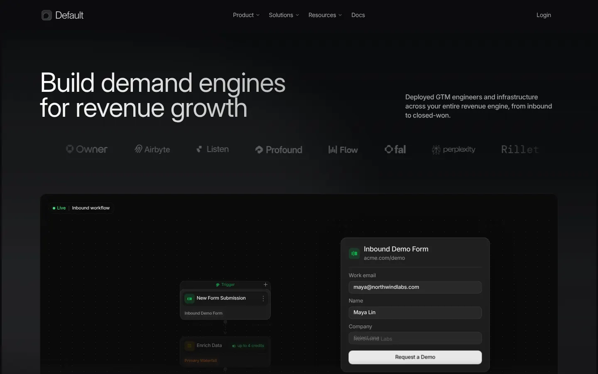
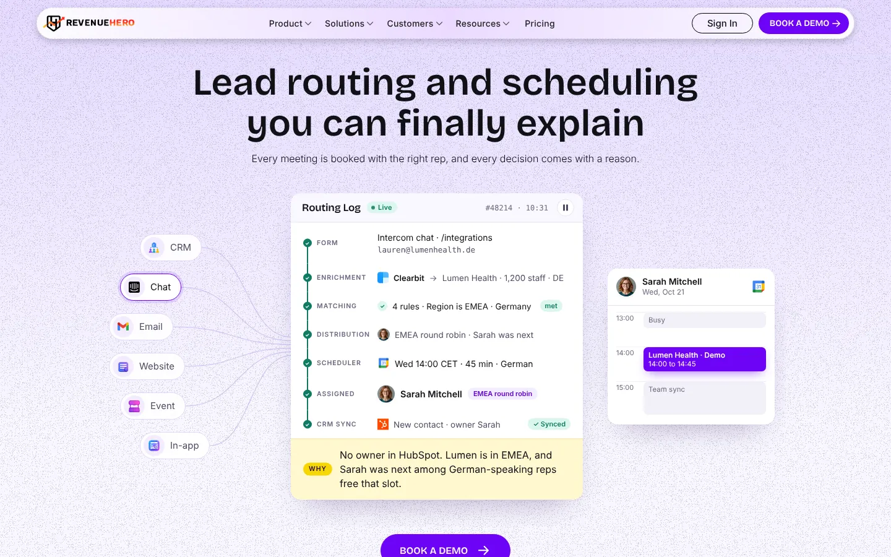
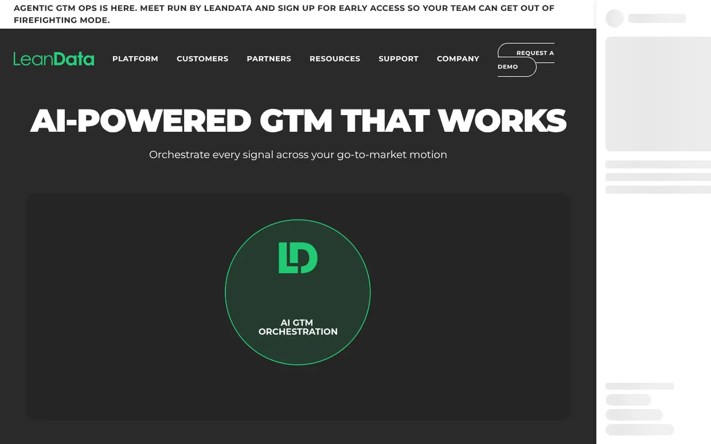
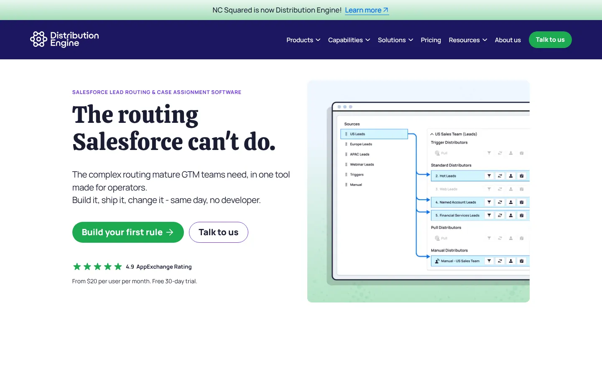
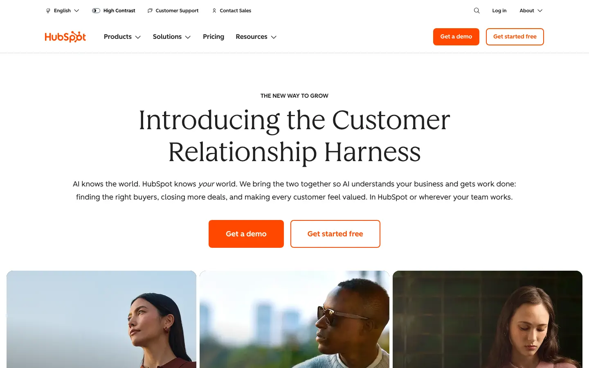

Chili Piper is strong at turning a form fill into a booked meeting. Its Growth plan routes form leads and shares them fairly across reps, and an SDR can book the right AE in one click. The catch is the price. Growth starts at $15,000 a year with 15 seats, and every plan is billed yearly.

That's a lot for a team of five, or for a team that wants to pay month to month. A good Chili Piper alternative still sends each form lead to the right person and books the meeting. It shares leads fairly, shows why each lead went where it did, and comes with a price and contract a smaller team can live with.

> **[Try Claritia free](https://app.tryclaritia.com/signup)** to route each form lead to the right rep and book the meeting on the same page, with monthly billing.

In this post, we compare 9 tools that route leads and book meetings. You'll see what each one routes on, what it costs and how it bills.

## Main points

- Chili Piper's Growth plan starts at $15,000 a year with 15 seats, billed yearly, and its pricing page lists no free plan or trial.
- Most tools below route form leads to a meeting and a person. Some live inside Salesforce, and several bill month to month.
- Check three things first: what the tool routes on, which plan you need for routing, and the billing terms.
- Top picks: [Claritia](/), [Default](https://www.default.com/), [RevenueHero](https://www.revenuehero.io/), [Calendly](https://calendly.com/), [OnceHub](https://www.oncehub.com/), [Cal.com](https://cal.com/), [LeanData](https://www.leandata.com/), [Distribution Engine](https://www.distributionengine.com/) and [HubSpot](https://www.hubspot.com/).
- Pick [Claritia](/) if you're a small team and want form routing with monthly billing and a free start.

## What is a Chili Piper alternative?

A Chili Piper alternative is a tool that does Chili Piper's main job. It reads what a lead tells you, picks the right rep and books a meeting with them. Some tools route from the form itself, and others route inside your CRM.

Typical features include:

- Routing from form answers to the right meeting and person.
- Round robin, with control over who gets more meetings.
- Routing to the record owner in your CRM.
- Booking on the same page as the form.
- A log that shows why each lead went where it did.
- Connections to Salesforce, HubSpot or other CRMs.

## How to choose a Chili Piper alternative

Price matters, but so does the contract behind it. These five checks help:

- **Routing from form answers.** The form should send each lead to the right meeting and person.
- **A fair rotation.** Round robin should share leads fairly and let you control who gets more.
- **CRM ties.** Look for routing to the record owner in your CRM.
- **An entry price a small team can start on.** Some tools start at a few dollars a seat, others at thousands a year.
- **Billing terms.** Plans range from month to month to yearly contracts and quotes.

## The 9 best Chili Piper alternatives in 2026

| Tool | Best for | Free plan | Paid from | Billing |
|---|---|---|---|---|
| [Claritia](/) | Small teams routing form leads | Yes | $12 a seat a month, billed yearly | Monthly or yearly |
| [Default](https://www.default.com/) | Ops teams who want routing plus workflows | None listed | $12,000 a year | Yearly |
| [RevenueHero](https://www.revenuehero.io/) | B2B teams booking from forms | No | $79 a month plus $25 a seat, billed yearly | Monthly or yearly |
| [Calendly](https://calendly.com/) | Teams who want routing on a known link | Yes, 1 event type | $10 a seat a month, billed yearly | Monthly or yearly |
| [OnceHub](https://www.oncehub.com/) | Routing forms with chatbots | Yes | $10 a user a month, billed yearly | Monthly or yearly |
| [Cal.com](https://cal.com/) | Open source routing forms | Yes, 1 user | $12 a user a month | Monthly or yearly |
| [LeanData](https://www.leandata.com/) | Salesforce teams with complex rules | No | See their pricing page | Quote |
| [Distribution Engine](https://www.distributionengine.com/) | Salesforce teams who want a lower entry price | 30-day trial | $10 a user a month, billed yearly | Yearly, 5 licenses or more |
| [HubSpot](https://www.hubspot.com/) | Teams who run sales in HubSpot | Yes, up to 2 users | $20 a seat a month, paid monthly | Monthly or yearly |

## 1. Claritia

[Claritia](/) gives small teams forms that turn visitors into leads, plus meetings that book them with the right person. The form picks the meeting, and the meeting picks the person. Routing and round robin come on the Pro plan, and you can pay month to month. It suits small teams who want Chili Piper style routing with monthly billing and a free start.

> **[Try Claritia free](https://app.tryclaritia.com/signup)** and turn on routing when you move to Pro, billed monthly or yearly.

### Key features

- **Routing by answer:** Route by any answer to a meeting and a person, plus routing by past answers, on Pro.
- **Round robin:** Weights and priority on Pro, so you control who gets more meetings.
- **Routing log:** See why each lead went where it did.
- **Booking inside the form:** The lead picks a time on the same page.
- **Owner first:** On Business, along with double round robin and Salesforce.
- **CRM connections:** HubSpot and Pipedrive connect from Starter, along with many other CRMs.

### Pros

- **Monthly billing:** Pay month to month, or save 20% billed yearly.
- **Free start:** A free plan lets you build forms and book meetings before you pay.
- **Fair seat pricing:** Teammates who only build forms or read answers are free.

### Cons

- **Built for small teams:** It fits small teams more than large enterprises.
- **No Zapier or Make apps yet:** They're on the way and aren't listed yet.

### Price and plans

You can start on the free plan with no card. Paid plans are priced per seat, and a seat is a teammate people can book a meeting with.

- **Free:** $0 for 1 seat and 250 submissions a month.
- **Starter:** $15 a seat a month ($12 billed yearly). Adds HubSpot, Pipedrive and many other CRMs.
- **Pro:** $39 a seat a month ($31 billed yearly). Adds routing by answer, round robin and the routing log.
- **Business:** $79 a seat a month ($63 billed yearly). Adds Salesforce, owner first and double round robin.

## 2. Default

[Default](https://www.default.com/) pairs routing with workflows and enrichment in one platform. Its plans set the base fee, and each rep then takes a seat for routing or scheduling. It suits ops teams who want routing and workflows under one contract.

### Key features

- **Routing and Scheduling seat:** Covers queues, object routing, round robins and booking links.
- **Workflow runs:** 200,000 a year on Growth, with unlimited workflow building.
- **Enrichment:** 24,000 enrichment credits a year on Growth.
- **Slack support:** A shared Slack channel for support.

### Pros

- **One platform:** Routing, workflows and enrichment under one contract.
- **Room for automation:** A large yearly allowance of workflow runs on Growth.

### Cons

- **High entry price:** Growth starts at $12,000 a year before seats.
- **Seats cost extra:** $540 a user a year for Routing and Scheduling, $240 for Scheduling only.
- **Yearly billing only:** Plans are billed yearly.

### Price and plans

Plans are billed yearly, and each rep needs a seat on top.

- **Growth:** $12,000 a year.
- **Enterprise:** $25,000 a year.
- **Routing and Scheduling seat:** $540 a user a year.
- **Scheduling seat:** $240 a user a year.

## 3. RevenueHero

[RevenueHero](https://www.revenuehero.io/) books meetings from web forms and booking pages. It routes with round robin and custom rules on its Essentials plan. A platform fee plus a fee per seat keeps the entry price low, which suits B2B teams who want inbound booking and routing with no seat minimum.

### Key features

- **Rules and domain matching:** Custom rules and domain matching on Essentials, with a routing log.
- **Qualification:** Qualify leads on their form answers.
- **CRM write-back:** Meeting outcomes go back to your CRM, such as HubSpot or Salesforce.
- **More round robin options:** Balanced and collective round robin on Advanced, along with fallback redistribution.

### Pros

- **Low entry price:** A platform fee plus a fee per seat.
- **No seat minimum:** Start with the team you have.
- **Monthly option:** Pay monthly or yearly.

### Cons

- **No free trial:** Its FAQ suggests starting on the monthly plan.
- **Owner updates cost more:** Updating owners in the CRM needs the Advanced plan.

### Price and plans

- **Essentials:** $79 a month plus $25 a seat, billed yearly, or $99 plus $35 a seat billed monthly.
- **Advanced:** $159 plus $35 a seat, billed yearly.

## 4. Calendly

[Calendly](https://calendly.com/)'s Teams plan adds routing forms and round robin. It also routes by the owner set in Salesforce or HubSpot. That covers a good share of what teams buy Chili Piper for, on a booking page your leads already know. It fits teams who want routing forms on the booking link they already use.

### Key features

- **Routing forms:** Routing forms and round robin on Teams.
- **Owner routing:** Routes by the owner set in Salesforce or HubSpot, on Teams.
- **Salesforce lookup routing:** On Enterprise.
- **Billing choice:** Monthly or yearly billing.

### Pros

- **A familiar link:** Your leads already know the booking page.
- **Free plan:** One event type for free.
- **Owner routing without Enterprise:** Salesforce and HubSpot owner routing comes on Teams.

### Cons

- **Routing needs Teams:** Standard leaves out forms that route leads.
- **Large Enterprise contract:** Enterprise starts at $15,000 a year with a 50-seat minimum.

### Price and plans

- **Free:** 1 event type.
- **Standard:** $10 a seat a month billed yearly ($12 monthly).
- **Teams:** $16 a seat a month billed yearly ($20 monthly).
- **Enterprise:** From $15,000 a year, with a 50-seat minimum.

## 5. OnceHub

[OnceHub](https://www.oncehub.com/)'s Route plan adds routing forms and round robin, and it can assign meetings to the CRM contact owner. The Engage plan adds website chatbots that qualify and book in the same chat. It suits teams who want routing forms and a chatbot that books.

### Key features

- **Routing forms:** Routing forms and round robin on Route.
- **Contact owner:** Meetings assigned to the CRM contact owner on Route and up.
- **CRM connections:** Native Salesforce and HubSpot connections from Schedule up.
- **Chatbots:** On Engage, chatbots qualify and book in the same chat.

### Pros

- **Free plan:** A free Basic plan to start.
- **Trial:** A 14-day trial of Engage with no credit card.
- **Monthly option:** Pay monthly or yearly.

### Cons

- **Chatbots cost more:** They only come on Engage, at $39 a user a month billed yearly.
- **Enterprise minimum:** Enterprise needs 30 users or more.

### Price and plans

Paid plans start at $10 a user a month, billed yearly.

- **Basic:** Free.
- **Route:** $19 a user a month billed yearly ($23 monthly).
- **Engage:** $39 a user a month billed yearly.
- **Enterprise:** For 30 users or more.

## 6. Cal.com

[Cal.com](https://cal.com/) is open source scheduling. Its Teams plan includes routing forms and round robin, and the free plan already lists Salesforce and HubSpot sync for one user. It suits teams who want open source routing forms at a low price.

### Key features

- **Routing forms:** Routing forms and round robin on Teams.
- **Workflows:** Custom notifications and workflows on Teams.
- **CRM sync:** Salesforce and HubSpot sync listed on the free plan.
- **Apps:** Mobile apps and a browser extension.

### Pros

- **Open source:** You can see and build on the code.
- **Low price:** Teams is $12 a user a month.
- **Free plan:** Free for 1 user.

### Cons

- **Owner routing unclear:** Routing by CRM owner isn't spelled out on its pricing page.
- **Setup time:** The many options can take time to set up well.

### Price and plans

- **Free:** $0 for 1 user.
- **Teams:** $12 a user a month, with 25% off billed yearly.
- **Organizations:** $28 a user a month.

## 7. LeanData

[LeanData](https://www.leandata.com/) is routing built on Salesforce. Its Orchestration editions start with round robin and territory routing for leads, then grow to any Salesforce object. BookIt adds scheduling on top, from web forms to handoffs. It's made for Salesforce teams with complex territory and account rules.

### Key features

- **Territory routing:** Round robin and territory routing on Standard.
- **Any object:** Routing for any standard or custom object on Premium.
- **BookIt for Forms:** Turns web forms into booking pages.
- **BookIt Handoff:** Spreads meetings fairly across a team.

### Pros

- **Complex rules:** Handles detailed territory and account rules in Salesforce.
- **Room to grow:** Routing extends from leads to any Salesforce object.

### Cons

- **Quote pricing:** Prices are by quote, and setup is billed apart.
- **Salesforce only:** It's built around Salesforce, so teams on other CRMs will look elsewhere.

### Price and plans

LeanData has no free plan.

- **All editions:** By quote. LeanData prices each package based on its features and size.
- **Setup:** Billed apart.

## 8. Distribution Engine

[Distribution Engine](https://www.distributionengine.com/) routes leads inside Salesforce, and its sister product Booking Engine handles meetings. Distribution Engine covers round robin and skills-based routing, and Booking Engine adds booking links with round robin and Salesforce events. It suits Salesforce teams who want routing and booking at a published price.

### Key features

- **Workload routing:** Routes by workload or account ownership.
- **Matching and territories:** Lead-to-account matching and territory assignment.
- **Skills-based routing:** Sends leads to the people with the right skills.
- **Booking Engine:** Booking links with round robin and Salesforce events.

### Pros

- **Published prices:** Prices are on its site, which makes budgeting simple.
- **Free trial:** 30 days through the Salesforce AppExchange.
- **Your data stays put:** All data stays in your Salesforce org.

### Cons

- **Needs Salesforce:** It only works inside Salesforce.
- **License minimum:** Paid plans need at least 5 licenses, billed yearly.

### Price and plans

Paid plans need at least 5 licenses and are billed yearly.

- **Distribution Engine:** $20 to $55 a user a month, billed yearly.
- **Booking Engine Starter:** $10 a user a month, billed yearly.

## 9. HubSpot

[HubSpot](https://www.hubspot.com/)'s meetings tool lives in its CRM. Team scheduling pages, round robin included, need a paid Sales Hub or Service Hub plan and a Sales or Service seat. Workflows can then act on each new meeting. It fits teams who already run sales in HubSpot and want booking on the record.

### Key features

- **Booking on the record:** Meetings are booked straight onto the contact record.
- **Round robin:** Books whoever is free at the chosen time.
- **Workflows:** Up to 300 workflows on Professional.
- **Free CRM:** For up to 2 users.

### Pros

- **All in one CRM:** Meetings and workflows live where your sales team already works.
- **Free start:** The CRM is free for up to 2 users.

### Cons

- **Onboarding fee:** Professional adds a required $1,500 one-time onboarding fee.
- **Unclear routing plans:** Its pricing page doesn't show which plans include lead form routing.
- **Paid seat for team pages:** Round robin needs a paid Sales Hub or Service Hub plan and a Sales or Service seat.

### Price and plans

- **Free:** For up to 2 users.
- **Starter:** $20 a seat a month paid monthly, lower billed yearly.
- **Professional:** $90 a seat a month billed yearly, plus a $1,500 one-time onboarding fee.

## Which Chili Piper alternative should you pick?

- If you're a small team and want form routing with monthly billing, pick [Claritia](/) Pro.
- If you want routing tied to enrichment and many workflow runs, and a yearly contract suits you, look at [Default](https://www.default.com/).
- If you sell B2B and want inbound booking with no seat minimum, try [RevenueHero](https://www.revenuehero.io/) Essentials.
- If you live in Salesforce and need territory rules, compare [LeanData](https://www.leandata.com/) with [Distribution Engine](https://www.distributionengine.com/).
- If you already run sales in HubSpot, use [HubSpot](https://www.hubspot.com/)'s team scheduling pages.

## Questions

### What is the best Chili Piper alternative for small teams?

For a small team, Claritia is a strong pick. It routes form answers to a meeting and a person on Pro, from $31 a seat a month billed yearly, with a free plan to start.

### Is there a Chili Piper alternative with monthly billing?

Yes. Claritia, RevenueHero, Calendly, OnceHub and Cal.com all offer monthly billing. Chili Piper bills its plans yearly.

### Which Chili Piper alternative works best with Salesforce?

LeanData and Distribution Engine are built inside Salesforce. Claritia Business adds Salesforce with owner first, and Calendly Teams routes by Salesforce assignment.

### Does Chili Piper have a free plan?

Its pricing page lists no free plan or trial. You book a demo to start.

### What should you move first when you switch?

Start with your main demo form and its routing rules. Rebuild one path, test it with a few real leads, then move the rest.

## Get started

Ready to route your first form? Give each lead the right rep and a booked meeting, without a yearly contract.

> **[Try Claritia free](https://app.tryclaritia.com/signup)** to build your first form today, then turn on routing on Pro, billed monthly or yearly.

You can also see how [routing](/products/routing) works and what each plan costs on [pricing](/pricing).
