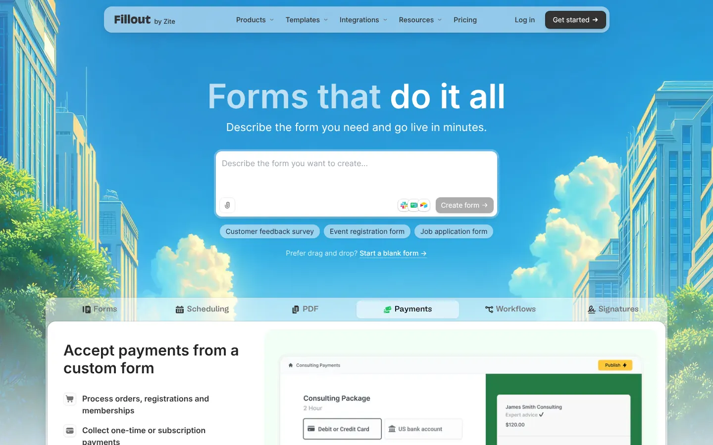
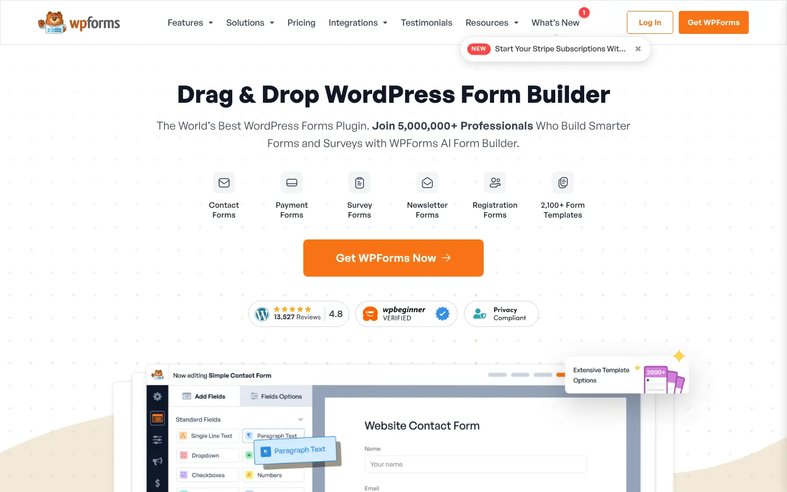
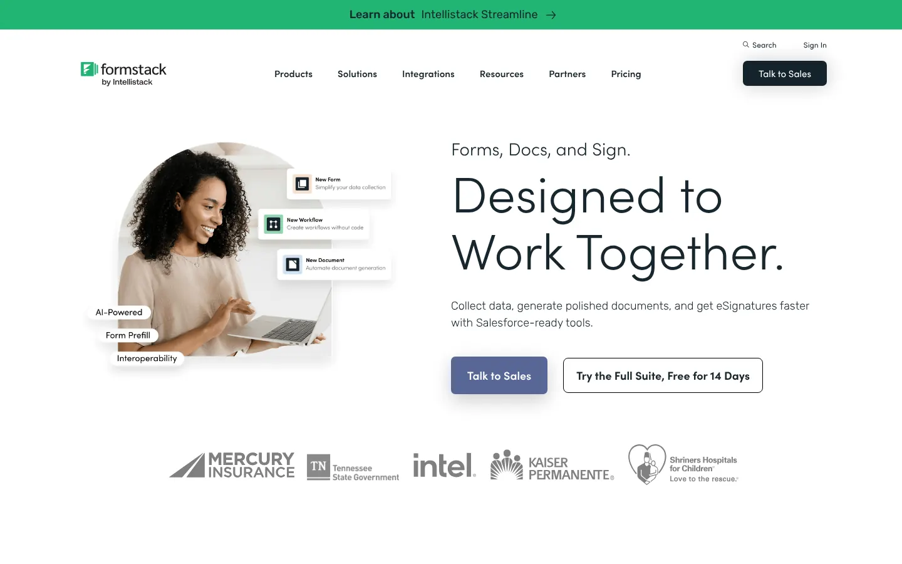

You need a form today, and you don't want to write code or wait for a developer. A drag and drop form builder lets you pick a field, drop it where it belongs and see the form take shape as you go. The catch is that every builder says it's easy, and you only learn how it really feels once you're ten questions in.

The best editor is one you can come back to in six months and still find your way around. Moving a question, adding a page or changing a rule should take seconds, and so should putting the form on your site.

> **[Try Claritia free](https://app.tryclaritia.com/signup)** to build a form by describing it in one sentence, then change any question by hand or by asking.

In this post, we compare 8 form builders by how they feel to build in. You'll see what each one does well, where it falls short and what it costs.

## Main points

- A drag and drop form builder lets you build a form by moving fields onto a page, with no code.
- The editors differ in what you can drag, how you set logic, and how long a big form stays easy to manage.
- Most free plans let you try the editor fully. The limits are on forms and monthly answers.
- Top picks: [Claritia](/), [Jotform](https://www.jotform.com/), [Fillout](https://www.fillout.com/), [WPForms](https://wpforms.com/), [Zoho Forms](https://www.zoho.com/forms/), [Formstack](https://www.formstack.com/), [Cognito Forms](https://www.cognitoforms.com/) and [Google Forms](https://www.google.com/forms/about/).
- Pick [Claritia](/) if you'd rather describe the form than drag every field, and want it to end in a booked meeting.

## What is a drag and drop form builder?

A drag and drop form builder is a visual editor for online forms. You pick fields such as name, email, dropdown or file upload from a list, drag them onto the form, and set each one up in a side panel. What you see while you build is close to what people see when they fill it in.

For a wider look at form tools, with less focus on the editor, see our list of the [best form builders](/blog/best-form-builder).

Typical features include:

- A field list you drag from, with basic and advanced fields.
- Reordering questions and pages by dragging them.
- A settings panel for each field: label, help text, required, checks.
- A visual way to set conditional logic.
- A live preview and templates to start from.

## How to choose a drag and drop form builder

Every editor looks easy with three fields. Build a real form with 15 questions and two pages, then check:

- **Speed on a long form.** Can you still find and move a question quickly, or does the page turn into a long scroll?
- **Logic you can read.** Show-if rules and page skips should be easy to set and easy to check later.
- **Fields you need.** Payments, file uploads, signatures, calculations or a booking calendar, on the plan you'd pay for.
- **Phone preview.** Most people will fill in your form on a phone.
- **Embedding.** A link, a code snippet or a plugin that puts the form on your site in minutes.
- **The free plan's limits.** How many forms and answers you get before you pay.

Not a fan of dragging? Doc-style builders like [Tally](https://tally.so/) let you type a form like a note, and [AI form builders](/blog/best-ai-form-builder) draft it from a sentence.

## The 8 best drag and drop form builders in 2026

Prices checked November 2026.

| Tool | Best for | Free plan | Paid from | Editor style |
|---|---|---|---|---|
| [Claritia](/) | Forms that book a meeting | Unlimited forms, 250 submissions a month | $12 a seat a month, billed yearly | Describe it to Tia, then edit by hand or by asking |
| [Jotform](https://www.jotform.com/) | A template for every need | 5 forms, 100 submissions a month | $34 a month, billed yearly | Drag and drop with widgets |
| [Fillout](https://www.fillout.com/) | A big free allowance | 1,000 responses a month | $15 a month, billed yearly | Drag and drop or AI |
| [WPForms](https://wpforms.com/) | WordPress sites | WPForms Lite | $49.50 for the first year | Drag and drop inside WordPress |
| [Zoho Forms](https://www.zoho.com/forms/) | High answer volume | 3 forms, 500 submissions a month | $10 a month, billed yearly | No-code drag and drop |
| [Formstack](https://www.formstack.com/) | Larger teams with documents | No, 14-day trial | $83 a month, billed yearly | No-code drag and drop |
| [Cognito Forms](https://www.cognitoforms.com/) | Forms with math | 100 entries a month | $19 a month, billed yearly | Drag and drop with calculations |
| [Google Forms](https://www.google.com/forms/about/) | Quick internal forms | Free with a Google account | Comes with Google Workspace | Simple drag to reorder |

## 1. Claritia

[Claritia](/) is a forms, scheduling and follow-up app built for small B2B teams that want every lead from their website to reach the right rep and book a meeting before they leave the page. It builds forms from a sentence or one of 840 templates, opens the right person's calendar the moment the form is sent, routes each lead by its answers, and drafts follow-up emails in your brand's voice for you to approve. It takes a different route from a classic drag and drop builder, since Tia, the AI form builder, writes the questions and pages from your sentence and links a meeting. You then change anything by hand or by asking Tia, which suits small teams who want a working form fast.

> **[Try Claritia free](https://app.tryclaritia.com/signup)** and get your first form drafted from one sentence.

### Key features

- **Tia, the AI form builder:** Builds a form from a plain sentence, and adds or fixes questions when you ask.
- **15 field types:** Including file uploads, on every plan.
- **Pages and logic:** Multi-page forms, show-if logic, page skips and calculations on the free plan.
- **840 templates and 18 styles:** Start from a real form in your field. See the [form templates](/templates).
- **Booking inside the form:** The last page can be the right person's calendar.

### Pros

- **Fast first draft:** A full form from one sentence.
- **Logic for free:** Conditional logic and calculations are on every plan.
- **Fair seat pricing:** Teammates who only build forms or read answers are free.

### Cons

- **A different way to build:** The quickest path is describing the form. If you'd rather place every field yourself, compare it with a classic builder like Jotform.
- **Newer tool:** Its app marketplace is smaller, and its Zapier and Make apps aren't listed yet.

### Price and plans

You can start on the free plan with no card. Paid plans are priced per seat, and a seat is a teammate people can book a meeting with.

- **Free:** $0 for 1 seat and 250 submissions a month.
- **Starter:** $15 a seat a month ($12 billed yearly). Adds e-signatures, Stripe payments and HubSpot.
- **Pro:** $39 a seat a month ($31 billed yearly). Adds routing and removes Claritia branding.
- **Business:** $79 a seat a month ($63 billed yearly). Adds partial answers and Salesforce.

## 2. Jotform

[Jotform](https://www.jotform.com/) is a drag and drop form builder for businesses, schools, nonprofits, and public agencies that want to collect data, payments, and signatures without writing code. Forms can use conditional logic, answer piping, prefilled fields, and translations, and they accept one-time or recurring payments through many gateways. Submissions can become PDFs, flow into CRMs and spreadsheets, and be managed in related Jotform tools for tables, approval workflows, e-signatures, and reports. You drag fields and widgets onto the form, change colors and layout, and can open any of its more than 20,000 templates as a ready-made starting point for almost any kind of form.

### Key features

- **Drag and drop builder:** Fields, images and widgets added with a click or a drag.
- **20,000+ templates:** One for almost every use.
- **150+ integrations:** Listed on its features page.
- **Embed code:** Copy and paste it into your site builder.

### Pros

- **Huge template library:** You rarely start from a blank page.
- **Widgets for odd needs:** Many extra field types beyond the basics.

### Cons

- **Small free plan:** 5 forms and 100 submissions a month, with Jotform branding.
- **Single user:** Plans below Enterprise are for one user.

### Price and plans

- **Starter:** Free, 5 forms and 100 submissions a month.
- **Bronze:** $34 a month billed yearly, or $39 monthly. 25 forms and 1,000 submissions a month.
- **Silver:** $39 a month billed yearly, or $49 monthly. 50 forms and 2,500 submissions a month.
- **Gold:** $99 a month billed yearly, or $129 monthly. 100 forms and 10,000 submissions a month.

## 3. Fillout

[Fillout](https://www.fillout.com/) is a form builder for teams that want branded forms, surveys, and quizzes connected to the tools they already use. You can describe a form for its AI to build or use drag and drop, then add logic, file uploads, payments, and signatures. It also offers scheduling forms that sync with Google Calendar or Outlook, PDF generation, workflows, login forms that let people edit past answers, custom domains, and native integrations. Its free plan includes 1,000 responses a month and unlimited seats, so the whole team can build, which suits teams who want a modern editor and a large free allowance.

### Key features

- **Drag and drop or AI:** Pick the way you like to work.
- **Unlimited seats:** On every plan.
- **Logic and payments:** On the free plan.
- **Embedding:** On every plan, free included.

### Pros

- **Big free plan:** 1,000 responses a month.
- **Room for the team:** Everyone can build at no extra cost.

### Cons

- **Branding on lower plans:** Free forms show a Fillout badge and Starter shows light branding.
- **Partial submissions cost more:** They're on Business.

### Price and plans

- **Free:** $0, 1,000 responses a month.
- **Starter:** $15 a month billed yearly, 2,000 responses.
- **Pro:** $40 a month billed yearly, 5,000 responses.
- **Business:** $75 a month billed yearly, unlimited responses.

## 4. WPForms

[WPForms](https://wpforms.com/) is a form builder plugin for WordPress site owners who want to add contact, payment, survey and registration forms without writing code. It offers a drag-and-drop editor with templates and an AI form builder, along with conditional logic, multi-page forms and calculations. Entries are kept in the WordPress dashboard, and the plugin can send email notifications, accept Stripe payments, collect signatures and file uploads, save partial entries and pass leads to email marketing tools and CRMs. You build in your WordPress dashboard, and every paid plan includes unlimited forms, submissions and users, plus conditional logic. If you run a WordPress site, also see our list of [WordPress form builders](/blog/best-wordpress-form-builder).

### Key features

- **Drag and drop in WordPress:** No separate app to log in to.
- **Conditional logic:** On every paid plan.
- **Multi-page forms and file uploads:** From Basic.
- **WPForms AI:** Drafts forms you can then edit.

### Pros

- **No caps on paid plans:** Unlimited forms, submissions and users.
- **Free version:** WPForms Lite lets you try the editor.

### Cons

- **WordPress only:** It doesn't work on other site builders.
- **Renewals cost more:** First-year prices are introductory, and renewals are at full price. The free version also takes a 3% fee on payments.

### Price and plans

Prices are per year, for the first year.

- **Basic:** $49.50 for 1 site (regular price $99).
- **Plus:** $99.50 for 3 sites (regular price $199).
- **Pro:** $199.50 for 5 sites (regular price $399). Adds payments and calculations.
- **Elite:** $299.50 for unlimited sites (regular price $599). Adds HubSpot and Salesforce.

## 5. Zoho Forms

[Zoho Forms](https://www.zoho.com/forms/) is an online form builder for businesses that want to collect data and move it through review and approval steps without code. It can build a form from a prompt, turn PDFs or photos of paper forms into online forms, and read business cards or IDs to fill in fields. Forms support many field types, subforms, payments, and multi-level approvals, a mobile app collects entries offline, and data can flow into Zoho CRM. Its no-code drag and drop builder comes with templates and conditional logic, and paid plans start at 10,000 submissions a month, so it suits teams who use Zoho apps or expect a lot of answers.

### Key features

- **Drag and drop builder:** Drag elements onto the form and set them up.
- **Conditional logic:** Built into the editor.
- **High caps:** From 10,000 submissions a month.
- **Zoho apps:** A close link with Zoho CRM.

### Pros

- **Low entry price:** Basic is $10 a month billed yearly.
- **Room to grow:** Higher plans add users and answers.

### Cons

- **Small free plan:** 3 forms.
- **Basic is one user:** You need Standard for a team.

### Price and plans

All prices are billed yearly.

- **Free:** 1 user, 3 forms and 500 submissions a month.
- **Basic:** $10 a month. 1 user and 10,000 submissions a month.
- **Standard:** $25 a month. 10 users and 25,000 submissions a month.
- **Professional and Premium:** $50 and $90 a month, for 25 and 100 users.

## 6. Formstack

[Formstack](https://www.formstack.com/) is a no-code platform for organizations that want to collect data, create documents and gather signatures without manual paperwork. Its form builder offers AI form creation, prefilled links, branded themes, step logic and group approvals, and it sends submissions into CRMs and other business systems. Separate products generate documents from the data a form collects and capture eSignatures, and versions of its forms and documents run inside Salesforce. Its no-code drag and drop builder includes conditional logic, and the Suite plan adds the documents and e-signatures. It's priced for larger teams that need forms, documents and signatures in one place.

### Key features

- **Drag and drop builder:** No code and no help from IT.
- **Conditional logic:** Show or hide fields based on answers.
- **Documents and signatures:** In the Suite plan.
- **Free trial:** 14 days with no card.

### Pros

- **Built for bigger teams:** Forms, documents and signatures together, plus a Salesforce Solutions plan.

### Cons

- **No free plan:** Only a 14-day trial.
- **Tight limits on Forms:** 1 builder user, 25 forms and 1,000 submissions per form.

### Price and plans

- **Forms:** $83 a month billed yearly, or $99 monthly.
- **Suite:** $250 a month billed yearly, or $299 monthly. 3 builder users and 100 forms.
- **Salesforce Solutions and Enterprise:** Custom pricing.

## 7. Cognito Forms

[Cognito Forms](https://www.cognitoforms.com/) is an online form builder for organizations that want to collect data and automate the work that follows each entry. Its drag-and-drop builder handles many field types, automatic calculations, signatures and file uploads. Forms can move entries through approval workflows, generate documents, look up data from other forms and take payments through Square, Stripe, PayPal or its own Cognito Pay. It also includes controls that help teams meet HIPAA, GDPR and CCPA rules. Its builder is strong at math, with repeating sections and tables that suit quotes, orders and any form with a total, and even its free plan takes payments.

### Key features

- **Drag and drop builder:** Build forms visually.
- **Calculations:** Prices, totals and dates.
- **Repeating sections and tables:** For lists of items or people.
- **Payments:** On the free plan.

### Pros

- **Good at quotes:** Totals and repeating items are where it shines.
- **Paid forms for free:** Take payments before you upgrade.

### Cons

- **Small free plan:** 100 entries a month, 1 user, with Cognito Forms branding.
- **More than a quick form needs:** The builder suits detailed forms more than short, styled ones.

### Price and plans

- **Free:** 100 entries a month and 1 user.
- **Pro:** $19 a month billed yearly, or $24 monthly. 2,000 entries a month.
- **Higher plans:** More users and entries. See their pricing page.

## 8. Google Forms

[Google Forms](https://www.google.com/forms/about/) is the survey and form tool in Google Workspace, made for people and teams who want to gather answers from any device with little setup. You pick question types, arrange them with drag and drop, add logic that shows questions based on earlier answers, or build quizzes that test knowledge. Forms can be shared by email, link, or embed. Responses appear as live charts and can be exported to Google Sheets for deeper analysis. It's the simple free choice here, and it suits quick internal forms and surveys more than branded lead forms.

### Key features

- **Drag to reorder:** Move questions into place.
- **Google Sheets:** Answers go straight to a sheet.
- **Embed HTML:** Copy the code and paste it on your site.
- **Shared editing:** Several people can work on one form.

### Pros

- **Free and familiar:** Anyone with a Google account can start in minutes.

### Cons

- **Few design options:** Forms look like Google Forms.
- **Simple logic:** Section-based branching only, and no payments or booking.

### Price and plans

- **Personal:** Free with a Google account.
- **Business:** Comes with Google Workspace. See their pricing page.

## Which drag and drop form builder should you pick?

- If you want a form drafted for you that ends in a booked meeting, pick [Claritia](/).
- If you want a template for almost anything, pick [Jotform](https://www.jotform.com/).
- If you want a big free plan for the whole team, pick [Fillout](https://www.fillout.com/).
- If your site runs on WordPress, pick [WPForms](https://wpforms.com/).
- If your forms add up prices and totals, pick [Cognito Forms](https://www.cognitoforms.com/).
- If you need a quick internal survey, [Google Forms](https://www.google.com/forms/about/) is enough.

## Questions

### What is the easiest drag and drop form builder?

For a simple form, Google Forms and Jotform are easy to learn. If you'd rather skip dragging, Claritia drafts the whole form from one sentence, and you edit from there.

### Is there a free drag and drop form builder?

Yes. Jotform, Fillout, Zoho Forms, Cognito Forms and Google Forms all have free plans, and WPForms has a free Lite version. Claritia is free for 1 seat and 250 submissions a month. Read more in our list of [free form builders](/blog/best-free-form-builder).

### Can I add a drag and drop form to my website?

Yes. Most tools give you a link and an embed code. Claritia forms go on any site with one script tag, on every plan, Free included.

### Do drag and drop form builders support conditional logic?

Most do. Claritia, Fillout and Jotform include it on their free plans, and WPForms has it on every paid plan. Google Forms has simple section-based branching.

### What's the difference between a drag and drop and an AI form builder?

In a drag and drop builder, you place each field yourself. An AI form builder drafts the whole form from a description, and you edit the result. Fillout, Jotform and Claritia offer AI drafting too.

## Get started

Pick two builders from this list and build the same real form in each. The one you finish faster, without looking for help, is your editor.

> **[Try Claritia free](https://app.tryclaritia.com/signup)** to build your first form from one sentence and book your first meeting today.

You can also browse the [840 form templates](/templates) or see how [Claritia forms](/products/forms) work.
