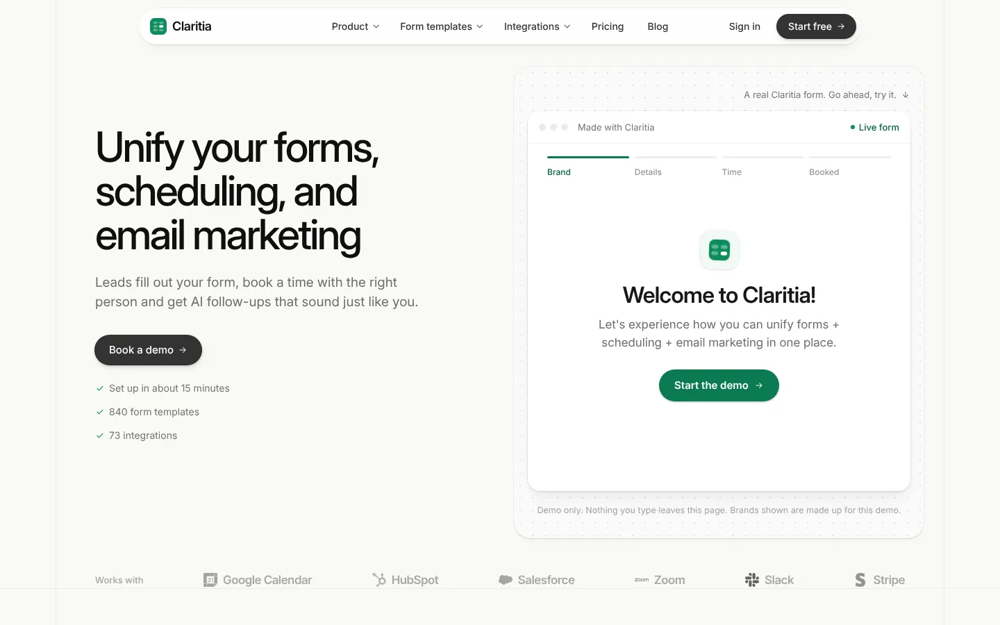
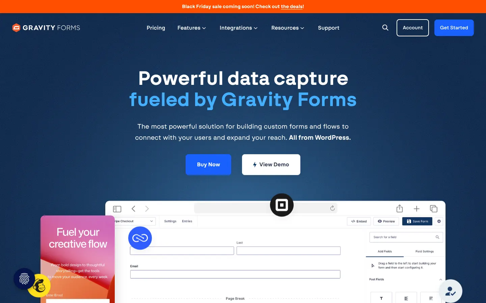

A form with conditional logic changes as people answer it. A visitor who picks "Just browsing" skips the budget questions. A visitor who picks "Ready to buy" sees the booking step. Each person gets a shorter form, and you get cleaner answers.

Most form builders list conditional logic, but how far it goes varies a lot. A good one can skip whole steps, run math on answers, pass hidden values like UTM tags into the rules, and let you try all of it on the free plan before you pay.

> **[Try Claritia free](https://app.tryclaritia.com/signup)** to build a form with conditional logic, step skips and calculations on the free plan, and let it end in a booked meeting.

In this post, we compare 8 form builders with conditional logic. You'll see how deep each one's logic goes, what it costs, and where it falls short.

## Main points

- Every tool below has conditional logic, but some put it on the free plan and others start it on a paid plan.
- Deeper logic means page skips, calculations and hidden values, beyond showing or hiding a question.
- Check what happens after the logic runs: where the answer goes and whether the lead can book a call.
- Top picks: [Claritia](/), [Typeform](https://www.typeform.com/), [Fillout](https://www.fillout.com/), [Jotform](https://www.jotform.com/), [Tally](https://tally.so/), [Paperform](https://paperform.co/), [Zoho Forms](https://www.zoho.com/forms/) and [Gravity Forms](https://www.gravityforms.com/).
- Pick [Claritia](/) if you want the logic to end in a booked meeting with the right person.

## What is a form builder with conditional logic?

A form builder with conditional logic lets you set rules that change the form as people answer. A rule can show a question, hide it, skip a page or pick the ending. Each person only sees what applies to them.

Typical features include:

- Rules that show or hide a question based on an answer.
- Page skips that jump past whole steps.
- Calculations that build scores and totals from answers.
- Hidden fields that carry values like UTM tags into the rules.
- Different endings or thank-you pages for different answers.
- Logic on the emails sent after a form is filled in.

## How to choose a form builder with conditional logic

Almost every tool says it has logic. These five checks show how much you really get:

- **Depth of logic.** Rules that show or hide questions, plus jumps that skip whole pages.
- **Logic on the free plan.** You should be able to test real rules before you spend money.
- **Calculations.** Scores and totals built from answers.
- **What happens after the form.** Where the answer goes once the logic has done its job.
- **Fair pricing.** Clear plans with caps you can live with.

## The 8 best form builders with conditional logic in 2026

| Tool | Best for | Free plan | Paid from | Logic on the free plan |
|---|---|---|---|---|
| [Claritia](/) | Forms that branch into a booked meeting | Yes, 250 submissions a month | $12 a seat a month, billed yearly | Yes, with step skips and calculations |
| [Typeform](https://www.typeform.com/) | One question at a time | Yes, with a low response cap | $28 a month, billed yearly | Included from the Basic plan |
| [Fillout](https://www.fillout.com/) | Generous free limits | Yes, 1,000 responses a month | $15 a month, billed yearly | Yes |
| [Jotform](https://www.jotform.com/) | Long forms with many rules | Yes, 5 forms and 100 submissions | $34 a month, billed yearly | Yes |
| [Tally](https://tally.so/) | Free forms with no submission cap | Yes, unlimited within fair use | $24 a month, billed monthly | Yes, with calculations |
| [Paperform](https://paperform.co/) | Forms that read like a page | Yes, 30 submissions a month | $49 a month, billed yearly | Yes |
| [Zoho Forms](https://www.zoho.com/forms/) | Teams already on Zoho | Yes, 3 forms and 500 submissions | See their pricing page | See their pricing page |
| [Gravity Forms](https://www.gravityforms.com/) | WordPress sites | No free version | $59 a year | Core feature on every license |

## 1. Claritia

[Claritia](/) is a forms and meetings tool for small teams, with workflows that follow up. Its forms come with conditional logic and step skips on the free plan, plus calculations and formulas. When the logic decides a visitor is a fit, the same form can book them into a meeting with the right person, so it suits teams that want the logic to end in a booked meeting.

> **[Try Claritia free](https://app.tryclaritia.com/signup)** and build your first branching form on the free plan.

### Key features

- **Logic on the free plan:** Conditional logic, step skips, calculations and formulas are all free.
- **Hidden fields:** Capture UTM tags and where the visitor came from, and pre-fill the form from the link.
- **Routing:** On Pro, route by any answer to a meeting and a person, with a routing log.
- **Booking inside the form:** A qualified visitor books a meeting in the same flow.
- **Tia, the AI form builder:** Builds a form from a plain sentence, so you start with questions in place.

### Pros

- **Logic for free:** Step skips and calculations cost nothing.
- **Logic that leads somewhere:** The answers can decide who the lead meets with.
- **Fair seat pricing:** Teammates who only build forms or read answers are free.

### Cons

- **Newer tool:** Its app marketplace and community are smaller than the big names.
- **No Zapier or Make apps yet:** They're on the way and are yet to be listed.

### Price and plans

You can start on the free plan with no card. Paid plans are priced per seat, and a seat is a teammate people can book a meeting with.

- **Free:** $0 for 1 seat and 250 submissions a month.
- **Starter:** $15 a seat a month ($12 billed yearly). Adds HubSpot, e-signatures and Stripe payments.
- **Pro:** $39 a seat a month ($31 billed yearly). Adds round robin and routing by answer.
- **Business:** $79 a seat a month ($63 billed yearly). Adds Salesforce, partial answers and owner first.

## 2. Typeform

[Typeform](https://www.typeform.com/) shows one question at a time, which makes branching feel natural to the person filling it in. Its logic lets you send people down different paths based on what they answer. It suits brand-led forms where the look matters as much as the rules. The free plan has a low response cap, so most teams move to a paid plan quickly.

### Key features

- **Conditional logic:** Part of every plan from Basic up.
- **One question at a time:** Keeps long branching forms easy to follow.
- **Typeform AI:** Builds a form from a prompt and translates it into more than 25 languages.
- **AI answer analysis:** Helps you read open-ended replies.

### Pros

- **Natural branching:** With one question at a time, branching feels natural to the person filling it in.
- **Design control:** A good fit when the look of each question matters.

### Cons

- **Tight response caps:** 100 a month on Basic and 1,000 on Plus.
- **Free plan for trying:** It's mainly for testing the tool.

### Price and plans

- **Free:** Yes, with a low response cap.
- **Basic:** $28 a month, billed yearly.
- **Plus:** $56 a month, billed yearly.
- **Business:** $91 a month.

## 3. Fillout

[Fillout](https://www.fillout.com/) gives you a lot for free. Conditional logic is on every plan, and the free plan includes 1,000 responses a month with unlimited forms and seats. It suits teams that want to build deep logic before they pay anything.

### Key features

- **Logic on every plan:** The free plan included.
- **Free allowance:** 1,000 responses a month and unlimited seats.
- **Scheduling forms:** On all plans.
- **Partial submissions:** On the Business plan.

### Pros

- **Test rules for free:** Real logic and real volume before you pay.
- **Room for the team:** Unlimited seats on the free plan.

### Cons

- **Free plan limits:** It shows a Fillout badge and leaves out custom endings and redirects.
- **Salesforce costs more:** It's only on the top Team and Enterprise plans.

### Price and plans

- **Free:** $0, with 1,000 responses a month.
- **Starter:** $15 a month, billed yearly.
- **Pro:** $40 a month, billed yearly.
- **Business:** $75 a month, billed yearly.

## 4. Jotform

[Jotform](https://www.jotform.com/) is one of the oldest form builders, and its logic shows that age in a good way. You can set rules that show fields, skip pages, change emails and send people to different thank-you pages. Jotform says conditional logic is on every plan, the free one included. It suits long forms like applications and intake forms with many branches.

### Key features

- **Conditional logic:** On the free Starter plan.
- **Rules for fields and pages:** Show fields, skip pages, change emails and pick the thank-you page.
- **AI form generator:** Free to use.
- **AI Agents:** On every plan, with limits by tier.

### Pros

- **Many rule types:** Good for forms with dozens of branches.
- **Logic for free:** Every plan includes it.

### Cons

- **Small free plan:** 5 forms and 100 submissions a month.
- **Single user:** Each plan is for one user until you reach Enterprise.

### Price and plans

- **Starter:** Free, with 5 forms and 100 submissions a month.
- **Bronze:** $34 a month, billed yearly.
- **Silver:** $39 a month, billed yearly.
- **Gold:** $99 a month, billed yearly.

## 5. Tally

[Tally](https://tally.so/) feels like writing a document. You type questions, then add logic blocks that show or hide what comes next. Its free plan includes conditional logic and calculations with unlimited forms and submissions, within its fair use rules. It suits solo founders and small teams who want logic for free.

### Key features

- **Logic and calculations:** Both on the free plan.
- **Unlimited use:** Unlimited forms and submissions within fair use.
- **Answer piping:** Reuse earlier answers in later questions.
- **Languages:** Over 45, with right-to-left support.

### Pros

- **Logic with no cap:** Rules and math on a free plan with no submission cap.
- **Easy to build:** Logic blocks sit right in the document.

### Cons

- **Drop-off data costs more:** Partial submissions and drop-off analytics need Pro.
- **Fewer native integrations:** Many teams lean on Zapier or Make.

### Price and plans

- **Free:** $0, unlimited within fair use.
- **Pro:** $24 a month, billed monthly.
- **Business:** $74 a month, billed monthly.

Yearly billing gives two months off.

## 6. Paperform

[Paperform](https://paperform.co/) forms look like web pages, with text and images between the questions. Its conditional logic is on every plan, and it adds a calculations assistant on Pro and up. It works well for quotes and bookings, and for any form that needs to read like a landing page.

### Key features

- **Conditional logic:** On all plans, the free one included.
- **Calculations assistant:** On Pro and up.
- **Appointment field:** On every plan, with Google Calendar sync.
- **AI form creation:** On every plan.

### Pros

- **Logic on every plan:** No upgrade needed to test your rules.
- **Unlimited submissions on Pro:** Within fair use.

### Cons

- **Tiny free plan:** Only 30 submissions a month.
- **Partial responses cost more:** They need Pro or higher.

### Price and plans

- **Free:** 30 submissions a month.
- **Pro:** $49 a month billed yearly, or $59 billed monthly.
- **Business:** $124 a month billed yearly, or $149 billed monthly.

## 7. Zoho Forms

[Zoho Forms](https://www.zoho.com/forms/) has a detailed rules system. Its pricing page lists field rules, form rules, page rules and set value actions, each with an advanced version. If your team already runs on Zoho CRM and other Zoho apps, the fit is close.

### Key features

- **Rule types:** Field rules, form rules, page rules and set value actions, each with an advanced version.
- **Zoho CRM:** A Zoho CRM field and the Zoho CRM integration on every plan.
- **High caps:** Paid plans start at 10,000 submissions a month on Basic.
- **AI tools:** Turn a PDF or an image into a form.

### Pros

- **Detailed rules:** Many rule types for complex forms.
- **Made for Zoho teams:** Zoho CRM is on every plan.

### Cons

- **Unclear plan limits:** The pricing page leaves it unclear which rule types sit on which plan.
- **Small free plan:** 3 forms.

### Price and plans

- **Free:** 3 forms and 500 submissions.
- **Paid plans:** See their pricing page.

## 8. Gravity Forms

[Gravity Forms](https://www.gravityforms.com/) is a WordPress plugin. Conditional logic is a core feature on every license, and it works on fields and on the emails sent after a fill. For rules that mix AND with OR, there is an add-on. It suits WordPress sites that want entries stored on their own server.

### Key features

- **Conditional logic:** On every license.
- **Logic after the fill:** On notifications and confirmation messages.
- **Advanced Conditional Logic:** An add-on for grouped AND and OR rules.
- **HubSpot add-on:** From the Basic license.

### Pros

- **Your own data:** Entries stay on your own server.
- **Logic everywhere:** Rules work on fields and on the emails sent after.

### Cons

- **No free version:** And no trial.
- **WordPress only:** It doesn't work on other site builders.

### Price and plans

- **Basic:** $59 a year.
- **Pro:** $159 a year.
- **Elite:** $259 a year.

## Which form builder with conditional logic should you pick?

- If you want the logic to end in a booked meeting with the right person, pick [Claritia](/).
- If you want the most free responses while you test your rules, pick [Fillout](https://www.fillout.com/) or [Tally](https://tally.so/).
- If your form is a long application with dozens of branches, pick [Jotform](https://www.jotform.com/).
- If the look of each question matters most, pick [Typeform](https://www.typeform.com/).
- If your site runs on WordPress and you want entries on your own server, pick [Gravity Forms](https://www.gravityforms.com/).

## Questions

### What is conditional logic in a form?

Conditional logic is a set of rules that change the form based on answers. A rule can show a question, hide it, skip a page or pick the ending. People only see what applies to them.

### Which form builders have conditional logic on the free plan?

Claritia, Fillout, Jotform, Tally and Paperform all include conditional logic on their free plans. Typeform includes it from its Basic plan. Check each plan's caps on submissions before you commit.

### Does conditional logic make forms shorter?

Yes. Each person only sees the questions that fit their answers. A shorter path means fewer people give up halfway.

### Can conditional logic do math?

Many builders pair logic with calculations. Claritia and Tally both include calculations on the free plan, so you can score answers and use the result in your rules.

### Can a form route people based on their answers?

Yes. In Claritia, Pro plans route by any answer to a meeting and a person. A qualified lead can book with the right teammate before leaving the page.

## Get started

Build your first branching form on the free plan in a few minutes.

> **[Try Claritia free](https://app.tryclaritia.com/signup)** to build your first branching form and book your first meeting today.

You can also see how [Claritia forms](/products/forms) handle logic, or learn how [routing](/products/routing) sends each lead to the right person.
