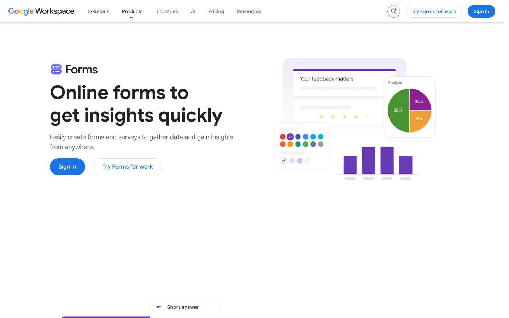
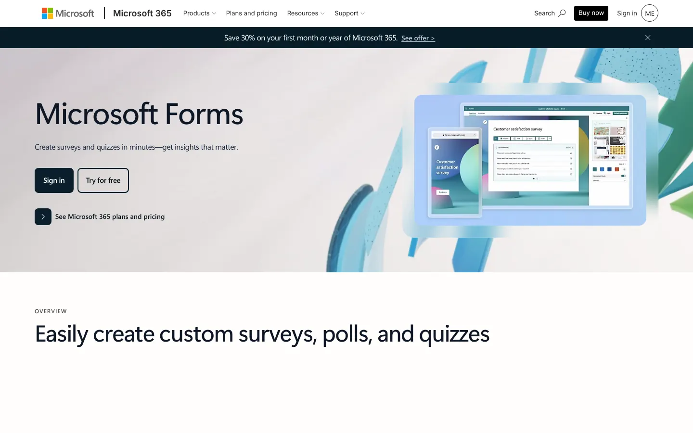

A free form builder lets you test an idea and take your first leads before you spend a cent. The catch: free plans differ more than their sign-up pages suggest. Some cap answers each month or the number of forms. Others hold back logic or payments until you upgrade.

A good one gives you a plan you can run for real. Its limits are clear, the features you need are on the $0 plan, and the first paid plan is fairly priced for when you outgrow free.

> **[Try Claritia free](https://app.tryclaritia.com/signup)** to get unlimited forms, 250 submissions a month and meeting booking inside the form, all for $0.

Below, we compare 9 free form builders: what each free plan includes, what it holds back and what the first upgrade costs.

## Main points

- Every tool below has a free plan, but the limits range from 30 submissions a month to unlimited within fair use.
- Most free plans show the vendor's branding on your forms.
- Logic, payments and integrations sit on the free plan in some tools and behind an upgrade in others.
- Top picks: [Claritia](/), [Tally](https://tally.so/), [Fillout](https://www.fillout.com/), [Google Forms](https://www.google.com/forms/about/), [Microsoft Forms](https://www.microsoft.com/en-us/microsoft-365/online-surveys-polls-quizzes), [Zoho Forms](https://www.zoho.com/forms/), [Jotform](https://www.jotform.com/), [Cognito Forms](https://www.cognitoforms.com/) and [Paperform](https://paperform.co/).
- Pick [Claritia](/) if you want free forms that book meetings right inside the form.

## What is a free form builder?

A free form builder is a form tool with a plan that costs $0. You can build forms, share them and collect answers without a card. In return, the free plan has limits, such as a cap on answers or forms, the vendor's branding, or features kept for paid plans.

Typical features include:

- A set number of forms, or unlimited forms.
- A monthly cap on answers, or fair use rules.
- Basic logic that shows or skips questions.
- Links to a spreadsheet or other apps.
- The vendor's branding on each form.
- A paid plan that removes limits when you grow.

## How to choose a free form builder

Read the limits before you build. These five checks show what you really get for $0:

- **Monthly answer limit.** How many submissions the free plan takes before forms close or stop.
- **Form limit.** Whether you can build as many forms as you need.
- **Features you keep for free.** Logic, file uploads, payments and integrations on the $0 plan.
- **Branding.** Whether free forms show the vendor's name.
- **The first upgrade.** What the next plan costs once you outgrow free.

## The 9 best free form builders in 2026

| Tool | Best for | Free plan | Paid from | Best free feature |
|---|---|---|---|---|
| [Claritia](/) | Free forms that book meetings | Unlimited forms, 250 submissions a month | $12 a seat a month, billed yearly | Meeting booking inside the form |
| [Tally](https://tally.so/) | High volume on $0 | Unlimited forms and submissions (fair use) | $24 a month | No submission cap |
| [Fillout](https://www.fillout.com/) | Teams with many builders | 1,000 responses a month, unlimited seats | $15 a month, billed yearly | Payments and logic for free |
| [Google Forms](https://www.google.com/forms/about/) | Internal surveys | Free with a Google account | See their pricing page | Google Sheets link |
| [Microsoft Forms](https://www.microsoft.com/en-us/microsoft-365/online-surveys-polls-quizzes) | Microsoft users | Up to 200 responses per form, 400 forms | See their pricing page | Works with Excel |
| [Zoho Forms](https://www.zoho.com/forms/) | Zoho users | 3 forms, 500 submissions a month | See their pricing page | Zoho CRM link |
| [Jotform](https://www.jotform.com/) | Template seekers | 5 forms, 100 submissions a month | $34 a month, billed yearly | Large template library |
| [Cognito Forms](https://www.cognitoforms.com/) | Free order forms | 100 entries a month | $19 a month, billed yearly | Payments and calculations |
| [Paperform](https://paperform.co/) | Trying a page-style builder | 30 submissions a month | $49 a month, billed yearly | Unlimited users |

## 1. Claritia

[Claritia](/) is a forms, scheduling and follow-up app built for small B2B teams that want every lead from their website to reach the right rep and book a meeting before they leave the page.

It builds forms from a sentence or one of 840 templates, opens the right person's calendar the moment the form is sent, routes each lead by its answers, and drafts follow-up emails in your brand's voice for you to approve.

Its free plan gives you unlimited forms and 250 submissions a month, and each form can book a meeting with you on the spot. Tia, the AI form builder, drafts the form, so you can start in minutes.

> **[Try Claritia free](https://app.tryclaritia.com/signup)** and book your first meeting from a free form today.

### Key features

- **Free form tools:** Multi-page forms, conditional logic, calculations and file uploads on the free plan.
- **Templates and styles:** 840 form templates and 18 form styles, all free.
- **Booking inside the form:** One meeting type with Google Calendar or Outlook, plus reminders a day and an hour before.
- **Sharing and data:** Webhooks and CSV export, plus embeds on WordPress, Webflow, Framer, Shopify and Squarespace.
- **Tia, the AI form builder:** Drafts a form from one plain sentence.

*A Claritia form asks for team size, then shows open times so the lead books on the spot.*

### Pros

- **Free forms that book calls:** The free plan books a meeting inside the form.
- **Unlimited forms:** No cap on how many forms you build.
- **Free teammates:** Teammates who only build forms or read answers are free.

### Cons

- **Some links cost more:** Payments and links to tools like HubSpot or Google Sheets start on Starter.
- **Newer tool:** Its app marketplace and community are smaller than the big names.

### Price and plans

You can start on the free plan with no card. Paid plans are priced per seat, and a seat is a teammate people can book a meeting with.

- **Free:** $0 for 1 seat and 250 submissions a month.
- **Starter:** $15 a seat a month ($12 billed yearly). Adds 2,000 submissions a month, HubSpot, e-signatures and Stripe payments.
- **Pro:** $39 a seat a month ($31 billed yearly). Adds round robin and routing by answer, and removes Claritia branding.
- **Business:** $79 a seat a month ($63 billed yearly). Adds Salesforce, partial answers and owner first.

## 2. Tally

[Tally](https://tally.so/) is a form builder for individuals and teams who want to make forms by typing, much like writing in a document. You insert blocks for contact details, file uploads, ratings, signatures, and Stripe payments, then add conditional logic, calculations, hidden fields, and answer piping.

Forms can be embedded or shown as popups, and submissions can go to Notion, Slack, Airtable, or Google Sheets. Tally is hosted in Europe and does not use cookie tracking.

It has the most generous free plan on this list: unlimited forms and submissions under fair use, with logic and payments at no cost. Makers and small teams who need high volume on $0 get the most from it.

### Key features

- **Unlimited use:** Unlimited forms and submissions, under fair use rules.
- **Payments and signatures:** On the free plan.
- **Free integrations:** Google Sheets, Notion, Airtable and webhooks.
- **Endings:** Redirect on completion and a custom thank-you page at no cost.

### Pros

- **No submission cap:** Volume doesn't push you to pay.
- **Logic for free:** Conditional logic comes with the free plan.

### Cons

- **Branding:** Free forms show Tally branding.
- **Team features cost more:** Partial submissions and team collaboration need Pro.

### Price and plans

- **Free:** $0, unlimited under fair use.
- **Pro:** $24 a month.
- **Business:** $74 a month.

Paying yearly gives two months off.

## 3. Fillout

[Fillout](https://www.fillout.com/) is a form builder for teams that want branded forms, surveys, and quizzes connected to the tools they already use. You can describe a form for its AI to build or use drag and drop, then add logic, file uploads, payments, and signatures.

It also offers scheduling forms that sync with Google Calendar or Outlook, PDF generation, workflows, login forms that let people edit past answers, custom domains, and native integrations.

The free plan gives you 1,000 responses a month with unlimited forms and seats, plus logic, payments and scheduling forms. If several people on your team build forms, few free plans beat it.

### Key features

- **Free responses:** 1,000 a month.
- **Unlimited seats:** On every plan, free included.
- **Logic and payments:** Both free.
- **Airtable and Google Sheets:** Linked on the free plan.

### Pros

- **Room for the whole team:** Everyone can build forms on the free plan.
- **Scheduling for free:** Scheduling forms are on the free plan.

### Cons

- **Branding:** Free forms carry a Fillout badge.
- **Paid extras:** Custom themes and redirects need a paid plan.

### Price and plans

- **Free:** $0, with 1,000 responses a month.
- **Starter:** $15 a month, billed yearly.
- **Pro:** $40 a month, billed yearly.
- **Business:** $75 a month, billed yearly.

## 4. Google Forms

[Google Forms](https://www.google.com/forms/about/) is the survey and form tool in Google Workspace, made for people and teams who want to gather answers from any device with little setup. You pick question types, arrange them with drag and drop, add logic that shows questions based on earlier answers, or build quizzes that test knowledge.

Forms can be shared by email, link, or embed. Responses show up as live charts and land in Google Sheets. It's free with a Google account, and you can share editing with your team.

### Key features

- **Free:** With a Google account.
- **Google Sheets:** Answers go straight to a sheet.
- **Quizzes:** With grading.
- **Shared editing:** Several people can edit one form at the same time.

### Pros

- **No setup:** Anyone with a Google account can start.
- **Good for internal work:** For internal surveys, it's often all you need.

### Cons

- **Few design options:** Forms look much the same.
- **Simple logic, no payments:** Logic is section-based, and there are no built-in payments.

### Price and plans

- **Personal:** Free with a Google account.
- **Business:** Comes with Google Workspace. See their pricing page.

## 5. Microsoft Forms

[Microsoft Forms](https://www.microsoft.com/en-us/microsoft-365/online-surveys-polls-quizzes) is a survey and quiz app in Microsoft 365 for schools, businesses and individuals who want to collect feedback or check what people know.

Users build surveys, polls and quizzes with question types such as choice, text, rating and Likert, add branching logic and themes, and share the form by link. Built-in AI suggests questions and designs, results appear as answers come in, and a form can also be created from an Excel workbook.

With a free Microsoft account, each form takes up to 200 responses and you can keep up to 400 forms. Business and school accounts get far higher limits.

### Key features

- **Free:** With a Microsoft account.
- **Excel:** Answers open in Excel.
- **Quizzes and polls:** For classes and teams.
- **High limits on work accounts:** Up to 5,000,000 responses per form on business and school accounts.

### Pros

- **Fits Microsoft 365:** A natural free pick if you already work in Microsoft 365.
- **Many forms:** Keep up to 400 forms on a free account.

### Cons

- **Low cap per form:** 200 responses per form on a free account.
- **Basic look:** Simple styling and few options for lead forms.

### Price and plans

- **Personal:** Free with a Microsoft account.
- **Business:** Comes with Microsoft 365. See their pricing page.

## 6. Zoho Forms

[Zoho Forms](https://www.zoho.com/forms/) is an online form builder for businesses that want to collect data and move it through review and approval steps without code. It can build a form from a prompt, turn PDFs or photos of paper forms into online forms, and read business cards or IDs to fill in fields.

Forms support many field types, subforms, payments, and multi-level approvals, a mobile app collects entries offline, and data can flow into Zoho CRM. Its free plan is for one user, with 3 forms and 500 submissions a month. It's the natural pick for solo users who already use Zoho CRM.

### Key features

- **Free submissions:** 500 a month.
- **Zoho CRM:** A close link with Zoho CRM.
- **Payments:** Up to 10 payment submissions on the free plan.
- **Mobile app:** Collect answers on the go.

### Pros

- **Fair answer limit:** 500 submissions a month is plenty for a single contact or event form.
- **Made for Zoho users:** Answers fit straight into Zoho CRM.

### Cons

- **Few forms:** Only 3 on the free plan.
- **One user:** You can't share building with a team on free.

### Price and plans

- **Free:** 1 user, 3 forms and 500 submissions a month.
- **Paid plans:** See their pricing page.

## 7. Jotform

[Jotform](https://www.jotform.com/) is a drag and drop form builder for businesses, schools, nonprofits, and public agencies that want to collect data, payments, and signatures without writing code.

Forms can use conditional logic, answer piping, prefilled fields, and translations, and they accept one-time or recurring payments through many gateways. Submissions can become PDFs, flow into CRMs and spreadsheets, and be managed in related Jotform tools for tables, approval workflows, e-signatures, and reports.

Its free plan opens up the huge template library and widgets, but the limits are tight: 5 forms and 100 submissions a month. Start here if you work alone and need a template for an unusual form.

### Key features

- **Templates:** A very large template library.
- **Widgets:** Many widgets for special fields.
- **Payments and signatures:** Up to 10 payment submissions and 10 signed documents a month for free.
- **Form views:** 10,000 a month on the free plan.

### Pros

- **A template for almost anything:** Handy for unusual forms.
- **Some payments for free:** Take a few payments before you upgrade.

### Cons

- **Tight limits:** Only 5 forms and 100 submissions a month.
- **Branding and seats:** Free forms show Jotform branding, and every plan below Enterprise is single-user.

### Price and plans

- **Starter:** Free, with 5 forms and 100 submissions a month.
- **Bronze:** $34 a month billed yearly, or $39 billed monthly.
- **Silver:** $39 a month, billed yearly.
- **Gold:** $99 a month, billed yearly.

## 8. Cognito Forms

[Cognito Forms](https://www.cognitoforms.com/) is an online form builder for organizations that want to collect data and automate the work that follows each entry. Its drag-and-drop builder handles many field types, automatic calculations, signatures and file uploads.

Forms can move entries through approval workflows, generate documents, look up data from other forms and take payments through Square, Stripe, PayPal or its own Cognito Pay. It also includes controls that help teams meet HIPAA, GDPR and CCPA rules.

It's one of the few free plans that handles payments and real math, with 100 entries a month and unlimited forms. Use it for small order forms, quotes with totals and paid sign-ups.

### Key features

- **Payments:** On the free plan.
- **Calculations:** Work out prices and totals.
- **Repeating sections:** For lists of items.
- **Unlimited forms:** Build as many as you need.

### Pros

- **Paid forms for free:** Take money before you upgrade.
- **Low first upgrade:** $19 a month billed yearly.

### Cons

- **Small answer limit:** 100 entries a month on free.
- **Branding:** Free forms show Cognito Forms branding.

### Price and plans

- **Free:** 100 entries a month.
- **Pro:** $19 a month billed yearly, or $24 billed monthly. 2,000 entries a month.

## 9. Paperform

[Paperform](https://paperform.co/) is an online form builder for small businesses and solo operators who want one form to capture details, take payment, and start the next step. Its editor works like a document, with a one question at a time mode, conditional logic, and spreadsheet style formulas for prices and scores.

Forms can take bookings and Stripe payments, send contracts for e-signature through Papersign, and pass submissions to CRMs, email tools, and spreadsheets through integrations or Stepper workflows.

Its free plan lets you mix content and questions like a web page, with unlimited forms and users and a cap of 30 submissions a month. Treat it as a long trial of a page-style builder before you choose a paid plan.

### Key features

- **Unlimited forms and users:** On the free plan.
- **Page-like editor:** For forms that double as landing pages.
- **Pro trial:** New accounts start with a 7-day Pro trial.
- **Unlimited submissions on paid plans:** Under fair use.

### Pros

- **Whole team for free:** Unlimited users on the free plan.
- **Try before you pay:** A 7-day Pro trial to test paid features.

### Cons

- **Very small answer limit:** 30 submissions a month is too few for live lead forms.
- **Higher upgrade:** Paid plans start higher than most in this list.

### Price and plans

- **Free:** Unlimited forms and users, 30 submissions a month.
- **Pro:** $49 a month billed yearly, or $59 billed monthly.
- **Business:** $124 a month billed yearly, or $149 billed monthly.

## Which free form builder should you pick?

- **If your free forms should book calls,** pick [Claritia](/). Its free plan books meetings right inside the form.
- **If you expect thousands of answers and pay $0,** pick [Tally](https://tally.so/).
- **If several teammates build forms,** pick [Fillout](https://www.fillout.com/) for its unlimited seats.
- **If you work in Google or Microsoft apps,** [Google Forms](https://www.google.com/forms/about/) or [Microsoft Forms](https://www.microsoft.com/en-us/microsoft-365/online-surveys-polls-quizzes) will cover internal needs.
- **If you need to take money on day one,** pick [Cognito Forms](https://www.cognitoforms.com/) or [Tally](https://tally.so/).

## Questions

### Is there a free form builder with no limits?

Tally comes closest, with unlimited forms and submissions under fair use. Every free plan has some limit, such as branding or features held back for paid plans.

### Which free form builder takes payments?

Tally and Fillout take payments on their free plans, and so does Cognito Forms. Jotform and Zoho Forms allow up to 10 payment submissions on free. Claritia adds Stripe payments on Starter.

### Do free forms show the vendor's branding?

Most do. Tally, Fillout, Jotform and Cognito Forms show branding on free forms. Claritia removes its branding on Pro.

### Can you book meetings with a free form builder?

Yes. Claritia's free plan includes one calendar and one meeting type, booked inside the form with a confirmation email and calendar invite. Fillout's free plan includes scheduling forms.

### When should you move to a paid plan?

Upgrade when you hit the monthly answer cap or want answers sent to your CRM. On Claritia, Starter adds 2,000 submissions a month and links to CRMs like HubSpot and Pipedrive.

## Get started

Claritia's free plan gives you unlimited forms and 250 submissions a month, with a meeting type to book calls.

> **[Try Claritia free](https://app.tryclaritia.com/signup)** to build your first form and book your first meeting for $0.

You can also browse the [form templates](/templates). When you grow, compare [plans and prices](/pricing).
