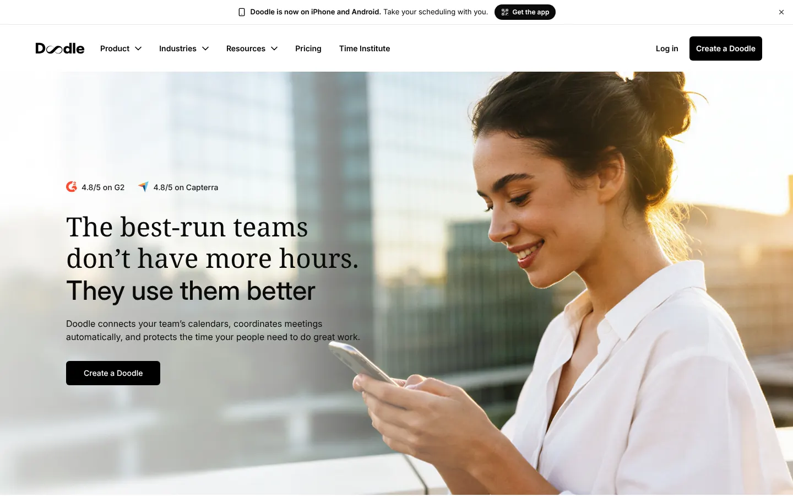
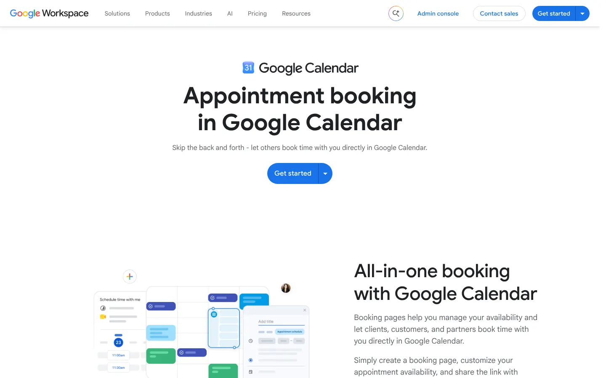
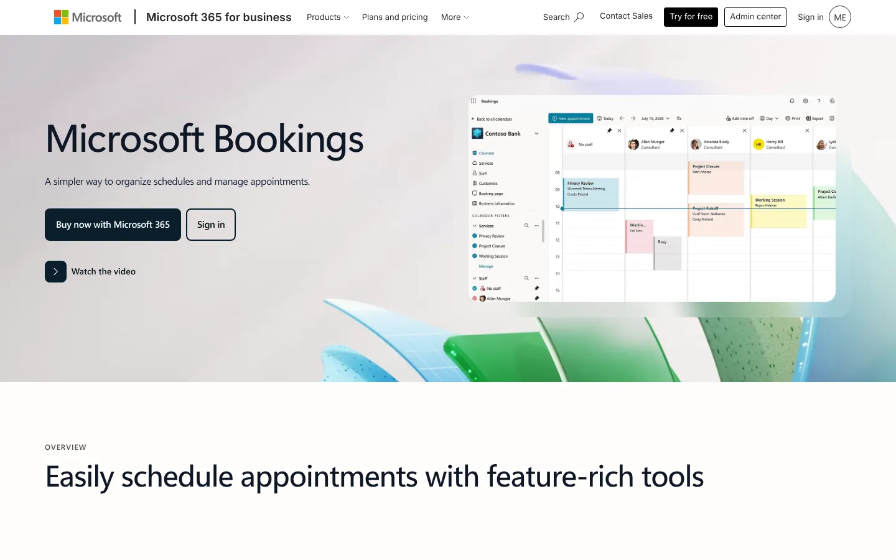
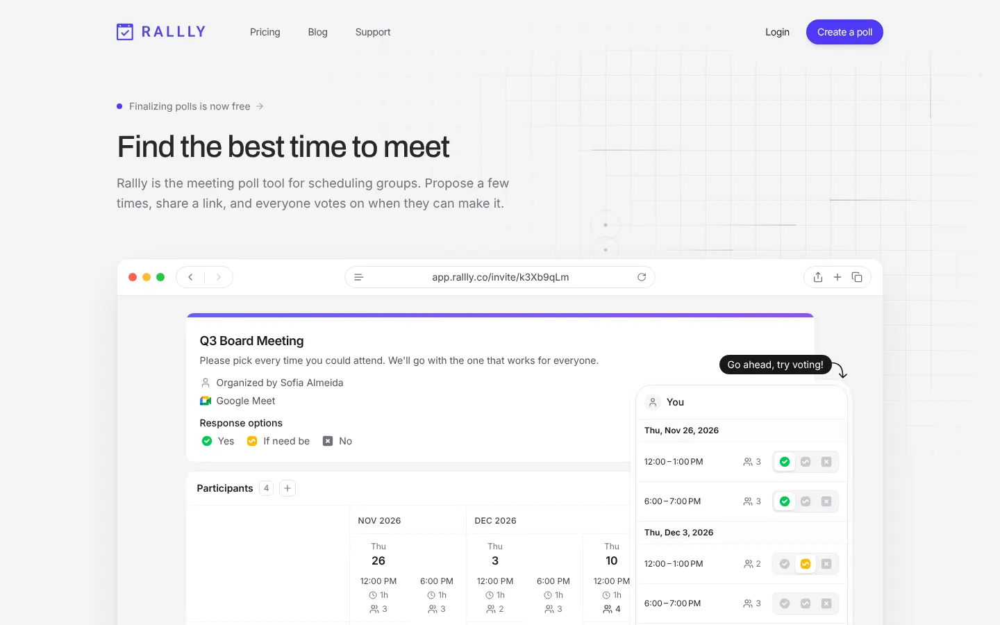

Setting up a meeting with one other person should take a minute. Instead it often takes five emails. You offer times, they offer others, and by the time you agree, one of the slots is gone. With a group, the thread gets longer and someone always gets left out.

A free meeting scheduler ends that thread. For one person, you send a link that shows only your open times. For a group, you send a poll and everyone marks what works. Most free plans do one of those jobs well, and only a few do both.

> **[Try Claritia free](https://app.tryclaritia.com/signup)** to share a link that books meetings on your calendar, with reminders a day and an hour before.

In this post, we compare 8 free meeting schedulers on the two jobs that matter when you meet with other people: booking one-on-one calls and finding one time for a group.

## Main points

- A free meeting scheduler does two jobs: a booking link for one-on-one calls, and a meeting poll to find one time with a group.
- For both jobs on one free plan, look at [Zcal](https://zcal.co/), [Calendly](https://calendly.com/) and [Doodle](https://doodle.com/en/). Zcal has the fewest limits.
- For group polls only, [Rallly](https://rallly.co/) is free, and nobody needs an account to create a poll or vote.
- Top picks: [Claritia](/), [Doodle](https://doodle.com/en/), [Zcal](https://zcal.co/), [Calendly](https://calendly.com/), [Cal.com](https://cal.com/), [Google Calendar appointment schedules](https://workspace.google.com/resources/appointment-scheduling/), [Microsoft Bookings](https://www.microsoft.com/en-us/microsoft-365/business/scheduling-and-booking-app) and [Rallly](https://rallly.co/).
- Pick [Claritia](/) if your meetings start on your website and you want your questions answered before the calendar opens.

## What is a free meeting scheduler?

A free meeting scheduler is a tool with a $0 plan and no end date that helps you agree on a time with other people. It checks your calendar, shows times that work, and puts the meeting on everyone's calendar once a time is picked.

There are three common formats, and many tools offer more than one:

- **Booking links.** You share a link, the other person picks one of your open times, and the meeting is booked. Best for one-on-one calls with clients, candidates or leads.
- **Meeting polls.** You suggest a few times, everyone votes, and you confirm the winner. Best for groups, where you need every answer before you pick.
- **Group events.** One time slot that several people can book, up to a limit. Best for classes, demos and info sessions.

Our guides to [free scheduling software](/blog/best-free-scheduling-software) and [free Calendly alternatives](/blog/free-calendly-alternatives) compare free booking pages for running a business. This post looks at a narrower job: getting a meeting on the calendar with other people, one or many, without paying.

## How to choose a free meeting scheduler

Start with who you meet with, then check these five things:

- **One person or a group.** One person at a time needs a booking link. A group that must agree needs a poll.
- **What guests must do.** The best tools let people book or vote without making an account.
- **The free cap.** One poll, one booking page, or three open polls. Find the limit you'll hit first.
- **Calendar checks.** A tool that reads your calendar won't offer a time you've already filled.
- **Time zones.** Guests should see times in their own time zone, so nobody does the math.

## The 8 best free meeting schedulers in 2026

Prices checked November 2026.

| Tool | Best for | Booking links on free | Group option on free | Paid from |
|---|---|---|---|---|
| [Claritia](/) | Booking from your website, with questions first | 1 meeting type | Polls and group meetings are on Starter | $12 a seat a month, billed yearly |
| [Doodle](https://doodle.com/en/) | One poll, one booking page and one sign-up sheet | 1 booking page and one 1:1 link | 1 group poll and 1 sign-up sheet | See their pricing page |
| [Zcal](https://zcal.co/) | Both jobs with the fewest limits | Unlimited links | Polls, and group events of up to 5 per slot | $7 a user a month, billed yearly |
| [Calendly](https://calendly.com/) | A familiar link plus polls | 1 event type | Meeting polls | $10 a seat a month, billed yearly |
| [Cal.com](https://cal.com/) | Unlimited links for one person | Unlimited links | Seats, so several people book one slot | $12 a user a month, billed yearly |
| [Google Calendar appointment schedules](https://workspace.google.com/resources/appointment-scheduling/) | Google Calendar users | 1 booking page | Guests can invite others | Eligible Google Workspace or Google One plan |
| [Microsoft Bookings](https://www.microsoft.com/en-us/microsoft-365/business/scheduling-and-booking-app) | Companies on Microsoft 365 | Personal booking page | Outlook's Scheduling Poll, for work accounts | Included in eligible Microsoft 365 plans |
| [Rallly](https://rallly.co/) | Free group polls with no sign-up | None, polls only | Polls, up to 3 open at once | $6 a seat a month, billed yearly |

## 1. Claritia

[Claritia](/) is a forms, scheduling and follow-up app built for small B2B teams that want every lead from their website to reach the right rep and book a meeting before they leave the page.

It builds forms from a sentence or one of 840 templates, opens the right person's calendar the moment the form is sent, routes each lead by its answers, and drafts follow-up emails in your brand's voice for you to approve.

Its free plan gives you one meeting type on one calendar, shown in each visitor's own time zone and language. People book from a link or at the end of a form, then get a calendar invite and reminders. Meeting polls, group meetings with a guest limit and one-off meetings come on Starter.

> **[Try Claritia free](https://app.tryclaritia.com/signup)** with no card, and share your first booking link today.

### Key features

- **Booking inside forms:** On the free plan, with name and email filled in from the form.
- **Time zone and language:** Times show in each visitor's own time zone and language on every plan.
- **Reminders on free:** A confirmation with a calendar invite, then reminders a day and an hour before.
- **Polls and groups on Starter:** Meeting polls, group meetings with a guest limit and single-use links.

### Pros

- **You know who's coming:** The form asks your questions before the calendar opens.
- **Fewer no-shows at $0:** Reminders and reschedule links come on the free plan.
- **Free teammates:** People who only build forms or read answers never need a seat.

### Cons

- **No polls on free:** Meeting polls and group meetings start on Starter.
- **One meeting type on free:** A second kind of meeting means Starter.
- **Newer tool:** Its marketplace is smaller, and Zapier and Make apps aren't listed yet.

### Price and plans

You can start on the free plan with no card. Paid plans are priced per seat, and a seat is a teammate people can book a meeting with.

- **Free:** $0 for 1 seat, with 1 meeting type on 1 calendar and 250 submissions a month.
- **Starter:** $15 a seat a month ($12 billed yearly). Adds unlimited meeting types, meeting polls and group meetings with a guest limit.
- **Pro:** $39 a seat a month ($31 billed yearly). Adds round robin, meetings with everyone free, and removes Claritia branding.
- **Business:** $79 a seat a month ($63 billed yearly). Adds owner first and unlimited submissions.

## 2. Doodle

[Doodle](https://doodle.com/en/) is a scheduling tool for people and teams who need to find a time with a group or let others book them from a link. Its group polls let you offer a few times, collect votes from anyone without a Doodle account, and send calendar invites when you confirm.

It also offers booking pages, one-to-one links and sign-up sheets, and it reads Outlook, Google and Apple calendars. Its free plan gives you one of each tool: one group poll, one booking page, one 1:1 link and one sign-up sheet. Doodle says everyone sees the poll times in their own time zone.

### Key features

- **Group polls:** Offer times, track who has replied, then confirm and send invites to everyone who answered.
- **Booking page:** Set your hours, buffers and a daily limit, then share one link.
- **Sign-up sheets:** Sessions with a cap on how many people can join each one.

### Pros

- **Every format in one account:** Polls, booking links and sign-up sheets on the free plan.
- **Easy for guests:** Voters only need the link.

### Cons

- **One of each on free:** A second poll or booking page means a paid plan.
- **Limits on free:** The free plan shows ads, and deadlines, reminders and polls with more than 20 time slots are paid features.

### Price and plans

- **Free:** $0, with one group poll, booking page, 1:1 link and sign-up sheet.
- **Pro:** Priced per seat, for one person. Adds unlimited polls and pages, deadlines, reminders, Zoom, Teams and Webex links, and no ads.
- **Team:** Priced per seat, for two or more people. Adds an admin console, co-hosts, custom branding and Stripe payments.
- **Enterprise:** From USD 15,000 a year.

Doodle's pricing page didn't show the Pro and Team prices when we checked, so confirm them there before you upgrade.

## 3. Zcal

[Zcal](https://zcal.co/) is a scheduling app for individuals, teams, and class hosts who want booking pages and meeting polls in one place. Booking pages can carry custom fonts, colors, layouts, welcome videos, and custom questions, and they sync with Google, Outlook, and Apple calendars.

Teams can use round robin and collective events, while group events, sign-up sheets, and polls handle classes and groups. It sends confirmations and reminders and connects to Zoom, Stripe, and Zapier.

At $0 it covers both jobs, with unlimited links, meeting polls and group events of up to 5 people per slot.

### Key features

- **Unlimited links:** Plus unlimited calendar accounts across Google, Outlook and Apple.
- **Meeting polls:** Unlimited meeting polls on the free plan.
- **Group events:** Up to 5 people per time slot on free, and no limit on paid plans.
- **Video links:** Zoom, Google Meet and Microsoft Teams on free.

### Pros

- **Both jobs free:** A booking link for one person and a poll for a group, in one free account.
- **No ads:** Zcal says its free plan has none.

### Cons

- **Branding stays:** Removing Zcal branding needs Pro.
- **One reminder:** Multiple email reminders and SMS reminders are on paid plans.

### Price and plans

- **Free:** $0 for one person.
- **Pro:** $7 a user a month, billed yearly. Adds teams, round robin, collective events and SMS reminders.
- **Business:** $12 a user a month, billed yearly. Adds custom domains and unlimited teams.

Both paid plans come with a 14-day free trial.

## 4. Calendly

[Calendly](https://calendly.com/) is scheduling software for professionals and teams who want people to book meetings without trading emails. You connect your calendars, set hours, buffers, and daily limits, and share booking links for one-on-one, multi-host, or group meetings.

It sends email and text reminders, offers routing forms that send website leads to the right teammate, and collects payments. Newer tools include an AI assistant that finds times over email and a notetaker that writes meeting recaps.

Its free plan gives one person one event type and one calendar connection. Meeting polls and one-off meetings are on every plan, Free included, so you can share a booking link and still run a vote for a group.

### Key features

- **One event type:** With one calendar connection and unlimited one-on-one meetings.
- **Meeting polls:** Polls and one-off meeting links on the free plan.
- **Group types on paid plans:** Group and collective meeting types start on Standard.

### Pros

- **Polls at $0:** A free way to settle a group time.
- **Quick sharing:** The browser extension puts your times one click away.

### Cons

- **No reminders on free:** Automations and reminders start on Standard.
- **One event type:** A second kind of meeting needs Standard.

### Price and plans

- **Free:** $0, with one event type and one calendar.
- **Standard:** $10 a seat a month, billed yearly.
- **Teams:** $16 a seat a month, billed yearly.
- **Enterprise:** From $15,000 a year, starting at 50 seats.

## 5. Cal.com

[Cal.com](https://cal.com/) is scheduling software for individuals and companies that want booking links they can shape around their own process. It syncs calendars, detects time zones, sends reminders, and runs video calls through Zoom, Google Meet, Microsoft Teams, or its own Cal Video.

Teams can use round robin, collective events where every host must be free, routing forms, and workflows, plus admin tools such as SAML SSO and audit logs. Its source code is published on GitHub.

Its free plan is for one user, with unlimited links and calendars, email and SMS notifications, and automatic time zone detection. You can also offer seats, so several people book the same slot.

### Key features

- **Unlimited links and calendars:** For one user.
- **Notifications:** Email and SMS on free.
- **Seats:** Let several people book one time slot.

### Pros

- **Text alerts at $0:** Few free plans send SMS.
- **Room to grow:** You can host the open code yourself.

### Cons

- **One user only:** Shared availability and round robin need Teams.
- **No collective events on free:** Meetings where every host must be free are a Teams feature.

### Price and plans

- **Free:** $0 for one user.
- **Teams:** $12 a user a month, billed yearly.
- **Organizations:** $28 a user a month, billed yearly.

## 6. Google Calendar appointment schedules

[Google Calendar appointment schedules](https://workspace.google.com/resources/appointment-scheduling/) is a booking feature built into Google Calendar for people who want others to pick an open time without leaving their own calendar. You set the length, hours, buffers, and daily limits, add booking form questions, and share a booking page link or embed it on a website.

It checks your calendars to prevent double bookings, sends confirmation emails, and on eligible paid accounts adds reminders, guest email checks, and Stripe payments. A personal Google account gets one booking page, where you set the hours, time zone and length of your appointments.

### Key features

- **One booking page:** With a personal Google account or Workspace Business Starter.
- **Meeting options:** Google Meet, in person, or a phone call.
- **Guest permissions:** You can let guests invite others to the meeting.

### Pros

- **Nothing to sign up for:** It's already in your Google account.
- **Local times for everyone:** Google Calendar shows each event in the local time zone of each person invited.

### Cons

- **Thin free version:** Reminders, more than one schedule, checks across calendars and payments need an eligible paid Google plan.
- **Browser only for setup:** You can't create a schedule in the phone app.
- **Other video tools by hand:** For Zoom or another service, you add the link to each booking yourself.

### Price and plans

- **Personal Google account:** Free, with one booking page.
- **Eligible Workspace or Google One plans:** Add the premium features. See Google's pricing page.

## 7. Microsoft Bookings

[Microsoft Bookings](https://www.microsoft.com/en-us/microsoft-365/business/scheduling-and-booking-app) is a scheduling app included with many Microsoft 365 business subscriptions, built for organizations that want customers or colleagues to book time without the back and forth. It offers personal booking pages for one person's availability and shared booking pages where teams define services, staff, and business hours.

Bookings works with Outlook calendars, creates a Microsoft Teams link for online appointments, sends email and text reminders, and stores its data in Exchange Online. If your company already pays for an eligible plan, it costs nothing extra.

For groups, Outlook's Scheduling Poll lets people vote on up to 15 times, suggested from everyone's free and busy times.

### Key features

- **Personal booking page:** Starts with 15 and 30 minute meeting types you can edit.
- **Teams meetings:** Each online booking gets its own Teams link.
- **Scheduling Poll:** People outside your company vote on a secure web page.

### Pros

- **Already paid for:** It comes with many Microsoft 365 business and enterprise plans.
- **No account for guests:** People can book without a Microsoft account.

### Cons

- **Not sold alone:** You need an eligible Microsoft 365 or Office 365 plan.
- **Work accounts only for polls:** Microsoft says Scheduling Poll isn't supported for Outlook.com consumer accounts.
- **No payments:** Microsoft says Bookings has no payment support.

### Price and plans

Microsoft lists Bookings in Microsoft 365 Business Basic, Business Standard and Business Premium, the E and F plans, and Teams Essentials and Teams Premium.

## 8. Rallly

[Rallly](https://rallly.co/) is an open-source meeting poll tool for groups that want to agree on one time without a long email thread. You propose a few times, share a link, and everyone marks the times they can make, with no account needed to create a poll or vote.

Each person sees the options in their own time zone. When you pick a time, Rallly emails a calendar invite to everyone. Its free plan has no cap on polls created or people voting, with up to 3 polls open at once.

### Key features

- **No sign-up:** Create a poll and vote on one without an account.
- **Time zones:** Options show in each participant's own time zone.
- **Calendar invites:** Finalize the poll and everyone gets an invite by email.

### Pros

- **Free for most groups:** No limit on participants.
- **Open source:** You can host it yourself with Docker.

### Cons

- **Polls only:** It has no booking page for one-on-one calls.
- **Short memory on free:** Polls are deleted once their dates are more than 30 days past and nobody has touched them for 30 days.

### Price and plans

- **Hobby:** Free, with up to 3 open polls.
- **Pro:** $6 a seat a month, billed yearly. Adds unlimited open polls, polls kept for good, custom branding and team spaces.

## Which free meeting scheduler should you pick?

- If your meetings start on your website and you want questions answered first, pick [Claritia](/).
- If you want booking links and polls in one free account with few limits, pick [Zcal](https://zcal.co/).
- If you need one link for clients and the odd group vote, pick [Calendly](https://calendly.com/) or [Doodle](https://doodle.com/en/).
- If you only need to settle a group time, pick [Rallly](https://rallly.co/).
- If your company already pays for Google Workspace or Microsoft 365, try [Google Calendar appointment schedules](https://workspace.google.com/resources/appointment-scheduling/) or [Microsoft Bookings](https://www.microsoft.com/en-us/microsoft-365/business/scheduling-and-booking-app) first.

## Questions

### What is the best free meeting scheduler?

It depends on who you meet with. Zcal covers booking links and polls for free with the fewest limits. Rallly is the simplest free poll. Claritia fits when bookings start on your website and you want a form before the calendar.

### Is there a free scheduler for group meetings?

Yes. Zcal and Calendly include meeting polls on free, Doodle includes one group poll, and Rallly lets you keep up to 3 polls open at once. In Claritia, meeting polls and group meetings with a guest limit start on Starter. See our guide to [group meeting schedulers](/blog/group-meeting-scheduler).

### Does Google Calendar have a free meeting scheduler?

Yes. A personal Google account can make one booking page with appointment schedules. Reminders, more schedules and payments need an eligible paid Google plan.

### Is Doodle still free?

Yes. Doodle's free plan includes one group poll, one booking page, one 1:1 link and one sign-up sheet. Unlimited polls and pages need Pro.

### Which free meeting scheduler handles time zones?

Several do. Doodle and Rallly show poll times in each person's time zone, Cal.com detects time zones on free, and Claritia shows the visitor's time zone and language on every plan. Our guide on how to [schedule meetings across time zones](/blog/schedule-meetings-across-time-zones) covers the rest.

## Get started

Pick the tool that fits how you meet: a link for one person, a poll for a group. If your meetings start on your website, put the booking at the end of a form.

> **[Try Claritia free](https://app.tryclaritia.com/signup)** to connect Google Calendar or Outlook and share your first booking link today.

You can also see how [Claritia Meetings](/products/meetings) works or compare [plans and prices](/pricing).
