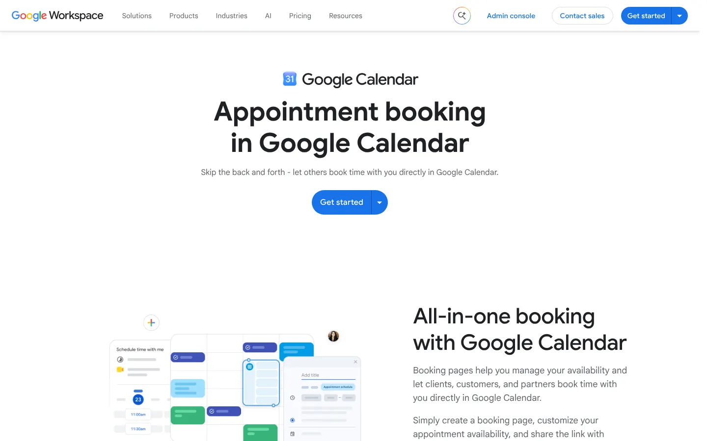
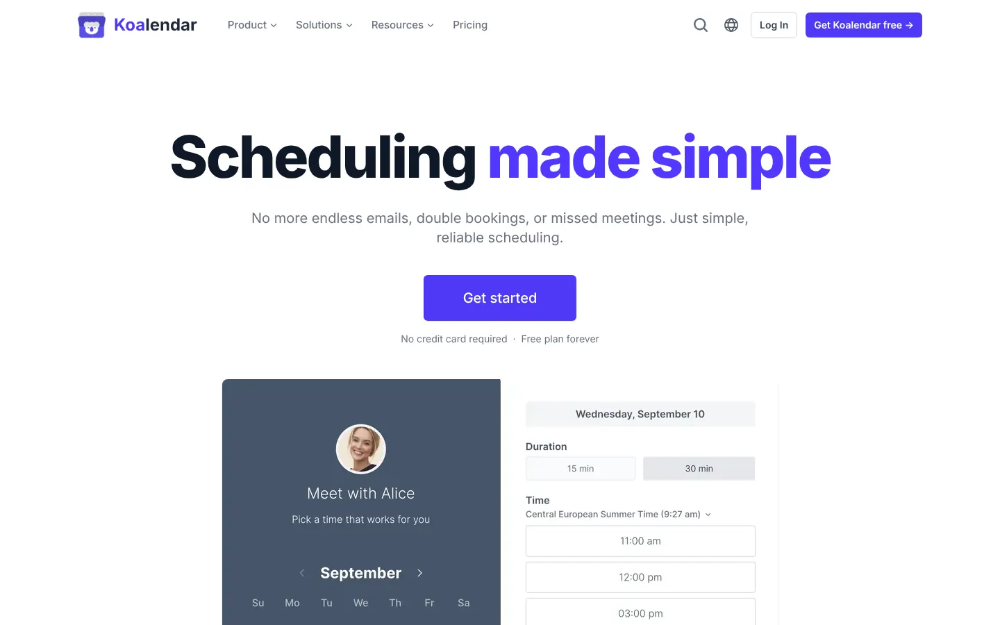
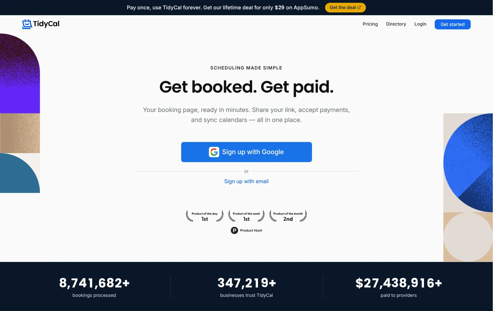
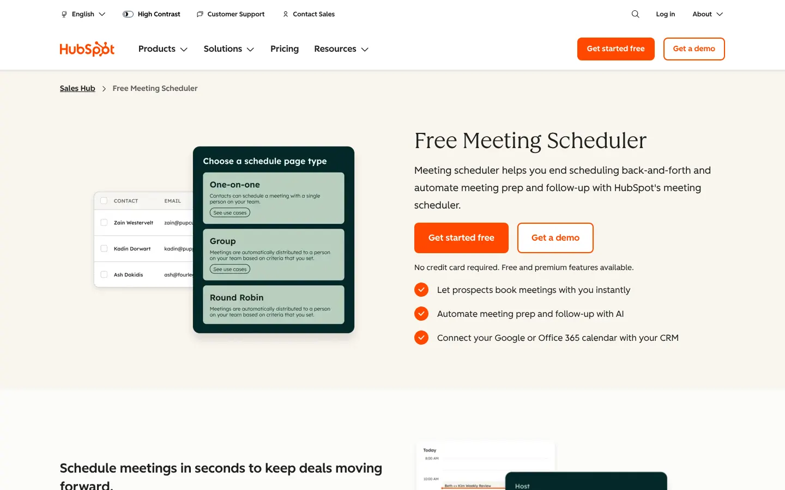
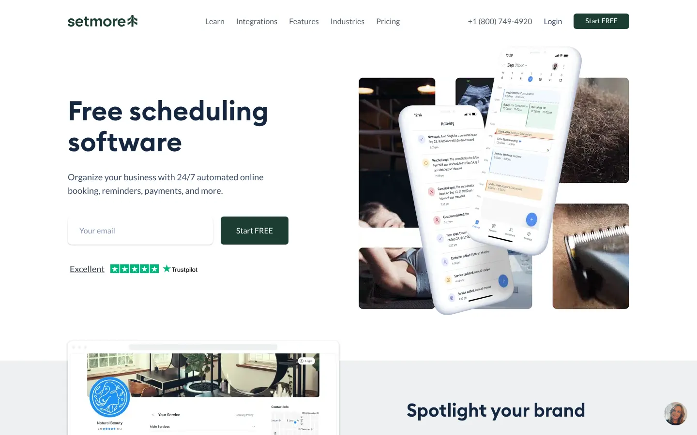

You can run real booking on a free plan today. Most scheduling tools offer one that never expires, and a few are generous enough for a solo business to use for years. The catch is that every free plan stops somewhere, and the stopping point is different in each tool.

So the useful question is which limit you will hit first. For some people it's the number of event types. For others it's a missing reminder that leads to a no-show. A good free plan stops at a limit you can live with.

> **[Try Claritia free](https://app.tryclaritia.com/signup)** to build a form that books meetings at no cost, with reminders a day and an hour before.

Below, we compare 9 free scheduling plans. For each one, we name the limit you'll hit first and what the next plan costs.

## Main points

- Every tool on this list has a free plan with no end date, and each one stops at a different limit.
- The first limit varies: one event type on Calendly, one user on Cal.com, one calendar on TidyCal.
- Reminders on free vary too. Claritia, Zcal and Cal.com send them, while Calendly and Koalendar keep them for paid plans.
- Top picks: [Claritia](/), [Google Calendar appointment schedules](https://workspace.google.com/resources/appointment-scheduling/), [Zcal](https://zcal.co/), [Cal.com](https://cal.com/), [Koalendar](https://koalendar.com/), [TidyCal](https://tidycal.com/), [Calendly](https://calendly.com/), [HubSpot Meetings](https://www.hubspot.com/products/sales/schedule-meeting) and [Setmore](https://www.setmore.com/).
- Pick [Claritia](/) if you want a lead form and a booking page in one free tool.

## What is free scheduling software?

Free scheduling software is a booking tool with a plan that costs $0 and has no end date. It gives you a booking page and puts each booking on your calendar. Trials that end after a few days or weeks don't count.

Typical features include:

- A booking page or link you can share.
- Sync with one or more calendars.
- A set number of event or meeting types.
- Reminders before each meeting, on some tools.
- A video link for online meetings.
- The tool's branding on your page, which paid plans often remove.

## How to choose free scheduling software

Every free plan looks generous on its pricing page. These five checks show what you really get:

- **Free forever.** A plan with no end date, with trials left out.
- **The first limit.** The cap most people run into, named plainly.
- **Reminders on free.** Whether the free plan sends any.
- **Branding.** Whether the tool's name stays on your page.
- **Cost of the next step.** What the first paid plan costs when you outgrow free.

## The 9 best free scheduling software plans in 2026

| Tool | Best for | Free plan | Paid from | Main free limit |
|---|---|---|---|---|
| [Claritia](/) | Booking from a form at no cost | Yes | $12 a seat a month billed yearly | 1 meeting type on 1 calendar |
| [Google Calendar appointment schedules](https://workspace.google.com/resources/appointment-scheduling/) | Google Calendar users | Yes | See their pricing page | Some features need a paid plan |
| [Zcal](https://zcal.co/) | The most features for one person | Yes | $7 a user a month | Zcal branding stays on |
| [Cal.com](https://cal.com/) | Unlimited links for one person | Yes | $12 a user a month, billed yearly | 1 user |
| [Koalendar](https://koalendar.com/) | Unlimited event types and languages | Yes | $6.99 a seat a month billed yearly | No reminders on free |
| [TidyCal](https://tidycal.com/) | Paid bookings with no monthly bill | Yes | $29 one time | 1 calendar |
| [Calendly](https://calendly.com/) | A simple, familiar link | Yes | $10 a seat a month billed yearly | 1 event type |
| [HubSpot Meetings](https://www.hubspot.com/products/sales/schedule-meeting) | HubSpot CRM users | Yes | See their pricing page | 1 personal link |
| [Setmore](https://www.setmore.com/) | Free booking for a staff of four | Yes | See their pricing page | Email reminders only |

## 1. Claritia

[Claritia](/) is a forms, scheduling and follow-up app built for small B2B teams that want every lead from their website to reach the right rep and book a meeting before they leave the page.

It builds forms from a sentence or one of 840 templates, opens the right person's calendar the moment the form is sent, routes each lead by its answers, and drafts follow-up emails in your brand's voice for you to approve.

Its free plan puts booking inside a form, with reminders and reschedule links included.

> **[Try Claritia free](https://app.tryclaritia.com/signup)** with no card, and get unlimited forms with booking inside them.

### Key features

- **Unlimited forms:** With 250 submissions a month on the free plan.
- **Booking inside forms:** With Google Calendar or Outlook and a video link for each meeting.
- **Reminders and links:** Reminders a day and an hour before, plus reschedule and cancel links.
- **AI form builder:** Tia builds a form from a plain sentence, with 100 AI credits a month on free.
- **Templates and spam checks:** 840 form templates and Cloudflare spam protection on free. Browse the [templates](/templates) to start from one.

*Caption: A Claritia form asks its questions first, then shows open times on the same page.*

### Pros

- **Form and booking for $0:** You learn who's coming before they pick a time.
- **Reminders on free:** No paid plan needed to cut no-shows.
- **Free teammates:** Teammates who only build forms or read answers never need a seat, even on paid plans.

### Cons

- **One meeting type on free:** The free plan has one calendar and one meeting type, so a second meeting type means Starter.
- **Newer tool:** Its app marketplace and community are smaller than the big names.

### Price and plans

You can start on the free plan with no card. Paid plans are priced per seat, and a seat is a teammate people can book a meeting with.

- **Free:** $0 for 1 seat, with 1 meeting type on 1 calendar and 250 submissions a month.
- **Starter:** $15 a seat a month ($12 billed yearly). Adds unlimited meeting types and up to 6 calendars per seat.
- **Pro:** $39 a seat a month ($31 billed yearly). Removes Claritia branding.
- **Business:** $79 a seat a month ($63 billed yearly). Adds unlimited submissions.

## 2. Google Calendar appointment schedules

[Google Calendar appointment schedules](https://workspace.google.com/resources/appointment-scheduling/) is a booking feature built into Google Calendar for people who want others to pick an open time without leaving their own calendar. You set the length, hours, buffers, and daily limits, add booking form questions, and share a booking page link or embed it on a website.

It checks your calendars to prevent double bookings, sends confirmation emails, and on eligible paid accounts adds reminders, guest email checks, and Stripe payments. It works with a personal Google account or a Workspace account, though some features need an eligible Workspace or Google One plan. It suits solo users who want booking inside the calendar they already use.

### Key features

- **One free booking page:** A personal Google account gets a basic booking page in Google Calendar.
- **Reminders on paid plans:** Google lists email reminders as a paid-plan feature.
- **Calendar checks on paid plans:** Checking your other calendars before showing a slot is a paid-plan feature too.
- **Payments on paid plans:** Stripe payments on bookings need an eligible paid plan.

### Pros

- **Nothing to set up:** No new account or app.
- **Free basics:** The basics come with a Google account.

### Cons

- **Browser only for setup:** You create schedules in a web browser. The phone app can't make them.
- **Thin free version:** Reminders, more than one schedule, calendar checks and payments all need a paid Google plan.

### Price and plans

- **Google account:** Free for the basics.
- **Workspace or Google One:** Some features need an eligible paid plan. See their pricing page.

## 3. Zcal

[Zcal](https://zcal.co/) is a scheduling app for individuals, teams, and class hosts who want booking pages and meeting polls in one place. Booking pages can carry custom fonts, colors, layouts, welcome videos, and custom questions, and they sync with Google, Outlook, and Apple calendars.

Teams can use round robin and collective events, while group events, sign-up sheets, and polls handle classes and groups. It sends confirmations and reminders and connects to Zoom, Stripe, and Zapier.

Its free plan is one of the fullest around for a single person, with unlimited links and calendar accounts and free meeting polls. Paid plans mainly add team features and text reminders, so a solo user can get polls and reminders without paying.

### Key features

- **Unlimited links:** Unlimited links and calendar accounts.
- **Polls and reminders:** Meeting polls and automated email reminders on free.
- **Group events:** Up to five people per slot.
- **Payments:** Stripe payments on free, with a 3% fee.

### Pros

- **Full free plan:** Polls, reminders and payments at $0.
- **Cheap next step:** Pro is $7 a user a month.

### Cons

- **Branding on free:** Zcal branding stays on the free plan.
- **Team tools cost more:** Round robin and webhooks start on Pro.

### Price and plans

Both paid plans come with a 14-day free trial.

- **Free:** $0 for one person, with Zcal branding.
- **Pro:** $7 a user a month.
- **Business:** $12 a user a month.

## 4. Cal.com

[Cal.com](https://cal.com/) is scheduling software for individuals and companies that want booking links they can shape around their own process. It syncs calendars, detects time zones, sends reminders, and runs video calls through Zoom, Google Meet, Microsoft Teams, or its own Cal Video.

Teams can use round robin, collective events where every host must be free, routing forms, and workflows, plus admin tools such as SAML SSO and audit logs. Its source code is published on GitHub.

Its free plan is built for one user, with unlimited links and calendars plus email and SMS notifications, and you can host the code yourself. Solo users and developers get the most from it.

### Key features

- **Unlimited links:** Unlimited links and calendars for one user.
- **Notifications:** Email and SMS notifications on free.
- **Payments:** Stripe and PayPal payments on free.
- **CRM sync:** Salesforce and HubSpot sync on free.

### Pros

- **Text notifications at $0:** SMS is on the free plan.
- **CRM sync at $0:** Salesforce and HubSpot sync without paying.

### Cons

- **One user:** Any team setup needs Teams.
- **Team booking costs more:** Routing forms and round robin start on Teams.

### Price and plans

- **Free:** $0 for one user.
- **Teams:** $16 a user a month, or $12 billed yearly.
- **Organizations:** $28 a user a month.

## 5. Koalendar

[Koalendar](https://koalendar.com/) is a scheduling app for small businesses, consultants, educators, and teams that want a simple booking page clients can use from any device. You create booking pages with your logo and colors, connect Google, Outlook, or iCloud calendars, and add custom questions.

It detects time zones, sends email and SMS reminders, supports group, collective, and round robin bookings, takes Stripe payments, and offers booking pages in many languages. You get unlimited booking pages and event types for free, with more than 30 languages and phone apps, which makes it a good pick for solo users who book several kinds of meetings.

### Key features

- **Unlimited pages:** Unlimited booking pages and event types.
- **Languages:** Pages in more than 30 languages.
- **Phone apps:** Plus an embeddable booking page.
- **Calendly import:** A one-click import of your Calendly events.

### Pros

- **Many meeting types at $0:** No cap on event types.
- **Easy move from Calendly:** The one-click import saves setup time.

### Cons

- **No reminders on free:** Email reminders start on Pro.
- **Free plan limits:** Free connects two calendars and keeps Koalendar branding.

### Price and plans

- **Free:** $0, with two calendars and Koalendar branding.
- **Pro:** $6.99 a seat a month billed yearly ($9.99 monthly).
- **Business:** $29 a month billed yearly for three seats ($36 monthly).

## 6. TidyCal

[TidyCal](https://tidycal.com/) is a booking tool for coaches, consultants, and solo service providers who want a simple booking page that also takes payment. You list each service as a booking type and connect a Google, Microsoft, or Apple calendar to avoid double bookings.

Clients can pay through Stripe or PayPal when they book, buy session packages or recurring sessions, and get automated email and SMS reminders. It is made by Sumo Group, the company behind AppSumo.

Its free plan covers unlimited booking types and paid bookings, and when you outgrow it you can pay once for a lifetime plan to keep costs flat. It suits solo pros who sell sessions and dislike subscriptions.

### Key features

- **Unlimited bookings:** Unlimited bookings and booking types.
- **Paid bookings:** Stripe and PayPal, with a 1% fee.
- **Group and package bookings:** On free.
- **Lifetime plans:** From $29 when you want more.

### Pros

- **Paid sessions at $0:** Take payment on the free plan.
- **Flat costs:** Lifetime plans are paid once.

### Cons

- **One calendar on free:** The free plan connects one calendar.
- **SMS costs more:** SMS reminders need Agency Lifetime or Pro.

### Price and plans

- **Free:** $0, with one calendar.
- **Individual Lifetime:** $29 once.
- **Agency Lifetime:** $79 once.
- **Pro:** $12 a month or $99 a year.

## 7. Calendly

[Calendly](https://calendly.com/) is scheduling software for professionals and teams who want people to book meetings without trading emails. You connect your calendars, set hours, buffers, and daily limits, and share booking links for one-on-one, multi-host, or group meetings.

It sends email and text reminders, offers routing forms that send website leads to the right teammate, and collects payments. Newer tools include an AI assistant that finds times over email and a notetaker that writes meeting recaps.

Its free plan, the one many people start with, gives you one event type with one calendar and a booking page you can shape. Most growing users move to Standard for more event types and reminders, so the free plan suits people who need one simple booking link.

### Key features

- **Booking page:** A customizable booking page on free.
- **Browser extension:** Share times from anywhere.
- **Room to grow:** Standard adds unlimited event types and reminders, for $10 a seat billed yearly.

### Pros

- **Familiar name:** Most of your clients already know it.
- **Quick sharing:** The browser extension puts your times one click away.

### Cons

- **One event type:** One event type and one calendar on free.
- **No reminders on free:** The free plan has no reminders or automations.

### Price and plans

- **Free:** $0, with one event type and one calendar.
- **Standard:** $10 a seat a month billed yearly.
- **Teams:** $16 a seat a month billed yearly.
- **Enterprise:** From $15,000 a year.

## 8. HubSpot Meetings

[HubSpot Meetings](https://www.hubspot.com/products/sales/schedule-meeting) is the meeting scheduler inside HubSpot's CRM, built for sales and service teams that want prospects to book time and have every meeting recorded. You connect a Google or Office 365 calendar, then share a booking link or embed it on a web page or in live chat.

It supports round robin and group meeting links, logs booked meetings on contact records, can start email sequences, and uses AI to prepare meeting context and follow-ups. It's part of HubSpot's free tools and books into the free CRM, so it's a natural first step for small sales teams that plan to grow into HubSpot.

### Key features

- **Free with the CRM:** Comes with HubSpot's free CRM.
- **Contacts and bookings together:** Bookings land next to your contacts.
- **More links on paid plans:** Up to 1,000 personal and team links.
- **No branding on paid plans:** Paid plans remove HubSpot branding.

### Pros

- **A first step into HubSpot:** Easy to grow into the rest of the CRM.
- **No copying:** Bookings sit next to each contact.

### Cons

- **One link on free:** One personal link, with HubSpot branding.
- **Team links cost more:** They need a paid Sales Hub plan.

### Price and plans

- **Free:** One personal link, with HubSpot branding.
- **Sales Hub plans:** Team links and no branding. See their pricing page.

## 9. Setmore

[Setmore](https://www.setmore.com/) is an online appointment scheduling app for service businesses and teams that want customers to book and pay without back-and-forth calls. Each business gets a branded booking page with its services, real-time availability and reviews, which it can share on its website, Facebook, Instagram or a QR code.

Setmore books one-on-one appointments and group classes, sends email and text reminders, adds Zoom or Google Meet links, syncs with Google Calendar and takes card payments. Its free plan lets up to four people take bookings, with unlimited appointments, phone apps and support from real people. That fits a small shop or studio with a few staff members.

### Key features

- **Four users free:** Up to four users on the free plan.
- **Unlimited appointments:** No booking cap.
- **Payments:** Online and in-person payments.
- **Phone apps:** For iOS and Android.

### Pros

- **A team on free:** Few free plans cover more than one person.
- **Real support:** Help from real people.

### Cons

- **Email reminders only:** Text reminders need a paid plan.
- **Unclear Pro price:** The pricing page shows more than one price for Pro, so confirm before you upgrade.

### Price and plans

- **Free:** $0 for up to four users.
- **Pro:** See their pricing page.

## Which free scheduling software should you pick?

- If you want a lead form and booking in one free tool, pick [Claritia](/).
- If you're one person and want the most features at $0, pick [Zcal](https://zcal.co/) or [Cal.com](https://cal.com/).
- If you live in Google Calendar and book simple calls, use its [appointment schedules](https://workspace.google.com/resources/appointment-scheduling/).
- If a few staff members share the booking page, start with [Setmore](https://www.setmore.com/).
- If you charge for sessions and want to avoid a monthly plan later, pick [TidyCal](https://tidycal.com/).

## Questions

### Is there scheduling software that's free forever?

Yes. Every tool on this list has a free plan with no end date. Each one stops at a different limit, such as one event type, one user or one calendar.

### Which free scheduling tool sends reminders?

Claritia sends reminders a day and an hour before on free. Zcal sends email reminders, and Cal.com sends email and SMS notifications. Calendly and Koalendar keep reminders for paid plans.

### Can a team use free scheduling software?

Setmore's free plan covers up to four users. Most others cover one person. In Claritia, teammates who only build forms or read answers are free on every plan.

### Which free tool removes its branding?

Most free plans keep the tool's name on your page. Removing it usually needs a paid plan. In Claritia, branding comes off on Pro.

### When should you upgrade from a free plan?

Upgrade when the free limit starts costing you bookings. That might be a second meeting type or a teammate who needs to take calls.

## Start free today

Pick the free plan whose first limit you can live with, and upgrade only when it starts costing you bookings.

> **[Try Claritia free](https://app.tryclaritia.com/signup)** to build your first booking form and take your first meeting today.

You can also see what each plan adds on the [pricing page](/pricing).
