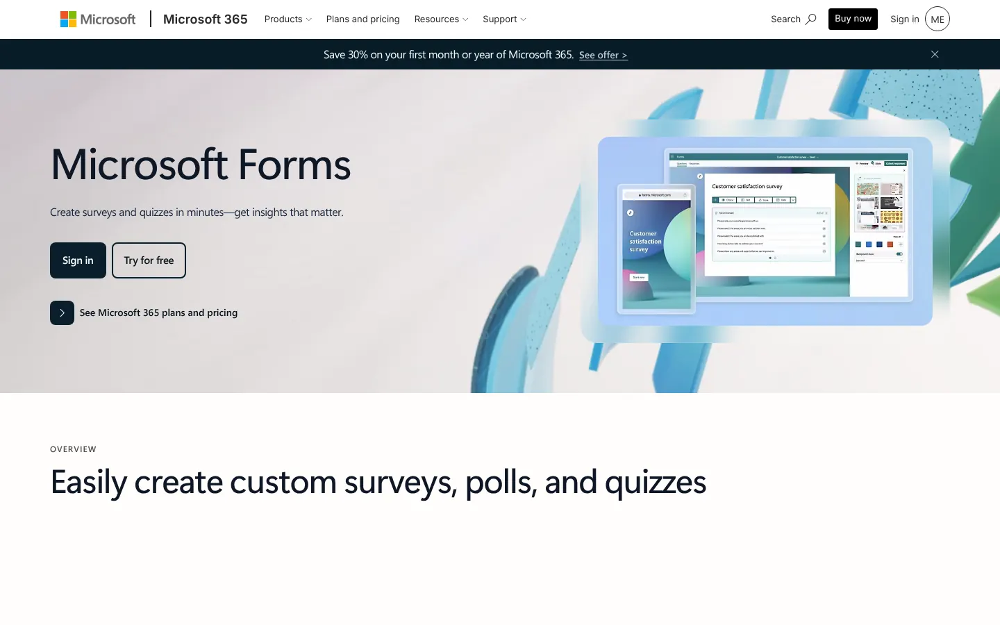
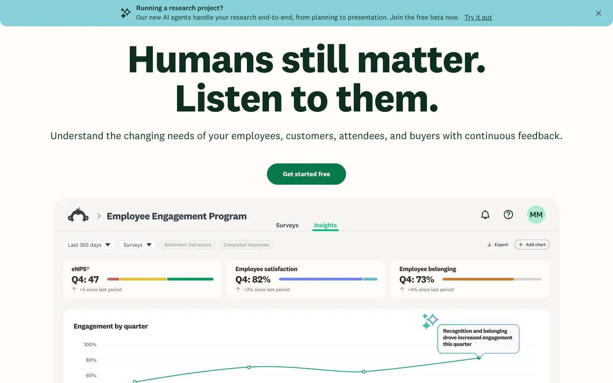

Google Forms does a lot for free. Anyone with a Google account can build a form in minutes, answers land in Google Sheets, and several people can edit a form together. For internal surveys and class quizzes, it's hard to beat.

Things change when a form faces your customers. You may want your own brand on it, logic that goes beyond sections, payments, or a way for a lead to book a call right after they answer. A good Google Forms alternative adds that next step.

> **[Try Claritia free](https://app.tryclaritia.com/signup)** to import your Google Forms for free and add a meeting booking step to each one.

In this post, we compare 9 Google Forms alternatives by design, logic, price and what happens after submit, with the pros and cons of each.

## Main points

- Google Forms is free and quick for internal surveys and quizzes. Forms that face customers often need more: your brand, logic beyond sections, payments or meeting booking.
- Every tool below has a free plan, and Claritia imports your Google Forms on its free plan.
- Check three things first: whether the form can look like your business, how far the logic goes, and what happens after submit.
- Top picks: [Claritia](/), [Tally](https://tally.so/), [Fillout](https://www.fillout.com/), [Microsoft Forms](https://www.microsoft.com/en-us/microsoft-365/online-surveys-polls-quizzes), [Typeform](https://www.typeform.com/), [Jotform](https://www.jotform.com/), [Paperform](https://paperform.co/), [Zoho Forms](https://www.zoho.com/forms/) and [SurveyMonkey](https://www.surveymonkey.com/).
- Pick [Claritia](/) if your forms collect leads and each one should end in a booked meeting.

## What is a Google Forms alternative?

A Google Forms alternative is a form builder you use in place of Google Forms. You build the form in the other tool, share it by link or on your site, and collect the answers there or in a spreadsheet.

Teams switch for three main reasons. They want forms that match their brand. They want logic and payments. Or they want something to happen right after submit, like a follow-up email or a booked meeting.

Typical features include:

- Design controls for fonts, colors and layout.
- Conditional logic that shows or skips questions based on answers.
- Payments and calculations.
- Links to Google Sheets and other tools.
- A way to bring your Google Forms across.
- Steps after submit, such as follow-up emails or meeting booking.

## How to choose a Google Forms alternative

Every tool here has a free plan, so price alone won't decide it. These five checks matter more:

- **Brand and design.** Whether the form can look like your business.
- **Logic.** Questions that change with each answer, beyond simple sections.
- **Lead follow-up.** Follow-up emails and meeting booking after submit.
- **Fair free plan.** Enough answers to try it for real before you pay.
- **Easy move.** How quickly you can bring your Google Forms across.

## The 9 best Google Forms alternatives in 2026

| Tool | Best for | Free plan | Paid from | Why switch from Google Forms |
|---|---|---|---|---|
| [Claritia](/) | Lead forms that book meetings | Unlimited forms, 250 submissions a month | $12 a seat a month, billed yearly | Imports Google Forms for free and adds booking |
| [Tally](https://tally.so/) | A free upgrade in feel | Unlimited forms and submissions (fair use) | $24 a month | Same $0 price, with payments and logic |
| [Fillout](https://www.fillout.com/) | Teams that build together | 1,000 responses a month | $15 a month, billed yearly | Unlimited seats and Google Sheets link |
| [Microsoft Forms](https://www.microsoft.com/en-us/microsoft-365/online-surveys-polls-quizzes) | Microsoft 365 users | Up to 200 responses per form | See their pricing page | Works with Excel and Teams |
| [Typeform](https://www.typeform.com/) | Branded customer forms | Yes, with a low response cap | $28 a month, billed yearly | One question at a time |
| [Jotform](https://www.jotform.com/) | Many kinds of forms | 5 forms, 100 submissions a month | $34 a month, billed yearly | Huge template library |
| [Paperform](https://paperform.co/) | Forms that read like a page | 30 submissions a month | $49 a month, billed yearly | Page-style design |
| [Zoho Forms](https://www.zoho.com/forms/) | Zoho users | 3 forms, 500 submissions a month | See their pricing page | Zoho CRM link |
| [SurveyMonkey](https://www.surveymonkey.com/) | Research surveys | Basic plan, 10 questions per survey | $39 a month, billed yearly | Survey analysis tools |

## 1. Claritia

[Claritia](/) is a forms, scheduling and follow-up app built for small B2B teams that want every lead from their website to reach the right rep and book a meeting before they leave the page. It builds forms from a sentence or one of 840 templates, opens the right person's calendar the moment the form is sent, routes each lead by its answers, and drafts follow-up emails in your brand's voice for you to approve. It picks up where Google Forms stops. You can import your Google Forms on the free plan and give each one smarter logic and a meeting booking step, and Tia, the AI form builder, drafts new forms from one plain sentence.

> **[Try Claritia free](https://app.tryclaritia.com/signup)** and bring your first Google Form across without retyping a question.

### Key features

- **Google Forms import:** On the free plan, so you keep your questions.
- **Logic:** Conditional logic and step skips, with calculations and hidden fields for UTM tags.
- **Styles and templates:** 18 form styles and 840 templates, with your own brand from Starter.
- **Booking inside the form:** Leads pick a time as soon as they answer, with reminders a day and an hour before.
- **Tia, the AI form builder:** Draft a new form from one plain sentence.

### Pros

- **Easy move:** Your Google Forms come across for free.
- **Logic for free:** Conditional logic and calculations are on every plan.
- **Fair seat pricing:** Teammates who only build forms or read answers are free.

### Cons

- **Newer tool:** Its app marketplace and community are smaller than Google's.
- **No mobile app:** There's no native mobile app.
- **No Zapier or Make apps yet:** They're on the way.

### Price and plans

You can start on the free plan with no card. Paid plans are priced per seat, and a seat is a teammate people can book a meeting with.

- **Free:** $0 for 1 seat and 250 submissions a month, with Google Forms import.
- **Starter:** $15 a seat a month ($12 billed yearly), with 2,000 submissions a month. Adds your own brand, Google Sheets and CRMs like HubSpot and Pipedrive.
- **Pro:** $39 a seat a month ($31 billed yearly), with 5,000 submissions a month. Adds round robin and routing by answer.
- **Business:** $79 a seat a month ($63 billed yearly), with unlimited submissions. Adds partial answers and Salesforce.

## 2. Tally

[Tally](https://tally.so/) is a form builder for individuals and teams who want to make forms by typing, much like writing in a document. You insert blocks for contact details, file uploads, ratings, signatures, and Stripe payments, then add conditional logic, calculations, hidden fields, and answer piping. Forms can be embedded or shown as popups, and submissions can go to Notion, Slack, Airtable, or Google Sheets. Tally is hosted in Europe and does not use cookie tracking. It keeps the best part of Google Forms, the $0 price, with unlimited forms and submissions under fair use and logic and payments for free. It suits people who want Google Forms' price with a nicer form.

### Key features

- **Unlimited forms:** Unlimited forms and submissions for free, under fair use.
- **Payments and calculations:** Both on the free plan.
- **Free integrations:** Links to Google Sheets and Notion.
- **Finish screens:** A custom thank-you page and redirect on completion at no cost.

### Pros

- **Still $0:** The same price as Google Forms, with more features.
- **Logic for free:** Logic is on the free plan.

### Cons

- **Free plan branding:** Free forms show Tally branding.
- **Teams cost more:** Team collaboration and custom domains need Pro.

### Price and plans

- **Free:** $0, unlimited forms and submissions under fair use.
- **Pro:** $24 a month, with two months off when you pay yearly.
- **Business:** $74 a month.

## 3. Fillout

[Fillout](https://www.fillout.com/) is a form builder for teams that want branded forms, surveys, and quizzes connected to the tools they already use. You can describe a form for its AI to build or use drag and drop, then add logic, file uploads, payments, and signatures. It also offers scheduling forms that sync with Google Calendar or Outlook, PDF generation, workflows, login forms that let people edit past answers, custom domains, and native integrations. It's a good fit if your team shares form work, like it does in Google Forms, since every plan has unlimited seats. The free plan takes 1,000 responses a month and links to Google Sheets, which suits teams that live in spreadsheets.

### Key features

- **Unlimited seats:** On every plan.
- **Big free plan:** 1,000 responses a month.
- **Logic and payments:** Both on the free plan.
- **Spreadsheet links:** Google Sheets and Airtable at no cost.

### Pros

- **Built for teams:** Everyone can build forms together, as in Google Forms.
- **Sheets for free:** Answers can still land in Google Sheets.

### Cons

- **Free plan branding:** Free forms carry a Fillout badge.
- **Partial submissions cost more:** They're a Business feature.

### Price and plans

- **Free:** $0, with 1,000 responses a month.
- **Starter:** $15 a month, billed yearly.
- **Pro:** $40 a month, billed yearly.
- **Business:** $75 a month, billed yearly.

## 4. Microsoft Forms

[Microsoft Forms](https://www.microsoft.com/en-us/microsoft-365/online-surveys-polls-quizzes) is a survey and quiz app in Microsoft 365 for schools, businesses and individuals who want to collect feedback or check what people know. Users build surveys, polls and quizzes with question types such as choice, text, rating and Likert, add branching logic and themes, and share the form by link. Built-in AI suggests questions and designs, results appear as answers come in, and a form can also be created from an Excel workbook. It's the closest match to Google Forms in spirit, simple and free with a Microsoft account. It fits teams that work in Microsoft 365, Excel and Teams, and business and school accounts get very high response limits.

### Key features

- **Free:** With a Microsoft account.
- **Excel:** Answers open in Excel.
- **Quizzes and polls:** Much like Google Forms.
- **High limits:** Up to 5,000,000 responses per form on business and school accounts.

### Pros

- **Familiar:** It works much like Google Forms, inside Microsoft 365.
- **Room to grow:** Very high response limits on business and school accounts.

### Cons

- **Free limit:** Free accounts take up to 200 responses per form.
- **Simple design:** Design and logic are about as simple as Google Forms.

### Price and plans

- **Free:** With a Microsoft account, up to 200 responses per form.
- **Business and school:** Comes with Microsoft 365. See their pricing page.

## 5. Typeform

[Typeform](https://www.typeform.com/) is an online form builder for marketing, product, HR, and customer teams that want forms, surveys, and quizzes people actually finish. It builds conversational forms that adapt to each answer, can draft and brand a form from a written prompt, and accepts video and audio replies. Responses can go to tools like HubSpot, Google Sheets, and Notion, take Stripe payments, book Calendly meetings, and feed AI summaries of themes and sentiment. It shows one question at a time with polished design that fits a brand, so it's the pick if you want your form to look nothing like a plain list of questions. You'll pay more for it, and each plan caps responses.

### Key features

- **One-question layout:** Shows one question at a time.
- **Design:** Strong design controls and many templates.
- **Logic:** Sends people down different paths.
- **Users:** Up to 5 users on Business.

### Pros

- **Brand-ready forms:** Polished design that fits a brand.
- **Smart paths:** Logic changes the questions for each person.

### Cons

- **Tight Basic plan:** 100 responses a month and 1 user.
- **Low free cap:** The free plan has a low response cap.

### Price and plans

- **Basic:** $28 a month billed yearly ($39 monthly).
- **Plus:** $56 a month, billed yearly.
- **Business:** $91 a month, billed yearly.

## 6. Jotform

[Jotform](https://www.jotform.com/) is a drag and drop form builder for businesses, schools, nonprofits, and public agencies that want to collect data, payments, and signatures without writing code. Forms can use conditional logic, answer piping, prefilled fields, and translations, and they accept one-time or recurring payments through many gateways. Submissions can become PDFs, flow into CRMs and spreadsheets, and be managed in related Jotform tools for tables, approval workflows, e-signatures, and reports. It covers far more form types than Google Forms, with a very large template library and widgets for special fields. It's a single-user tool below Enterprise, so it suits solo builders who need special fields and templates.

### Key features

- **Templates:** A very large template library.
- **Widgets:** Many widgets for special fields like signatures and payments.
- **Mobile apps:** For filling and managing forms.
- **HIPAA features:** On Gold and Enterprise.

### Pros

- **Range:** It covers far more form types than Google Forms.
- **Forms on the go:** Mobile apps for filling and managing forms.

### Cons

- **Small free plan:** It stops at 5 forms and 100 submissions a month.
- **Single user:** Plans below Enterprise are for one user.

### Price and plans

- **Free:** 5 forms and 100 submissions a month.
- **Bronze:** $34 a month billed yearly ($39 monthly).
- **Silver:** $39 a month, billed yearly.
- **Gold:** $99 a month, billed yearly.

## 7. Paperform

[Paperform](https://paperform.co/) is an online form builder for small businesses and solo operators who want one form to capture details, take payment, and start the next step. Its editor works like a document, with a one question at a time mode, conditional logic, and spreadsheet style formulas for prices and scores. Forms can take bookings and Stripe payments, send contracts for e-signature through Papersign, and pass submissions to CRMs, email tools, and spreadsheets through integrations or Stepper workflows. You can mix text and images with your questions, so the form reads like a web page, which helps when it needs to sell or explain an offer. Every plan has unlimited users.

### Key features

- **Page-style editor:** Room for content around your questions.
- **Unlimited users and forms:** On every plan.
- **Unlimited submissions:** On paid plans, under fair use.
- **Free trial:** 7 days with no card needed.

### Pros

- **Room to explain:** Text and images sit between your questions.
- **Whole team included:** Unlimited users on every plan.

### Cons

- **Small free plan:** It takes 30 submissions a month.
- **Higher price:** Paid plans start higher than most here.

### Price and plans

- **Free:** 30 submissions a month.
- **Pro:** $49 a month billed yearly, or $59 billed monthly.
- **Business:** $124 a month billed yearly, or $149 billed monthly.

## 8. Zoho Forms

[Zoho Forms](https://www.zoho.com/forms/) is an online form builder for businesses that want to collect data and move it through review and approval steps without code. It can build a form from a prompt, turn PDFs or photos of paper forms into online forms, and read business cards or IDs to fill in fields. Forms support many field types, subforms, payments, and multi-level approvals, a mobile app collects entries offline, and data can flow into Zoho CRM. It's a solid step up for teams on Zoho apps. Paid plans have unlimited forms and high caps, from 10,000 submissions a month on Basic.

### Key features

- **Zoho CRM:** A close link with Zoho CRM.
- **Unlimited forms:** On paid plans.
- **High limits:** 10,000 submissions a month on Basic.
- **Users:** Up to 10 users on Standard.
- **Mobile app:** For collecting answers on the go.

### Pros

- **High caps:** Plenty of room on paid plans.
- **Zoho fit:** Works closely with Zoho CRM.

### Cons

- **Small free plan:** 3 forms and 1 user.
- **Best inside Zoho:** It fits best inside the Zoho world.

### Price and plans

- **Free:** 3 forms, 500 submissions a month and 1 user.
- **Basic:** 10,000 submissions a month.
- **Standard:** Up to 10 users.

For prices, see their pricing page.

## 9. SurveyMonkey

[SurveyMonkey](https://www.surveymonkey.com/) is an online survey platform for teams that want to gather feedback from customers, employees and target markets and act on what they learn. Users build surveys and forms from templates, expert-written questions or a short AI prompt, add skip logic and branding, and send them by link, email, text message, QR code or website embed. It summarizes results with charts and AI-sorted themes for open answers, and it can reach a global panel of paid respondents. It's the pick if you use Google Forms mainly for surveys and want deeper results, and it's built for customer feedback and research more than for lead forms.

### Key features

- **Survey analysis:** Tools for reading results.
- **Yearly responses:** 15,000 responses a year on Advantage.
- **Team plans:** For 3 or more users.
- **Extra responses:** $0.15 each on paid plans.

### Pros

- **Deeper results:** Tools to read and share what people said.
- **Room for teams:** Team plans cover 3 or more users.

### Cons

- **Tight free plan:** Basic allows 10 questions per survey and limited responses.
- **Costly monthly plan:** Standard costs $149 a month for 1,000 responses.

### Price and plans

- **Basic:** Free, with 10 questions per survey and limited responses.
- **Standard:** $149 a month billed monthly, for 1,000 responses.
- **Advantage:** $39 a month billed yearly ($468 a year), with 15,000 responses a year.
- **Premier:** $139 a month, billed yearly.

## Which Google Forms alternative should you pick?

- If your forms collect leads and should book calls, pick [Claritia](/). You can import your Google Forms on the free plan.
- If you want to keep paying $0, pick [Tally](https://tally.so/).
- If your team builds forms together, pick [Fillout](https://www.fillout.com/).
- If your company runs on Microsoft 365, pick [Microsoft Forms](https://www.microsoft.com/en-us/microsoft-365/online-surveys-polls-quizzes).
- If you run surveys more than lead forms, pick [SurveyMonkey](https://www.surveymonkey.com/).

## Questions

### Can you move your Google Forms to another tool?

Yes. Claritia imports Google Forms on its free plan, so your questions come across without retyping. Then you can add logic and a meeting booking step.

### What is the best free alternative to Google Forms?

Tally is the best free alternative for volume, with unlimited forms and submissions under fair use. Claritia is the best free pick if you want forms that book meetings.

### Which Google Forms alternatives work with Google Sheets?

Tally and Fillout link to Google Sheets on their free plans. Claritia sends answers to Google Sheets from Starter, along with CRMs like HubSpot and Pipedrive.

### Is Microsoft Forms better than Google Forms?

They're very alike. Microsoft Forms fits teams on Microsoft 365 and Excel, while Google Forms fits teams on Google Workspace and Sheets.

### Can Google Forms book meetings?

Google Forms has no built-in meeting booking. Claritia books meetings inside the form, linked to Google Calendar or Outlook with a video link.

## Get started

Import your Google Forms into Claritia for free, then add a booking step so leads pick a time as soon as they answer.

> **[Try Claritia free](https://app.tryclaritia.com/signup)** to bring your first form across and book your first meeting today.

You can also see how it works with [Google Calendar](/integrations/google-calendar).
