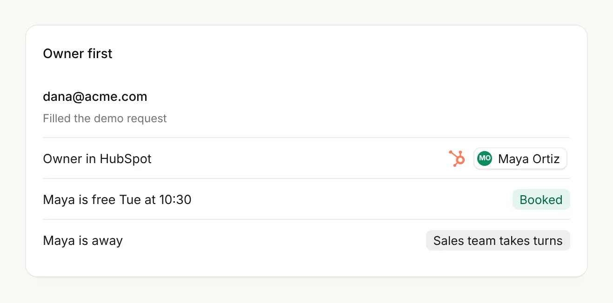
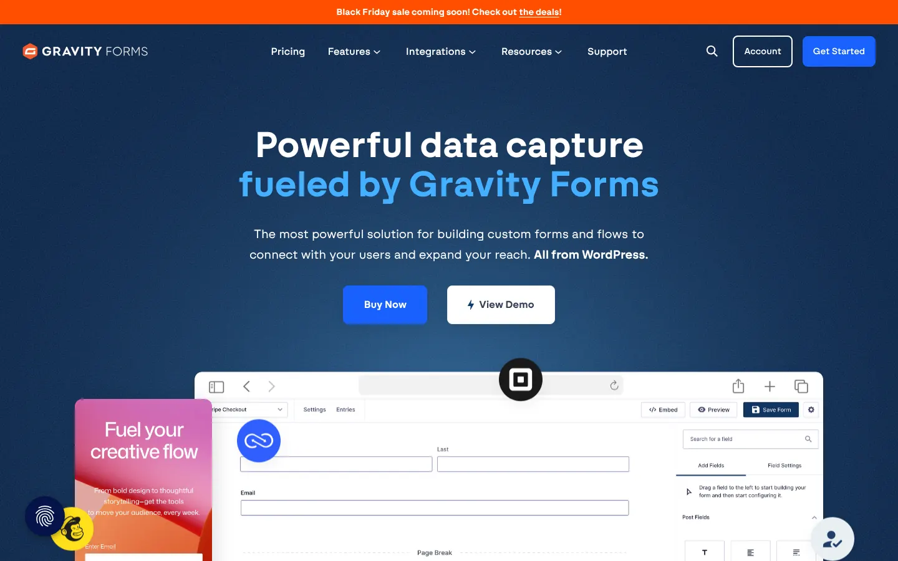
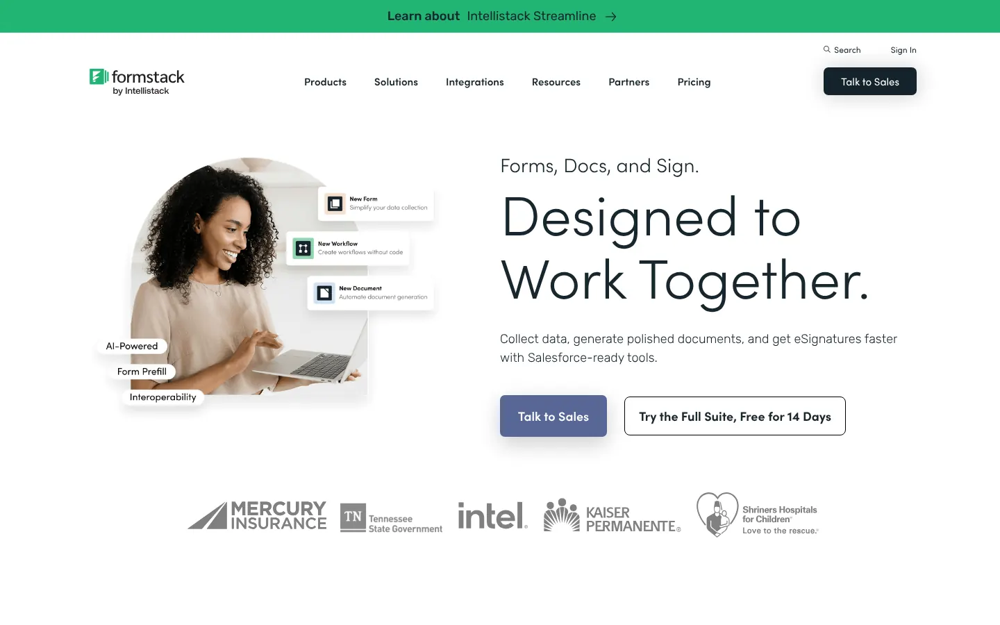

HubSpot forms are a fine place to start. The builder is free, and every person who fills in a form lands in your HubSpot CRM. The trouble starts when you want more.

Conditional logic and multi-step forms sit on HubSpot's premium plans, design control is limited, and a lead who fills in your form still has to go find a time to talk.

A good HubSpot Forms alternative keeps your leads flowing into HubSpot and fills the gap that bothers you most.

> **[Try Claritia free](https://app.tryclaritia.com/signup)** to build a form that sends each lead to HubSpot and books the meeting before they leave the page.

Below, we compare 8 form builders that work with HubSpot: how each one connects, what it costs and where it falls short.

## Main points

- HubSpot's free forms add contacts to your CRM, but conditional logic and multi-step forms need a paid HubSpot plan.
- Every tool below sends answers to HubSpot, either through a native connection, an add-on, or Zapier.
- Check three things first: how the tool connects to HubSpot, whether logic is on the plan you'd buy, and what happens after someone hits submit.
- Top picks: [Claritia](/), [Fillout](https://www.fillout.com/), [Typeform](https://www.typeform.com/), [Jotform](https://www.jotform.com/), [Paperform](https://paperform.co/), [Gravity Forms](https://www.gravityforms.com/), [Formstack](https://www.formstack.com/) and [Tally](https://tally.so/).
- Pick [Claritia](/) if you want each form to book a meeting and send the lead to HubSpot in one step.

## What is a HubSpot Forms alternative?

A HubSpot Forms alternative is a form builder you use in place of HubSpot's own forms while keeping HubSpot as your CRM. You build the form in the other tool, put it on your site, and each answer is sent to HubSpot as a contact, a deal or a ticket.

Teams switch for three main reasons. They want logic and multi-step forms without a bigger HubSpot plan. They want forms that match their brand. Or they want something to happen right after submit, like a booked meeting or a payment.

Most of them have:

- A native HubSpot connection, or one through Zapier or Make.
- Field mapping, so each question fills the right HubSpot property.
- Conditional logic that shows or skips questions based on answers.
- Hidden fields that keep UTM tags and the page a lead came from.
- Design controls for fonts, colors and layout.
- Extras such as payments, file uploads, e-signatures or meeting booking.

## How to choose a HubSpot Forms alternative

Price matters, but it's rarely the reason a switch goes wrong. These five checks matter more:

- **A real HubSpot connection.** A native connection is simpler and breaks less often than a Zapier step in the middle.
- **Logic on the plan you'd buy.** Some tools list conditional logic as a feature but put it on a higher plan.
- **What HubSpot records it creates.** Most tools create contacts. A few can also open deals or tickets.
- **What happens after submit.** A thank-you page, a booked meeting, a payment or a follow-up email.
- **Clear pricing.** A plan you can read without a sales call, and a fair limit on monthly responses.

## The 8 best HubSpot Forms alternatives in 2026

| Tool | Best for | Free plan | Paid from | How it connects to HubSpot |
|---|---|---|---|---|
| [Claritia](/) | Forms that book meetings and send leads to HubSpot | Yes, 250 submissions a month | $12 a seat a month, billed yearly | Native connection on Starter |
| [Fillout](https://www.fillout.com/) | A free plan with HubSpot included | Yes, 1,000 responses a month | $15 a month, billed yearly | Native, on every plan |
| [Typeform](https://www.typeform.com/) | Brand-led forms | Yes, with a low response cap | $28 a month, billed yearly | Maps questions to HubSpot properties |
| [Jotform](https://www.jotform.com/) | Creating more than contacts | Yes, 5 forms and 100 submissions | $34 a month, billed yearly | Creates contacts, deals, tickets and companies |
| [Paperform](https://paperform.co/) | Forms that read like pages | Yes, 30 submissions a month | $49 a month, billed yearly | Direct integration that creates or updates contacts |
| [Gravity Forms](https://www.gravityforms.com/) | WordPress sites | No free version | $59 a year | HubSpot add-on from the Basic license |
| [Formstack](https://www.formstack.com/) | Larger teams with document needs | No, 14-day trial | $83 a month, billed yearly | Featured integration among 300+ |
| [Tally](https://tally.so/) | Free forms with no submission cap | Yes, unlimited within fair use | $24 a month, billed monthly | Through Zapier or Make |

## 1. Claritia

[Claritia](/) is a forms, scheduling and follow-up app built for small B2B teams that want every lead from their website to reach the right rep and book a meeting before they leave the page.

It builds forms from a sentence or one of 840 templates, opens the right person's calendar the moment the form is sent, routes each lead by its answers, and drafts follow-up emails in your brand's voice for you to approve.

Its forms send leads to HubSpot on the Starter plan, and workflows send reminders and a follow-up the next day until the lead books.

> **[Try Claritia free](https://app.tryclaritia.com/signup)** and connect HubSpot in one click on Starter.

### Key features

- **HubSpot connection:** Each form fill becomes a HubSpot contact on Starter. See the [HubSpot integration](/integrations/hubspot).
- **Booking inside the form:** The right person's calendar opens as soon as the form is sent, with Google Calendar and Outlook on every plan.
- **Conditional logic:** Show-if logic and page skips on the free plan.
- **Routing:** On Pro, route by any answer to a meeting and a person. On Business, owner first books the lead with their HubSpot owner.
- **AI form builder:** Describe the form in a sentence, or start from one of 840 templates.
- **Hidden fields:** Keep UTM tags, the page and the referrer with each lead.

*With owner first, a lead whose HubSpot owner is Maya books with Maya, and the sales team takes turns when she is away.*

### Pros

- **One step from form to meeting:** The lead fills in the form and books a time in the same flow.
- **Logic for free:** Conditional logic and calculations are on every plan.
- **Fair seat pricing:** Teammates who only build forms or read answers are free.

### Cons

- **Newer tool:** Its app marketplace and community are smaller than the big names.
- **No Zapier or Make apps yet:** They're on the way and are yet to be listed.

### Price and plans

You can start on the free plan with no card. Paid plans are priced per seat, and a seat is a teammate people can book a meeting with.

- **Free:** $0 for 1 seat and 250 submissions a month.
- **Starter:** $15 a seat a month ($12 billed yearly). Adds HubSpot, e-signatures and Stripe payments.
- **Pro:** $39 a seat a month ($31 billed yearly). Adds round robin and routing by answer.
- **Business:** $79 a seat a month ($63 billed yearly). Adds Salesforce, partial answers and owner first.

## 2. Fillout

[Fillout](https://www.fillout.com/) is a form builder for teams that want branded forms, surveys, and quizzes connected to the tools they already use. You can describe a form for its AI to build or use drag and drop, then add logic, file uploads, payments, and signatures.

It also has scheduling forms that sync with Google Calendar or Outlook, PDF generation, workflows, login forms that let people edit past answers, custom domains, and native integrations.

HubSpot is one of the integrations on every plan, the free one too. The free plan also gives you 1,000 responses a month with unlimited forms and seats, more than most tools on this list.

### Key features

- **HubSpot on every plan:** The native connection is included on the free plan.
- **Conditional logic:** Available on all plans.
- **Scheduling forms:** Forms that let people pick a time, on all plans.
- **Partial submissions:** Save answers from people who leave early, on Business.

### Pros

- **Big free plan:** 1,000 responses a month with unlimited forms and seats.
- **HubSpot without an upgrade:** No paid plan needed to send leads to HubSpot.

### Cons

- **Free plan branding:** Free forms show a Fillout badge and have no CAPTCHA.
- **Salesforce costs more:** Salesforce is only on the Team and Enterprise plans, if you ever move CRMs.

### Price and plans

- **Free:** $0, with 1,000 responses a month.
- **Starter:** $15 a month, billed yearly.
- **Pro:** $40 a month, billed yearly.
- **Business:** $75 a month, billed yearly.

## 3. Typeform

[Typeform](https://www.typeform.com/) is an online form builder for marketing, product, HR, and customer teams that want forms, surveys, and quizzes people actually finish. It builds conversational forms that adapt to each answer, can draft and brand a form from a written prompt, and accepts video and audio replies.

Responses can go to tools like HubSpot, Google Sheets, and Notion, take Stripe payments, book Calendly meetings, and feed AI summaries of themes and sentiment. It gives you strong design control, and its HubSpot integration lets you map any question to a HubSpot property, so answers sync to your HubSpot records. Zapier workflows cover more HubSpot actions.

### Key features

- **HubSpot field mapping:** Map any question to a HubSpot property.
- **One-question layout:** A conversational format that suits short lead forms.
- **AI tools:** AI builds forms and asks a follow-up question when an answer is vague.
- **Conditional logic:** Available from the Basic plan.

### Pros

- **Design control:** Forms look polished and match your brand.
- **Flexible mapping:** Any question can fill any HubSpot property.
- **Zapier for more:** Extra HubSpot actions through Zapier workflows.

### Cons

- **Low response cap:** The Basic plan allows 100 responses a month.
- **Unclear plan limits:** Typeform's HubSpot page doesn't say which plans include the integration.

### Price and plans

- **Basic:** $28 a month, billed yearly.
- **Plus:** $56 a month, billed yearly.
- **Business:** $91 a month, billed yearly.

## 4. Jotform

[Jotform](https://www.jotform.com/) is a drag and drop form builder for businesses, schools, nonprofits, and public agencies that want to collect data, payments, and signatures without writing code.

Forms can use conditional logic, answer piping, prefilled fields, and translations, and they accept one-time or recurring payments through many gateways. Submissions can become PDFs, flow into CRMs and spreadsheets, and be managed in related Jotform tools for tables, approval workflows, e-signatures, and reports.

Its HubSpot integration goes past contacts. Its help pages list actions to create a contact, a deal, a ticket, a company or a custom record from a form, which helps if your form starts a sales or support process in HubSpot.

### Key features

- **More HubSpot records:** Create contacts, deals, tickets, companies or custom records from a submission.
- **Conditional logic:** Included on the free plan.
- **AI form generator:** Free to use.
- **Large template library:** Ready-made forms for most uses.

### Pros

- **Deals and tickets:** Good fit when a form should open a sales or support process.
- **Logic for free:** Conditional logic on the free Starter plan.

### Cons

- **Small free plan:** 5 forms and 100 submissions a month.
- **Single user:** Paid plans are for one user until Enterprise.

### Price and plans

- **Starter:** Free, with 5 forms and 100 submissions a month.
- **Bronze:** $34 a month, billed yearly.
- **Silver:** $39 a month, billed yearly.
- **Gold:** $99 a month, billed yearly.

## 5. Paperform

[Paperform](https://paperform.co/) is an online form builder for small businesses and solo operators who want one form to capture details, take payment, and start the next step. Its editor works like a document, with a one question at a time mode, conditional logic, and spreadsheet style formulas for prices and scores.

Forms can take bookings and Stripe payments, send contracts for e-signature through Papersign, and pass submissions to CRMs, email tools, and spreadsheets through integrations or Stepper workflows.

Its direct HubSpot integration creates or updates a contact, and its forms look like web pages, with text and images between questions. Only HubSpot properties marked for use in forms show up in its settings, so check those in HubSpot first.

### Key features

- **HubSpot integration:** Creates or updates contacts directly.
- **Page-style forms:** Mix text, images and questions on one page.
- **Appointment field:** Book times with Google Calendar sync, on every plan.
- **AI form creation:** On every plan.

### Pros

- **Room to explain:** Good for service businesses that need to describe the offer.
- **Logic on all plans:** Conditional logic is included everywhere.

### Cons

- **Tiny free plan:** 30 submissions a month.
- **Partial responses cost more:** They need Pro or higher.

### Price and plans

- **Pro:** $49 a month billed yearly, or $59 billed monthly.
- **Business:** $124 a month billed yearly, or $149 billed monthly.

## 6. Gravity Forms

[Gravity Forms](https://www.gravityforms.com/) is a form plugin for WordPress professionals and site owners who want to build anything from a simple contact form to a multi-step workflow on their own site. Its visual editor has many field types, multi-page layouts, conditional logic, calculations and save and continue.

It can take payments through Stripe, Square and other processors, register users, create posts from entries, route notifications based on answers, and send data to other tools through a REST API and webhooks.

A HubSpot add-on comes with the Basic license, so entries stay in your WordPress database and go to HubSpot as well, and conditional logic is included on every license.

### Key features

- **HubSpot add-on:** Included from the Basic license.
- **Conditional logic:** On every license.
- **Partial Entries:** Save unfinished forms, on Elite.
- **Salesforce:** On Elite, if you need both CRMs.

### Pros

- **Your own data:** Entries stay in your WordPress database.
- **Mature plugin:** Logic and add-ons for most WordPress needs.

### Cons

- **No free version:** And no trial.
- **WordPress only:** It doesn't work on other site builders.

### Price and plans

- **Basic:** $59 a year for 1 site.
- **Pro:** $159 a year for 3 sites.
- **Elite:** $259 a year.

## 7. Formstack

[Formstack](https://www.formstack.com/) is a no-code platform for organizations that want to collect data, create documents and gather signatures without manual paperwork. Its form builder has AI form creation, prefilled links, branded themes, step logic and group approvals, and it sends submissions into CRMs and other business systems.

Separate products generate documents from the data a form collects and capture eSignatures, and versions of its forms and documents run inside Salesforce. It is aimed at larger teams, with documents and e-signatures in its Suite plan. Among more than 300 integrations, it lists HubSpot as a featured one. Its Salesforce Solutions plan adds more Salesforce options.

### Key features

- **HubSpot integration:** Listed as a featured integration.
- **300+ integrations:** Connects to most business tools.
- **Documents and e-signatures:** Included in the Suite plan.
- **Free trial:** 14 days with no credit card.

### Pros

- **Built for bigger teams:** Forms, documents and signatures in one place.
- **Salesforce options:** A separate Salesforce Solutions plan.

### Cons

- **No free plan:** Only a 14-day trial.
- **Tight limits on Forms:** 1 builder user and 25 forms.

### Price and plans

- **Forms:** $83 a month, billed yearly.
- **Suite:** $250 a month, billed yearly.
- **Enterprise:** Custom pricing.

## 8. Tally

[Tally](https://tally.so/) is a form builder for individuals and teams who want to make forms by typing, much like writing in a document. You insert blocks for contact details, file uploads, ratings, signatures, and Stripe payments, then add conditional logic, calculations, hidden fields, and answer piping.

Forms can be embedded or shown as popups, and submissions can go to Notion, Slack, Airtable, or Google Sheets. Tally is hosted in Europe and does not use cookie tracking.

It is free, with unlimited forms and submissions within fair use, and its pricing page lists Zapier and Make among the free integrations. Those are the usual route from Tally to HubSpot. It suits teams on a tight budget who already use Zapier.

### Key features

- **Unlimited forms:** Unlimited forms and submissions within fair use.
- **Logic and calculations:** Both on the free plan.
- **Zapier, Make and webhooks:** On the free plan.
- **Document-style editor:** Quick to learn.

### Pros

- **Free goes far:** Most features are on the free plan.
- **Easy to use:** Type your form like a document.

### Cons

- **No native HubSpot connection:** You need a Zapier or Make step in the middle.
- **Partial submissions cost more:** They need Pro.

### Price and plans

- **Free:** $0, unlimited within fair use.
- **Pro:** $24 a month, billed monthly.
- **Business:** $74 a month, billed monthly.

Yearly billing gives two months off.

## Which HubSpot Forms alternative should you pick?

- If you want forms that book meetings and send leads to HubSpot, pick [Claritia](/).
- If you want HubSpot on a free plan, pick [Fillout](https://www.fillout.com/).
- If your form should open a deal or a ticket in HubSpot, pick [Jotform](https://www.jotform.com/).
- If your site runs on WordPress, pick [Gravity Forms](https://www.gravityforms.com/).
- If HubSpot's own free forms already cover you, stay with them until you need logic or booking.

## Questions

### Are HubSpot forms free?

Yes. HubSpot's form builder is free to start, and it adds each person to your HubSpot CRM. HubSpot lists conditional logic and multi-step forms as premium features.

### Can I use another form builder with HubSpot?

Yes. Claritia connects to HubSpot on Starter. Fillout, Jotform, Paperform and Typeform have their own HubSpot connections, and Gravity Forms has an add-on.

### Will I lose HubSpot tracking if I switch?

Your leads still reach HubSpot when the form connects to it. Claritia also catches UTM tags in hidden fields, so you keep the campaign data with each lead.

### Which HubSpot Forms alternative has conditional logic for free?

Claritia, Fillout, Jotform, Paperform and Tally all include conditional logic on their free plans.

### Can a form book a meeting and send the lead to HubSpot?

Yes. Claritia books the meeting inside the form and sends the lead to HubSpot on Starter. On Business, owner first books the lead with their owner in the CRM.

## Get started

Keep HubSpot as your CRM and give your forms booking and routing.

> **[Try Claritia free](https://app.tryclaritia.com/signup)** to build your first form, connect HubSpot and book your first meeting today.

You can also read about the [HubSpot integration](/integrations/hubspot) or see all [integrations](/integrations).
