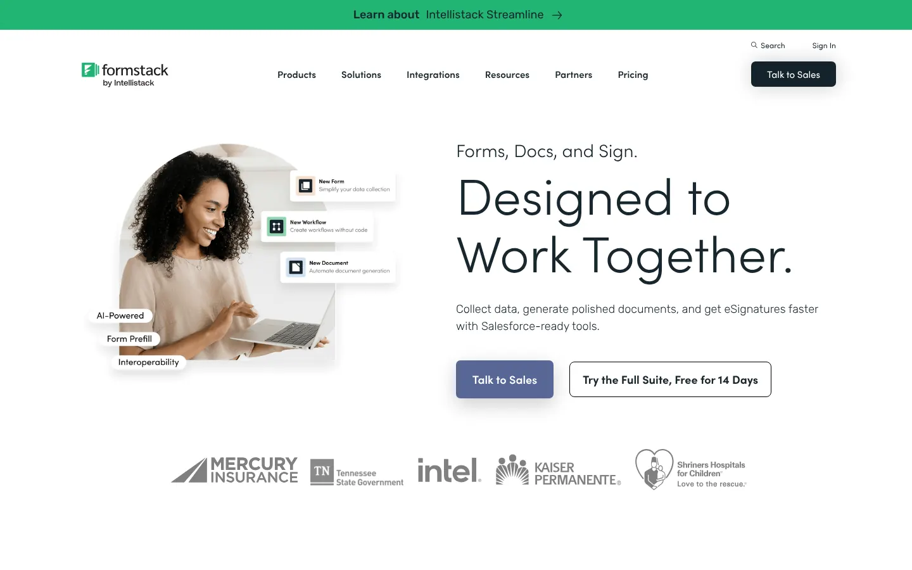

Jotform is one of the most complete form builders around. Its template library is huge, and it has a widget for almost any field. The trouble starts when a team wants to share the work.

Every plan below Enterprise is for a single user, and each plan caps how many forms you can keep, from 5 on free to 25 on Bronze.

A good Jotform alternative lets your whole team build forms and keep as many as they need, at a fair price.

> **[Try Claritia free](https://app.tryclaritia.com/signup)** to build unlimited forms with your whole team, since teammates who only build forms or read answers are free.

Below, we compare 8 Jotform alternatives by users, form limits and price.

## Main points

- Jotform plans below Enterprise are for one user, and each plan caps your forms, from 5 on free to 25 on Bronze.
- Claritia, Fillout, Tally, Paperform and Cognito Forms all include unlimited forms on their free plans.
- Check three things first: how many users each plan includes, whether forms are capped, and what happens after submit.
- Top picks: [Claritia](/), [Fillout](https://www.fillout.com/), [Typeform](https://www.typeform.com/), [Paperform](https://paperform.co/), [Tally](https://tally.so/), [Cognito Forms](https://www.cognitoforms.com/), [Zoho Forms](https://www.zoho.com/forms/) and [Formstack](https://www.formstack.com/).
- Pick [Claritia](/) if your team shares form work and wants each form to end in a booked meeting.

## What is a Jotform alternative?

A Jotform alternative is a form builder you use in place of Jotform. You build your forms in the other tool, share them by link or on your site, and collect the answers there.

Teams switch for three main reasons. They want more than one person on a plan. They want to keep as many forms as they need. Or they want something to happen after submit, like a follow-up email or a booked meeting.

Typical features include:

- Templates and a drag-and-drop or page-style editor.
- Conditional logic that shows or skips questions based on answers.
- File uploads and payments.
- Integrations with spreadsheets, CRMs and email tools.
- Shared access, so teammates can build forms and read answers.
- Steps after submit, such as follow-up emails or meeting booking.

## How to choose a Jotform alternative

Price is only part of it. Five checks tell you more:

- **Users included.** How many teammates can build forms and read answers on each plan.
- **Form limits.** Whether you can keep as many forms as you need.
- **Answers for the money.** Monthly submissions on the free and first paid plans.
- **Core features.** Logic, file uploads, payments and integrations.
- **What happens next.** Follow-up emails and meeting booking after submit.

## The 8 best Jotform alternatives in 2026

| Tool | Best for | Free plan | Paid from | Users included |
|---|---|---|---|---|
| [Claritia](/) | Teams whose forms book meetings | Unlimited forms, 250 submissions a month | $12 a seat a month, billed yearly | Form builders free; seats for people who take meetings |
| [Fillout](https://www.fillout.com/) | Large teams on a budget | 1,000 responses a month | $15 a month, billed yearly | Unlimited on every plan |
| [Typeform](https://www.typeform.com/) | Polished one-question forms | Yes, with a low response cap | $28 a month, billed yearly | 1 on Basic, up to 5 on Business |
| [Paperform](https://paperform.co/) | Page-style forms | 30 submissions a month | $49 a month, billed yearly | Unlimited on every plan |
| [Tally](https://tally.so/) | Free forms at volume | Unlimited forms and submissions (fair use) | $24 a month | Team collaboration on Pro |
| [Cognito Forms](https://www.cognitoforms.com/) | Order forms and quotes | 100 entries a month | $19 a month, billed yearly | 1 on free, 5 on Team |
| [Zoho Forms](https://www.zoho.com/forms/) | Zoho users | 3 forms, 500 submissions a month | See their pricing page | 1 on free, 10 on Standard |
| [Formstack](https://www.formstack.com/) | Larger groups with approvals | No free plan, 14-day trial | $83 a month, billed yearly | 1 builder on Forms |

## 1. Claritia

[Claritia](/) is a forms, scheduling and follow-up app built for small B2B teams that want every lead from their website to reach the right rep and book a meeting before they leave the page.

It builds forms from a sentence or one of 840 templates, opens the right person's calendar the moment the form is sent, routes each lead by its answers, and drafts follow-up emails in your brand's voice for you to approve.

Teammates who only build forms or read answers are free on every plan. A seat is only for a teammate people can book meetings with.

> **[Try Claritia free](https://app.tryclaritia.com/signup)** and invite your whole team to build forms at no extra cost.

### Key features

- **Unlimited forms:** On every plan, free included.
- **Free form builders:** Teammates who only build forms or read answers don't need a seat.
- **Core fields for free:** File uploads and conditional logic on the free plan, with Stripe payments and e-signatures from Starter.
- **Templates and styles:** 840 templates and 18 form styles to replace your Jotform layouts.
- **Booking inside the form:** The right person's calendar opens as soon as the form is sent.
- **Routing:** Round robin and routing by answer on Pro.

*Caption: A Claritia form can end on a time picker, so the lead books in the same flow.*

### Pros

- **Room for the team:** Adding builders doesn't add cost.
- **No form cap:** Keep as many forms as you need, even on free.
- **One step from form to meeting:** The lead fills in the form and books a time in the same flow.

### Cons

- **Newer tool:** Its app marketplace and community are smaller than Jotform's.
- **No mobile app:** There's no native mobile app.
- **No Zapier or Make apps yet:** They're on the way.

### Price and plans

You can start on the free plan with no card. Paid plans are priced per seat, and a seat is a teammate people can book a meeting with.

- **Free:** $0 for 1 seat and 250 submissions a month.
- **Starter:** $15 a seat a month ($12 billed yearly), with 2,000 submissions a month. Adds Stripe payments and e-signatures.
- **Pro:** $39 a seat a month ($31 billed yearly), with 5,000 submissions a month. Adds round robin and routing by answer.
- **Business:** $79 a seat a month ($63 billed yearly), with unlimited submissions. Adds partial answers and owner first.

## 2. Fillout

[Fillout](https://www.fillout.com/) is a form builder for teams that want branded forms, surveys, and quizzes connected to the tools they already use. You can describe a form for its AI to build or use drag and drop, then add logic, file uploads, payments, and signatures.

It also offers scheduling forms that sync with Google Calendar or Outlook, PDF generation, workflows, login forms that let people edit past answers, custom domains, and native integrations.

It's the most direct answer to Jotform's single-user plans. Every plan, free included, has unlimited seats and unlimited forms, and the free plan takes 1,000 responses a month.

### Key features

- **Unlimited seats and forms:** On every plan.
- **Big free plan:** 1,000 responses a month.
- **Logic and payments:** Both on the free plan.
- **Scheduling and links:** Scheduling forms for free, plus Airtable and Google Sheets links.

### Pros

- **Built for teams:** No per-user limits on any plan.
- **Generous free plan:** 1,000 responses a month beats most paid entry plans.

### Cons

- **Partial submissions cost more:** They're a Business feature.
- **Fewer templates:** It has fewer ready-made templates and widgets than Jotform.

### Price and plans

- **Free:** $0, with 1,000 responses a month.
- **Starter:** $15 a month, billed yearly.
- **Pro:** $40 a month, billed yearly.
- **Business:** $75 a month, billed yearly.

## 3. Typeform

[Typeform](https://www.typeform.com/) is an online form builder for marketing, product, HR, and customer teams that want forms, surveys, and quizzes people actually finish. It builds conversational forms that adapt to each answer, can draft and brand a form from a written prompt, and accepts video and audio replies.

Responses can go to tools like HubSpot, Google Sheets, and Notion, take Stripe payments, book Calendly meetings, and feed AI summaries of themes and sentiment.

Where Jotform offers every widget, Typeform keeps things calm with one question at a time. Higher plans add users, up to 5 on Business. It's best for brands that want a sleek, conversational form.

### Key features

- **One-question layout:** Shows one question at a time and works well on phones.
- **Design controls:** Strong control over how forms look.
- **Logic:** Changes the path for each person.
- **More users on higher plans:** 3 users on Plus and 5 on Business.

### Pros

- **Polished forms:** Clean design that keeps people moving.
- **Team room on higher plans:** Up to 5 users on Business.

### Cons

- **Tight Basic plan:** 100 responses a month and 1 user.
- **Low free cap:** The free plan has a low response cap.

### Price and plans

- **Basic:** $28 a month billed yearly ($39 monthly).
- **Plus:** $56 a month, billed yearly.
- **Business:** $91 a month, billed yearly.

## 4. Paperform

[Paperform](https://paperform.co/) is an online form builder for small businesses and solo operators who want one form to capture details, take payment, and start the next step. Its editor works like a document, with a one question at a time mode, conditional logic, and spreadsheet style formulas for prices and scores.

Forms can take bookings and Stripe payments, send contracts for e-signature through Papersign, and pass submissions to CRMs, email tools, and spreadsheets through integrations or Stepper workflows.

Every plan has unlimited users and unlimited forms. Content and questions sit on one canvas, much like a web page, so forms can double as landing pages. Paid plans add unlimited submissions under fair use.

### Key features

- **Unlimited users and forms:** On every plan.
- **Unlimited submissions:** On paid plans, under fair use.
- **Page-like editor:** Room for text and images around your questions.
- **Free trial:** 7 days with no card needed.

### Pros

- **No user or form limits:** The two Jotform caps are gone.
- **No counting answers:** Paid plans take unlimited submissions under fair use.

### Cons

- **Small free plan:** It takes 30 submissions a month.
- **Higher price:** Pro costs more than Jotform's Bronze plan.

### Price and plans

- **Free:** 30 submissions a month.
- **Pro:** $49 a month billed yearly, or $59 billed monthly.
- **Business:** $124 a month billed yearly, or $149 billed monthly.

## 5. Tally

[Tally](https://tally.so/) is a form builder for individuals and teams who want to make forms by typing, much like writing in a document. You insert blocks for contact details, file uploads, ratings, signatures, and Stripe payments, then add conditional logic, calculations, hidden fields, and answer piping.

Forms can be embedded or shown as popups, and submissions can go to Notion, Slack, Airtable, or Google Sheets. Tally is hosted in Europe and does not use cookie tracking.

Its free plan removes Jotform's two big limits: forms and submissions are both unlimited under fair use. Pro adds team collaboration in shared workspaces.

### Key features

- **Unlimited forms:** Unlimited forms and submissions for free, under fair use.
- **Payments and signatures:** Both on the free plan.
- **Free integrations:** Links to Google Sheets, Notion, Airtable and webhooks.
- **Team workspaces:** Workspaces and team members on Pro.

### Pros

- **High volume for $0:** No cap on forms or submissions, under fair use.
- **Doc-style editor:** You type your form like a document.

### Cons

- **Free plan branding:** Free forms show Tally branding.
- **Fewer extras:** It offers fewer widgets and templates than Jotform.

### Price and plans

- **Free:** $0, unlimited forms and submissions under fair use.
- **Pro:** $24 a month, with two months off when you pay yearly.
- **Business:** $74 a month.

## 6. Cognito Forms

[Cognito Forms](https://www.cognitoforms.com/) is an online form builder for organizations that want to collect data and automate the work that follows each entry. Its drag-and-drop builder handles many field types, automatic calculations, signatures and file uploads.

Forms can move entries through approval workflows, generate documents, look up data from other forms and take payments through Square, Stripe, PayPal or its own Cognito Pay. It also includes controls that help teams meet HIPAA, GDPR and CCPA rules.

If you used Jotform for order forms or quotes, it's a good swap. It handles calculations and repeating sections well. The free plan takes payments, and all plans include unlimited forms.

### Key features

- **Calculations:** Calculations and repeating sections for totals.
- **Payments:** On the free plan.
- **Unlimited forms:** On all plans.
- **Team plan:** 5 users on Team.

### Pros

- **Good with numbers:** Totals for quotes and orders work well.
- **No form cap:** Keep as many forms as you need.

### Cons

- **Small free plan:** 100 entries a month, with Cognito Forms branding.
- **One user on free:** The free plan has 1 user.

### Price and plans

- **Free:** 100 entries a month and 1 user.
- **Pro:** $19 a month billed yearly ($24 monthly), with 2,000 entries a month.
- **Team:** 5 users.

## 7. Zoho Forms

[Zoho Forms](https://www.zoho.com/forms/) is an online form builder for businesses that want to collect data and move it through review and approval steps without code. It can build a form from a prompt, turn PDFs or photos of paper forms into online forms, and read business cards or IDs to fill in fields.

Forms support many field types, subforms, payments, and multi-level approvals, a mobile app collects entries offline, and data can flow into Zoho CRM. Paid plans have unlimited forms and high submission caps, and Standard includes up to 10 users. The mobile app handles field work much like Jotform's.

### Key features

- **Unlimited forms:** On paid plans.
- **High limits:** 10,000 submissions a month on Basic.
- **Users:** Up to 10 users on Standard.
- **Zoho CRM:** A close link with Zoho CRM.
- **Mobile app:** For field work.

### Pros

- **Room for a team:** Up to 10 users on Standard.
- **Zoho fit:** Works closely with Zoho CRM.

### Cons

- **Small free plan:** 3 forms and 1 user.
- **Best inside Zoho:** It fits best inside the Zoho world.

### Price and plans

- **Free:** 3 forms, 500 submissions a month and 1 user.
- **Basic:** 10,000 submissions a month.
- **Standard:** Up to 10 users.

For prices, see their pricing page.

## 8. Formstack

[Formstack](https://www.formstack.com/) is a no-code platform for organizations that want to collect data, create documents and gather signatures without manual paperwork. Its form builder offers AI form creation, prefilled links, branded themes, step logic and group approvals, and it sends submissions into CRMs and other business systems.

Separate products generate documents from the data a form collects and capture eSignatures, and versions of its forms and documents run inside Salesforce. It's built for larger groups that need approvals and strict data rules, more than for quick lead forms. You can try it free for 14 days.

### Key features

- **Workflows and approvals:** Built for formal processes.
- **Free trial:** 14 days with no card needed.
- **Storage:** 2GB on the Forms plan.
- **Yearly savings:** Annual billing saves two months.

### Pros

- **Fits formal processes:** Good for groups with approval steps.
- **Try before you pay:** A 14-day trial with no card.

### Cons

- **Tight Forms plan:** 1 builder user and 25 forms.
- **Higher price:** It costs more than most tools here.

### Price and plans

- **Forms:** $83 a month billed yearly, with 1,000 submissions per form.

There's no free plan, only the 14-day trial.

## Which Jotform alternative should you pick?

- If your team shares form work and books calls, pick [Claritia](/). Builders are free, and forms book meetings.
- If you want unlimited seats on a budget, pick [Fillout](https://www.fillout.com/).
- If you want a sleek one-question style, pick [Typeform](https://www.typeform.com/).
- If you build order forms or quotes, pick [Cognito Forms](https://www.cognitoforms.com/).
- If you're already on Zoho, pick [Zoho Forms](https://www.zoho.com/forms/).

## Questions

### What is the best Jotform alternative for a team?

Claritia, for small teams that want forms to lead to meetings, since form builders are free. If you only need forms, Fillout has unlimited seats on every plan.

### Which Jotform alternative has unlimited forms?

Claritia, Fillout, Tally, Paperform and Cognito Forms all include unlimited forms on their free plans.

### Is Jotform free?

Jotform has a free Starter plan with 5 forms and 100 submissions a month. It's a single-user plan with Jotform branding.

### Can you take payments without Jotform?

Yes. Claritia takes Stripe payments from Starter, with PayPal and Square for paid meetings. Tally and Fillout take payments on their free plans, and so does Cognito Forms.

### How do you move from Jotform to Claritia?

Pick a matching template or describe the form to Tia in one sentence, then adjust the questions. Embed it with one script tag where your Jotform form used to be.

## Get started

Invite your whole team to build forms for free, and add seats only for teammates who take meetings. Pick from the [templates](/templates) to start fast.

> **[Try Claritia free](https://app.tryclaritia.com/signup)** to build your first form with your team and book your first meeting today.

Then see how [routing](/products/routing) sends each lead to the right person.
