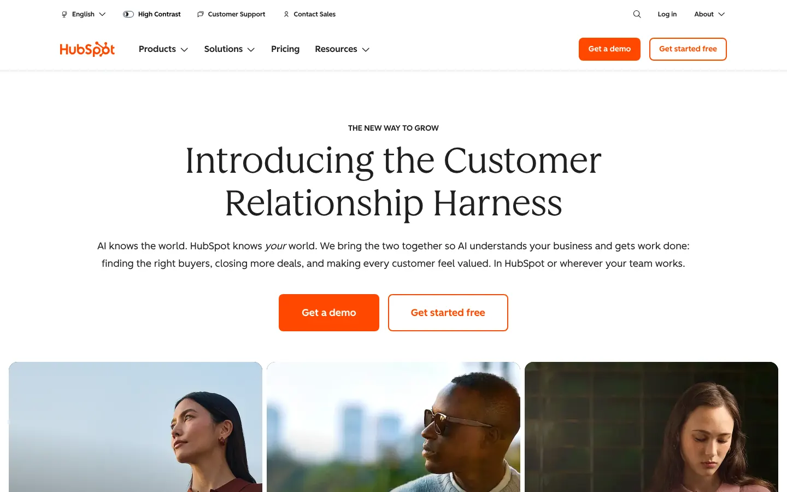
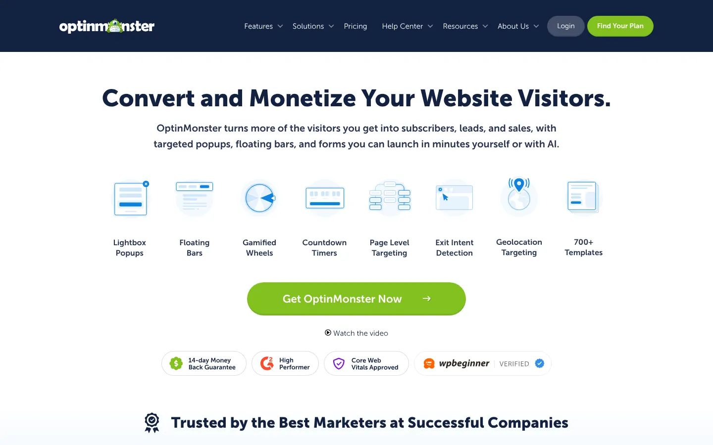
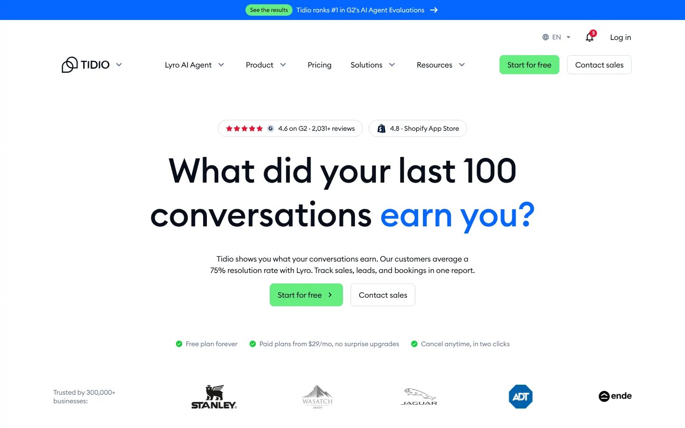
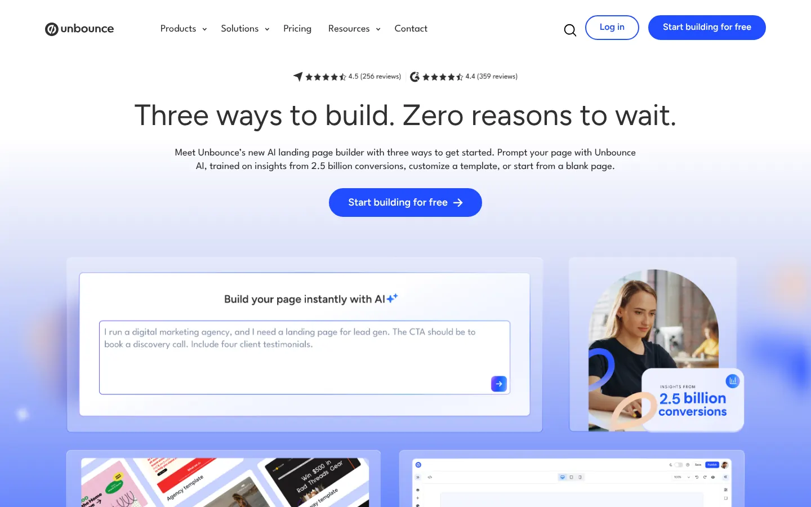

Your website gets visitors who could buy, and most of them leave without a word. A contact page catches a few. The rest read a page and forget your name by lunch.

Lead capture software gives those visitors an easy way to raise a hand, with a short form, a popup or a chat window. The good ones also get the lead to a person fast, ideally with a meeting booked.

> **[Try Claritia free](https://app.tryclaritia.com/signup)** to capture leads with a form or popup that books the meeting before the visitor leaves.

In this post, we compare 7 lead capture tools for small B2B teams. You'll see how each one captures leads, what it costs and where it falls short.

## Main points

- Lead capture tools come in three main kinds: forms, popups and live chat. Many teams use one form tool plus one of the others.
- What happens after the lead is captured matters more than the widget. Check where the lead goes and how fast someone can act.
- Watch the limits on free and entry plans: responses, conversations, impressions or visitors.
- Top picks: [Claritia](/), [HubSpot](https://www.hubspot.com/), [OptinMonster](https://optinmonster.com/), [Tidio](https://www.tidio.com/), [Typeform](https://www.typeform.com/), [Fillout](https://www.fillout.com/) and [Unbounce](https://unbounce.com/).
- Pick [Claritia](/) if you want each captured lead to book a meeting with the right person on the spot.

## What is lead capture software?

Lead capture software collects contact details from website visitors and turns them into leads. It does this with forms, popups, chat windows or landing pages, then sends each lead to your CRM, your inbox or a sales rep. If you're new to the idea, our guide on [what lead capture is](/blog/what-is-lead-capture) covers the basics.

Typical features include forms you can embed or show as a popup, triggers that time a popup or chat, hidden fields for UTM tags, spam protection, a link to your CRM, and a next step after submit, like a booked meeting.

## How to choose lead capture software

Start with how your buyers like to reach you. Then run these five checks:

- **The right format.** Demo requests suit forms. Readers on a blog suit popups. Visitors with questions suit chat.
- **The step after capture.** A booked call or a CRM sync beats a lead waiting in an inbox.
- **Source tracking.** Hidden fields for UTM tags, so you know which campaigns bring in leads.
- **Plan limits.** Responses, conversations, impressions or visitors, and what happens when you pass them.
- **Price as you grow.** Per-seat, per-site and usage pricing grow in different ways.

## The 7 best lead capture software tools in 2026

Prices checked November 2026.

| Tool | Best for | Free plan | Paid from | How it captures leads |
|---|---|---|---|---|
| [Claritia](/) | Leads who book a meeting in the same step | Yes, 250 submissions a month | $12 a seat a month, billed yearly | Forms in the page, popups, slide-ins and side tabs |
| [HubSpot](https://www.hubspot.com/) | Teams that want forms and chat inside a CRM | Yes, for up to 2 users | $20 a seat a month (Starter) | Forms, live chat and chatbots |
| [OptinMonster](https://optinmonster.com/) | Popups on content-heavy sites | Free trial with 500 impressions | $210 a year, billed yearly | Popups, floating bars and inline forms |
| [Tidio](https://www.tidio.com/) | Capturing leads in live chat | Yes, 50 conversations a month | $24.17 a month, billed yearly | Live chat, chat Flows and an AI agent |
| [Typeform](https://www.typeform.com/) | One-question-at-a-time lead forms | Yes, with a low response cap | $28 a month, billed yearly | Conversational forms |
| [Fillout](https://www.fillout.com/) | High form volume on a small budget | Yes, 1,000 responses a month | $15 a month, billed yearly | Forms, including scheduling forms |
| [Unbounce](https://unbounce.com/) | Landing pages for paid ads | Free trial | $22 a month, billed yearly | Landing pages with lead gen forms |

## 1. Claritia

[Claritia](/) is a forms, scheduling and follow-up app built for small B2B teams that want every lead from their website to reach the right rep and book a meeting before they leave the page.

It builds forms from a sentence or one of 840 templates, opens the right person's calendar the moment the form is sent, routes each lead by its answers, and drafts follow-up emails in your brand's voice for you to approve.

The same form can sit in the page or show as a popup, a slide-in, a corner button or a side tab.

> **[Try Claritia free](https://app.tryclaritia.com/signup)** and put a lead form with booking on your site on the free plan.

### Key features

- **Booking inside the form:** On every plan, with Google Calendar and Outlook.
- **Popup embed:** Show any form as a popup on every plan, or add it with one script tag. See [Claritia forms](/products/forms).
- **Tracking:** Hidden fields keep UTM tags, the page and the referrer, and you can add Google Analytics, Google Tag Manager, Meta Pixel and Google Ads tags.
- **Spam control:** Cloudflare spam protection, a honeypot, a rate limit and disposable email blocking.
- **CRM links:** On Starter, leads go to HubSpot, Pipedrive, Attio and other CRMs. See the [HubSpot integration](/integrations/hubspot).
- **Routing:** On Pro, route each lead to a meeting and a person based on their answers.

### Pros

- **Capture and booking in one step:** No separate scheduling link to send.
- **A lot on the free plan:** Conditional logic, hidden fields, popups and spam checks.
- **Fair seat pricing:** Teammates who only build forms or read answers are free.

### Cons

- **Newer tool:** Its app marketplace and community are smaller than the big names.
- **No Zapier or Make apps yet:** They're on the way and are yet to be listed.
- **No live chat:** Claritia captures leads with forms, so add a chat tool if you want one.

### Price and plans

You can start on the free plan with no card. Paid plans are priced per seat, and a seat is a teammate people can book a meeting with.

- **Free:** $0 for 1 seat and 250 submissions a month.
- **Starter:** $15 a seat a month ($12 billed yearly). Adds HubSpot and other CRMs, Slack alerts and a follow-up the next day until the lead books.
- **Pro:** $39 a seat a month ($31 billed yearly). Adds round robin, routing by answer and no Claritia branding.
- **Business:** $79 a seat a month ($63 billed yearly). Adds Salesforce, partial answers and owner first.

## 2. HubSpot

[HubSpot](https://www.hubspot.com/) is a customer platform for businesses of all sizes that want their marketing, sales and customer service teams to work from the same customer data. It is built around a shared CRM and adds separate products, called hubs, for marketing, sales, service, content, data management, and quotes and billing.

Teams use it to capture leads with forms and chat, send email campaigns, manage deals, run a help desk, build web pages and set up AI agents.

Its form builder, live chat and chatbot builder are free and tied to its free CRM, where every person who fills in a form or chats is stored as a contact. It suits teams that want lead capture and their CRM in one place and plan to stay in HubSpot.

### Key features

- **Free forms:** Each form fill is added to the CRM.
- **Live chat:** Routes chats to the right person and keeps each conversation in a shared inbox.
- **Chatbots:** HubSpot says its bots can qualify leads, book meetings and answer common questions.
- **Starter extras:** Removes HubSpot branding from live chat and adds email marketing and simple automation.

### Pros

- **Free to start:** For up to 2 users, with no credit card.
- **One system:** Forms, chat and contacts live together.

### Cons

- **Form logic costs more:** HubSpot lists conditional logic and multi-step forms as premium features.
- **Big jump after Starter:** Marketing Hub Professional starts at $800 a month, plus a required $3,000 onboarding fee.

### Price and plans

- **Free:** $0 for up to 2 users.
- **Starter:** $20 a seat a month, with a lower price for new customers for a limited time. Includes 1,000 marketing contacts.
- **Professional:** From $800 a month with 3 core seats, plus onboarding.
- **Enterprise:** From $3,600 a month, plus onboarding.

## 3. OptinMonster

[OptinMonster](https://optinmonster.com/) is a lead generation tool for website owners and marketers who want to turn more visitors into email subscribers, leads and sales. It builds popups, floating bars, fullscreen overlays, slide-ins, inline forms and spin-a-wheel coupon offers from templates in a drag-and-drop editor.

Campaigns show up based on rules such as exit intent, inactivity, scheduled dates, the page being viewed and past visitor behavior, and it includes A/B tests and conversion reports. It works on WordPress, Shopify and other sites.

Targeting can also use time on site and scroll depth, while exit intent and location rules come on higher plans. It suits content-heavy sites that want more email signups from their readers.

### Key features

- **All campaign types:** Popups, floating bars and more, with 700+ templates.
- **Targeting:** Page, time on site and scroll triggers on every plan.
- **Exit intent:** On Pro and Growth.
- **Webhooks and Zapier:** On Pro and Growth.

### Pros

- **Built for popups:** Lots of control over when and where a campaign shows.
- **A/B testing:** From the Plus plan.

### Cons

- **Key features on higher plans:** Exit intent, webhooks and badge removal start on Pro.
- **Impression limits:** Each plan has a cap on campaign impressions and sites.
- **Email first:** It collects contact details, and booking a meeting needs another tool.

### Price and plans

Plans are billed yearly by default, and monthly billing is also offered. These are the full yearly prices. OptinMonster was running a lower first-year offer when we checked.

- **Basic:** $210 a year for 1 site and 2,500 impressions.
- **Plus:** $570 a year for 2 sites and 10,000 impressions.
- **Pro:** $870 a year for 3 sites and 25,000 impressions.
- **Growth:** $1,470 a year for 5 sites and 100,000 impressions.

A free trial gives you Basic features with 500 impressions.

## 4. Tidio

[Tidio](https://www.tidio.com/) is a customer service platform for online stores and growing businesses that want to answer shoppers quickly and turn chats into sales. Its AI agent, Lyro, answers questions from the company's own help content and product catalog across live chat, email, WhatsApp, Instagram and Messenger, and hands harder cases to a person.

Tidio also offers a shared inbox, ticketing, a live chat widget and no-code Flows that greet visitors, collect contact details and send data to other tools. Flows can also take a quote request in the chat window, which suits teams whose visitors like to ask a question before they share an email.

### Key features

- **Live chat and ticketing:** Every chat and ticket in one inbox.
- **Flows:** No-code chat paths that collect data and take quote requests. Your first 100 visitors reached each month are free.
- **Lyro AI agent:** Answers common questions. Your first 50 Lyro conversations are free.
- **Live visitors list:** See who is on your site now, from Starter.

### Pros

- **Free plan:** Live chat with 50 billable conversations a month.
- **Chat that captures:** Flows can ask for an email inside the conversation.

### Cons

- **Usage limits:** Plans cap conversations, AI conversations and visitors reached by Flows.
- **Branding costs extra:** Removing Tidio branding is an add-on on lower plans.
- **Support first:** Much of the product is built around customer service.

### Price and plans

- **Free:** $0, with 50 billable conversations a month.
- **Starter:** $24.17 a month billed yearly, or $29 billed monthly, with 100 billable conversations.
- **Growth:** From $49.17 a month, billed yearly.
- **Plus:** From $300 a month, plus usage.

## 5. Typeform

[Typeform](https://www.typeform.com/) is an online form builder for marketing, product, HR, and customer teams that want forms, surveys, and quizzes people actually finish. It builds conversational forms that adapt to each answer, can draft and brand a form from a written prompt, and accepts video and audio replies.

Responses can go to tools like HubSpot, Google Sheets, and Notion, take Stripe payments, book Calendly meetings, and feed AI summaries of themes and sentiment.

It shows one question at a time, so a lead form feels closer to a conversation, and its HubSpot link can send contact, company or deal info. It suits brands that care about how the form looks and feels.

### Key features

- **Conversational layout:** One question per screen.
- **Conditional logic:** On every paid plan.
- **HubSpot and Calendly:** Send leads to HubSpot and let them book through Calendly.
- **Drop-off rates and conversion tracking:** On Business.

### Pros

- **Polished forms:** Good design control out of the box.
- **Many integrations:** HubSpot, Calendly, Slack and webhooks.

### Cons

- **Low response cap:** Basic includes 100 responses a month for 1 user.
- **Branding on lower plans:** Removing Typeform branding starts on Plus.

### Price and plans

- **Free:** Yes, with a low response cap.
- **Basic:** $28 a month billed yearly, or $39 monthly. 100 responses a month.
- **Plus:** $56 a month billed yearly, or $79 monthly. 1,000 responses a month.
- **Business:** $91 a month billed yearly, or $129 monthly. 10,000 responses a month.

## 6. Fillout

[Fillout](https://www.fillout.com/) is a form builder for teams that want branded forms, surveys, and quizzes connected to the tools they already use. You can describe a form for its AI to build or use drag and drop, then add logic, file uploads, payments, and signatures.

It also offers scheduling forms that sync with Google Calendar or Outlook, PDF generation, workflows, login forms that let people edit past answers, custom domains, and native integrations. It has one of the largest free plans for forms, with 1,000 responses a month and unlimited forms and seats, and HubSpot is among the integrations it includes on every plan.

### Key features

- **Free responses:** 1,000 a month.
- **Integrations on every plan:** HubSpot, Google Sheets, Airtable, Notion, webhooks and more.
- **Scheduling forms:** On every plan.
- **Partial submissions:** On Business.

### Pros

- **Volume on a budget:** A big free allowance.
- **Unlimited seats:** On every plan.

### Cons

- **No CAPTCHA on free:** That matters for public lead forms.
- **Salesforce costs more:** It isn't on the Free, Starter or Pro plans.

### Price and plans

- **Free:** $0, with 1,000 responses a month.
- **Starter:** $15 a month billed yearly, or $19 monthly. 2,000 responses a month.
- **Pro:** $40 a month billed yearly, or $49 monthly. 5,000 responses a month.
- **Business:** $75 a month billed yearly, or $89 monthly. Unlimited responses.

## 7. Unbounce

[Unbounce](https://unbounce.com/) is a landing page builder for marketers and agencies who want to build and test campaign pages without a developer. A page can start from an AI prompt, a template or a blank canvas, then be edited by prompt or drag and drop.

Unbounce runs A/B tests, uses Smart Traffic to send visitors to the variant most likely to convert, adds popups and sticky bars, and publishes to custom domains with forms that pass leads to other tools.

You build a page around one offer and send ad traffic to it to see which version brings more leads, so it suits marketers running paid campaigns.

### Key features

- **Lead gen forms:** On every plan.
- **Unlimited conversions:** No cap on leads.
- **A/B testing:** Unlimited tests from Experiment.
- **1,000+ integrations:** From Build.

### Pros

- **Page and form together:** Test versions of the whole page, form included.
- **No lead cap:** Conversions are unlimited on every plan.

### Cons

- **Visitor limits:** Starter allows up to 500 visitors a month and 5 pages.
- **Integrations cost more:** The large integration list starts on Build.

### Price and plans

- **Starter:** $22 a month billed yearly, or $29 monthly.
- **Build:** $74 a month billed yearly, or $99 monthly.
- **Experiment:** $112 a month billed yearly, or $149 monthly.
- **Optimize:** $187 a month billed yearly, or $249 monthly.

## Which lead capture software should you pick?

- If you want each lead to book a meeting with the right person right away, pick [Claritia](/).
- If your team already lives in HubSpot and wants forms and chat in one place, start with [HubSpot](https://www.hubspot.com/).
- If your site is full of blog posts and you want more signups from readers, pick [OptinMonster](https://optinmonster.com/).
- If your visitors ask questions before they buy, add live chat with [Tidio](https://www.tidio.com/).
- If you run paid ads to one offer, pick [Unbounce](https://unbounce.com/).

Many small teams combine two: a form tool for demo and quote requests, plus chat or a popup on content pages. For more form options, see our list of [lead generation form builders](/blog/best-lead-generation-form-builders).

## Questions

### What is the best lead capture software for a small business?

It depends on how your visitors reach you. For a B2B team that sells through calls, a form that books the meeting, like Claritia, gets leads on the calendar fastest. A content site may get more signups from a popup tool like OptinMonster.

### Is there free lead capture software?

Yes. Claritia, HubSpot, Tidio, Typeform and Fillout all have free plans. Check the limits: Claritia allows 250 submissions a month, Fillout 1,000 responses and Tidio 50 billable conversations.

### Are popups or forms better for lead capture?

They do different jobs. An embedded form suits visitors ready to act, like on a pricing page. A popup reaches readers who would never look for a form.

### Can lead capture software send leads to my CRM?

Most can. Claritia sends leads to HubSpot, Pipedrive, Attio and other CRMs on Starter, and to Salesforce on Business. HubSpot stores leads in its own CRM, and Typeform and Fillout connect to HubSpot.

### What should I do with a lead right after I capture it?

Let them book a meeting right after they submit, while they still remember you. Our guide to [inbound lead generation](/blog/inbound-lead-generation) covers speed to lead and follow-up.

## Get started

The best lead capture tool is the one that gets your leads to a person fast. Build a form that shows in the page or as a popup and books the meeting on the spot.

> **[Try Claritia free](https://app.tryclaritia.com/signup)** to build your first lead capture form and book your first meeting today.

You can also browse [lead generation templates](/templates/category/lead-generation) to start from a ready-made form.
