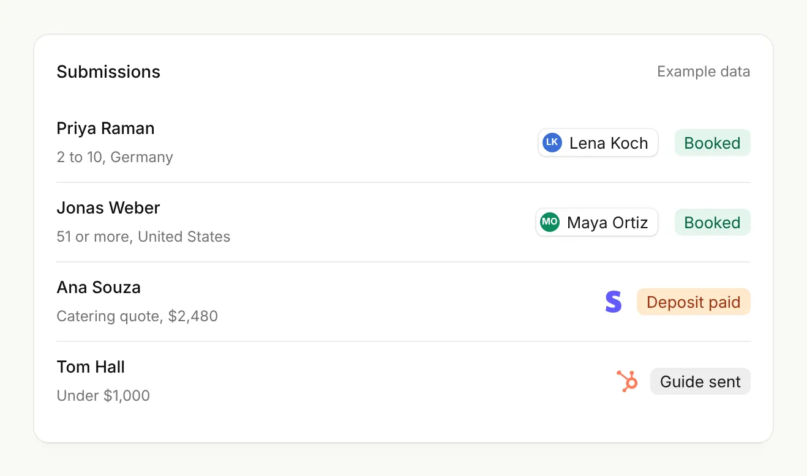
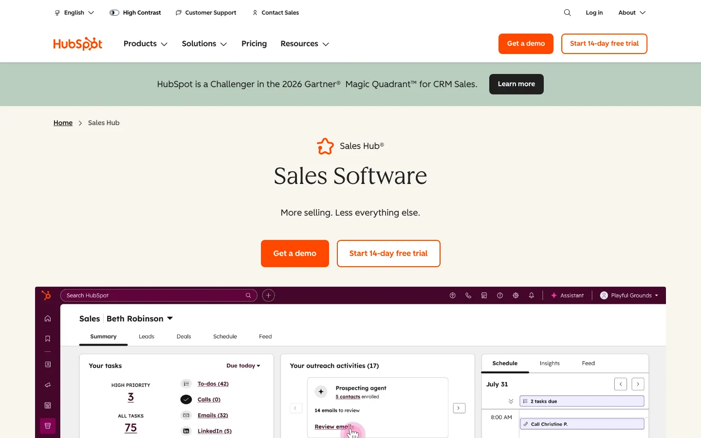
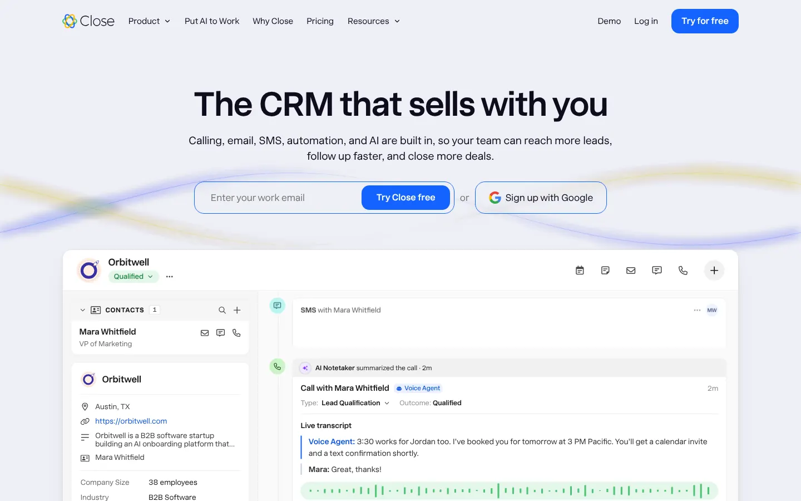
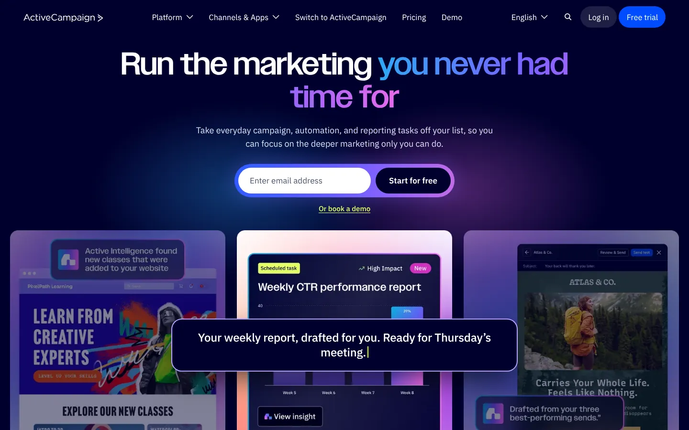
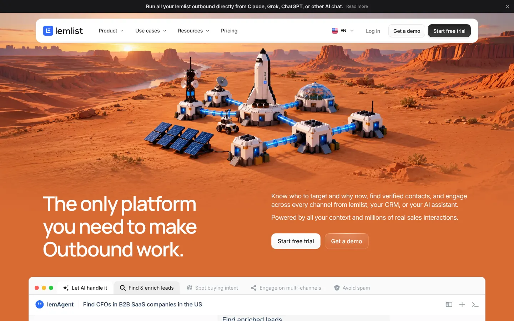
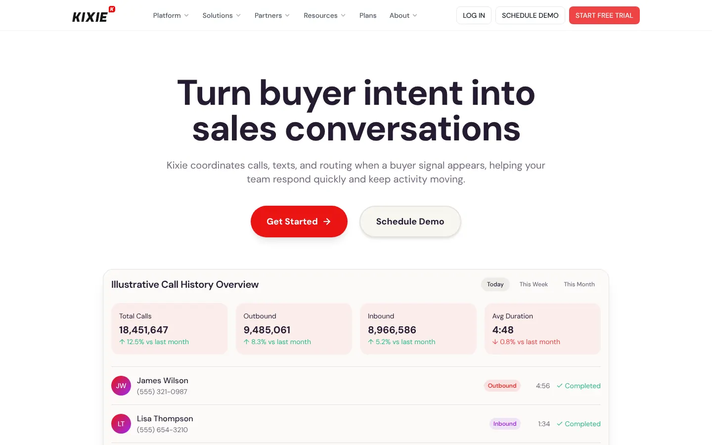

A lead often goes quiet for an ordinary reason. They filled your form and meant to book, then a meeting pulled them away. Or they booked and missed the call. Without a next message, that lead is gone.

Lead follow-up software sends the next message at the right time, so a good lead gets a second and third chance to talk to you. The right tool runs on its own and starts when you'd want it to: a form fill with no booking, a meeting tomorrow, a no-show, a call that just ended.

> **[Try Claritia free](https://app.tryclaritia.com/signup)** to send reminders before every meeting, then follow up with form leads until they book on Starter.

Below are 8 lead follow-up tools for small teams, with what starts each one's follow-up, the channels it uses and what each plan costs.

## Main points

- List the moments when a lead needs a nudge, then pick the tool whose triggers match them.
- Tools differ by channel. Some send email, some call and text, and some add LinkedIn steps.
- Meeting tools like Calendly and Zcal follow up around a booked meeting, so leads who never book get none.
- Top picks: [Claritia](/), [HubSpot Sales Hub](https://www.hubspot.com/products/sales), [Close](https://www.close.com/), [ActiveCampaign](https://www.activecampaign.com/), [lemlist](https://www.lemlist.com/), [Kixie](https://www.kixie.com/), [Calendly](https://calendly.com/) and [Zcal](https://zcal.co/).
- Pick [Claritia](/) if your leads fill a form and you want every one of them to end up on the calendar.

## What is lead follow-up software?

Lead follow-up software sends the next message to a lead at the right moment, such as a day after a form fill or right after a missed meeting. It stops once the lead books or replies.

Typical features include:

- Triggers such as a form fill or a missed meeting.
- Email, text, call or LinkedIn steps.
- Messages sent from your own inbox, in your own words.
- Reminders before a booked meeting.
- A stop when the lead books or replies.

## How to choose lead follow-up software

Pick your moments first. Then run these five checks:

- **Triggers tied to real moments.** A form fill with no booking, a missed meeting or a call that just ended.
- **The right channels.** Email, text, calls or LinkedIn.
- **Your own inbox and wording.** Messages should come from you and sound like you.
- **A clear stop.** Follow-up should end when the lead books or replies.
- **Price for a small team.** Check what the plan with the triggers you need costs for your team.

## The 8 best lead follow-up software tools in 2026

| Tool | Best for | Free plan | Paid from | Follow-up channels |
|---|---|---|---|---|
| [Claritia](/) | Following up form leads until they book | Yes | $12 a seat a month, billed yearly | Email from your Gmail or Outlook |
| [HubSpot Sales Hub](https://www.hubspot.com/products/sales) | Sales sequences inside a CRM | Yes, up to 2 users | $20 a seat a month, paid monthly | Email; LinkedIn steps with Sales Navigator |
| [Close](https://www.close.com/) | Small sales teams who call and text | 14-day trial | $9 a user a month, billed yearly | Email and SMS, plus a dialer |
| [ActiveCampaign](https://www.activecampaign.com/) | Marketing email automations | 14-day trial | See their pricing page | Email |
| [lemlist](https://www.lemlist.com/) | Outbound sequences | 14-day trial | $55 a month, billed yearly | Email; LinkedIn and calls on Multichannel |
| [Kixie](https://www.kixie.com/) | Calling and texting from your CRM | 7-day trial | See their pricing page | Calls and SMS |
| [Calendly](https://calendly.com/) | Reminders around a booked meeting | Yes, 1 event type | $10 a seat a month, billed yearly | Email reminders |
| [Zcal](https://zcal.co/) | Low-cost reminders and follow-ups | Yes | $7 a user a month | Email and SMS reminders |

## 1. Claritia

[Claritia](/) is a forms, scheduling and follow-up app for small B2B teams. It gets each website lead to the right rep and booked into a meeting before they leave the page.

It builds forms from a sentence or one of 840 templates, opens the right person's calendar the moment the form is sent, routes each lead by its answers, and drafts follow-up emails in your brand's voice for you to approve.

When someone fills your form but doesn't book, Starter follows up the next day until they book. Pro adds a thank-you after a held meeting and a no-show follow-up with the reschedule link.

> **[Try Claritia free](https://app.tryclaritia.com/signup)** and send reminders before every meeting from day one.

### Key features

- **Follow-up until they book:** The next day, every day, on Starter.
- **Meeting reminders:** A day and an hour before every meeting, on every plan.
- **No-show follow-up:** With the reschedule link, on Pro.
- **Thank-you after a held meeting:** On Pro.
- **Your own inbox:** Emails from your own Gmail or Outlook, with your own wording and times, on Starter.
- **Team alerts:** Slack and Microsoft Teams connections can alert your team too.

*Caption: Claritia lists each lead with who they booked and the next step, such as Booked or Guide sent.*

### Pros

- **Follow-up starts at the form:** Leads who fill a form but never book still get a nudge.
- **Reminders for free:** Email reminders are on every plan.
- **Fair seat pricing:** Teammates who only build forms or read answers are free.

### Cons

- **Built-in SMS still coming:** Text reminders go through your own Twilio number on Starter and up, only to people who said yes. Built-in SMS reminders on Pro and Business are coming soon.
- **No Zapier or Make apps yet:** They're on the way and aren't listed yet.

### Price and plans

You can start on the free plan with no card. Paid plans are priced per seat, and a seat is a teammate people can book a meeting with.

- **Free:** $0 for 1 seat and 250 submissions a month. Includes reminders a day and an hour before each meeting.
- **Starter:** $15 a seat a month ($12 billed yearly). Adds follow-up the next day until they book, your own wording and times, and emails from your own Gmail or Outlook.
- **Pro:** $39 a seat a month ($31 billed yearly). Adds the no-show follow-up and the thank-you after a held meeting.
- **Business:** $79 a seat a month ($63 billed yearly). Adds Salesforce, partial answers and owner first.

## 2. HubSpot Sales Hub

[HubSpot Sales Hub](https://www.hubspot.com/products/sales) is HubSpot's sales software for sales teams that want to find prospects, work deals and forecast revenue from one workspace tied to the CRM. It tracks leads and deals in pipelines, sends automated email sequences, places and logs calls from a dialer, records meetings, and scores deals by how likely they are to close.

AI tools point out accounts showing buying signals, draft follow-ups and suggest CRM updates, while managers get forecasts, coaching tools and reports. A rep enrolls a contact in a sequence, and HubSpot sends a timed series of emails and tasks. It suits sales teams who live in HubSpot and send one-to-one sequences.

### Key features

- **Sequences:** On Professional, with up to 500 email sends per user a day.
- **Workflows:** Up to 300 on Professional.
- **Automatic enrollment:** On Enterprise, workflows can enroll contacts in sequences on their own.
- **LinkedIn steps:** In sequences, with a Sales Navigator subscription.

### Pros

- **All in one CRM:** Sequences run where your reps already work.
- **Free start:** The CRM is free for up to 2 users.

### Cons

- **Sequences cost more:** They start on Professional, which adds a required $1,500 onboarding fee.
- **LinkedIn costs extra:** LinkedIn steps need a separate Sales Navigator subscription.

### Price and plans

- **Free:** For up to 2 users.
- **Starter:** $20 a seat a month paid monthly, lower billed yearly.
- **Professional:** $90 a seat a month billed yearly ($100 monthly), plus a $1,500 onboarding fee.

## 3. Close

[Close](https://www.close.com/) is a sales CRM for small and growing businesses that want their reps to call, email and text leads without switching between tools. It logs every call, email, text, note and meeting on the lead record, builds smart lists of leads that need attention, and runs automated follow-up workflows across email, phone and SMS.

It also records and transcribes meetings, reports on rep activity, and includes an AI agent named Chloe that can qualify leads and book meetings. SMS works on every plan. From Growth up, automated workflows send email and SMS, and a power dialer helps reps get through call lists.

### Key features

- **Two-way SMS:** On every plan.
- **Automated workflows:** Email and SMS on Growth and Scale.
- **Dialers:** A power dialer on Growth, with a predictive dialer on Scale.
- **Meeting reminders:** Calendar sync and meeting reminders on all plans.

### Pros

- **Calls, texts and email in one place:** Everything sits in the CRM.
- **Low entry price:** Solo is $9 a user a month billed yearly.
- **Free trial:** 14 days.

### Cons

- **Automation costs more:** Automated workflows start on Growth at $99 a user a month billed yearly.
- **Solo is for one:** It covers a single user.

### Price and plans

- **Solo:** $9 a user a month billed yearly ($19 monthly).
- **Essentials:** $35 a user a month billed yearly ($49 monthly).
- **Growth:** $99 a user a month billed yearly ($109 monthly).

## 4. ActiveCampaign

[ActiveCampaign](https://www.activecampaign.com/) is a marketing automation platform for businesses that want to send each contact the right email, text or message based on what that person does. Marketers build automated journeys on a visual canvas, segment contacts, and send email, SMS and WhatsApp campaigns, with landing pages, forms and a CRM for sales follow-up.

Its AI, called Active Intelligence, drafts campaigns and automations in the brand's voice, picks send times and builds reports from a written request. Every plan includes multi-step automations, Plus adds sales automation, and a Pipelines add-on brings deal records and lead scoring. It suits teams who follow up with nurture emails to a large list.

### Key features

- **Multi-step automations:** On every plan, limited to 5 actions on Starter.
- **Sales automation:** On Plus and up.
- **AI campaign follow-up:** On all plans.
- **Calendly connection:** From Plus up.

### Pros

- **Automation on every plan:** Even the entry plan has multi-step automations.
- **Room for sales:** The Pipelines add-on brings deal records and lead scoring.

### Cons

- **Prices grow with your list:** Prices scale with your contact count.
- **No built-in scheduler:** Meeting booking comes through Calendly.
- **Short automations on Starter:** Limited to 5 actions.

### Price and plans

Prices scale with your contact count, so see their pricing page for yours.

- **All plans:** Start at 1,000 contacts.
- **Trial:** 14 days free.

## 5. lemlist

[lemlist](https://www.lemlist.com/) is a sales outreach platform for sales teams that want to find prospects and run outbound campaigns across several channels. It offers a B2B lead database, finds and verifies emails and phone numbers, and enriches leads with data from LinkedIn, company websites and the CRM.

Teams build sequences that mix email, LinkedIn visits and messages, calls, WhatsApp and SMS, handle every reply in one inbox, and watch mailbox and domain health to keep emails out of spam. LinkedIn steps and calls join the same sequence on its Multichannel plan. It fits outbound teams who reach out first, before a lead fills any form.

### Key features

- **Email follow-ups:** With CRM connections, on the Email plan.
- **LinkedIn and calls:** On Multichannel.
- **Send volume:** Up to 50,000 emails a month on the Email plan.
- **Free trial:** 14 days with 200 free credits.

### Pros

- **One sequence, many channels:** Email, LinkedIn and calls together on Multichannel.
- **High email limit:** Up to 50,000 emails a month on the Email plan.

### Cons

- **Made for cold outreach:** It's built for cold outreach more than follow-up after a form fill.
- **LinkedIn costs more:** LinkedIn and call steps need Multichannel.

### Price and plans

- **Email:** $55 a month billed yearly ($69 monthly).
- **Multichannel:** $87 a month billed yearly ($109 monthly).

## 6. Kixie

[Kixie](https://www.kixie.com/) is a calling and texting platform for revenue teams that want to reach leads quickly and keep every conversation in their CRM. Its power dialer calls several lines at once and uses voice detection to connect reps only with live people, while local presence tools manage caller ID and number reputation.

Kixie also handles inbound calling and business texting, and it logs calls, texts, outcomes and recordings in CRMs such as HubSpot, Salesforce, Zoho and Pipedrive. Reps can click to call or text from the record, which suits teams who follow up by phone and text.

### Key features

- **Click to call and text:** From your CRM record.
- **Power dialer:** Up to 4 lines on Multi-Line.
- **SMS templates:** Plus team SMS on Professional.
- **Unlimited minutes:** In the US and Canada.

### Pros

- **Works in your CRM:** HubSpot, Salesforce, Zoho and Pipedrive.
- **Free trial:** 7 days with no credit card.

### Cons

- **No prices listed:** Its pricing page doesn't list prices.
- **No email follow-up:** Email follow-up sits with your CRM, outside Kixie.

### Price and plans

- **All plans:** See their pricing page. It doesn't list prices.
- **Trial:** 7 days free, with no credit card.

## 7. Calendly

[Calendly](https://calendly.com/) is scheduling software for professionals and teams who want people to book meetings without trading emails. You connect your calendars, set hours, buffers, and daily limits, and share booking links for one-on-one, multi-host, or group meetings. It sends email and text reminders, offers routing forms that send website leads to the right teammate, and collects payments.

Newer tools include an AI assistant that finds times over email and a notetaker that writes meeting recaps. For follow-up, meeting reminders come on Standard and up, and pre-drafted follow-up emails come with its Notetaker add-on plans. It suits teams who mostly need reminders for meetings already on the calendar.

### Key features

- **Meeting reminders:** From Standard up.
- **Follow-up drafts:** Pre-drafted follow-up emails with Notetaker add-on plans.
- **Team booking:** Round robin and routing forms on Teams.
- **A known page:** A booking page most leads already know.

### Pros

- **A familiar link:** Leads already know the booking page.
- **Free plan:** One event type for free.

### Cons

- **Small free plan:** The free plan has one event type.
- **Booked meetings only:** Its follow-up starts once a meeting exists, so leads who never booked get none.

### Price and plans

- **Free:** 1 event type.
- **Standard:** $10 a seat a month billed yearly ($12 monthly).
- **Teams:** $16 a seat a month billed yearly ($20 monthly).

## 8. Zcal

[Zcal](https://zcal.co/) is a scheduling app for individuals, teams, and class hosts who want booking pages and meeting polls in one place. Booking pages can carry custom fonts, colors, layouts, welcome videos, and custom questions, and they sync with Google, Outlook, and Apple calendars.

Teams can use round robin and collective events, while group events, sign-up sheets, and polls handle classes and groups. It sends confirmations and reminders and connects to Zoom, Stripe, and Zapier.

Its free plan sends automated email reminders, and Pro adds follow-up emails, custom reminder messages and SMS reminder credits. It's one of the lowest-priced ways to add text reminders, which suits small teams on a tight budget.

### Key features

- **Email reminders:** Free.
- **Follow-up emails:** On Pro, with custom reminder messages.
- **SMS credits:** 750 a month on Pro, 1,500 on Business.
- **Round robin:** On Pro.

### Pros

- **Low price:** Pro is $7 a user a month.
- **Free reminders:** Email reminders on the free plan.

### Cons

- **Booked meetings only:** Follow-up runs around meetings, so form leads who never book are out of reach.
- **One team on Pro:** Pro covers one team.

### Price and plans

- **Free:** $0, with email reminders.
- **Pro:** $7 a user a month, with 750 SMS credits a month.
- **Business:** $12 a user a month, with 1,500 SMS credits a month.

## Which lead follow-up software should you pick?

- If your leads fill a form and sometimes forget to book, pick [Claritia](/) Starter. Add Pro for no-show follow-ups.
- If your reps work a HubSpot pipeline and want sequences, pick [HubSpot Sales Hub](https://www.hubspot.com/products/sales) Professional.
- If your team follows up by phone as much as email, look at [Close](https://www.close.com/) or [Kixie](https://www.kixie.com/).
- If you reach out first, before any form fill, pick [lemlist](https://www.lemlist.com/).
- If you only need text reminders before meetings, [Zcal](https://zcal.co/) Pro is the low-cost choice.

## Questions

### What is lead follow-up software?

It sends the next message to a lead at the right moment, such as a day after a form fill or right after a missed meeting. It stops once the lead books or replies.

### How do you follow up with leads who didn't book?

Send a short email the next day with your booking link. Claritia does this on Starter, every day until they book.

### What should you send after a no-show?

A friendly note with a link to pick a new time. Claritia Pro sends a no-show follow-up with the reschedule link.

### Can follow-up emails come from your own inbox?

Yes, with Claritia Starter. Emails go out from your own Gmail or Outlook, with your own wording and times.

### Does Claritia send text reminders?

Yes, through your own Twilio number on Starter and up, only to people who said yes. Built-in SMS reminders on Pro and Business are coming soon. Email reminders a day and an hour before each meeting come on every plan.

## Get started

Turn form fills into booked meetings with follow-up that runs on its own.

> **[Try Claritia free](https://app.tryclaritia.com/signup)** to send your first meeting reminders today, then follow up with form leads until they book on Starter.

You can also see how [meetings](/products/meetings) and [forms](/products/forms) work together.
