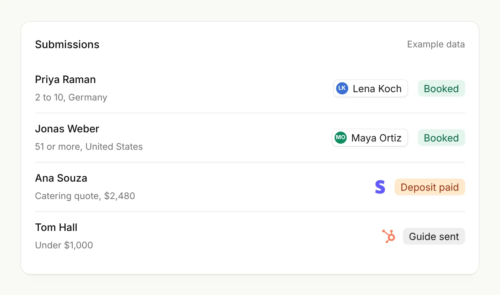
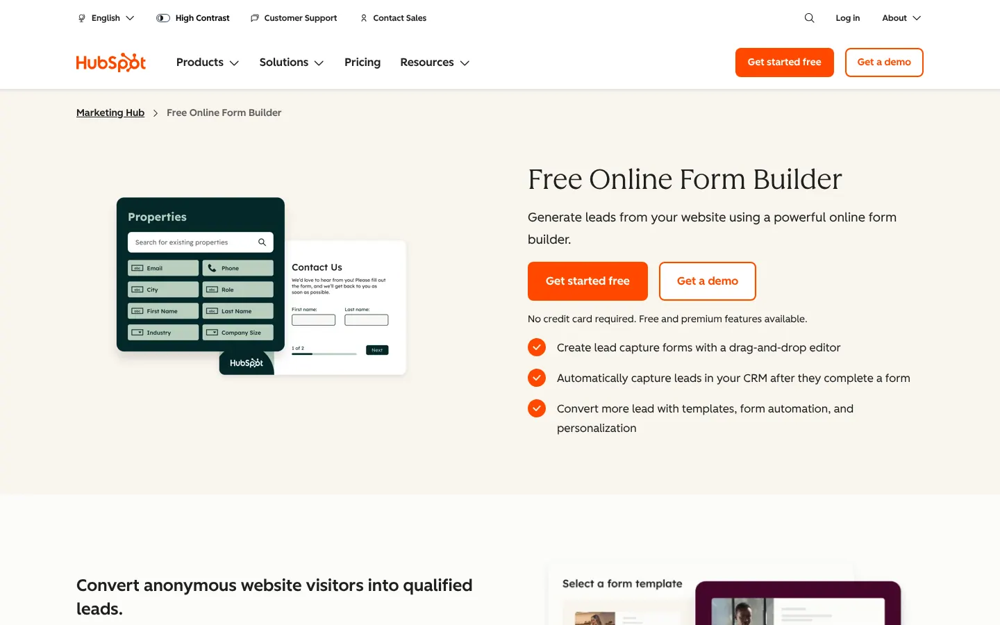
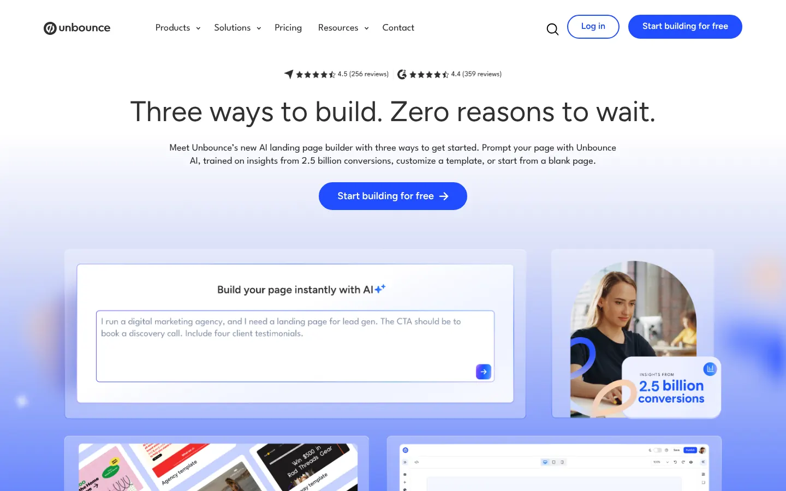

A lead generation form has one job. It turns a visitor into a lead you can follow up with. Too often, the lead lands in a spreadsheet and waits, and by the time someone calls, the visitor has moved on.

The best lead generation form builders keep the form short and move the lead to the next step while they still care. The lead lands in your CRM, or books a call right away, and you know which campaign brought them in.

> **[Try Claritia free](https://app.tryclaritia.com/signup)** to build a lead form that books the meeting before the visitor leaves the page.

Below, we compare 8 lead generation form builders on what happens to each lead after the form, what each tool costs, and where it falls short.

## Main points

- The minute after someone hits submit matters most. A booked call or a CRM sync beats a lead sitting in a spreadsheet.
- Hidden fields for UTM tags and ad pixels show you which campaigns bring in leads.
- Spam control and free plan limits decide how many real leads you can collect before you pay.
- Top picks: [Claritia](/), [HubSpot forms](https://www.hubspot.com/products/marketing/forms), [Typeform](https://www.typeform.com/), [Fillout](https://www.fillout.com/), [Jotform](https://www.jotform.com/), [Paperform](https://paperform.co/), [Unbounce](https://unbounce.com/) and [Zoho Forms](https://www.zoho.com/forms/).
- Pick [Claritia](/) if you want each good lead to book a meeting before they leave the page.

## What is a lead generation form builder?

A lead generation form builder is a tool for making forms that collect contact details and a few qualifying answers from visitors. Each answer becomes a lead your team can follow up with. The best ones also send the lead somewhere useful, like your CRM or a booked meeting.

Typical features include:

- Short forms with conditional logic, so you only ask more when an answer calls for it.
- Hidden fields that keep UTM tags and the page a lead came from.
- Ad pixels and tracking tags to measure your campaigns.
- Spam protection to keep fake leads out.
- A link to your CRM or email tool.
- A next step after submit, like a booked meeting or a follow-up email.

## How to choose a lead generation form builder

Field types matter less than what happens after the form. Check these five things:

- **The step after submit.** Where the lead goes in the first minute: a booked call, your CRM, or a spreadsheet.
- **Tracking.** Hidden fields for UTM tags and ad pixels, so you know which campaigns work.
- **Spam control.** Fake leads waste your team's time.
- **Free plan limits.** How many leads you can collect before you pay.
- **Price as you grow.** What the bill looks like when leads double.

## The 8 best lead generation form builders in 2026

| Tool | Best for | Free plan | Paid from | What happens after submit |
|---|---|---|---|---|
| [Claritia](/) | Turning leads into booked meetings | Yes, 250 submissions a month | $12 a seat a month, billed yearly | The lead books a meeting inside the form |
| [HubSpot forms](https://www.hubspot.com/products/marketing/forms) | Teams living in HubSpot | Yes, free forms | See their pricing page | The lead becomes a HubSpot contact |
| [Typeform](https://www.typeform.com/) | Brand-led lead forms | Yes, with a low response cap | $28 a month, billed yearly | AI can sort leads and send follow-ups |
| [Fillout](https://www.fillout.com/) | High volume on a small budget | Yes, 1,000 responses a month | $15 a month, billed yearly | Sends to HubSpot and other tools on every plan |
| [Jotform](https://www.jotform.com/) | Lead forms with payments | Yes, 5 forms and 100 submissions | $34 a month, billed yearly | Creates HubSpot contacts and deals |
| [Paperform](https://paperform.co/) | Lead forms that look like pages | Yes, 30 submissions a month | $49 a month, billed yearly | The appointment field books a time |
| [Unbounce](https://unbounce.com/) | Landing pages built around a form | No, 14-day trial | $29 a month, billed monthly | The lead stays on a page built to convert |
| [Zoho Forms](https://www.zoho.com/forms/) | Teams on Zoho CRM | Yes, 3 forms and 500 submissions | See their pricing page | The lead goes to Zoho CRM |

## 1. Claritia

[Claritia](/) is a forms, scheduling and follow-up app built for small B2B teams that want every lead from their website to reach the right rep and book a meeting before they leave the page.

It builds forms from a sentence or one of 840 templates, opens the right person's calendar the moment the form is sent, routes each lead by its answers, and drafts follow-up emails in your brand's voice for you to approve.

A visitor books in the same flow and gets a confirmation email with a calendar invite, then workflows send reminders a day and an hour before, so the lead hears from you before the call.

> **[Try Claritia free](https://app.tryclaritia.com/signup)** and set up a lead form that books meetings on the free plan.

### Key features

- **Booking inside the form:** On the free plan, with Google Calendar and Outlook.
- **Tracking:** Hidden fields catch UTM tags, and you can add Google Analytics, Google Tag Manager, Meta Pixel and Google Ads tags.
- **Spam control:** Cloudflare spam protection, a honeypot, a rate limit and disposable email blocking keep fake leads out.
- **CRM links:** On Starter, the form sends leads to HubSpot, Pipedrive, Attio and many more. See the [HubSpot integration](/integrations/hubspot).
- **Follow-up:** On Starter, a follow-up goes out the next day until the lead books.
- **Routing:** On Pro, route each lead to the right person based on their answers.

*Claritia's submissions list shows each lead, who they booked with and their next step.*

### Pros

- **One step from form to meeting:** The lead fills in the form and books a time in the same flow.
- **Spam control for free:** Every spam check is on the free plan.
- **Fair seat pricing:** Teammates who only build forms or read answers are free.

### Cons

- **Newer tool:** Its app marketplace and community are smaller than the big names.
- **Built for small teams:** It's made for small teams, not large enterprises.

### Price and plans

You can start on the free plan with no card. Paid plans are priced per seat, and a seat is a teammate people can book a meeting with.

- **Free:** $0 for 1 seat and 250 submissions a month.
- **Starter:** $15 a seat a month ($12 billed yearly). Adds HubSpot and other CRMs, Stripe payments and the next-day follow-up.
- **Pro:** $39 a seat a month ($31 billed yearly). Adds round robin and routing by answer.
- **Business:** $79 a seat a month ($63 billed yearly). Adds Salesforce, partial answers and owner first.

## 2. HubSpot forms

[HubSpot forms](https://www.hubspot.com/products/marketing/forms) is the form builder in HubSpot's Marketing Hub for marketers who want website visitors to become CRM contacts automatically. Users build forms in a drag-and-drop editor or from templates for newsletter signups, downloads, event registration and more, then embed them on a site or publish them as standalone pages.

Each submission is saved to the contact database, can trigger a follow-up email or nurture campaign, and feeds reports on views, submissions and conversion rate. The forms are free to start, which makes them the natural pick for teams whose whole funnel already runs in HubSpot. The more advanced form features sit on paid plans.

### Key features

- **Free CRM forms:** Every visitor who fills in a form is added to the CRM.
- **Follow-up and spam:** Automatic follow-up emails and spam filtering.
- **Form shortening:** Fills known fields, so returning visitors see fewer questions.
- **One system:** Forms live with your contacts and emails.

### Pros

- **Free to start:** The form builder costs nothing.
- **No sync to set up:** Leads land straight in HubSpot.

### Cons

- **Logic costs more:** HubSpot lists conditional logic and multi-step forms as premium features.
- **Rising cost:** Paid Marketing Hub plans add up as you add seats and contacts.

### Price and plans

- **Forms:** Free.
- **Marketing Hub:** See their pricing page.

## 3. Typeform

[Typeform](https://www.typeform.com/) is an online form builder for marketing, product, HR, and customer teams that want forms, surveys, and quizzes people actually finish. It builds conversational forms that adapt to each answer, can draft and brand a form from a written prompt, and accepts video and audio replies.

Responses can go to tools like HubSpot, Google Sheets, and Notion, take Stripe payments, book Calendly meetings, and feed AI summaries of themes and sentiment. Showing one question at a time can make a lead form feel more like a chat.

Its AI can also ask a follow-up question when an answer is vague, and its automations can send follow-up emails, so it suits brands that want a polished lead form.

### Key features

- **Conversational layout:** Suits short lead forms.
- **Clarify with AI:** Asks follow-up questions when an open answer is vague.
- **Automations:** Sort respondents and send follow-ups.
- **HubSpot mapping:** Answers can map to HubSpot properties.

### Pros

- **Polished forms:** A lead form that feels like a chat.
- **Follow-up built in:** Automations can sort leads and send emails.

### Cons

- **Low cap on Basic:** 100 responses a month.
- **Free plan for testing:** The low response cap suits testing more than live campaigns.

### Price and plans

- **Free:** Yes, with a low response cap.
- **Basic:** $28 a month, billed yearly.
- **Plus:** $56 a month, billed yearly.
- **Business:** $91 a month, billed yearly.

## 4. Fillout

[Fillout](https://www.fillout.com/) is a form builder for teams that want branded forms, surveys, and quizzes connected to the tools they already use. You can describe a form for its AI to build or use drag and drop, then add logic, file uploads, payments, and signatures.

It also offers scheduling forms that sync with Google Calendar or Outlook, PDF generation, workflows, login forms that let people edit past answers, custom domains, and native integrations.

It has one of the most generous free plans for lead forms, with 1,000 responses a month and unlimited forms and seats, and HubSpot is among the integrations on every plan. It suits teams that collect a lot of leads and want to keep costs low.

### Key features

- **Free responses:** 1,000 a month.
- **Logic and scheduling:** Conditional logic and scheduling forms on all plans.
- **Integrations:** Most of them, HubSpot included, on every plan.
- **Partial submissions:** On the Business plan, so you see leads who stopped halfway.

### Pros

- **Volume on a budget:** A large free allowance for lead forms.
- **CRM on the free plan:** HubSpot without an upgrade.

### Cons

- **No CAPTCHA on free:** That matters for public lead forms.
- **Salesforce costs more:** It's only on the Team and Enterprise plans.

### Price and plans

- **Free:** $0, with 1,000 responses a month.
- **Starter:** $15 a month, billed yearly.
- **Pro:** $40 a month, billed yearly.
- **Business:** $75 a month, billed yearly.

## 5. Jotform

[Jotform](https://www.jotform.com/) is a drag and drop form builder for businesses, schools, nonprofits, and public agencies that want to collect data, payments, and signatures without writing code.

Forms can use conditional logic, answer piping, prefilled fields, and translations, and they accept one-time or recurring payments through many gateways. Submissions can become PDFs, flow into CRMs and spreadsheets, and be managed in related Jotform tools for tables, approval workflows, e-signatures, and reports.

It is a large, mature builder with a form for almost every case, and its HubSpot integration can create contacts, deals, tickets and companies from a submission. Its payment handling suits lead forms that take a deposit or collect long details.

### Key features

- **HubSpot integration:** Creates contacts, deals, tickets and companies from a submission.
- **Conditional logic:** On the free plan.
- **AI form generator:** Free to use.
- **AI Agents:** With limits by plan.

### Pros

- **More than contacts:** A lead form can open a deal in HubSpot.
- **Payments:** A good fit when the lead form takes a deposit.

### Cons

- **Small free plan:** 5 forms and 100 submissions a month.
- **Single user:** Paid plans are for one user until Enterprise.

### Price and plans

- **Starter:** Free, with 5 forms and 100 submissions a month.
- **Bronze:** $34 a month, billed yearly.
- **Silver:** $39 a month, billed yearly.
- **Gold:** $99 a month, billed yearly.

## 6. Paperform

[Paperform](https://paperform.co/) is an online form builder for small businesses and solo operators who want one form to capture details, take payment, and start the next step. Its editor works like a document, with a one question at a time mode, conditional logic, and spreadsheet style formulas for prices and scores.

Forms can take bookings and Stripe payments, send contracts for e-signature through Papersign, and pass submissions to CRMs, email tools, and spreadsheets through integrations or Stepper workflows.

Its forms look like web pages, with text and images mixed in, and its appointment field is on every plan and syncs with Google Calendar, so a lead can pick a time. That suits service businesses that want a lead form with room to explain the offer.

### Key features

- **Appointment field:** On every plan, with Google Calendar sync.
- **Conditional logic:** On all plans.
- **Unlimited submissions on Pro:** Within fair use.
- **HubSpot integration:** Creates or updates a contact directly.

### Pros

- **Room to explain:** Good for businesses that sell with a story.
- **Booking on every plan:** A lead can pick a time from the form.

### Cons

- **Tiny free plan:** 30 submissions a month.
- **Partial responses cost more:** They need Pro or higher.

### Price and plans

- **Free:** 30 submissions a month.
- **Pro:** $49 a month billed yearly, or $59 billed monthly.
- **Business:** $124 a month billed yearly, or $149 billed monthly.

## 7. Unbounce

[Unbounce](https://unbounce.com/) is a landing page builder for marketers and agencies who want to build and test campaign pages without a developer. A page can start from an AI prompt, a template or a blank canvas, then be edited by prompt or drag and drop.

Unbounce runs A/B tests, uses Smart Traffic to send visitors to the variant most likely to convert, adds popups and sticky bars, and publishes to custom domains with forms that pass leads to other tools.

You build the whole page around the form. Conversions are uncapped on every plan, with the limits on visitors, so it suits marketers running paid ads to a page made for one offer.

### Key features

- **Lead gen forms:** Built into landing pages.
- **Uncapped conversions:** No cap on any plan.
- **AI credits:** On every plan, for writing page copy.
- **Free trial:** 14 days with full features and no credit card.

### Pros

- **Page and form together:** Test versions of the whole page.
- **No lead cap:** Conversions are uncapped on every plan.

### Cons

- **Visitor limits:** Starter allows 500 visitors a month.
- **Page builder first:** Complex forms need another tool.

### Price and plans

Prices below are billed monthly. Yearly billing costs less.

- **Starter:** $29 a month.
- **Build:** $99 a month.
- **Experiment:** $149 a month.
- **Optimize:** $249 a month.

## 8. Zoho Forms

[Zoho Forms](https://www.zoho.com/forms/) is an online form builder for businesses that want to collect data and move it through review and approval steps without code.

It can build a form from a prompt, turn PDFs or photos of paper forms into online forms, and read business cards or IDs to fill in fields. Forms support many field types, subforms, payments, and multi-level approvals, a mobile app collects entries offline, and data can flow into Zoho CRM.

A Zoho CRM field and the integration come on every plan, and paid plans have high caps, starting at 10,000 submissions a month. It fits teams that run sales in Zoho CRM and already pay for Zoho apps.

### Key features

- **Zoho CRM:** On every plan.
- **Save and resume:** A lead can finish later.
- **AI tools:** Turn a PDF or an image into a form.
- **High caps:** On paid plans.

### Pros

- **Leads straight to Zoho CRM:** No extra tool in the middle.
- **Room for volume:** Paid plans start at 10,000 submissions a month.

### Cons

- **Small free plan:** 3 forms.
- **Best inside Zoho:** It works best for teams already on other Zoho apps.

### Price and plans

- **Free:** 3 forms and 500 submissions.
- **Paid plans:** See their pricing page.

## Which lead generation form builder should you pick?

- If you want good leads to book a meeting before they leave the page, pick [Claritia](/).
- If your team already runs on HubSpot and the free forms cover you, start with [HubSpot forms](https://www.hubspot.com/products/marketing/forms).
- If you collect a lot of leads on a tight budget, pick [Fillout](https://www.fillout.com/).
- If you run paid ads to one offer and want to test pages, pick [Unbounce](https://unbounce.com/).
- If your sales team lives in Zoho CRM, pick [Zoho Forms](https://www.zoho.com/forms/).

## Questions

### What is a lead generation form?

A lead generation form collects contact details and a few qualifying answers from a visitor. The goal is a lead your team can follow up with. Short forms with a clear next step tend to work best.

### How many fields should a lead form have?

Ask only for what you need to take the next step. An email and one or two qualifying questions are often enough. Conditional logic lets you ask more only when an answer calls for it.

### How do I stop spam leads?

Use a form builder with spam protection built in. Claritia includes Cloudflare spam protection, a honeypot, a rate limit and disposable email blocking on the free plan.

### Can a lead form book a meeting?

Yes. Claritia puts meeting booking inside the form on every plan. On Pro, it can route each lead to the right person based on their answers.

### Which lead form builders connect to HubSpot?

Claritia connects to HubSpot on Starter. Fillout, Jotform, Paperform and Typeform also offer HubSpot connections. HubSpot's own forms add leads straight to its CRM.

## Get started

Start with one short form on the free plan and see how many leads book a call.

> **[Try Claritia free](https://app.tryclaritia.com/signup)** to build your first lead form and book your first meeting today.

You can also browse [form templates](/templates) or see how [Claritia meetings](/products/meetings) work with your forms.
