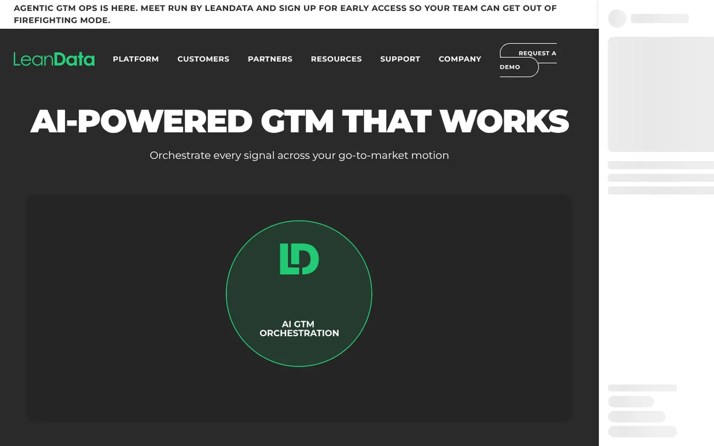
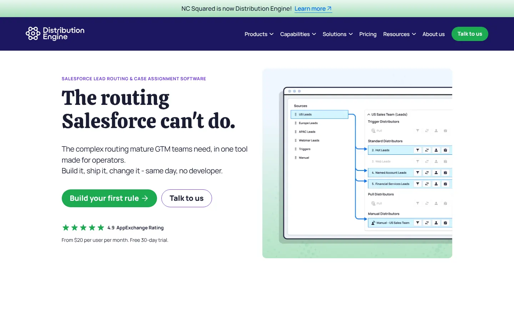
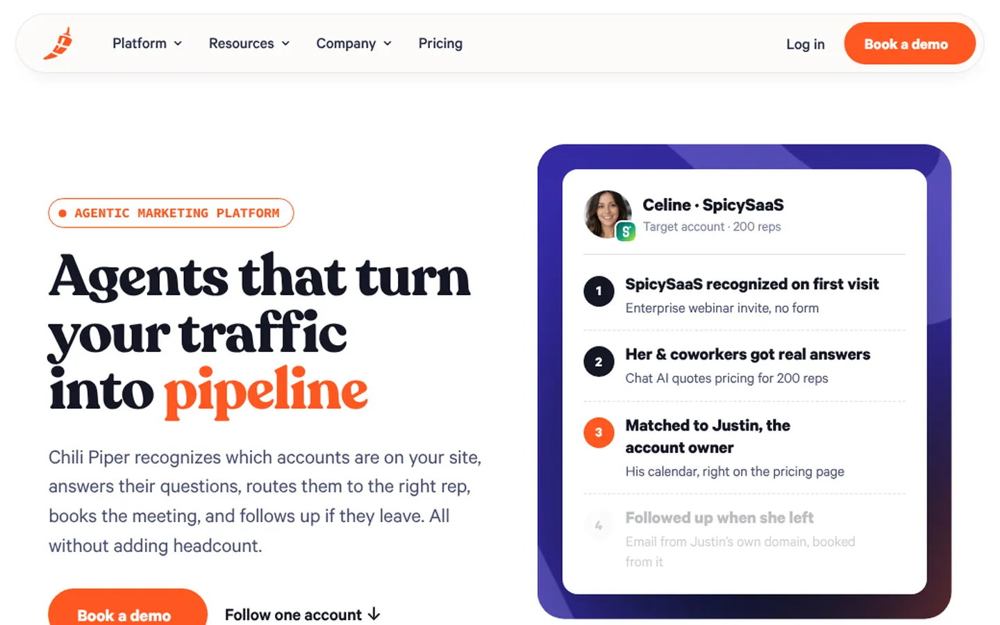
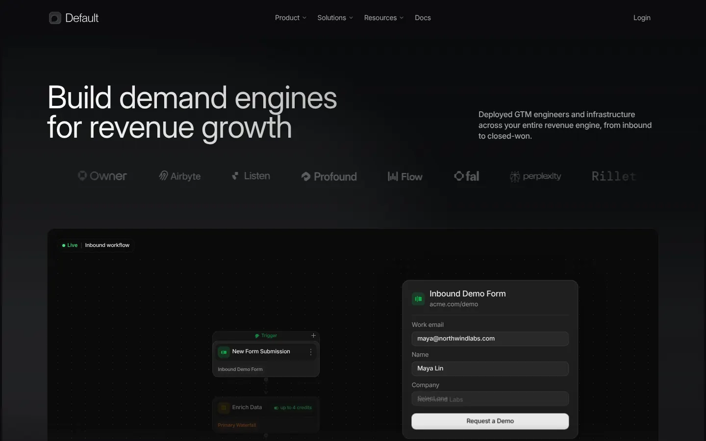
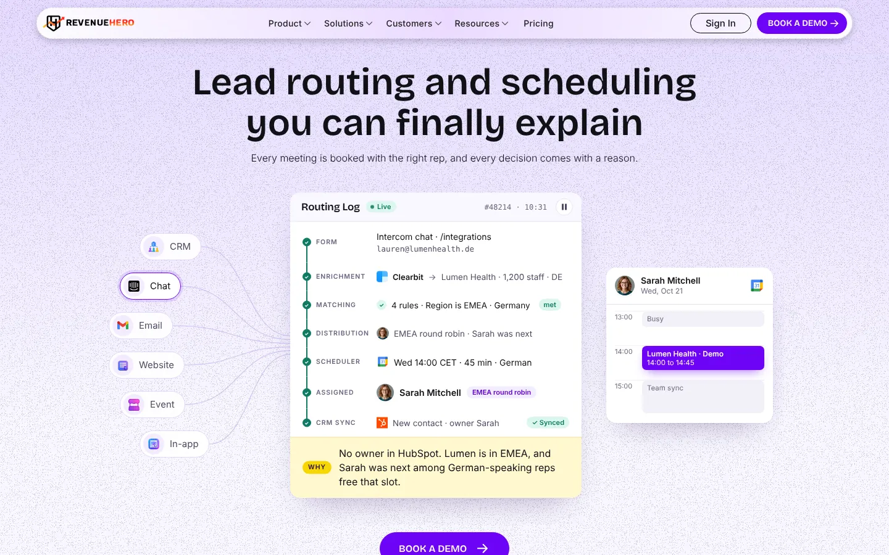

Lead routing decides who gets each new lead and how fast. When nobody owns that choice, a lead waits in an inbox, lands with the wrong rep, or goes to someone who is out that week.

A good router reads what the lead told you and checks who already owns the account. Then it hands the lead to a free rep, ideally with a meeting already booked, and shows you why each lead went where it did.

> **[Try Claritia free](https://app.tryclaritia.com/signup)** to build a form that routes each lead to the right rep and books the meeting in the same step.

In this post, we compare 8 lead routing tools. You'll see what each one routes on, which CRM it needs and what it costs.

## Main points

- Some tools live inside Salesforce and handle territories across thousands of accounts. Others start from a web form and book the meeting in the same step.
- Know which kind you need before you compare prices.
- Check what the tool routes on, which CRM it needs, and whether a log shows why each lead went where it did.
- Top picks: [Claritia](/), [LeanData](https://www.leandata.com/), [Distribution Engine](https://www.distributionengine.com/), [Chili Piper](https://www.chilipiper.com/), [Default](https://www.default.com/), [RevenueHero](https://www.revenuehero.io/), [Calendly](https://calendly.com/) and [OnceHub](https://www.oncehub.com/).
- Pick [Claritia](/) if your leads come in through web forms and you want each one booked with the right person.

## What is lead routing software?

Lead routing software decides which person gets each new lead. It reads form answers or CRM fields and hands the lead to the right rep based on your rules.

Typical features include:

- Rules based on form answers or CRM fields.
- Round robin, to share leads fairly across a team.
- Owner-first routing to the rep who already owns the person or account.
- Territory routing by region or account.
- A fallback when no one in the rule is free.
- A routing log that shows why each lead went where it did.

## How to choose lead routing software

Start with where your leads come from. Then run these five checks:

- **What it routes on.** Form answers, CRM fields, territories or past activity.
- **Which CRM it needs.** Some tools need Salesforce. Others work without a CRM at all.
- **A clear log.** You should see why each lead went to each person.
- **A fallback.** Something should happen when no one in the rule is free.
- **Entry price and contract terms.** Check the lowest plan with routing, and whether it ties you to a yearly contract.

## The 8 best lead routing software tools in 2026

| Tool | Best for | Free plan | Paid from | Routes by |
|---|---|---|---|---|
| [Claritia](/) | Routing form leads straight to a meeting | Yes | $12 a seat a month, billed yearly | Any form answer and past answers; CRM owner on Business |
| [LeanData](https://www.leandata.com/) | Salesforce teams with territory rules | No | See their pricing page | Territory and any Salesforce object |
| [Distribution Engine](https://www.distributionengine.com/) | Salesforce teams who want a published price | 30-day trial | $20 a user a month, billed yearly | Workload and account owner |
| [Chili Piper](https://www.chilipiper.com/) | Large teams with SDR to AE handoffs | No | $15,000 a year with 15 seats | Form answers and fair distribution |
| [Default](https://www.default.com/) | Ops teams who want routing with workflows | None listed | $12,000 a year | Queues and CRM objects |
| [RevenueHero](https://www.revenuehero.io/) | B2B inbound with CRM matching | No | $79 a month plus $25 a seat, billed yearly | Custom rules and domain; any CRM property on Advanced |
| [Calendly](https://calendly.com/) | Routing on a booking link | Yes, 1 event type | $16 a seat a month for routing, billed yearly | Form answers and CRM assignment |
| [OnceHub](https://www.oncehub.com/) | Routing forms and chatbots | Yes | $19 a user a month for routing, billed yearly | Form answers and CRM contact owner |

## 1. Claritia

[Claritia](/) is a forms, scheduling and follow-up app built for small B2B teams that want every lead from their website to reach the right rep and book a meeting before they leave the page.

It builds forms from a sentence or one of 840 templates, opens the right person's calendar the moment the form is sent, routes each lead by its answers, and drafts follow-up emails in your brand's voice for you to approve.

Routing starts from the form itself, since each form picks the meeting and each meeting picks the person. You can route by any answer or by what the person said in past fills, and on Business a known account goes to its CRM owner.

> **[Try Claritia free](https://app.tryclaritia.com/signup)** and turn on routing by answer when you move to Pro.

### Key features

- **Routing by answer:** Route by any answer to a meeting and a person on Pro.
- **Past answers:** A returning lead goes where it went before.
- **Routing log:** Shows why each lead went where it did.
- **Owner first:** On Business, with double round robin and Salesforce. See the [Salesforce integration](/integrations/salesforce).
- **Fair rotation:** Team pools and away days keep the rotation fair on Pro.
- **Booking inside the form:** The lead picks a time on the same page.

### Pros

- **No CRM needed:** Routing works from form answers alone.
- **Monthly billing:** Pay month to month, or save 20% billed yearly.
- **Fair seat pricing:** Teammates who only build forms or read answers are free.

### Cons

- **Built for small teams:** It fits small teams more than large enterprises with deep territory maps.
- **Newer tool:** Its app marketplace is smaller than the big names.

### Price and plans

You can start on the free plan with no card. Paid plans are priced per seat, and a seat is a teammate people can book a meeting with.

- **Free:** $0 for 1 seat and 250 submissions a month.
- **Starter:** $15 a seat a month ($12 billed yearly). Adds HubSpot and other CRMs.
- **Pro:** $39 a seat a month ($31 billed yearly). Adds routing by answer and by past answers, round robin, team pools and the routing log.
- **Business:** $79 a seat a month ($63 billed yearly). Adds Salesforce, owner first and double round robin.

## 2. LeanData

[LeanData](https://www.leandata.com/) is a revenue orchestration platform for B2B marketing, sales, operations, and customer success teams that want every lead and account handled by the right person. It matches leads to accounts and opportunities, routes them by territory rules, round robin, and service levels, and keeps an audit trail of each decision, with deep Salesforce support.

Its BookIt tool lets prospects schedule with the assigned rep, and Journeys tracks buying groups across a deal. Its Standard edition covers round robin and territory routing for leads, and higher editions extend routing to contacts and accounts, then to any standard or custom Salesforce object.

### Key features

- **Lead routing:** Round robin, territory routing and lead-to-account routing on Standard.
- **Multi-criteria assignment:** Along with signal-driven workflows, on Advanced.
- **Any Salesforce object:** On Premium, with scheduled automations.
- **BookIt:** Adds scheduling for forms and handoffs.

### Pros

- **Room to grow:** Routing extends from leads to contacts, accounts and any Salesforce object.
- **Scheduling add-on:** BookIt books meetings from forms and handoffs.

### Cons

- **Quote pricing:** Pricing is by quote, and onboarding is billed apart.
- **Salesforce only:** It's built around Salesforce, so teams on other CRMs need a different tool.
- **No free plan:** You start with a quote.

### Price and plans

- **Standard, Advanced and Premium:** By quote. Quotes depend on the features and the number of Salesforce users or queues.
- **Onboarding:** Billed apart.

## 3. Distribution Engine

[Distribution Engine](https://www.distributionengine.com/) is a lead routing and case assignment app built inside Salesforce for revenue operations teams and Salesforce admins who want every record to reach the right rep fast, without writing code.

It assigns leads, cases and other records by round robin, territory, skills, workload, availability and account ownership, matches inbound leads to existing accounts, and reassigns work that misses its response target.

A companion product, Booking Engine, books meetings and hands qualified leads to reps inside Salesforce. It installs from the Salesforce AppExchange and keeps all data in your Salesforce org, and its published prices make budgeting simple.

### Key features

- **Round robin:** Along with territory assignment.
- **Workload routing:** Routes by workload or account ownership.
- **Skills-based routing:** For support and sales teams.
- **Booking Engine:** A separate product for scheduling.

### Pros

- **Published prices:** Easy to budget for.
- **Free trial:** 30 days with no credit card.
- **Your data stays put:** All data stays in your Salesforce org.

### Cons

- **Needs Salesforce:** It only works inside Salesforce.
- **License minimum:** Paid plans need at least 5 licenses, billed yearly.
- **Scheduling costs extra:** Booking Engine is a separate product.

### Price and plans

Paid plans need at least 5 licenses and are billed yearly.

- **Starter:** $20 a user a month.
- **Unlimited:** $55 a user a month.
- **Booking Engine:** $10 a user a month.

## 4. Chili Piper

[Chili Piper](https://www.chilipiper.com/) is a meeting booking and lead routing platform for B2B revenue teams that want inbound buyers to book with the right rep right away. When someone submits a form, it qualifies them, routes them by rules such as company size, region or account owner, and shows that rep's calendar on the spot.

It also routes Salesforce records by rep workload, identifies visiting companies, runs an AI chat, blocks fake bookings and sends reps a brief before each meeting. Its strength is the handoff, where an SDR books the right AE in one click.

It connects to Salesforce and HubSpot and shares leads fairly across a sales team, so it suits larger sales teams with set handoffs between SDRs and AEs.

### Key features

- **Form routing:** Form routing and lead distribution on Growth.
- **One-click handoffs:** An SDR books the right AE in one click.
- **CRM connections:** Salesforce and HubSpot.
- **Marketing connections:** Marketo and Pardot.

### Pros

- **Built for handoffs:** Fits teams with set SDR to AE handoffs.
- **Both big CRMs:** Works with Salesforce and HubSpot.

### Cons

- **High entry price:** Growth starts at $15,000 a year with 15 seats.
- **Yearly billing only:** All plans are billed yearly, with no monthly option.
- **No free plan:** You start on a paid plan.

### Price and plans

All plans are billed yearly.

- **Growth:** $15,000 a year with 15 seats, then $45 a seat a month.
- **Scale:** $42,000 a year with 30 seats.

## 5. Default

[Default](https://www.default.com/) is a go-to-market platform for B2B revenue and RevOps teams that want inbound leads qualified, routed, and booked without manual work. When a visitor submits a demo form, it enriches the record from a chain of data providers, checks it against ideal customer rules, assigns a rep by round robin or territory, and opens that rep's branded scheduler.

It also offers a Chrome extension, two-way CRM sync, an API, and access for AI agents through MCP. Each rep takes a seat for routing or scheduling on top of the base plan, and the Routing and Scheduling seat covers queues and round robins, plus booking links. It suits ops teams who want routing and workflow runs in one platform.

### Key features

- **Routing and Scheduling seat:** Queues and object routing.
- **Workflow runs:** 200,000 a year on Growth.
- **Enrichment:** 24,000 enrichment credits a year on Growth.
- **Rollover:** Unused credits and runs roll over within the yearly agreement.

### Pros

- **One platform:** Routing, enrichment and workflows together.
- **Unused runs carry over:** Credits and runs you don't use roll over within the agreement.

### Cons

- **High entry price:** Growth starts at $12,000 a year, plus seats.
- **Seats cost extra:** A Routing and Scheduling seat is $540 a user a year.
- **No free plan listed:** You start on a yearly plan.

### Price and plans

Plans are billed yearly, plus seats.

- **Growth:** $12,000 a year.
- **Enterprise:** $25,000 a year.
- **Routing and Scheduling seat:** $540 a user a year.

## 6. RevenueHero

[RevenueHero](https://www.revenuehero.io/) is a lead routing and scheduling tool for B2B demand gen, sales, and RevOps teams that want each qualified lead booked with the right rep.

It matches leads to accounts and owners already in the CRM, routes the rest by territory and other rules, and runs round robin with weights, caps, and paired AE and SE booking. It logs the reason behind every assignment, returns credit for no-shows, and syncs meetings to HubSpot, Salesforce, or Attio.

It books leads from forms and booking pages. Essentials handles round robin with custom rules and domain matching, and Advanced adds matching on any CRM property, along with fallback redistribution. It suits B2B teams who want CRM-aware routing without a large contract.

### Key features

- **Domain matching:** With a routing log, on Essentials.
- **CRM matching:** Match on any CRM property or lookup field on Advanced.
- **Fallback redistribution:** On Advanced, when the first pick can't take the lead.
- **Free admin seats:** With no seat minimum.

### Pros

- **No seat minimum:** Start with the team you have.
- **Free admin seats:** Admins don't need a paid seat.
- **Monthly option:** Essentials can be paid monthly.

### Cons

- **No free trial:** You start on a paid plan.
- **Advanced for CRM updates:** Owner updates and lead creation in the CRM need Advanced.

### Price and plans

- **Essentials:** $79 a month plus $25 a seat, billed yearly, or $99 plus $35 a seat billed monthly.
- **Advanced:** $159 plus $35 a seat, billed yearly.

## 7. Calendly

[Calendly](https://calendly.com/) is scheduling software for professionals and teams who want people to book meetings without trading emails. You connect your calendars, set hours, buffers, and daily limits, and share booking links for one-on-one, multi-host, or group meetings. It sends email and text reminders, offers routing forms that send website leads to the right teammate, and collects payments.

Newer tools include an AI assistant that finds times over email and a notetaker that writes meeting recaps. Its routing forms come on the Teams plan, where a lead answers a few questions and lands on the right event, and Teams also routes by HubSpot assignment. Routing by Salesforce assignment and Salesforce lookup come on Enterprise.

### Key features

- **Routing forms:** On Teams.
- **Owner routing:** Routes by HubSpot owner on Teams, and by Salesforce assignment on Enterprise.
- **Salesforce lookup routing:** On Enterprise.
- **Round robin:** Shares the meetings across the team.

### Pros

- **Simple routing:** A few questions send the lead to the right event.
- **HubSpot owner routing on Teams:** No Enterprise plan needed for HubSpot owners.
- **Free plan:** One event type for free.

### Cons

- **Routing needs Teams:** Routing forms skip the Standard plan.
- **Large Enterprise contract:** Enterprise starts at $15,000 a year with a 50-seat minimum.

### Price and plans

- **Free:** 1 event type.
- **Teams:** $16 a seat a month billed yearly ($20 monthly).
- **Enterprise:** From $15,000 a year, with a 50-seat minimum.

## 8. OnceHub

[OnceHub](https://www.oncehub.com/) is a scheduling and engagement platform for sales, service, support, and recruiting teams that want to screen visitors and book them with the right person. It offers branded booking pages, booking hubs, routing forms that qualify people before they book, and AI chat and phone agents that answer questions and schedule calls.

Its scheduling engine handles one-on-one, multi-host, and group meetings, creates video links and reminders, and connects to CRMs and Zapier. Its Route plan adds routing forms and round robin and can send a meeting to the contact owner in your CRM, while Engage adds website chatbots that route leads in a chat.

### Key features

- **Routing forms:** On Route, with round robin.
- **Contact owner:** Meetings with the CRM contact owner on Route and up.
- **Chatbots:** On Engage, to route leads in a chat.
- **Trial:** A 14-day trial of Engage with no credit card.

### Pros

- **Free plan:** A free Basic plan to start.
- **Forms and chat:** Routing forms and chatbots from one tool.

### Cons

- **Routing needs Route:** Routing needs Route or higher.
- **Chatbots cost more:** Chatbots only come on Engage.

### Price and plans

- **Basic:** Free.
- **Route:** $19 a user a month billed yearly ($23 monthly).
- **Engage:** $39 a user a month billed yearly.

## Which lead routing software should you pick?

- If your leads come in through web forms and you want each one booked with the right person, pick [Claritia](/) Pro.
- If you run Salesforce with territories and account rules, compare [LeanData](https://www.leandata.com/) with [Distribution Engine](https://www.distributionengine.com/).
- If you need matching on CRM fields at a lower entry price, try [RevenueHero](https://www.revenuehero.io/) Advanced.
- If you want routing and workflow runs under one yearly contract, look at [Default](https://www.default.com/).
- If you only need a few questions before a booking link, [Calendly](https://calendly.com/) Teams is enough.

## Questions

### What is lead routing software?

Lead routing software decides which person gets each new lead. It reads form answers or CRM fields and hands the lead to the right rep based on your rules.

### Do you need Salesforce for lead routing?

Some tools need it, like LeanData and Distribution Engine. Claritia routes from form answers with no CRM needed, and adds Salesforce owner first on Business.

### What is owner-first routing?

Owner-first routing sends a lead to the rep who already owns that person or account in your CRM. In Claritia, it's on the Business plan.

### How do you check that leads go to the right place?

Use a routing log. Claritia's routing log on Pro shows where each lead went and which rule sent it there.

### What happens when no one in a rule is free?

Good tools fall back to a wider group. In Claritia, team pools and round robin share the lead among the people who can take it.

## Get started

Route your next form lead to the right person, with the meeting booked before they leave the page.

> **[Try Claritia free](https://app.tryclaritia.com/signup)** to build your first form today, then turn on routing on Pro.

You can also read how [routing](/products/routing) works or connect [Salesforce](/integrations/salesforce).
