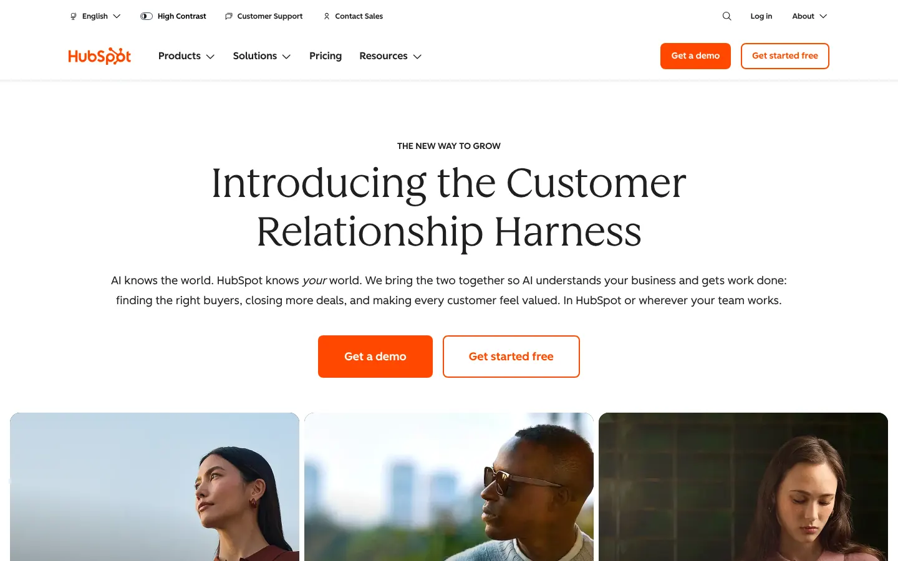
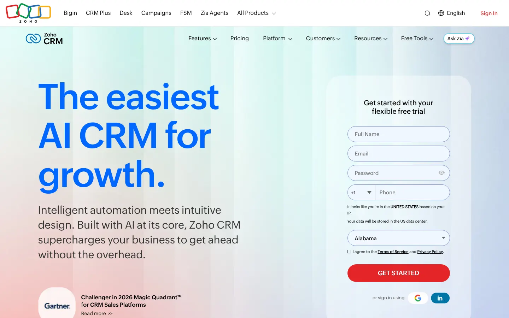
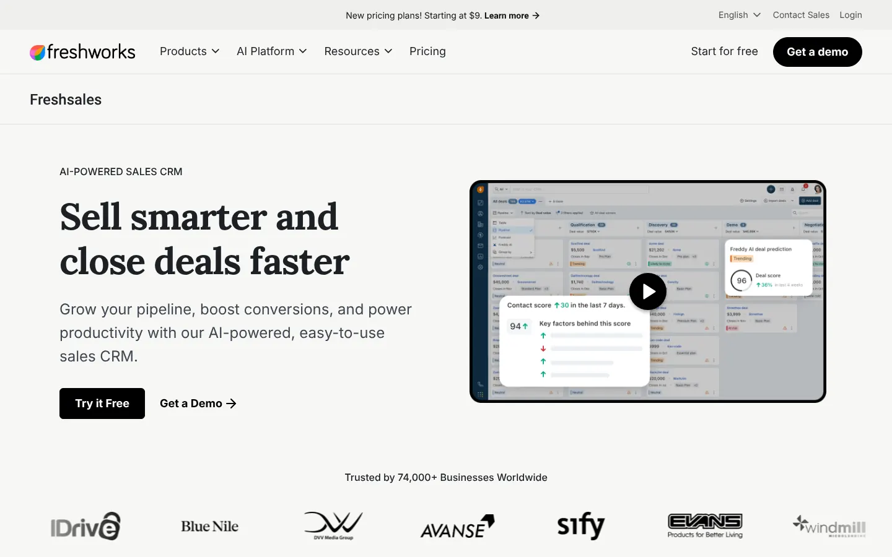
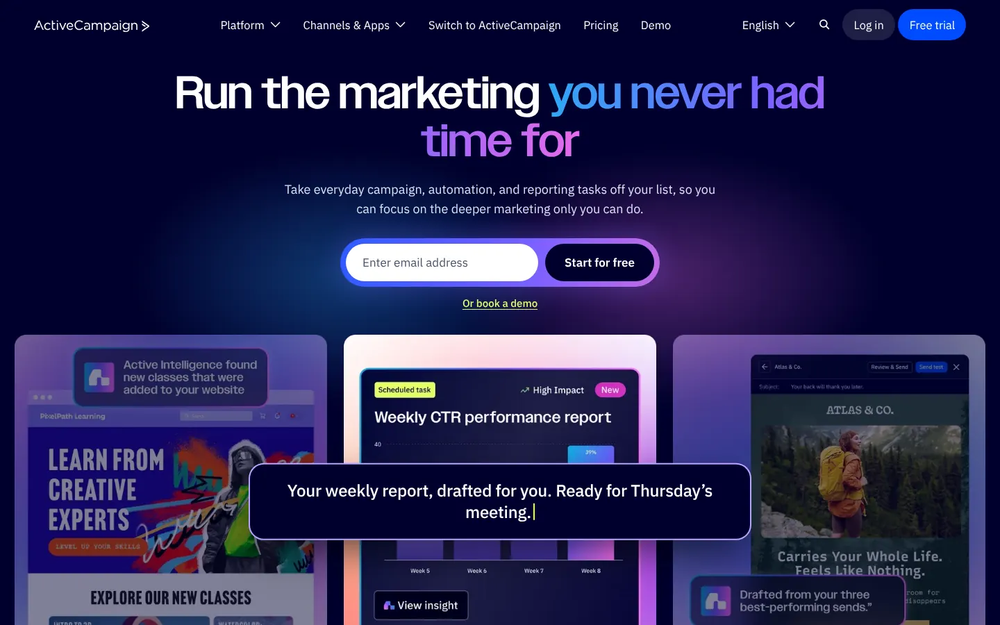
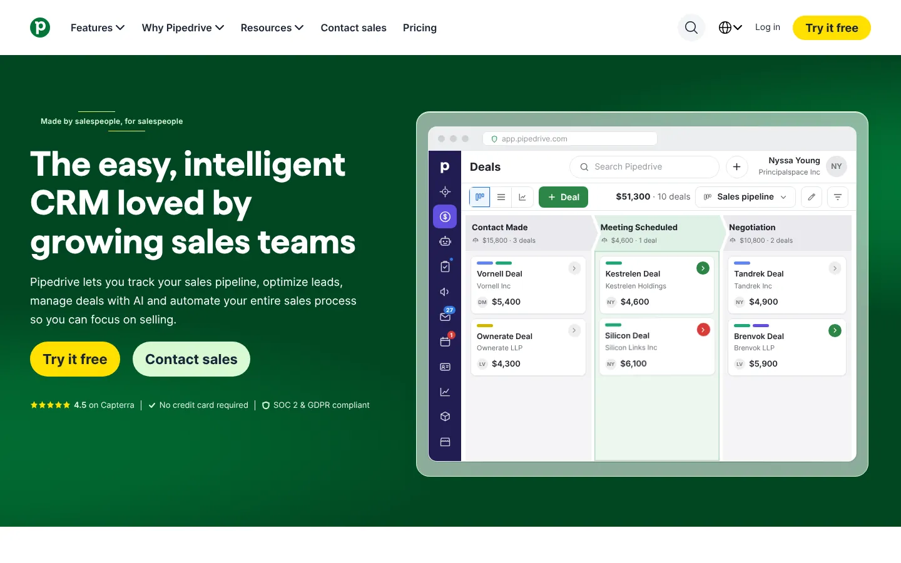

Leads come in from your forms, chats and campaigns, and your reps can't call them all today. So they guess. They pick the newest lead, or the one with a familiar company name, while a perfect fit who asked for a demo yesterday sits further down the list.

Lead scoring software ranks those leads for you. It adds points for good fit and real interest, takes points away for bad signs, and puts the best leads at the top. The catch is that many tools keep scoring on a higher plan, so the price you see first is rarely the price you pay for scoring.

> **[Try Claritia free](https://app.tryclaritia.com/signup)** to qualify each lead inside the form, route it by its answers and book the meeting before the lead leaves.

Below, we compare 7 lead scoring tools for small B2B teams: the kind of score each one builds, the plan that includes it and what it costs.

## Main points

- Most CRMs keep lead scoring off their free and entry plans.
- Rule-based scoring lets you set the points yourself. Predictive or AI scoring learns from past deals and needs enough history.
- [HubSpot](https://www.hubspot.com/) scores on Professional and up, [Salesforce Sales Cloud](https://www.salesforce.com/sales/) includes its predictive scoring on Advanced and Max, and [Zoho CRM](https://www.zoho.com/crm/) has scoring rules from Standard at $14 a user a month.
- Top picks: [Claritia](/), [HubSpot](https://www.hubspot.com/), [Salesforce Sales Cloud](https://www.salesforce.com/sales/), [Zoho CRM](https://www.zoho.com/crm/), [Freshsales](https://www.freshworks.com/crm/sales/), [ActiveCampaign](https://www.activecampaign.com/) and [Pipedrive](https://www.pipedrive.com/).
- Pick [Claritia](/) if most of your leads come from website forms and you want the good ones routed and booked in the same step.

## What is lead scoring software?

Lead scoring software gives each lead a number based on how well they fit your ideal customer and how interested they seem. It updates the score as the lead's details change or as they open emails, visit pages and fill in forms. New to the idea? Start with our guide to [what lead scoring is](/blog/what-is-lead-scoring).

Most of them have:

- Fit rules based on details like company size, job title or country.
- Interest rules based on actions like a demo request or a pricing page visit.
- Negative points for bad signs, like a competitor's domain.
- Score decay, so old activity counts for less over time.
- Thresholds that label leads hot, warm or cold.
- Predictive or AI scores on some plans.
- Workflows that act on the score, such as assigning an owner.

## How to choose lead scoring software

Start with where your leads already live, then check these five things:

- **The plan that includes scoring.** Many tools list lead scoring as a feature, then keep it on a plan two steps up.
- **Rules or AI.** Rules you write are clear and work from day one. AI scoring needs a history of won and lost leads to learn from.
- **What it can score.** Some tools score contacts, others score companies or deals. [Pipedrive](https://www.pipedrive.com/), for example, scores deals.
- **What the score triggers.** A score should assign an owner, alert a rep or start nurture emails. If it only fills a field, reps will ignore it.
- **The data behind it.** Fit scores are only as good as the details you collect. Ask for company size and role on your forms.

Some CRMs have no scoring engine at all. [Close](https://www.close.com/), for one, shows you how to score with custom fields and saved lists you update yourself.

## The 7 best lead scoring software tools in 2026

Prices checked November 2026.

| Tool | Best for | Type of score | Plan with scoring | Paid from |
|---|---|---|---|---|
| [Claritia](/) | Scoring and routing form leads in one step | Segments and lead scoring, plus points from form answers | Form calculations on every plan | $12 a seat a month, billed yearly |
| [HubSpot](https://www.hubspot.com/) | Teams already running on HubSpot | Fit, engagement and combined, with AI on Enterprise | Marketing Hub or Sales Hub Professional | Sales Hub Professional from $90 a seat a month |
| [Salesforce Sales Cloud](https://www.salesforce.com/sales/) | Larger teams with lots of lead history | Predictive | Advanced and Max, or a paid extra on Core | $395 a user a month for Advanced, billed yearly |
| [Zoho CRM](https://www.zoho.com/crm/) | Low-cost rule scoring | Rules, with Zia AI scores from Professional | Standard | $14 a user a month, billed yearly |
| [Freshsales](https://www.freshworks.com/crm/sales/) | AI contact scoring at a mid price | AI contact scoring | Pro | $39 a user a month, billed yearly |
| [ActiveCampaign](https://www.activecampaign.com/) | Email nurture with scoring | Lead scoring in the Pipelines add-on | Plus and up, with the add-on | $49 a month for Plus, billed yearly for 1,000 contacts |
| [Pipedrive](https://www.pipedrive.com/) | Scoring deals in a pipeline | Deal fit scores | Premium and up | See Pipedrive's pricing page |

## 1. Claritia

[Claritia](/) is a forms, scheduling and follow-up app built for small B2B teams that want every lead from their website to reach the right rep and book a meeting before they leave the page.

It builds forms from a sentence or one of 840 templates, opens the right person's calendar the moment the form is sent, routes each lead by its answers, and drafts follow-up emails in your brand's voice for you to approve.

For scoring, it keeps segments and lead scoring next to your contacts, and a form can add up points while the lead answers. The answers then decide which meeting and which rep each lead gets.

> **[Try Claritia free](https://app.tryclaritia.com/signup)** and build a form that qualifies leads and books the good fits today.

### Key features

- **Points inside the form:** Calculations and formulas add up a score as the lead answers, on every plan.
- **Segments and lead scoring:** Group and rank contacts next to their answers and meetings.
- **AI qualify:** It only picks an outcome you set, so leads never land in a bucket you didn't define.
- **Routing:** Route by any answer to a meeting and a person on Pro, with a log of every decision.
- **CRM sync:** Send leads to HubSpot on Starter, or to Pipedrive, Zoho CRM, Close and others. Salesforce is on Business.

*Caption: Claritia's routing rules turn form answers into an outcome: an enterprise demo, a rep by country, a starter guide or the sales round robin.*

### Pros

- **Score and book in one step:** A good fit picks a time with the right rep before leaving the page.
- **Logic for free:** Conditional logic and calculations are on every plan.
- **Fair seat pricing:** Teammates who only build forms or read results are free.

### Cons

- **Newer tool:** Its app marketplace and community are smaller than the big CRMs.
- **No Zapier or Make apps yet:** They're on the way and are yet to be listed.
- **Built around forms:** It suits leads that start on your website more than scoring a large email list.

### Price and plans

You can start on the free plan with no card. Paid plans are priced per seat, and a seat is a teammate people can book a meeting with.

- **Free:** $0 for 1 seat and 250 submissions a month.
- **Starter:** $15 a seat a month ($12 billed yearly). Adds HubSpot and the other CRM connections.
- **Pro:** $39 a seat a month ($31 billed yearly). Adds round robin and routing by answer.
- **Business:** $79 a seat a month ($63 billed yearly). Adds Salesforce, partial answers and owner first.

## 2. HubSpot

[HubSpot](https://www.hubspot.com/) is a customer platform for businesses of all sizes that want their marketing, sales and customer service teams to work from the same customer data. It is built around a shared CRM and adds separate products, called hubs, for marketing, sales, service, content, data management, and quotes and billing.

Teams use it to capture leads with forms and chat, send email campaigns, manage deals, run a help desk, build web pages and set up AI agents.

Its lead scoring tool builds fit, engagement and combined scores, with group limits, negative points, score decay and labels for each score range. It's on Marketing Hub and Sales Hub Professional and Enterprise. Contact scores need Marketing Hub, and deal scores need Sales Hub.

### Key features

- **Three score types:** Fit, engagement and combined scores for contacts and companies, and combined scores for deals.
- **Score decay:** Engagement points shrink every 1, 3, 6 or 12 months, as you choose.
- **Thresholds:** High, medium and low labels, or A1 to C3 on combined scores.
- **AI scores:** Marketing Hub Enterprise can build contact scores with AI from at least 50 contacts.
- **Predictive properties:** Likelihood to close and contact priority on Marketing Hub or Sales Hub Enterprise.

### Pros

- **Everything in one place:** Scores sit next to emails, deals and workflows.
- **Clear rules:** You can test a record and preview the spread of scores before turning a score on.
- **Acts on the score:** Workflows can assign owners or alert reps when a score crosses a line.

### Cons

- **High entry price:** Scoring needs Professional, which also carries a required onboarding fee.
- **Score limits:** Professional allows up to 5 scores. Enterprise allows 50 on Marketing Hub and 10 on Sales Hub.

### Price and plans

Free and Starter plans have no lead scoring.

- **Marketing Hub Professional:** Starts at $800 a month with 3 core seats, plus a one-time $3,000 onboarding fee. Up to 5 scores.
- **Marketing Hub Enterprise:** Starts at $3,600 a month with 5 core seats, plus a $7,000 onboarding fee. Up to 50 scores and AI scoring.
- **Sales Hub Professional:** Starts at $90 a seat a month, plus a $1,500 onboarding fee. Up to 5 scores.
- **Sales Hub Enterprise:** Starts at $150 a seat a month, plus a $3,500 onboarding fee. Up to 10 scores.

## 3. Salesforce Sales Cloud

[Salesforce Sales Cloud](https://www.salesforce.com/sales/) is a sales CRM for companies of every size that want their sellers to track every account, deal and conversation in one place and hit their number. It captures calls, emails and meetings on each record, manages pipelines and forecasts, and adds AI agents that research prospects, prep deals and watch accounts.

Its lead scoring, called Einstein Lead Scoring in Salesforce's help pages, is predictive. It studies your data, predicts which leads are most likely to convert and shows the factors behind each score. Salesforce's pricing page includes it on the Advanced and Max editions and offers it as a paid extra on Core.

### Key features

- **Predictive lead scoring:** Scores leads by how likely they are to convert, with the reasons shown.
- **Opportunity scoring:** Scores open deals by how likely they are to close, from Core up.
- **AI agents:** Research prospects, prep deals and watch accounts.
- **Slack and Teams:** Account insights and deal updates where your team works.

### Pros

- **No rules to write:** The model finds the patterns in your own lead history.
- **Deep CRM:** Fits teams that already run sales on Salesforce.

### Cons

- **Costly for small teams:** Scoring is included from Advanced at $395 a user a month.
- **Needs history:** A predictive model works best with plenty of past leads and deals.
- **Not on entry suites:** Starter Suite and Pro Suite don't include lead scoring.

### Price and plans

Prices are per user a month. Pro Suite and up are billed yearly.

- **Starter Suite:** $25. No lead scoring.
- **Pro Suite:** $100. No lead scoring.
- **Core:** $195. Lead scoring available to buy.
- **Advanced:** $395. Lead scoring included.
- **Max:** $550. Lead scoring included.

## 4. Zoho CRM

[Zoho CRM](https://www.zoho.com/crm/) is a sales CRM for businesses of all kinds that want to capture leads, sell as a team and automate routine work. It tracks leads, contacts and deals across pipelines, scores leads by engagement and details, assigns them by round robin or with its AI assistant Zia, and runs follow-up cadences. A free edition covers 3 users.

Scoring rules start on Standard, with one rule per layout based on fields and calls. Professional allows more criteria per rule and adds Zia's AI scores, and Enterprise allows five rules per layout.

### Key features

- **Scoring rules:** From Standard, with 10 criteria per rule, rising to 20 on Professional and 30 on Enterprise.
- **Zia scores:** AI scores from Professional.
- **Lead assignment:** Round robin or Zia matching, with limits on leads per rep.
- **Cadences:** Branching follow-up sequences based on replies.

### Pros

- **Lowest paid entry here:** Rule scoring from $14 a user a month.
- **Room to grow:** More rules and AI scores on higher editions.

### Cons

- **Tight rules on Standard:** One rule per layout, scoring on fields and calls only.
- **No scoring on Free:** The free edition leaves scoring out.

### Price and plans

- **Free:** $0 for up to 3 users. No scoring.
- **Standard:** $14 a user a month billed yearly, or $20 monthly.
- **Professional:** $23 a user a month billed yearly, or $35 monthly.
- **Enterprise:** $40 a user a month billed yearly, or $50 monthly.

## 5. Freshsales

[Freshsales](https://www.freshworks.com/crm/sales/) is Freshworks' sales CRM for startups and growing businesses that want to find, qualify and close leads from one place. It captures leads from campaigns, then qualifies, routes and tracks them, with kanban pipelines, built-in chat, email and phone, and automated workflows. Its AI, Freddy, highlights the best leads and deals and writes emails.

Contact scoring is on the Pro plan, where Freddy gives each contact an intent score and shows the key factors behind it.

### Key features

- **Contact scoring:** AI intent scores on Pro.
- **Deal insights:** Also on Pro.
- **Territory management and sales sequences:** On Pro.
- **Free trial:** 21 days, no card needed.

### Pros

- **AI scoring at a mid price:** Pro costs $39 a user a month billed yearly.
- **Calls, chat and email built in:** Reps can act on a high score from the same screen.

### Cons

- **Not on Growth:** The $9 plan has no contact scoring.
- **Less control:** AI scores show their factors, but you don't set the points.

### Price and plans

- **Growth:** $9 a user a month, billed yearly.
- **Pro:** $39 a user a month, billed yearly. Adds contact scoring.
- **Enterprise:** $59 a user a month, billed yearly.

## 6. ActiveCampaign

[ActiveCampaign](https://www.activecampaign.com/) is a marketing automation platform for businesses that want to send each contact the right email, text or message based on what that person does. Marketers build automated journeys on a visual canvas, segment contacts, and send email, SMS and WhatsApp campaigns, with landing pages, forms and a CRM for sales follow-up.

Its AI, called Active Intelligence, drafts campaigns and automations in the brand's voice, picks send times and builds reports from a written request.

Lead scoring comes with the Pipelines add-on, which you can add to Plus, Pro or Enterprise. A second add-on for sales engagement adds win probability. It suits teams whose leads warm up through email before sales calls.

### Key features

- **Lead scoring:** In the Pipelines add-on, with deal and account records.
- **Win probability:** In the sales engagement add-on.
- **Automations:** Multi-step journeys on every plan.
- **Segments:** Advanced segmentation on Pro and up.

### Pros

- **Scoring next to nurture:** Email actions feed the score in the same tool.
- **Clear plan steps:** Prices are listed for each contact count.

### Cons

- **Add-on needed:** Scoring isn't in any plan on its own, and Starter can't add it.
- **Prices grow with your list:** Costs rise with your contact count.

### Price and plans

Prices below are a month, billed yearly for 1,000 contacts. The Pipelines add-on costs extra.

- **Starter:** $15. No lead scoring.
- **Plus:** $49.
- **Pro:** $79.
- **Enterprise:** $145.

## 7. Pipedrive

[Pipedrive](https://www.pipedrive.com/) is a sales CRM for growing sales teams that want a clear view of every deal and less admin. Reps drag deals through stages that match their sales cycle, get reminders on when to follow up, and automate repetitive steps. It adds web forms, a chatbot, a prospect database, sales reports and Nova, which writes call recaps and CRM updates.

Its Scores feature rates deals by fit on the Premium plan and up. Admins set criteria that add 25 points, add 10 or take 10 away, using deal and activity fields, and each pipeline can have one active score.

### Key features

- **Deal scores:** Highly positive, slightly positive and negative criteria groups.
- **Preview:** Test the score on a real deal before turning it on.
- **Clear reasons:** Hover over a score to see what added to it.
- **LeadBooster:** Web forms, chatbot, live chat and prospecting on Premium.

### Pros

- **Simple to set up:** Criteria work like Pipedrive's filters, with AND and OR conditions.
- **Easy to read:** Reps see why each deal scored as it did.

### Cons

- **Deals only:** Scores use deal and activity fields, so leads are scored once they're deals.
- **Higher plan:** Scores start on Premium, above Lite and Growth.

### Price and plans

Pipedrive's plans are Lite, Growth, Premium and Ultimate, with a 14-day free trial. Scores are on Premium and Ultimate. We couldn't check its prices this month, so see [Pipedrive](https://www.pipedrive.com/) for current rates.

## Which lead scoring software should you pick?

- If most leads come from your website forms and you want them routed and booked, pick [Claritia](/).
- If your team already runs on HubSpot Professional, use [HubSpot](https://www.hubspot.com/) lead scoring. Our [HubSpot lead scoring guide](/blog/hubspot-lead-scoring) shows the setup.
- If you have years of lead history in Salesforce, pick [Salesforce Sales Cloud](https://www.salesforce.com/sales/) Advanced.
- If you want rule scoring on a small budget, pick [Zoho CRM](https://www.zoho.com/crm/).
- If you want AI contact scores at a mid price, pick [Freshsales](https://www.freshworks.com/crm/sales/).
- If your leads warm up through email first, pick [ActiveCampaign](https://www.activecampaign.com/) with the Pipelines add-on.

## Questions

### What is the best lead scoring software for small businesses?

It depends on where your leads live. Claritia fits teams whose leads start on website forms. Zoho CRM is the lowest-cost CRM with scoring rules, and HubSpot fits teams already on its Professional plans.

### Is there free lead scoring software?

Few tools include lead scoring for free. HubSpot, Zoho CRM, Salesforce, Freshsales and ActiveCampaign all keep it off their free or entry plans. In Claritia, form calculations that add up a score are on the free plan.

### What is the difference between rule-based and predictive lead scoring?

With rule-based scoring, you set the points for each fit and interest signal. Predictive scoring uses a model trained on your past leads to guess which new ones will convert, and it needs enough history to learn from.

### Does HubSpot have lead scoring?

Yes. It's on Marketing Hub and Sales Hub Professional and Enterprise. AI-built contact scores need Marketing Hub Enterprise. See our guide to [HubSpot lead scoring](/blog/hubspot-lead-scoring).

### Which Salesforce edition has Einstein lead scoring?

Salesforce's pricing page includes lead scoring on the Advanced and Max editions of Sales Cloud, and lists it as available to buy on Core. Starter Suite and Pro Suite don't include it.

### What should a lead score trigger?

A clear action at each level: hot leads go to a rep with a meeting offered, warm leads get nurture emails, and cold leads stay on the newsletter.

## Get started

Pick the tool that matches where your leads already live, and check that scoring is on the plan you'd buy. Then write a short model and connect each score to an action.

> **[Try Claritia free](https://app.tryclaritia.com/signup)** to build a form that qualifies each lead and books the good fits with the right rep.

You can also read [what lead scoring is](/blog/what-is-lead-scoring) or see how [Claritia routing](/products/routing) works.
