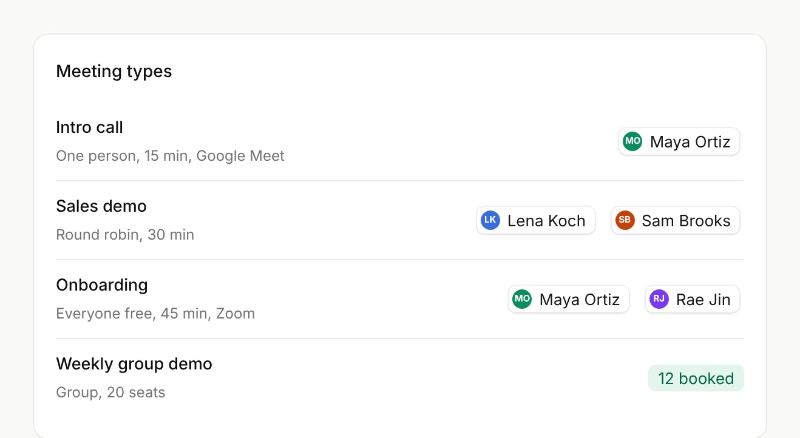
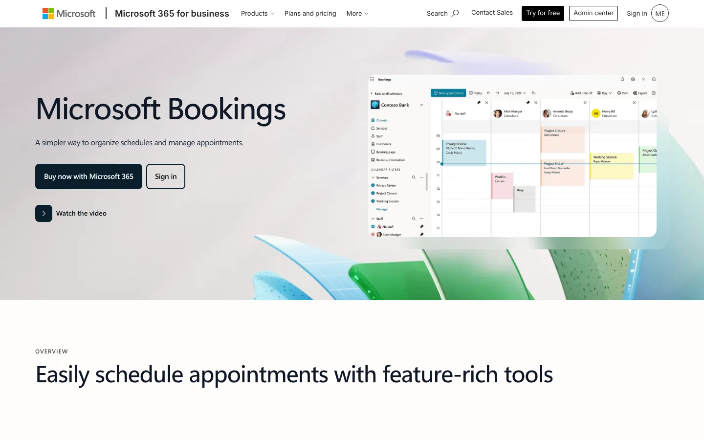
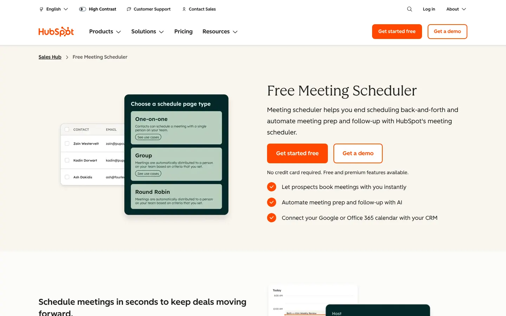

Outlook is good at meetings with people inside your company. You can see their free and busy times, and the Scheduling Assistant finds a slot. Booking a call with someone outside your company is harder. You send three times, they reply with a fourth, and a day goes by before anyone is on the calendar.

A meeting scheduler for Outlook fixes that with a booking link. It reads your Outlook calendar, shows only your free times, and drops each booking back into Outlook, often with a Teams link attached.

> **[Try Claritia free](https://app.tryclaritia.com/signup)** to connect Outlook or Microsoft 365 in one click and get a Teams link on every booked meeting.

Below, we compare 9 meeting schedulers that sync with Outlook and Microsoft 365, and what each one costs.

## Main points

- Every tool here reads your Outlook or Microsoft 365 calendar for busy times and adds bookings back to it.
- Teams links usually need a work or school Microsoft 365 account. Personal Outlook.com accounts can book, but often without a Teams link.
- [Microsoft Bookings](https://www.microsoft.com/en-us/microsoft-365/business/scheduling-and-booking-app) comes with many Microsoft 365 business plans, but it isn't sold on its own and can't take payments.
- Top picks: [Claritia](/), [Microsoft Bookings](https://www.microsoft.com/en-us/microsoft-365/business/scheduling-and-booking-app), [Calendly](https://calendly.com/), [Cal.com](https://cal.com/), [Zoho Bookings](https://www.zoho.com/bookings/), [OnceHub](https://www.oncehub.com/), [SavvyCal](https://savvycal.com/), [YouCanBookMe](https://youcanbook.me/) and [HubSpot Meetings](https://www.hubspot.com/products/sales/schedule-meeting).
- Pick [Claritia](/) if your meetings start from a form on your website and you want Outlook and Teams on the free plan.

## What is a meeting scheduler for Outlook?

A meeting scheduler for Outlook is a booking tool that connects to your Outlook or Microsoft 365 calendar. You share a link, the other person picks one of your open times, and the meeting lands on your Outlook calendar with an invite sent to both of you.

Outlook has two built-in helpers, and they do a different job. The Scheduling Assistant compares calendars inside your company. Scheduling Poll, which replaced the FindTime add-in in 2022, sends a few time options for people to vote on.

Microsoft notes that Scheduling Poll isn't supported for Outlook.com consumer accounts. A booking link is better when people outside your company need to pick a time on their own.

Typical features include:

- Two-way sync with Outlook, so a taken time never shows.
- A Teams link added to each online meeting.
- Working hours, buffers and reminders.
- Team booking, like round robin.

## How to choose a meeting scheduler for Outlook

Most tools say they work with Outlook. Five checks show how well:

- **Your account type.** Microsoft 365 work and school accounts, personal Outlook.com, or both.
- **Teams links.** Whether the tool creates a Teams link for each booking, and on which plan.
- **Fresh busy times.** Whether a meeting you add in Outlook blocks that time right away, out of office included.
- **More than one calendar.** Whether the tool checks a second calendar, like a team or personal one.
- **Team booking.** Round robin and shared pages, if more than one person takes the calls.

## The 9 best meeting schedulers for Outlook in 2026

Prices checked November 2026.

| Tool | Best for | Free plan | Paid from | Outlook and Teams |
|---|---|---|---|---|
| [Claritia](/) | Booking leads from a form into Outlook | Yes, 1 calendar | $12 a seat a month, billed yearly | Outlook and Microsoft 365 on every plan, with Teams links |
| [Microsoft Bookings](https://www.microsoft.com/en-us/microsoft-365/business/scheduling-and-booking-app) | Teams already paying for Microsoft 365 | Included with eligible plans | Microsoft 365 Business Basic, $7 a user a month paid yearly | Built in, with Teams links |
| [Calendly](https://calendly.com/) | A link your clients already know | Yes, 1 event type | $10 a seat a month, billed yearly | Outlook and Office 365 calendars, Teams links on every plan |
| [Cal.com](https://cal.com/) | Unlimited links for one user | Yes, 1 user | $12 a user a month, billed yearly | Outlook calendar and a free Teams app |
| [Zoho Bookings](https://www.zoho.com/bookings/) | A low price per user | Yes, 1 user | $6 a user a month, billed yearly | Microsoft 365 and Outlook.com sync, Teams links |
| [OnceHub](https://www.oncehub.com/) | Exchange and Microsoft 365 shops | Yes, 1 booking link | $10 a seat a month, billed yearly | Microsoft 365 and Exchange, Teams links |
| [SavvyCal](https://savvycal.com/) | Calls with outside clients | Setup only | $10 a user a month, billed yearly | Microsoft 365 calendars, Teams links |
| [YouCanBookMe](https://youcanbook.me/) | Simple pages with a free start | Yes, 30 bookings a month | $8.10 a month, billed yearly | Microsoft calendars, Teams links on free |
| [HubSpot Meetings](https://www.hubspot.com/products/sales/schedule-meeting) | Teams on HubSpot's CRM | Yes, 1 personal link | See their pricing page | Office 365 and Exchange calendars |

## 1. Claritia

[Claritia](/) is a forms, scheduling and follow-up app built for small B2B teams that want every lead from their website to reach the right rep and book a meeting before they leave the page.

It builds forms from a sentence or one of 840 templates, opens the right person's calendar the moment the form is sent, routes each lead by its answers, and drafts follow-up emails in your brand's voice for you to approve.

It connects to Outlook or Microsoft 365 in one click on every plan, the free one included, and its workflows send reminders and follow-ups. A visitor picks a time inside your form, and the meeting lands in Outlook with a Teams link.

> **[Try Claritia free](https://app.tryclaritia.com/signup)** and connect Outlook in a few minutes, no card needed.

### Key features

- **Fresh busy times:** Outlook tells Claritia as soon as your calendar changes, and out-of-office time is blocked too.
- **Teams links:** Work and school accounts get a Microsoft Teams link on each meeting. See the [Outlook integration](/integrations/outlook).
- **More than one calendar:** On Starter, count several calendars as busy and pick where new meetings go.
- **Team meetings:** On Pro, round robin and everyone-free meetings read each person's Outlook calendar.
- **Lead alerts in Teams:** On Starter, post each new lead to a [Microsoft Teams](/integrations/microsoft-teams) channel.

*Caption: Claritia's meeting types include round robin and everyone-free meetings for teams.*

### Pros

- **Outlook on free:** One calendar per seat on Free, six on every paid plan.
- **Invites done right:** Guests get Claritia's invite, and co-hosts on your team get Outlook's own invite.
- **Form and booking in one step:** You learn who's coming before they pick a time.

### Cons

- **No Teams link for personal accounts:** Outlook.com accounts book without one.
- **Teams alerts cost more:** Posting leads to a Teams channel needs Starter.
- **Newer tool:** Its marketplace is smaller, and Zapier and Make apps aren't listed yet.

### Price and plans

You can start on the free plan with no card. Paid plans are priced per seat, and a seat is a teammate people can book a meeting with.

- **Free:** $0 for 1 seat, with 1 meeting type on 1 calendar.
- **Starter:** $15 a seat a month ($12 billed yearly). Adds 6 calendars per seat, team booking pages and the Teams channel alerts.
- **Pro:** $39 a seat a month ($31 billed yearly). Adds round robin with weights and meetings with everyone free.
- **Business:** $79 a seat a month ($63 billed yearly). Adds owner first and Salesforce.

## 2. Microsoft Bookings

[Microsoft Bookings](https://www.microsoft.com/en-us/microsoft-365/business/scheduling-and-booking-app) is a scheduling app included with many Microsoft 365 business subscriptions, built for organizations that want customers or colleagues to book time without the back and forth. It offers personal booking pages for one person's availability and shared booking pages where teams define services, staff, and business hours.

Bookings works with Outlook calendars, creates a Microsoft Teams link for online appointments, sends email and text reminders, and stores its data in Exchange Online. Its personal pages, also called Bookings with me, tie one-on-one booking to your Outlook calendar. It suits companies already paying for Microsoft 365.

### Key features

- **Personal booking page:** Starts with 15 and 30 minute meeting types you can edit.
- **Teams meetings:** Each online booking gets its own Teams link.
- **Shared pages:** Up to 100 staff on one booking page.
- **Notifications:** Email and SMS notices to cut no-shows.

### Pros

- **Already paid for:** It comes with many Microsoft 365 business and enterprise plans.
- **No account for guests:** People can book without a Microsoft account.
- **Data stays in Microsoft 365:** Bookings data is stored in Exchange Online.

### Cons

- **No payments:** Microsoft says Bookings has no payment support.
- **Not sold alone:** You need an eligible Microsoft 365 or Office 365 plan.
- **Admin work:** Each shared booking calendar creates a mailbox in Exchange, and staff outside your company can't share their free and busy times.

### Price and plans

Microsoft lists Bookings in Microsoft 365 Business Basic, Business Standard and Business Premium, the E and F plans, and Teams Essentials and Teams Premium.

- **Microsoft 365 Business Basic:** $7 a user a month, paid yearly.
- **Higher Microsoft 365 plans:** See Microsoft's pricing page.

## 3. Calendly

[Calendly](https://calendly.com/) is scheduling software for professionals and teams who want people to book meetings without trading emails. You connect your calendars, set hours, buffers, and daily limits, and share booking links for one-on-one, multi-host, or group meetings. It sends email and text reminders, offers routing forms that send website leads to the right teammate, and collects payments.

Newer tools include an AI assistant that finds times over email and a notetaker that writes meeting recaps. Many of your clients have used a Calendly link before. It connects Outlook and Office 365 calendars, with video integrations, Microsoft Teams included, on every plan.

### Key features

- **Outlook and Office 365 calendars:** One on free, six on paid plans.
- **Teams links:** On every plan, along with Zoom and Google Meet.
- **Outlook for workflows:** Connect Outlook for email workflows on Standard and up.
- **Round robin:** On Teams.

### Pros

- **Familiar page:** Most invitees know how it works.
- **Teams on free:** Video links don't need an upgrade.

### Cons

- **One event type on free:** And no reminders until Standard.
- **Dynamics costs more:** Microsoft Dynamics 365 is on Enterprise.

### Price and plans

- **Free:** $0, with 1 event type and 1 calendar.
- **Standard:** $10 a seat a month billed yearly.
- **Teams:** $16 a seat a month billed yearly.
- **Enterprise:** From $15,000 a year.

## 4. Cal.com

[Cal.com](https://cal.com/) is scheduling software for individuals and companies that want booking links they can shape around their own process. It syncs calendars, detects time zones, sends reminders, and runs video calls through Zoom, Google Meet, Microsoft Teams, or its own Cal Video.

Teams can use round robin, collective events where every host must be free, routing forms, and workflows, plus admin tools such as SAML SSO and audit logs. Its source code is published on GitHub.

Its free Microsoft 365/Teams app, set up together with its Outlook calendar app, gives booked meetings a Teams link. It needs a work or school account. It suits one person who wants unlimited links at no cost.

### Key features

- **Outlook calendar:** Connect it alongside other calendars.
- **Teams app:** Free, for work or school accounts.
- **Unlimited links:** And unlimited calendars for one user on free.

### Pros

- **Generous free plan:** Unlimited links for one person.
- **Open code:** You can host it yourself.

### Cons

- **One user on free:** Round robin and shared availability need Teams.
- **Work account needed:** The Teams app won't work with a personal account.

### Price and plans

- **Free:** $0 for one user.
- **Teams:** $12 a user a month billed yearly ($16 monthly).
- **Organizations:** $28 a user a month billed yearly ($37 monthly).

## 5. Zoho Bookings

[Zoho Bookings](https://www.zoho.com/bookings/) is appointment scheduling software for businesses of any size that want meetings to land on their calendar without back and forth. It offers one-on-one, group, collective, and resource-based event types, with workspaces for branches or departments, staff roles, and booking limits.

Routing forms qualify leads before they book, workflows send email and SMS and update records, and it connects with Zoho CRM, Zoho Desk, and other Zoho apps. It syncs both ways with Microsoft 365 and Outlook.com calendars, on its free plan too, and can add a Teams link to virtual meetings. Price-minded teams on Microsoft 365 will like it.

### Key features

- **Two-way sync:** Zoho, Google and Microsoft 365 or Outlook.com.
- **Teams links:** For all virtual meetings.
- **Dynamics 365:** Sync meeting data to it.
- **Round robin:** Four ways to share appointments across users.

### Pros

- **Low prices:** From $6 a user a month billed yearly.
- **Free reminders:** Notification emails and reminders on the free plan.

### Cons

- **One user on free:** Teams need a paid plan.
- **Rooms cost extra:** Resources are paid add-ons.

### Price and plans

- **Free:** $0 for one user.
- **Basic:** $6 a user a month billed yearly ($8 monthly).
- **Premium:** $9 a user a month billed yearly ($12 monthly).

## 6. OnceHub

[OnceHub](https://www.oncehub.com/) is a scheduling and engagement platform for sales, service, support, and recruiting teams that want to screen visitors and book them with the right person. It offers branded booking pages, booking hubs, routing forms that qualify people before they book, and AI chat and phone agents that answer questions and schedule calls.

Its scheduling engine handles one-on-one, multi-host, and group meetings, creates video links and reminders, and connects to CRMs and Zapier. It connects to Microsoft 365 and Exchange calendars and adds Teams links, even on its free Basic plan. Companies with stricter IT rules are its best fit.

### Key features

- **Calendars:** Google, Microsoft 365, Exchange and iCloud.
- **Teams links:** Plus Zoom, Google Meet and Webex.
- **Routing:** Routing forms and round robin on Route.

### Pros

- **Exchange support:** Useful for older Microsoft setups.
- **IT controls:** SSO and corporate calendar connection as an add-on.

### Cons

- **Small free plan:** One user, one calendar and one booking link.
- **Add-on cost:** The security add-on is $5 a seat a month billed yearly.

### Price and plans

- **Basic:** Free for one user.
- **Schedule:** $10 a seat a month billed yearly ($12 monthly).
- **Route:** $19 a seat a month billed yearly ($23 monthly).
- **Engage:** $39 a seat a month billed yearly ($47 monthly).

## 7. SavvyCal

[SavvyCal](https://savvycal.com/) is a scheduling tool for professionals and teams who want booking links that feel easy for both the host and the guest. Guests see a full week of open times and can lay their own calendar over the link to spot a match.

Hosts set buffers, limits, preferred times, and time blocks, put links on their own domain, and take Stripe payments. It also supports round robin, collective, and group links, meeting polls, and reminder workflows. It connects to Microsoft 365 (Outlook) calendars and creates Teams links for bookings on a work or school calendar. Consultants who book many outside calls are its sweet spot.

### Key features

- **Calendar overlay:** Invitees see their own Microsoft calendar next to your times.
- **Teams links:** For work and school calendars.
- **Unlimited calendars:** Google, Microsoft, iCloud and Fastmail.
- **Round robin:** On Basic.

### Pros

- **Easy for the invitee:** Picking a time is quick.
- **Team booking on the first plan:** Round robin comes with Basic.

### Cons

- **No free booking:** People can only book you on a paid plan.
- **No self-serve trial:** There's a 30-day money-back guarantee instead.

### Price and plans

- **Basic:** $10 a user a month billed yearly ($12 monthly).
- **Premium:** $17 a user a month billed yearly ($20 monthly).

## 8. YouCanBookMe

[YouCanBookMe](https://youcanbook.me/) is an online scheduling tool for small and midsize businesses that want a branded booking page tied to their calendars. It syncs with Google, Apple, Outlook, and Fastmail calendars, and offers booking forms with conditional questions, approval of requests before they are confirmed, password protected pages, and paid bookings through Stripe.

It sends confirmations, reminders, and follow-ups by email and SMS, triggers webhooks, and reports on bookings, no-shows, and revenue. It checks Microsoft calendars for open times and connects to Microsoft Teams on its free plan. Solo users and small teams who want a plain booking page fit it well.

### Key features

- **Microsoft calendars:** One on free, up to 6 on Professional.
- **Teams links:** Plus Zoom and Google Meet, on free.
- **Booking questions:** Custom questions on the booking form.
- **Round robin:** On Team.

### Pros

- **Teams on free:** No upgrade for video links.
- **Billing choice:** Monthly, yearly or two-year plans.

### Cons

- **Booking cap on free:** 30 bookings a month.
- **One calendar on free:** A second calendar means Individual.

### Price and plans

- **Free:** $0, with 30 bookings a month.
- **Individual:** $8.10 a month billed yearly ($9 monthly).
- **Professional:** $11.70 a month billed yearly ($13 monthly).
- **Team:** $16.20 a member a month billed yearly ($18 monthly).

## 9. HubSpot Meetings

[HubSpot Meetings](https://www.hubspot.com/products/sales/schedule-meeting) is the meeting scheduler inside HubSpot's CRM, built for sales and service teams that want prospects to book time and have every meeting recorded. You connect a Google or Office 365 calendar, then share a booking link or embed it on a web page or in live chat.

It supports round robin and group meeting links, logs booked meetings on contact records, can start email sequences, and uses AI to prepare meeting context and follow-ups. It also syncs with Exchange calendars. It makes the most sense for sales teams whose contacts already live in HubSpot.

### Key features

- **Office 365 and Exchange:** Real-time calendar sync.
- **CRM logging:** Bookings land on each contact record.
- **Round robin and group links:** For teams.
- **Embeddable widget:** Put the calendar on your site.

### Pros

- **Free start:** One personal link costs nothing.
- **One record:** Meetings sit next to each contact's history.

### Cons

- **Branding on free:** The free link carries HubSpot branding.
- **Team links cost more:** They need a paid Sales Hub plan.

### Price and plans

- **Free:** One personal link, with HubSpot branding.
- **Sales Hub plans:** Team links and no branding. See their pricing page.

## Which meeting scheduler for Outlook should you pick?

- If your meetings start from a website form and you want Outlook and Teams on free, pick [Claritia](/).
- If your company already pays for Microsoft 365 and you don't need payments, start with [Microsoft Bookings](https://www.microsoft.com/en-us/microsoft-365/business/scheduling-and-booking-app).
- If your clients expect a familiar link, pick [Calendly](https://calendly.com/).
- If you're on Exchange or have strict IT rules, look at [OnceHub](https://www.oncehub.com/).
- If price per user matters most, pick [Zoho Bookings](https://www.zoho.com/bookings/).

## Questions

### Does Outlook have a built-in meeting scheduler?

Yes, in a few forms. The Scheduling Assistant compares calendars inside your company, and Scheduling Poll lets people vote on times. Microsoft Bookings adds booking pages and comes with many Microsoft 365 plans.

### Can I add a Teams link to every booking?

Yes, with most tools here. Teams links usually need a work or school Microsoft 365 account. In Claritia, personal Outlook.com accounts can book, but without a Teams link.

### Is Microsoft Bookings free?

It isn't sold on its own. It comes with eligible plans such as Microsoft 365 Business Basic, Business Standard and Business Premium.

### Do guests need Outlook to book?

No. Guests book from any browser. In Claritia, they get a calendar invite that works in Outlook, Google and Apple Calendar.

### What happened to FindTime?

Microsoft replaced the FindTime add-in with Scheduling Poll in Outlook, as announced in July 2022.

## Get started

Connect Outlook once and let people book your open times from a link or a form.

> **[Try Claritia free](https://app.tryclaritia.com/signup)** to connect Outlook or Microsoft 365, add a Teams link and book your first meeting today.

You can also read about the [Outlook integration](/integrations/outlook) or see how [Claritia Meetings](/products/meetings) works.
