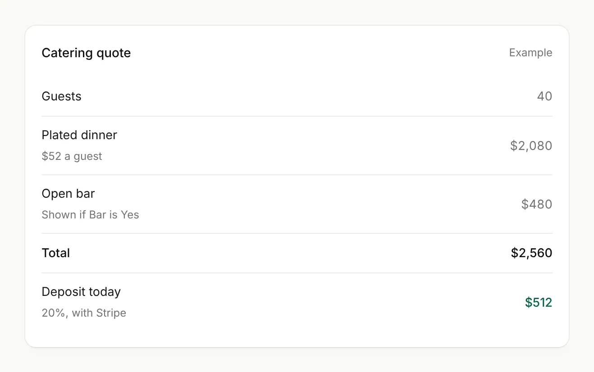
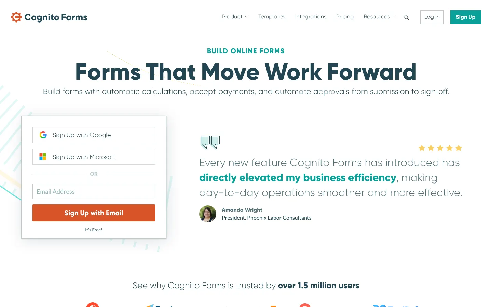
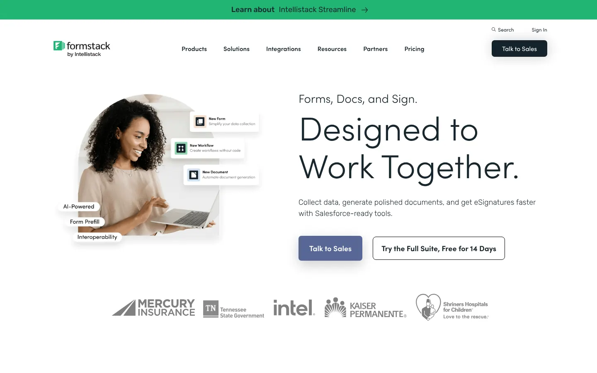

Most form builders let you drag fields onto a page without code. The hard part starts after you share the form: a price that changes with each answer, a deposit taken on the spot, a row in your sheet, a lead sent to the right person and an email that goes out the next day.

If your tool can't do those steps, you end up writing scripts, gluing apps together with Zapier or copying answers by hand. A good no-code form builder runs the whole job, from the first question to the follow-up, with settings you click through.

> **[Try Claritia free](https://app.tryclaritia.com/signup)** to build a form with logic, prices and a booked meeting at the end, without writing a line of code.

Below, we compare 8 no-code form builders on the work they do around the form: logic, calculations, payments, integrations and the steps that run after submit.

## Main points

- A no-code form builder lets you build the form and the work that follows it, like logic, prices, payments and follow-ups, with no code.
- Check what's on the free plan. Logic is common at $0, while payments, calculations and integrations often sit on paid plans.
- For built-in workflows, look at [Fillout](https://www.fillout.com/), [Jotform](https://www.jotform.com/), [Paperform](https://paperform.co/) and [Cognito Forms](https://www.cognitoforms.com/).
- Top picks: [Claritia](/), [Fillout](https://www.fillout.com/), [Jotform](https://www.jotform.com/), [Paperform](https://paperform.co/), [Tally](https://tally.so/), [Cognito Forms](https://www.cognitoforms.com/), [Zoho Forms](https://www.zoho.com/forms/) and [Formstack](https://www.formstack.com/).
- Pick [Claritia](/) if the end of your workflow is a meeting booked with the right person.

## What is a no-code form builder?

A no-code form builder is a tool for making online forms, and the steps around them, without writing code. You add fields, set rules and connect other apps through menus and settings. The tool hosts the form, saves each answer and runs the steps you set.

The better ones go past the form and run the workflow too:

- **Logic.** Show a question, skip a page or end the form based on an answer.
- **Calculations.** Add up a price, a score or a quote while people answer.
- **Payments.** Take a card payment or a deposit inside the form.
- **Integrations.** Send each answer to a CRM, a sheet, a chat app or an email tool.
- **After submit.** A custom thank-you page, an email, an approval step or a booked meeting.

If you only need a simple form, our list of the [best form builders](/blog/best-form-builder) covers general picks, and our guide to [drag and drop form builders](/blog/best-drag-and-drop-form-builders) looks at how each editor feels to use. This post is about the work that happens around the form.

## How to choose a no-code form builder

Write down the steps your form should run, from first question to last email. Then check each tool against them:

- **Logic and calculations on your plan.** Some tools list calculations but only let you publish them on paid plans.
- **Payments.** Which processors it takes, and whether the free plan caps how many payments you can collect.
- **Native integrations.** A direct link to your CRM or sheet breaks less often than a Zapier step in the middle.
- **Steps after submit.** Emails, approvals, documents, redirects or a booked meeting.
- **Limits that grow with you.** Monthly submissions, users and forms on the plan you'd buy.

## The 8 best no-code form builders in 2026

Prices checked November 2026.

| Tool | Best for | Free plan | Paid from | Built-in workflow |
|---|---|---|---|---|
| [Claritia](/) | Forms that end in a booked meeting | Yes, 250 submissions a month | $12 a seat a month, billed yearly | Booking, reminders, follow-ups and routing |
| [Fillout](https://www.fillout.com/) | The most workflow on a free plan | Yes, 1,000 responses a month | $15 a month, billed yearly | Fillout Workflows, on every plan |
| [Jotform](https://www.jotform.com/) | Approvals and tasks across many forms | Yes, 5 forms and 100 submissions | $34 a month, billed yearly | Free workflow builder with approvals |
| [Paperform](https://paperform.co/) | Quotes, orders and payments | Yes, 30 submissions a month | $49 a month, billed yearly | Stepper workflows, on every plan |
| [Tally](https://tally.so/) | Logic and payments at $0 | Yes, unlimited within fair use | $24 a month, billed monthly | Integrations, Zapier, Make and webhooks |
| [Cognito Forms](https://www.cognitoforms.com/) | Forms with heavy math | Yes, 100 entries a month | $19 a month, billed yearly | Workflow and approvals on Team |
| [Zoho Forms](https://www.zoho.com/forms/) | Teams on Zoho apps | Yes, 3 forms and 500 submissions | $10 a month, billed yearly | Approvals from Standard |
| [Formstack](https://www.formstack.com/) | Forms that become documents | No, free trial | $83 a month, billed yearly | Documents and e-signatures on Suite |

## 1. Claritia

[Claritia](/) is a forms, scheduling and follow-up app built for small B2B teams that want every lead from their website to reach the right rep and book a meeting before they leave the page.

It builds forms from a sentence or one of 840 templates, opens the right person's calendar the moment the form is sent, routes each lead by its answers, and drafts follow-up emails in your brand's voice for you to approve.

Conditional logic, page skips, calculations and booking inside the form are on the free plan. On paid plans, the same form can take a Stripe payment, send the lead to your CRM or sheet, and follow up until the lead books.

> **[Try Claritia free](https://app.tryclaritia.com/signup)** and build your first workflow from a single sentence.

### Key features

- **Logic and math for free:** Show-if logic, page skips, calculations and formulas on every plan.
- **Hidden fields:** Keep UTM tags, the page and the referrer with each answer.
- **Payments:** Take a payment or a deposit with Stripe, from Starter.
- **Booking at the end:** The right person's calendar opens as soon as the form is sent.
- **Follow-ups:** A confirmation and reminders on free. Your own wording and a next-day follow-up until they book, from Starter.
- **Routing:** On Pro, send each lead to a meeting and a person based on any answer.
- **Integrations:** Webhooks and CSV on free. HubSpot, Pipedrive, [Google Sheets](/integrations/google-sheets), Slack and more from Starter.

*Caption: A Claritia quote form adds up the price as people pick options, then takes a deposit with Stripe.*

### Pros

- **One flow from form to meeting:** No separate scheduler or spreadsheet to keep in sync.
- **Logic and calculations at $0:** Quote and score forms work on the free plan.
- **Free teammates:** People who only build forms, edit workflows or read results don't need a seat.

### Cons

- **Newer tool:** Its app marketplace and community are smaller than the big names.
- **No Zapier or Make apps yet:** They aren't listed yet, so other apps need a webhook.
- **Payments need Starter:** Stripe and e-signatures aren't on the free plan.

### Price and plans

You can start on the free plan with no card. Paid plans are priced per seat, and a seat is a teammate people can book a meeting with.

- **Free:** $0 for 1 seat and 250 submissions a month.
- **Starter:** $15 a seat a month ($12 billed yearly). Adds Stripe payments, e-signatures and integrations.
- **Pro:** $39 a seat a month ($31 billed yearly). Adds routing by answer and round robin.
- **Business:** $79 a seat a month ($63 billed yearly). Adds partial answers, Salesforce and unlimited submissions.

## 2. Fillout

[Fillout](https://www.fillout.com/) is a form builder for teams that want branded forms, surveys, and quizzes connected to the tools they already use. You can describe a form for its AI to build or use drag and drop, then add logic, file uploads, payments, and signatures.

It also offers scheduling forms that sync with Google Calendar or Outlook, PDF generation, workflows, login forms that let people edit past answers, custom domains, and native integrations.

Its free plan covers more workflow than most. Payments, calculations and scoring, hidden fields, PDF generation and Fillout Workflows are all included, with 1,000 responses a month and unlimited seats.

### Key features

- **Fillout Workflows:** Built-in form, scheduling and approval workflows, on every plan.
- **Calculations and scoring:** On the free plan, with pre-fill and hidden fields.
- **Payments:** Collect payments on the free plan.
- **Integrations:** Google Sheets, Airtable, Notion, HubSpot, Mailchimp and webhooks on free.

### Pros

- **Big free plan:** Most workflow features cost nothing.
- **Unlimited seats:** The whole team can build without per-seat fees.

### Cons

- **Emails to respondents cost more:** Respondent emails and redirects start on Starter.
- **Free plan branding:** Free forms show a Fillout badge and have no CAPTCHA.

### Price and plans

- **Free:** $0, with 1,000 responses a month.
- **Starter:** $15 a month, billed yearly.
- **Pro:** $40 a month, billed yearly.
- **Business:** $75 a month, billed yearly. Adds partial submissions.

## 3. Jotform

[Jotform](https://www.jotform.com/) is a drag and drop form builder for businesses, schools, nonprofits, and public agencies that want to collect data, payments, and signatures without writing code. Forms can use conditional logic, answer piping, prefilled fields, and translations, and they accept one-time or recurring payments through many gateways.

Submissions can become PDFs, flow into CRMs and spreadsheets, and be managed in related Jotform tools for tables, approval workflows, e-signatures, and reports.

Its free workflow builder starts a flow with each submission. It can assign tasks, ask for approval and request a payment at any step, and Jotform says it adds no extra transaction fees.

### Key features

- **Workflow builder:** Approvals, task assignments and payment requests, free to build.
- **40+ payment gateways:** Including Stripe, Square, PayPal and Authorize.Net.
- **Workflow templates:** More than 200 ready-made flows to start from.
- **Many integrations:** CRMs, spreadsheets and storage apps.

### Pros

- **Approvals built in:** Good for requests that need a manager's yes.
- **Mature tool:** Templates and widgets for almost any form.

### Cons

- **Small free plan:** 5 forms, 100 submissions and 10 payment submissions a month.
- **One user:** Paid plans are for a single user until Enterprise.

### Price and plans

- **Starter:** Free, with 5 forms and 100 submissions a month.
- **Bronze:** $34 a month, billed yearly.
- **Silver:** $39 a month, billed yearly.
- **Gold:** $99 a month, billed yearly.

## 4. Paperform

[Paperform](https://paperform.co/) is an online form builder for small businesses and solo operators who want one form to capture details, take payment, and start the next step. Its editor works like a document, with a one question at a time mode, conditional logic, and spreadsheet style formulas for prices and scores.

Forms can take bookings and Stripe payments, send contracts for e-signature through Papersign, and pass submissions to CRMs, email tools, and spreadsheets through integrations or Stepper workflows.

Stepper, its workflow tool, comes with every plan. The free plan includes 200 workflow steps a month, and paid plans have no step limit.

### Key features

- **Calculation field:** Works out quotes, totals and appointment lengths from the answers.
- **Payments:** One-time, recurring, coupons and tax, with no Paperform transaction fee.
- **Stepper workflows:** Multi-step automations on every plan.
- **Conditional success pages:** Show a different ending based on the answers.

### Pros

- **Built for selling:** Product, subscription and price features in one form.
- **Unlimited users:** Seats are unlimited on every plan.

### Cons

- **Key fields are paid-only:** Calculation, hidden, product and subscription fields won't publish on the free plan.
- **Tiny free plan:** 30 submissions a month.

### Price and plans

- **Free:** $0, with 30 submissions a month.
- **Pro:** $49 a month, billed yearly.
- **Business:** $124 a month, billed yearly.

## 5. Tally

[Tally](https://tally.so/) is a form builder for individuals and teams who want to make forms by typing, much like writing in a document. You insert blocks for contact details, file uploads, ratings, signatures, and Stripe payments, then add conditional logic, calculations, hidden fields, and answer piping.

Forms can be embedded or shown as popups, and submissions can go to Notion, Slack, Airtable, or Google Sheets. Tally is hosted in Europe and does not use cookie tracking.

Logic, calculations, payments and signatures are all free, with unlimited forms and submissions within its fair use rules. Its free integrations include Zapier, Make and webhooks for steps it doesn't run itself.

### Key features

- **Logic and calculations:** On the free plan.
- **Payments and signatures:** Collect both for free.
- **Free integrations:** Google Sheets, Notion, Airtable, Zapier, Make and webhooks.
- **Redirect on completion:** Send people to any page after submit.

### Pros

- **Free goes far:** Most workflow pieces cost nothing.
- **Quick to learn:** Typing a form feels like writing a note.

### Cons

- **Few built-in steps:** For approvals or multi-step flows, you lean on Zapier or Make.
- **Some features cost more:** Partial submissions and emails to respondents need Pro.

### Price and plans

- **Free:** $0, unlimited within fair use.
- **Pro:** $24 a month, billed monthly.
- **Business:** $74 a month, billed monthly.

Yearly billing gives two months off.

## 6. Cognito Forms

[Cognito Forms](https://www.cognitoforms.com/) is an online form builder for organizations that want to collect data and automate the work that follows each entry. Its drag-and-drop builder handles many field types, automatic calculations, signatures and file uploads.

Forms can move entries through approval workflows, generate documents, look up data from other forms and take payments through Square, Stripe, PayPal or its own Cognito Pay. It also includes controls that help teams meet HIPAA, GDPR and CCPA rules.

Payments come on every plan, the free one included. Workflow and approvals, data lookups and a client portal start on the Team plan.

### Key features

- **Calculations:** Automatic math across fields for quotes and totals.
- **Payments on every plan:** Including Cognito Pay.
- **Workflow and approvals:** Move entries through review steps, on Team.
- **Data lookups:** Pull data from other forms, on Team.

### Pros

- **Strong with math:** A good fit for order forms and price sheets.
- **Payments at $0:** No need to upgrade to take money.

### Cons

- **Low free limit:** 100 entries a month for one user.
- **Workflows cost more:** Approvals need Team, above Pro.

### Price and plans

- **Individual:** Free, with 100 entries a month.
- **Pro:** $19 a month billed yearly ($24 monthly), with 2,000 entries.
- **Team:** Adds workflow and approvals. See their pricing page.

## 7. Zoho Forms

[Zoho Forms](https://www.zoho.com/forms/) is an online form builder for businesses that want to collect data and move it through review and approval steps without code. It can build a form from a prompt, turn PDFs or photos of paper forms into online forms, and read business cards or IDs to fill in fields.

Forms support many field types, subforms, payments, and multi-level approvals, a mobile app collects entries offline, and data can flow into Zoho CRM.

Its free plan connects to Zoho apps and to Google Sheets, Microsoft Excel, webhooks and Zapier, and it takes 10 payment submissions a month. Approvals start on the Standard plan.

### Key features

- **Approvals:** Multi-level approval steps, from Standard.
- **Payments:** Stripe, PayPal, Square and many other gateways.
- **Zoho apps:** Sends entries to Zoho CRM, Desk, Books and more.
- **Offline app:** Collect entries on a phone with no signal.

### Pros

- **High submission limits:** 10,000 a month on the $10 Basic plan.
- **Fits Zoho:** Quick to connect if your team already runs on Zoho.

### Cons

- **3 forms on free:** And 10 payment submissions a month.
- **Users cost more:** Basic is for 1 user, and Standard adds 10.

### Price and plans

- **Free:** $0, with 3 forms and 500 submissions a month.
- **Basic:** $10 a month, billed yearly.
- **Standard:** $25 a month, billed yearly. Adds approvals.
- **Professional:** $50 a month, billed yearly.
- **Premium:** $90 a month, billed yearly.

## 8. Formstack

[Formstack](https://www.formstack.com/) is a no-code platform for organizations that want to collect data, create documents and gather signatures without manual paperwork. Its form builder offers AI form creation, prefilled links, branded themes, step logic and group approvals, and it sends submissions into CRMs and other business systems.

Separate products generate documents from the data a form collects and capture eSignatures, and versions of its forms and documents run inside Salesforce.

It suits larger teams whose forms should end in a contract or a filled document. The Suite plan bundles forms, documents and signatures, and it lists more than 300 integrations.

### Key features

- **Approvals:** Route submissions for approval.
- **Documents:** Turn answers into documents, on Suite.
- **eSignatures:** Unlimited on Suite.
- **300+ integrations:** Plus native Salesforce options.

### Pros

- **Form to signed document:** The whole paperwork chain in one place.
- **Built for regulated work:** HIPAA options are offered as an add-on.

### Cons

- **No free plan:** Only a free trial.
- **Tight limits on Forms:** 1 builder user and 25 forms.

### Price and plans

- **Forms:** $83 a month billed yearly ($99 monthly).
- **Suite:** $250 a month billed yearly ($299 monthly).
- **Salesforce and Enterprise:** Custom pricing.

## Which no-code form builder should you pick?

- If your workflow should end in a booked meeting with the right person, pick [Claritia](/).
- If you want the most workflow on a free plan, pick [Fillout](https://www.fillout.com/).
- If your forms need approvals and task steps, pick [Jotform](https://www.jotform.com/) or [Cognito Forms](https://www.cognitoforms.com/).
- If you sell products or quotes through a form, pick [Paperform](https://paperform.co/).
- If your form should end in a signed document, pick [Formstack](https://www.formstack.com/).

## Questions

### What is the best no-code form builder?

It depends on what should happen after submit. Claritia fits forms that book meetings, Fillout gives the most on a free plan, and Jotform and Cognito Forms suit approval steps.

### Can I take payments in a form without code?

Yes. Fillout, Tally, Cognito Forms and Jotform let you collect payments on their free plans, with limits on Jotform. Claritia takes Stripe payments and deposits from Starter.

### Which no-code form builders can do calculations?

Claritia, Fillout, Tally and Cognito Forms all include calculations on their free plans. Paperform has a calculation field, but forms that use it need a paid plan to publish.

### Do I need Zapier with a no-code form builder?

Not always. Most tools here send answers straight to common apps like Google Sheets or a CRM. Zapier or Make helps when a tool lacks the app you use.

### What can a form do after someone submits it?

It can show a thank-you page, redirect, send an email, start an approval, create a document, add a row to a sheet or book a meeting. Claritia opens the calendar right after submit.

## Get started

List every step your form should run, then pick the tool that does them without code. If the last step is a meeting, let the form book it.

> **[Try Claritia free](https://app.tryclaritia.com/signup)** to build a form with logic, prices and booking, and take your first lead today.

You can also see how [Claritia forms](/products/forms) work or browse 840 free [form templates](/templates).
