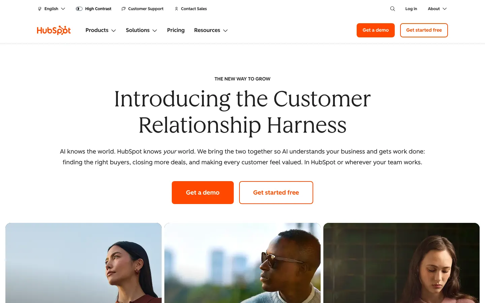

Round robin scheduling shares new meetings across your team. Without it, one person gets every call while another waits for work, and a lead waits longer than they should for a time.

A good tool hands each booking to the right free teammate. It lets you give some people more meetings than others, drops people who are away, and comes on a plan you can afford. That last part matters, since round robin often sits one or two plans above the cheapest one.

> **[Try Claritia free](https://app.tryclaritia.com/signup)** to build a form that books the right teammate, then add round robin with weights and away days on Pro.

In this post, we compare 9 round robin scheduling tools for small teams who book demos or intro calls. You'll see how each one picks the next person and which plan you need for it.

## Main points

- Look past the words "round robin" on a pricing page. It often sits one or two plans above the cheapest one.
- The better tools let you weight people, cap their meetings and skip people who are away.
- A form before the booking can send each lead to the right group before the rotation picks a name.
- Top picks: [Claritia](/), [Calendly](https://calendly.com/), [Cal.com](https://cal.com/), [SavvyCal](https://savvycal.com/), [OnceHub](https://www.oncehub.com/), [Zcal](https://zcal.co/), [HubSpot](https://www.hubspot.com/), [Zoho Bookings](https://www.zoho.com/bookings/) and [YouCanBookMe](https://youcanbook.me/).
- Pick [Claritia](/) if you want the form and the rotation in one tool, with weights and away days.

## What is round robin scheduling software?

Round robin scheduling software hands each new meeting to the next person on a team. It keeps work fair and gets leads a time sooner, since anyone free can take the call.

Typical features include:

- A rotation by turn, weight, priority or open time.
- Daily or weekly caps for each person.
- Time off, so people on leave drop out of the rotation.
- Team booking links that show everyone's open times.
- Forms that send each lead to the right group first.
- Calendar sync, so only free times show.

## How to choose round robin scheduling software

Most tools list round robin somewhere. These five checks show which one fits your team:

- **How it picks the next person.** Plain rotation, weights, priority or open time.
- **Limits for each person.** A daily or weekly cap keeps one person from taking every call.
- **Time off.** People on leave should drop out of the rotation.
- **What happens before the booking.** A form can send people to the right group first.
- **The plan you need.** Check which plan has round robin and what it costs.

## The 9 best round robin scheduling software in 2026

| Tool | Best for | Free plan | Paid from | Round robin on |
|---|---|---|---|---|
| [Claritia](/) | Forms that book the right teammate | Yes | $12 a seat a month, billed yearly | Pro, $31 a seat billed yearly |
| [Calendly](https://calendly.com/) | Teams already on Calendly links | Yes, 1 event type | $10 a seat a month, billed yearly | Teams, $16 a seat billed yearly |
| [Cal.com](https://cal.com/) | Open source scheduling | Yes, 1 user | $12 a user a month | Teams |
| [SavvyCal](https://savvycal.com/) | A kind booking page | Setup only | $10 a user a month, billed yearly | Basic and Premium |
| [OnceHub](https://www.oncehub.com/) | Routing forms with chat | Yes | $10 a user a month, billed yearly | Route, $19 a user billed yearly |
| [Zcal](https://zcal.co/) | Low-cost team links | Yes | $7 a user a month | Pro and Business |
| [HubSpot](https://www.hubspot.com/) | Teams that live in HubSpot | Yes, up to 2 users | $20 a seat a month, paid monthly | Paid Sales Hub or Service Hub |
| [Zoho Bookings](https://www.zoho.com/bookings/) | Teams on Zoho apps | Yes, 1 user | $6 a user a month, billed yearly | See their pricing page |
| [YouCanBookMe](https://youcanbook.me/) | Simple booking pages | Yes, 30 bookings a month | See their pricing page | Team |

## 1. Claritia

[Claritia](/) brings forms and meetings together for small teams, with workflows that follow up. A visitor fills your form and picks a time inside it, and the meeting goes to the next right person in the rotation. Round robin sits on the Pro plan with weights and priority, so you can send more meetings to the people who should get them. It suits small teams who want the form and the rotation in one place.

> **[Try Claritia free](https://app.tryclaritia.com/signup)** and add round robin with weights and priority on Pro.

### Key features

- **Weights and priority:** Give some people more meetings than others.
- **Meetings with everyone free:** For calls that need the whole group.
- **Team pools and away days:** A pool for each group, and people on leave drop out.
- **Limits for each person:** Daily and weekly caps, so one person never takes every call in a busy week.
- **Routing by answer:** Route by any answer to a meeting and a person, with a routing log that shows where each lead went.
- **Owner first and double round robin:** On Business.

### Pros

- **Form and rotation in one tool:** The lead fills the form and books the next right teammate in the same flow.
- **Monthly billing:** Pay month to month, or save 20% billed yearly.
- **Fair seat pricing:** Teammates who only build forms or read answers are free.

### Cons

- **Newer tool:** Its app marketplace and community are smaller than the big names.
- **No mobile app:** There's no native mobile app.

### Price and plans

You can start on the free plan with no card. Paid plans are priced per seat, and a seat is a teammate people can book a meeting with.

- **Free:** $0 for 1 seat and 250 submissions a month.
- **Starter:** $15 a seat a month ($12 billed yearly). Adds booking pages for each person and the team.
- **Pro:** $39 a seat a month ($31 billed yearly). Adds round robin with weights and priority, team pools, away days and limits for each person.
- **Business:** $79 a seat a month ($63 billed yearly). Adds owner first and double round robin.

## 2. Calendly

[Calendly](https://calendly.com/) is the booking link many of your buyers already know. Its Teams plan adds round robin and team scheduling, along with forms that route leads to the right event. Teams also routes by the owner already set in HubSpot, and Enterprise adds routing by Salesforce owner. It suits teams already on Calendly links who want to add a rotation.

### Key features

- **Round robin:** Round robin and team scheduling on Teams.
- **Routing forms:** On Teams and Enterprise.
- **Owner routing:** By HubSpot assignment on Teams, and by Salesforce assignment on Enterprise.
- **Salesforce lookup routing:** On Enterprise.

### Pros

- **A familiar page:** Most invitees have seen the booking page before.
- **HubSpot owner routing on Teams:** No Enterprise plan needed for HubSpot owners.

### Cons

- **Round robin needs Teams:** The free plan has one event type.
- **Routing forms cost more:** Standard leaves them out, so a small team pays for Teams to get them.

### Price and plans

- **Free:** 1 event type.
- **Standard:** $10 a seat a month billed yearly ($12 monthly).
- **Teams:** $16 a seat a month billed yearly ($20 monthly).

## 3. Cal.com

[Cal.com](https://cal.com/) is open source scheduling with a free plan for one person and unlimited links. Its Teams plan adds round robin and routing forms, plus custom notifications and workflows for reminders. It suits teams who like open source and want room to build on top.

### Key features

- **Free plan:** For 1 user with unlimited links.
- **Round robin and routing forms:** On Teams.
- **Workflows:** Custom notifications and workflows on Teams.
- **CRM sync:** Salesforce and HubSpot sync listed on the free plan.

### Pros

- **Open source:** Room to build on top.
- **Low price:** Teams is $12 a user a month, less billed yearly.

### Cons

- **Free plan is for one:** Any team rotation means paying for Teams.
- **Setup time:** The wide set of options can take longer to set up than a simpler tool.

### Price and plans

- **Free:** $0 for 1 user.
- **Teams:** $12 a user a month, with 25% off billed yearly.
- **Organizations:** $28 a user a month.

## 4. SavvyCal

[SavvyCal](https://savvycal.com/) puts care into the booking page, so the person booking has an easy time. Both paid plans include round robin and collective team links. It suits teams who care most about how the booking page feels.

### Key features

- **Round robin:** Round robin and collective links on both paid plans.
- **Meeting polls:** Free, along with link setup.
- **Your own domain:** Booking pages on your own domain on Premium.
- **No branding:** Premium removes SavvyCal branding.

### Pros

- **Easy booking page:** Built with the person booking in mind.
- **Round robin on the first paid plan:** Basic includes it.
- **Money-back guarantee:** 30 days on paid plans.

### Cons

- **No self-serve trial:** You can email support to try it first.
- **No routing by answer listed:** Its pricing page doesn't list routing by form answers.
- **Free plan can't take bookings:** People can only book from your links on a paid plan.

### Price and plans

The free plan lets you set up links and send meeting polls.

- **Basic:** $10 a user a month billed yearly ($12 monthly).
- **Premium:** $17 a user a month billed yearly ($20 monthly).

## 5. OnceHub

[OnceHub](https://www.oncehub.com/) has a plan for each job, from Schedule up to Engage. Round robin and routing forms arrive on Route, and Engage adds chatbots for your website. It suits teams who want routing forms and a website chatbot from one vendor.

### Key features

- **Round robin and routing forms:** On Route.
- **Contact owner:** Meetings assigned to the CRM contact owner on Route and up.
- **CRM connections:** Native Salesforce and HubSpot connections from Schedule up.
- **Chatbots:** On Engage.

### Pros

- **Free plan:** A free Basic plan to start.
- **Trial:** A 14-day trial of Engage with no credit card.

### Cons

- **Round robin skips Schedule:** You start on Route.
- **Chatbots cost more:** They only come on Engage, the top self-serve plan.

### Price and plans

- **Basic:** Free.
- **Schedule:** $10 a user a month billed yearly.
- **Route:** $19 a user a month billed yearly ($23 monthly).
- **Engage:** $39 a user a month billed yearly.

## 6. Zcal

[Zcal](https://zcal.co/) gives you unlimited links on a free plan that stays free. Round robin and collective events start on Pro, which also adds follow-up emails and SMS reminders. It suits small teams who want round robin at the lowest price here.

### Key features

- **Free plan:** Unlimited links and meeting polls.
- **Round robin:** Round robin and collective events on Pro.
- **SMS reminders:** 750 credits a month on Pro, 1,500 on Business.
- **Unlimited teams:** On Business.

### Pros

- **Lowest price here:** Round robin on Pro at $7 a user a month.
- **Follow-up built in:** Pro adds follow-up emails and SMS reminders.

### Cons

- **One team on Pro:** More teams need Business.
- **No routing by answer listed:** Its pricing page doesn't list routing by answers.

### Price and plans

- **Free:** $0, with unlimited links.
- **Pro:** $7 a user a month.
- **Business:** $12 a user a month.

## 7. HubSpot

[HubSpot](https://www.hubspot.com/)'s meetings tool lives inside its CRM. Team scheduling pages, round robin included, need a paid Sales Hub or Service Hub plan and a Sales or Service seat. When a contact picks a time, HubSpot books the teammate who is free at that time. It suits teams who already run their sales in HubSpot.

### Key features

- **Booking on the record:** Bookings land straight on the contact record.
- **Round robin:** Books whoever on the team is free at the chosen time.
- **Free CRM:** For up to 2 users.
- **Workflows:** Up to 50 on Starter.

### Pros

- **All in one CRM:** Meetings sit where your sales team already works.
- **Free start:** The CRM is free for up to 2 users.

### Cons

- **Disconnected calendars:** HubSpot's own help pages say a teammate with a disconnected calendar is treated as always free.
- **Onboarding fee:** Professional adds a required $1,500 one-time onboarding fee.
- **Paid seat for team pages:** Round robin needs a paid Sales Hub or Service Hub plan and a Sales or Service seat.

### Price and plans

- **Free:** For up to 2 users.
- **Starter:** $20 a seat a month paid monthly, with a lower price billed yearly.
- **Professional:** $90 a seat a month billed yearly, plus a $1,500 one-time onboarding fee.

## 8. Zoho Bookings

[Zoho Bookings](https://www.zoho.com/bookings/) fits teams who already use Zoho apps. The free plan covers one user with reminders and two-way calendar sync. Round robin is on its feature list, but the pricing page doesn't show which plan includes it.

### Key features

- **Free plan:** One user, with reminder emails and two-way calendar sync.
- **Zoho CRM sync:** Bookings connect to Zoho CRM.
- **Round robin:** On its feature list.
- **Zoho One:** Zoho One customers get Premium.

### Pros

- **Low prices:** Low per-user prices.
- **Good fit for Zoho users:** Premium comes with Zoho One.

### Cons

- **Free plan is for one:** Only one user.
- **Unclear round robin plan:** You'll need to ask Zoho which plan has round robin.

### Price and plans

- **Free:** For 1 user.
- **Basic:** $6 a user a month billed yearly ($8 monthly).
- **Premium:** $9 a user a month billed yearly ($12 monthly).

## 9. YouCanBookMe

[YouCanBookMe](https://youcanbook.me/) keeps booking pages simple. Round robin comes on the Team plan, along with more calendars and booking pages for each person. It suits teams who want plain booking pages with a rotation.

### Key features

- **Round robin:** On Team.
- **More calendars:** Up to 10 calendars for each user on Team.
- **Forms:** Unlimited questions on Professional and Team.
- **Reminders:** From the Individual plan up.

### Pros

- **Simple pages:** Booking pages kept plain and simple.
- **Free trial:** New users get 14 days with no credit card.

### Cons

- **Small free plan:** 30 bookings a month, with a "Powered for free" button.
- **Round robin on the top plan only:** You need Team.

### Price and plans

- **Free:** 30 bookings a month.
- **Individual, Professional and Team:** See their pricing page.

## Which round robin scheduling software should you pick?

- If you want the form and the rotation in one tool, with weights and away days, pick [Claritia](/) Pro.
- If your buyers already know Calendly and you route by HubSpot owner, pick [Calendly](https://calendly.com/) Teams.
- If you run your whole sales process in HubSpot, use [HubSpot](https://www.hubspot.com/)'s team scheduling pages.
- If price comes first and a plain rotation is enough, pick [Zcal](https://zcal.co/) Pro.
- If you like open source and want routing forms too, pick [Cal.com](https://cal.com/) Teams.

## Questions

### What is round robin scheduling?

Round robin scheduling hands each new meeting to the next person on a team. It keeps work fair and gets leads a time sooner, since anyone free can take the call.

### Can round robin give some people more meetings?

Yes, on tools with weights. In Claritia Pro, you set a weight and a priority for each person, so a senior rep can take more calls than a new hire.

### What happens when a teammate is on vacation?

Most tools skip people with no open time. Claritia also has away days, so a person on leave drops out of the rotation until they're back.

### Do you need a form for round robin?

A plain booking link works. A form helps when different leads need different people, since it can send each lead to the right group before the rotation picks a name.

### What's the cheapest round robin scheduling software?

Among the tools here, Zcal Pro lists round robin at $7 a user a month. Claritia Pro is $31 a seat billed yearly and adds forms and routing in the same plan.

## Get started

Set up your first team rotation today, and let each form lead book the right teammate.

> **[Try Claritia free](https://app.tryclaritia.com/signup)** to build your first form, then turn on round robin with weights and away days on Pro.

You can also see how [routing](/products/routing) and [meetings](/products/meetings) work together.
