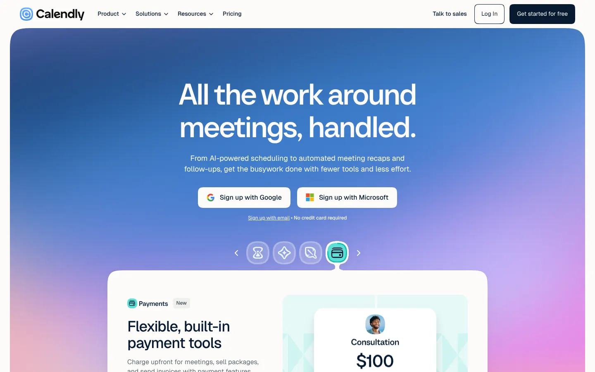
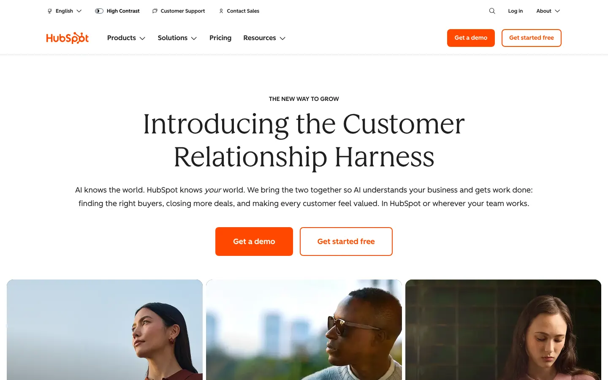
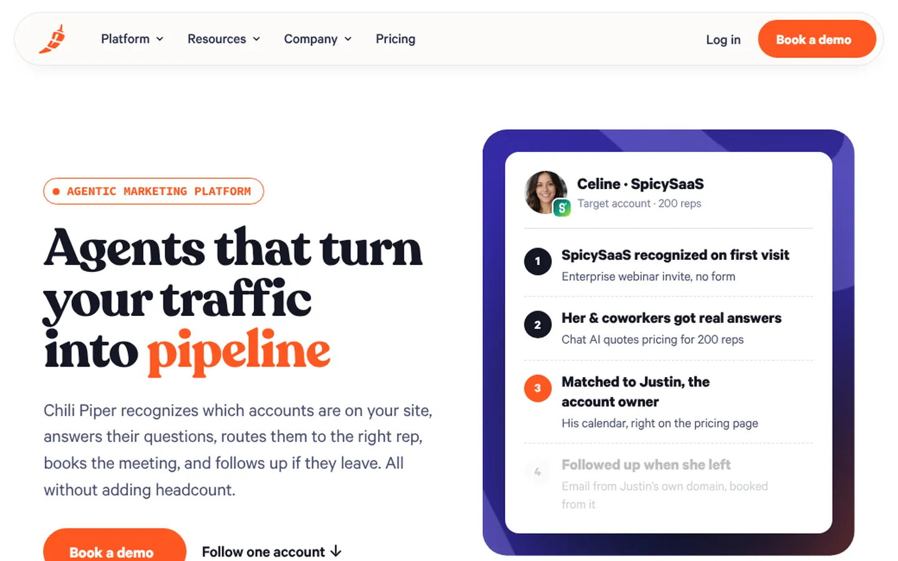
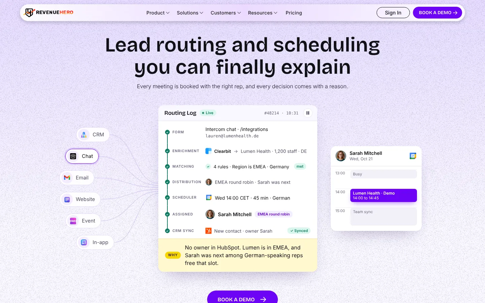
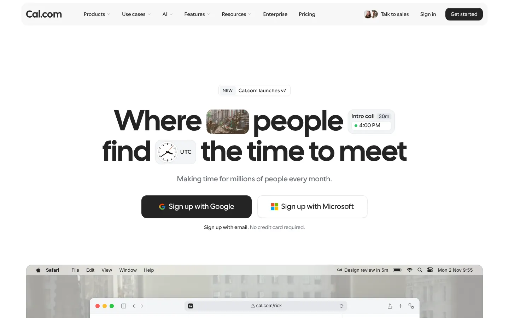

A sales team books meetings all day: first calls, demos, follow-ups and handoffs from one rep to another. The right scheduling tool lets a lead pick a time in one step and puts that meeting with the right rep. It should also log the meeting in your CRM, so no one has to copy it over by hand.

This post is for sales teams of a few reps up to a few dozen. Look closely at the page a lead sees when they book. It's often their first real look at your team.

> **[Try Claritia free](https://app.tryclaritia.com/signup)** to let leads book a demo inside your form, with reminders a day and an hour before.

Below, we compare 8 scheduling tools for sales teams on CRM ties, team booking and the real price for a team of reps.

## Main points

- The right tool lets a lead pick a time in one step, puts the meeting with the right rep and logs it in your CRM.
- Check how each tool ties to your CRM, how it shares meetings across reps, and what a lead sees when they book.
- Prices vary a lot, from $10 a seat a month billed yearly on Calendly Standard to $15,000 a year with 15 seats on Chili Piper Growth.
- Top picks: [Claritia](/), [Calendly](https://calendly.com/), [HubSpot](https://www.hubspot.com/), [Chili Piper](https://www.chilipiper.com/), [RevenueHero](https://www.revenuehero.io/), [OnceHub](https://www.oncehub.com/), [SavvyCal](https://savvycal.com/) and [Cal.com](https://cal.com/).
- Pick [Claritia](/) if most of your demos start from a form on your site and you want leads to land with the right rep.

## What is scheduling software for sales teams?

Scheduling software for sales teams lets leads book calls and demos with reps on their own. It shares meetings across the team, logs each one in your CRM, and sends reminders so fewer meetings slip.

Typical features include:

- Booking pages for each rep and for the team.
- Round robin that shares meetings across reps.
- Routing that sends each lead to the right rep.
- CRM sync that logs meetings on the contact record.
- Booking from a form or web page.
- Reminders and follow-ups that cut no-shows.

## How to choose scheduling software for sales teams

A long feature list matters less than how a tool fits your sales process. Check these five things:

- **CRM ties.** Logging meetings and booking with the record owner.
- **Team booking.** Round robin and meetings with several reps.
- **Booking from a form or web page.** Leads skip the back and forth.
- **Reminders and follow-ups.** They cut no-shows.
- **Price for your team.** What a team of five to ten reps pays.

## The 8 best scheduling software tools for sales teams in 2026

| Tool | Best for | Free plan | Paid from | CRM ties |
|---|---|---|---|---|
| [Claritia](/) | Small sales teams booking from forms | Yes | $12 a seat a month, billed yearly | HubSpot and many more on Starter; Salesforce on Business |
| [Calendly](https://calendly.com/) | Reps who send booking links | Yes, 1 event type | $10 a seat a month, billed yearly | HubSpot on Standard; Salesforce on Teams |
| [HubSpot](https://www.hubspot.com/) | Teams who run sales in HubSpot | Yes, up to 2 users | $20 a seat a month, paid monthly | Built into HubSpot CRM |
| [Chili Piper](https://www.chilipiper.com/) | Larger teams with SDR to AE handoffs | No | $15,000 a year with 15 seats | Salesforce and HubSpot |
| [RevenueHero](https://www.revenuehero.io/) | B2B inbound booking | No | $79 a month plus $25 a seat, billed yearly | HubSpot, Salesforce, Zoho and Attio |
| [OnceHub](https://www.oncehub.com/) | Booking with routing forms and chat | Yes | $10 a user a month, billed yearly | Salesforce and HubSpot from Schedule |
| [SavvyCal](https://savvycal.com/) | Reps who want a polished link | Setup only | $10 a user a month, billed yearly | CRM connections on both plans |
| [Cal.com](https://cal.com/) | Open source teams | Yes, 1 user | $12 a user a month, billed yearly | Salesforce and HubSpot sync on free |

## 1. Claritia

[Claritia](/) is a forms, scheduling and follow-up app built for small B2B teams that want every lead from their website to reach the right rep and book a meeting before they leave the page.

It builds forms from a sentence or one of 840 templates, opens the right person's calendar the moment the form is sent, routes each lead by its answers, and drafts follow-up emails in your brand's voice for you to approve.

A lead fills in your demo form and picks a time on the same page. Workflows then send the reminders and follow-ups.

> **[Try Claritia free](https://app.tryclaritia.com/signup)** and connect HubSpot, Pipedrive, Attio, Close and more CRMs on Starter.

### Key features

- **Booking inside forms:** Plus booking pages for each rep and the team on Starter.
- **CRM connections:** HubSpot, Pipedrive, Attio, Close and many more CRMs on Starter. Salesforce and owner first come on Business.
- **Round robin and routing:** Round robin with weights and priority on Pro, along with routing.
- **Reminders:** A day and an hour before, on every plan.
- **No-show follow-up:** On Pro, a follow-up that sends the reschedule link.

*Caption: Right after a lead sends the demo form, Claritia opens the right rep's calendar.*

### Pros

- **Form and booking together:** Leads book on the same page they fill in.
- **Seats only for reps who meet:** Teammates who only build forms or read answers are free.
- **Many CRMs on Starter:** HubSpot, Pipedrive, Attio and Close don't need the top plan.

### Cons

- **No native mobile app:** Reps book from the web.
- **Email reminders only for now:** SMS reminders on Pro and Business are coming soon.

### Price and plans

You can start on the free plan with no card. Paid plans are priced per seat, and only people who take meetings need a seat.

- **Free:** $0 for 1 seat, with 1 meeting type on 1 calendar.
- **Starter:** $15 a seat a month ($12 billed yearly). Adds booking pages for each rep and the team, plus HubSpot and many more CRMs.
- **Pro:** $39 a seat a month ($31 billed yearly). Adds round robin, routing and the no-show follow-up.
- **Business:** $79 a seat a month ($63 billed yearly). Adds Salesforce and owner first.

## 2. Calendly

[Calendly](https://calendly.com/) is scheduling software for professionals and teams who want people to book meetings without trading emails. You connect your calendars, set hours, buffers, and daily limits, and share booking links for one-on-one, multi-host, or group meetings. It sends email and text reminders, offers routing forms that send website leads to the right teammate, and collects payments.

Newer tools include an AI assistant that finds times over email and a notetaker that writes meeting recaps. It is the booking link most leads have seen, which suits reps who mostly send it by email or drop it on a page. Its Teams plan adds round robin and routing forms, along with Salesforce for logging meetings.

### Key features

- **Familiar booking page:** A page leads already know how to use.
- **HubSpot:** A HubSpot connection on Standard.
- **Round robin and routing forms:** On Teams.
- **CRM routing:** Routing by Salesforce or HubSpot assignment on Teams.

### Pros

- **No learning curve for leads:** Most have booked through it before.
- **HubSpot on Standard:** The CRM link comes before the Teams plan.

### Cons

- **Small free plan:** It has one event type.
- **Follow-ups cost extra:** Pre-drafted follow-up emails come with the Notetaker add-on plans.

### Price and plans

- **Free:** $0, with one event type.
- **Standard:** $10 a seat a month billed yearly ($12 monthly).
- **Teams:** $16 a seat a month billed yearly ($20 monthly).

## 3. HubSpot

[HubSpot](https://www.hubspot.com/) is a customer platform for businesses of all sizes that want their marketing, sales and customer service teams to work from the same customer data. It is built around a shared CRM and adds separate products, called hubs, for marketing, sales, service, content, data management, and quotes and billing.

Teams use it to capture leads with forms and chat, send email campaigns, manage deals, run a help desk, build web pages and set up AI agents.

Its meetings tool sits inside the CRM, so every booking lands on the contact record, and reps on a Sales seat can create several scheduling pages and team pages with round robin. It works best for sales teams whose whole pipeline already lives in HubSpot.

### Key features

- **Logged meetings:** Meetings land on the contact record with no setup.
- **Team pages:** Team scheduling pages with round robin on paid Sales Hub plans.
- **Sequences:** On Professional, with 500 email sends per user a day.
- **Free CRM:** For up to 2 users.

### Pros

- **No setup for logging:** Every booking is on the record already.
- **One place for the pipeline:** Meetings, contacts and sequences live together.

### Cons

- **Limited Core seat:** A Core seat gets only one one-on-one scheduling page.
- **Onboarding fee:** Professional adds a required $1,500 one-time onboarding fee.

### Price and plans

- **Free:** $0 for up to 2 users.
- **Starter:** $20 a seat a month paid monthly, lower billed yearly.
- **Professional:** $90 a seat a month billed yearly ($100 monthly), plus the onboarding fee.

## 4. Chili Piper

[Chili Piper](https://www.chilipiper.com/) is a meeting booking and lead routing platform for B2B revenue teams that want inbound buyers to book with the right rep right away.

When someone submits a form, it qualifies them, routes them by rules such as company size, region or account owner, and shows that rep's calendar on the spot. It also routes Salesforce records by rep workload, identifies visiting companies, runs an AI chat, blocks fake bookings and sends reps a brief before each meeting.

Its Growth plan routes form leads and shares them fairly across reps, and an SDR can book the right AE in one click. It ties to Salesforce and HubSpot, along with Marketo and Pardot, which suits larger teams with SDRs handing meetings to AEs.

### Key features

- **Form routing:** Form routing and fair lead distribution on Growth.
- **Handoffs:** One-click handoffs from SDR to AE.
- **CRM connections:** Salesforce and HubSpot.
- **ChiliCal:** Its standalone scheduler, for very large teams.

### Pros

- **Built for handoffs:** SDRs book the right AE in one click.
- **Marketing ties:** Works with Marketo and Pardot as well as the CRM.

### Cons

- **High entry price:** Growth starts at $15,000 a year with 15 seats, billed yearly only.
- **ChiliCal limits:** ChiliCal on its own needs at least 200 seats and has no routing.

### Price and plans

- **Growth:** $15,000 a year with 15 seats, then $45 a seat a month.
- **Scale:** $42,000 a year with 30 seats.

## 5. RevenueHero

[RevenueHero](https://www.revenuehero.io/) is a lead routing and scheduling tool for B2B demand gen, sales, and RevOps teams that want each qualified lead booked with the right rep. It matches leads to accounts and owners already in the CRM, routes the rest by territory and other rules, and runs round robin with weights, caps, and paired AE and SE booking.

It logs the reason behind every assignment, returns credit for no-shows, and syncs meetings to HubSpot, Salesforce, or Attio. It books meetings from web forms and booking pages and qualifies leads on their form answers. A platform fee plus a seat fee, with no seat minimum, keeps the cost low for small teams.

### Key features

- **Qualification:** Leads are qualified on their form answers.
- **Routing:** Round robin and custom rules.
- **CRM write-back:** Meeting outcomes are written back to HubSpot or Salesforce.
- **CRM ties:** HubSpot, Salesforce, Zoho and Attio.
- **Handoff seats:** For SDRs, on Advanced.

### Pros

- **Fair for small teams:** No seat minimum, and admin seats are free.
- **Made for inbound:** Forms, qualification and booking in one flow.

### Cons

- **No free start:** There's no free plan or free trial.
- **Owner updates cost more:** Owner updates in the CRM need Advanced.

### Price and plans

- **Essentials:** $79 a month plus $25 a seat, billed yearly ($99 plus $35 a seat monthly).
- **Advanced:** $159 a month plus $35 a seat, billed yearly.

## 6. OnceHub

[OnceHub](https://www.oncehub.com/) is a scheduling and engagement platform for sales, service, support, and recruiting teams that want to screen visitors and book them with the right person.

It offers branded booking pages, booking hubs, routing forms that qualify people before they book, and AI chat and phone agents that answer questions and schedule calls. Its scheduling engine handles one-on-one, multi-host, and group meetings, creates video links and reminders, and connects to CRMs and Zapier.

Its plans cover booking at every step, from a plain link on Schedule to routing forms on Route, which can also assign meetings to the CRM contact owner. The Engage plan adds a website chatbot that qualifies leads and books demos.

### Key features

- **CRM connections:** Native Salesforce and HubSpot from the Schedule plan.
- **Owner meetings:** Meetings with the CRM contact owner on Route.
- **Routing forms:** On Route.
- **Chatbots:** On Engage, qualifying leads and booking them.

### Pros

- **CRM from the first paid plan:** Salesforce and HubSpot come with Schedule.
- **Try before you buy:** A 14-day trial of Engage with no credit card.

### Cons

- **Round robin costs more:** It needs Route or higher.
- **Enterprise minimum:** Enterprise needs 30 users or more.

### Price and plans

- **Basic:** Free.
- **Schedule:** $10 a user a month billed yearly.
- **Route:** $19 a user a month billed yearly ($23 monthly).
- **Engage:** Adds chatbots, with a 14-day trial and no credit card.

## 7. SavvyCal

[SavvyCal](https://savvycal.com/) is a scheduling tool for professionals and teams who want booking links that feel easy for both the host and the guest.

Guests see a full week of open times and can lay their own calendar over the link to spot a match. Hosts set buffers, limits, preferred times, and time blocks, put links on their own domain, and take Stripe payments.

It also supports round robin, collective, and group links, meeting polls, and reminder workflows. Both paid plans include round robin and CRM connections, and Premium adds Stripe payments at booking. It suits reps who care how their booking link looks.

### Key features

- **Team links:** Round robin and collective links on both plans.
- **Connections:** CRM connections and Zapier on both plans.
- **Own domain:** Booking pages on your own domain with Premium.
- **Payments:** Stripe payments at booking on Premium.

### Pros

- **Polished booking page:** It feels personal to the lead.
- **Low risk:** A 30-day money-back guarantee.

### Cons

- **Paid plan to take bookings:** People can only book from your links on a paid plan.
- **No self-serve trial:** You can't try it before you pay.

### Price and plans

- **Basic:** $10 a user a month billed yearly ($12 monthly).
- **Premium:** $17 a user a month billed yearly ($20 monthly).

## 8. Cal.com

[Cal.com](https://cal.com/) is scheduling software for individuals and companies that want booking links they can shape around their own process. It syncs calendars, detects time zones, sends reminders, and runs video calls through Zoom, Google Meet, Microsoft Teams, or its own Cal Video.

Teams can use round robin, collective events where every host must be free, routing forms, and workflows, plus admin tools such as SAML SSO and audit logs. Its source code is published on GitHub.

It is open source with a free plan for one person, and even the free plan lists Salesforce and HubSpot sync. Teams adds round robin and routing forms for a sales group, so it suits sales teams who want open source and a low price.

### Key features

- **CRM sync on free:** Salesforce and HubSpot sync on the free plan.
- **Team booking:** Round robin and routing forms on Teams.
- **Apps:** Mobile apps and a browser extension.
- **Calendly import:** Bring your setup over from Calendly.

### Pros

- **CRM sync at $0:** No paid plan needed to sync with Salesforce or HubSpot.
- **Low team price:** Teams is $12 a user a month.

### Cons

- **One user on free:** The free plan is for one user.
- **Setup takes time:** Its many settings take time to set up well.

### Price and plans

- **Free:** $0 for 1 user.
- **Teams:** $16 a user a month, or $12 billed yearly.
- **Organizations:** $28 a user a month.

## Which scheduling software should your sales team pick?

- If most of your demos start from a form on your site, pick [Claritia](/). Leads book on the same page and land with the right rep.
- If your reps send booking links by email all day, pick [Calendly](https://calendly.com/).
- If your team runs on HubSpot and pays for Sales Hub already, start with [HubSpot](https://www.hubspot.com/)'s meetings tool.
- If you have a large team with SDRs and AEs and budget for a yearly contract, look at [Chili Piper](https://www.chilipiper.com/).

## Questions

### What is the best scheduling software for sales teams?

For small sales teams, Claritia is a strong pick because the form and the booking sit together, with routing to the right rep on Pro. Larger teams with set SDR handoffs often look at Chili Piper.

### Does scheduling software log meetings in your CRM?

Most tools here do. Claritia sends bookings to HubSpot and many other CRMs on Starter, and to Salesforce on Business.

### How do sales teams cut no-shows?

Send reminders and give an easy way to move the time. Claritia sends reminders a day and an hour before, with reschedule and cancel links. Pro adds a no-show follow-up.

### Do all your reps need a paid seat?

In Claritia, only people who take meetings need a seat. Teammates who only build forms or read answers are free.

### Can a lead book a demo without leaving the form?

Yes, in Claritia. The lead answers the form and picks a time in it, and the meeting goes to the right rep.

## Get started

Give your reps a booking flow that starts on your site.

> **[Try Claritia free](https://app.tryclaritia.com/signup)** to build your demo form and book your first meeting today.

You can also see [meetings](/products/meetings), or connect your CRM through [HubSpot](/integrations/hubspot).
