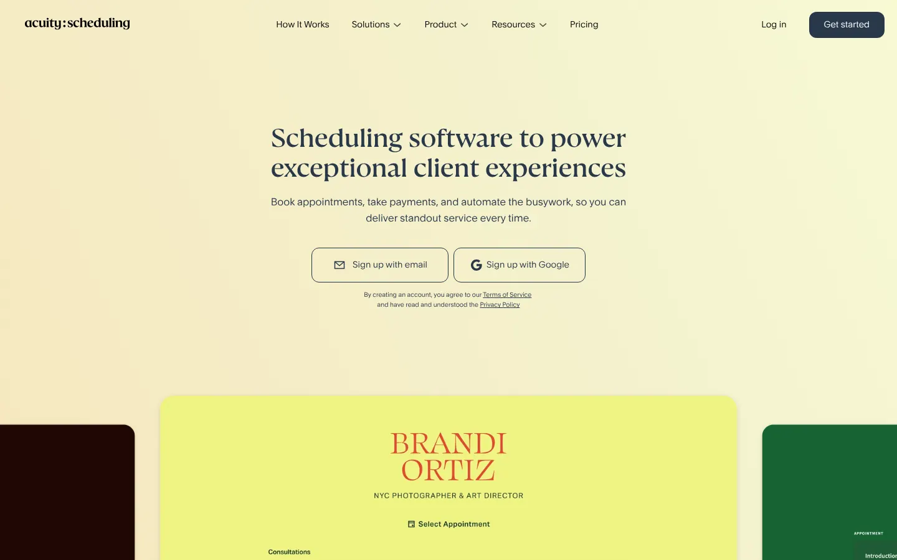
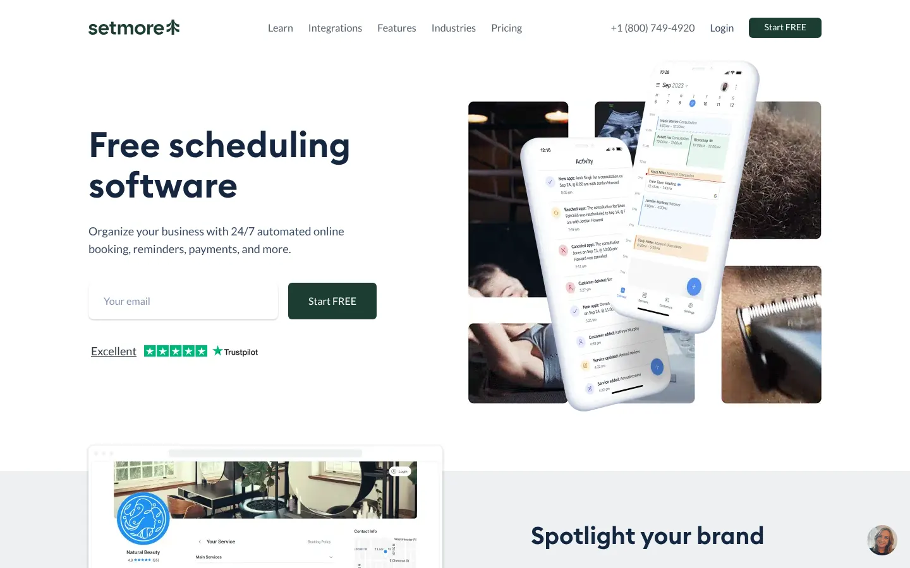
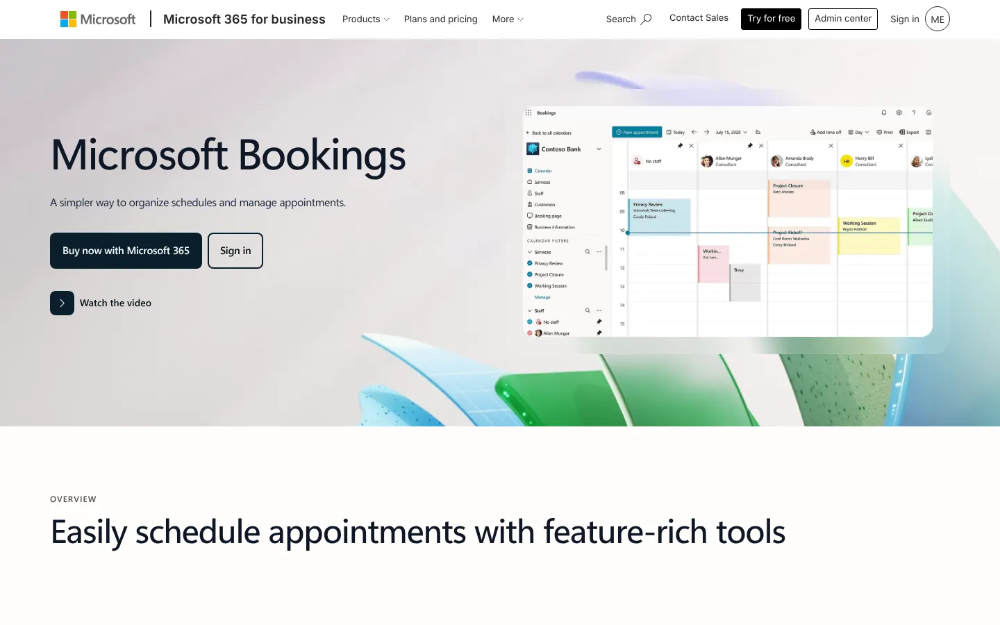
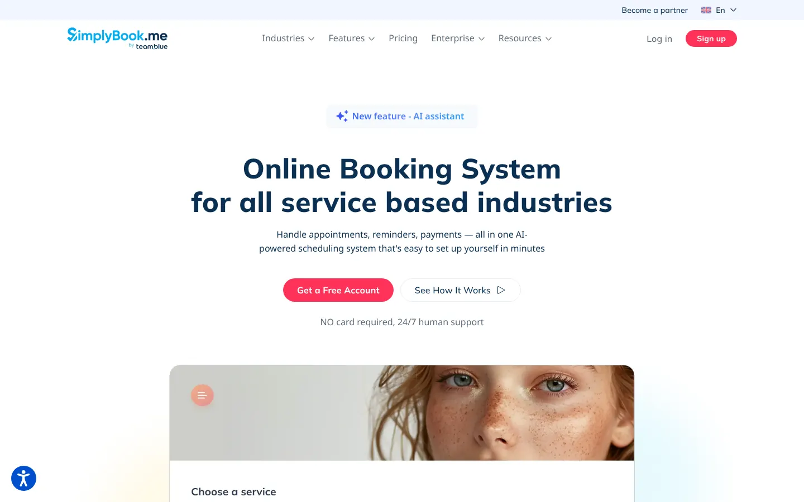
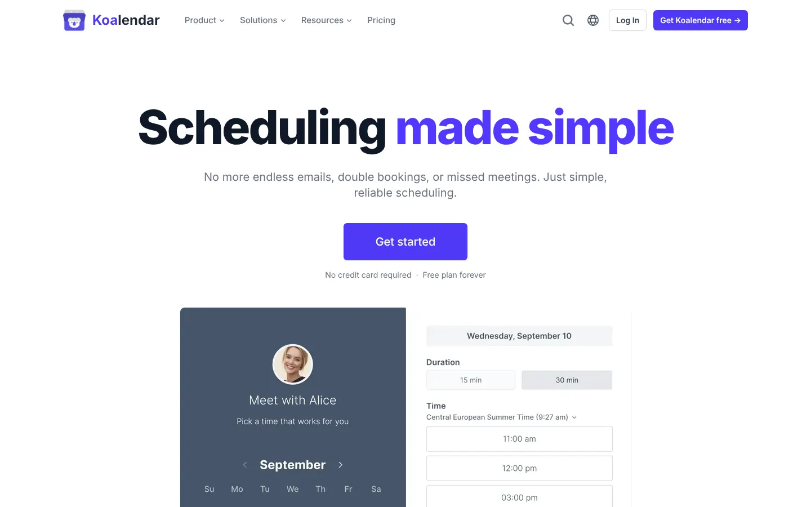

A small business books time in many shapes. A studio books classes, while an agency books sales calls. The right tool lets clients pick a time on their own and asks the questions you need before anyone shows up. Then it sends the reminders for you.

The biggest difference between these tools is how they charge. Most charge per person or per calendar. A few charge by the number of bookings each month. Before you compare features, count who on your team takes bookings and roughly how many you get in a month. That one step makes the prices below easy to compare.

> **[Try Claritia free](https://app.tryclaritia.com/signup)** to let clients fill in your form and book a time inside it, and pay only for teammates people can book.

In this post, we compare 8 scheduling tools for small business on free plans, how each one charges, reminders and client forms.

## Main points

- The right tool lets clients book on their own, asks your questions up front and sends reminders for you.
- The biggest difference is how each tool charges: per person, per calendar, or by bookings a month.
- Count who takes bookings and how many you get a month before you compare prices.
- Top picks: [Claritia](/), [Acuity Scheduling](https://acuityscheduling.com/), [Setmore](https://www.setmore.com/), [Microsoft Bookings](https://www.microsoft.com/en-us/microsoft-365/business/scheduling-and-booking-app), [Calendly](https://calendly.com/), [Zoho Bookings](https://www.zoho.com/bookings/), [SimplyBook.me](https://simplybook.me/) and [Koalendar](https://koalendar.com/).
- Pick [Claritia](/) if clients find you through your website and you want their details and the booking in one step.

## What is scheduling software for small business?

Scheduling software for small business lets clients book time with you or your staff online. It shows your open times, collects the details you need, puts the booking on the right calendar and sends reminders.

Typical features include:

- A booking page that works on a phone, in the client's time zone.
- Calendar sync with Google Calendar or Outlook.
- Questions or forms that collect client details before the meeting.
- Email or text reminders.
- A video link on each online booking.
- Payments when the client books.

## How to choose scheduling software for small business

Most tools here handle a basic booking page. These five checks show which one fits your business:

- **How the price grows.** What a team of three to five pays as you add people or bookings.
- **Client details up front.** Forms or questions that collect what you need before the meeting.
- **Reminders.** Email and text reminders that cut down on missed bookings.
- **Calendar and video links.** Google Calendar or Outlook, plus a meeting link on each booking.
- **Ease for clients.** A booking page that works on a phone in the client's time zone.

## The 8 best scheduling software tools for small business in 2026

| Tool | Best for | Free plan | Paid from | How you're charged |
|---|---|---|---|---|
| [Claritia](/) | Teams that book clients from website forms | Yes | $12 a seat a month billed yearly | Per bookable seat; form builders are free |
| [Acuity Scheduling](https://acuityscheduling.com/) | Service businesses with intake forms | No, 7-day trial | $16 a month billed yearly | By number of calendars |
| [Setmore](https://www.setmore.com/) | Small staff teams on a tight budget | Yes, up to 4 users | See their pricing page | Per user on paid plans |
| [Microsoft Bookings](https://www.microsoft.com/en-us/microsoft-365/business/scheduling-and-booking-app) | Businesses already on Microsoft 365 | Comes with some plans | See their pricing page | Part of a Microsoft 365 licence |
| [Calendly](https://calendly.com/) | Sales calls and one-on-one meetings | Yes, 1 event type | $10 a seat a month billed yearly | Per seat |
| [Zoho Bookings](https://www.zoho.com/bookings/) | Teams that use Zoho apps | Yes, 1 user | $6 a user a month billed yearly | Per user |
| [SimplyBook.me](https://simplybook.me/) | Low booking volume with many services | Yes, 50 bookings | $11.90 a month billed yearly | By bookings and providers |
| [Koalendar](https://koalendar.com/) | Very small teams that want low prices | Yes | $6.99 a seat a month billed yearly | Per seat; Business includes 3 seats |

## 1. Claritia

[Claritia](/) joins forms and meetings for small teams of every kind, with workflows that follow up after. A client fills in your form and books a time inside it, so you get their details and the meeting in one step. Answers can send each booking to the right person on your team. It suits small teams that win clients through a website and want the form to book the meeting.

> **[Try Claritia free](https://app.tryclaritia.com/signup)** and test the full flow on your own site with 250 form submissions a month.

### Key features

- **Booking inside forms:** On the free plan, with working hours, buffers and daily caps. See [Claritia Forms](/products/forms) for the form side.
- **Reminders:** A day and an hour before each meeting, with reschedule and cancel links.
- **Routing by answer:** On Pro, answers send each booking to the right person.
- **Paid meetings:** Starter adds paid meetings with Stripe or PayPal.
- **Team booking pages:** Starter adds booking pages for each person and the team.

### Pros

- **Pay only for bookable teammates:** Anyone who just builds forms or reads answers is free.
- **Details and booking in one step:** You learn about the client before the meeting.
- **Room to test for free:** The free plan is enough to test the full flow on your own site.

### Cons

- **No native mobile app:** You manage bookings in the browser.
- **Email reminders only for now:** Text reminders on Pro and Business are coming soon.

### Price and plans

You can start on the free plan with no card. Paid plans are priced per seat, and a seat is a teammate people can book a meeting with.

- **Free:** $0 for 1 seat, with 250 form submissions a month and one meeting type on one calendar.
- **Starter:** $15 a seat a month ($12 billed yearly). Adds paid meetings with Stripe or PayPal, plus booking pages for each person and the team.
- **Pro:** $39 a seat a month ($31 billed yearly). Adds routing by any answer and round robin.
- **Business:** $79 a seat a month ($63 billed yearly). Adds your own domain for forms and booking pages.

## 2. Acuity Scheduling

[Acuity Scheduling](https://acuityscheduling.com/) is a long-standing pick for service businesses. Every plan includes custom intake forms and online payments. You pay by the number of calendars, which suits a business where each staff member or room has one. It's a strong fit for salons and clinics that take payment when clients book.

### Key features

- **Intake forms:** Custom client intake forms on every plan.
- **Payments:** Through Stripe, Square, PayPal and Venmo.
- **Standard extras:** Packages, memberships, a waitlist and SMS reminders.
- **HIPAA support:** Premium includes a signed HIPAA agreement for health businesses.

### Pros

- **Intake and payment on every plan:** You don't need an upgrade for either one.
- **Priced by calendar:** Fits a business where each staff member or room has a calendar.

### Cons

- **No free plan:** Only a 7-day trial, with no card needed.
- **One calendar on Starter:** A second staff member means Standard.

### Price and plans

- **Starter:** $16 a month billed yearly ($20 monthly), with one calendar.
- **Standard:** $27 a month billed yearly ($34 monthly).
- **Premium:** $55 a month billed yearly ($69 monthly).

## 3. Setmore

[Setmore](https://www.setmore.com/) gives a small staff team a lot at no cost. The free plan covers up to four users with unlimited appointments, and it has phone apps for iOS and Android. It suits shops and studios with a few staff and a small budget.

### Key features

- **Four users free:** Up to four users with unlimited appointments.
- **Payments:** Online and in-person payments on the free plan.
- **Phone apps:** For iOS and Android.
- **Support:** Round-the-clock support from real people, listed on the free plan.

### Pros

- **A small staff for $0:** Four people can take bookings on free.
- **Help any time:** Round-the-clock support from real people.

### Cons

- **Email reminders only on free:** Text reminders need a paid plan.
- **Unclear paid price:** The pricing page shows different numbers in different places, so confirm the paid price before you buy.

### Price and plans

Paid plans are charged per user.

- **Free:** $0 for up to four users.
- **Pro:** See their pricing page.

## 4. Microsoft Bookings

If your business already pays for Microsoft 365, you may already have [Microsoft Bookings](https://www.microsoft.com/en-us/microsoft-365/business/scheduling-and-booking-app). It comes with Business Basic, Business Standard, Business Premium and Teams Essentials, among other plans. It ties into Outlook and creates a Teams meeting for each online booking. It suits offices that already run on Outlook and Teams.

### Key features

- **Booking pages:** Personal booking pages and shared pages for the whole team.
- **Notifications:** Email and text notifications to reduce no-shows.
- **Teams meetings:** A Teams meeting for each online booking.
- **Your data:** Booking data stays inside Microsoft 365.

### Pros

- **Already paid for:** It's included with many Microsoft 365 business plans.
- **Fits Outlook:** It ties into the calendar your office already uses.

### Cons

- **Needs the right plan:** You need a Microsoft 365 plan that includes it.
- **Made for Microsoft:** Teams that live in Google Workspace will find less to like.

### Price and plans

- **Microsoft 365 business plans:** Part of a Microsoft 365 licence, included with some plans. See their pricing page.

## 5. Calendly

[Calendly](https://calendly.com/) is the name most people know for booking links. It's simple for clients and fits sales calls and one-on-one meetings well. Team features like round robin start on the Teams plan. It suits small sales and consulting teams that book calls.

### Key features

- **Free plan:** One event type and a booking page.
- **Reminders:** Standard adds unlimited event types and automated reminders.
- **Payments:** Stripe and PayPal payments on Standard.
- **Team booking:** Teams adds round robin and lead routing.

### Pros

- **Simple for clients:** Most people already know how it works.
- **Payments on Standard:** Take payment without the Teams plan.

### Cons

- **Small free plan:** One event type and no reminders.
- **Team features cost more:** Round robin and routing need Teams at $16 a seat a month billed yearly.

### Price and plans

- **Free:** $0, with one event type.
- **Standard:** $10 a seat a month billed yearly.
- **Teams:** $16 a seat a month billed yearly.
- **Enterprise:** From $15,000 a year.

## 6. Zoho Bookings

[Zoho Bookings](https://www.zoho.com/bookings/) fits businesses that already run on Zoho. It links to Zoho CRM and Bigin, and its per-user prices are among the lowest here. It suits small teams already using Zoho CRM or Bigin.

### Key features

- **Free plan:** One person, with two-way sync for Google and Outlook calendars.
- **Round robin:** Four ways to share bookings.
- **Workspaces:** Premium includes three workspaces for separate parts of the business.
- **Zoho ties:** Links to Zoho CRM and Bigin.

### Pros

- **Low prices:** Per-user prices are among the lowest here, billed yearly.
- **Fits Zoho teams:** Bookings tie into the Zoho apps you already use.

### Cons

- **One person on free:** The free plan covers one person only.
- **Add-on costs:** Rooms and equipment are paid add-ons on top of the plan price.

### Price and plans

- **Free:** $0 for one user.
- **Basic:** $6 a user a month billed yearly ($8 monthly).
- **Premium:** $9 a user a month billed yearly ($12 monthly).

## 7. SimplyBook.me

[SimplyBook.me](https://simplybook.me/) prices by bookings and providers, which helps a business with a low or steady volume. It comes with a booking website and a widget for your own site. Higher plans raise both the booking cap and the number of staff. It suits small service businesses with a steady, modest number of bookings.

### Key features

- **Booking website:** A booking website plus a WordPress widget.
- **Free plan:** 50 bookings and one provider.
- **Room to grow:** Basic covers 100 bookings and five providers, and Premium raises that to 2,000 bookings and 30 providers.

### Pros

- **Price follows volume:** A low or steady month keeps the cost down.
- **Free start:** 50 bookings at $0.

### Cons

- **Booking caps:** A busy month can push you to the next plan.
- **One provider on free:** A team needs a paid plan.

### Price and plans

- **Free:** 50 bookings and one provider.
- **Basic:** $11.90 a month billed yearly ($13.90 monthly), for 100 bookings and five providers.
- **Standard:** $24.90 a month billed yearly ($29.90 monthly).
- **Premium:** $49.90 a month billed yearly ($59.90 monthly), for 2,000 bookings and 30 providers.

## 8. Koalendar

[Koalendar](https://koalendar.com/) keeps prices low for one or two people. Its free plan has unlimited booking pages and event types, and Business bundles three seats with round robin. It suits very small teams that want a simple page at a low price.

### Key features

- **Unlimited on free:** Unlimited bookings and event types.
- **Languages:** Booking pages in more than 30 languages.
- **Pro extras:** Email reminders and custom booking questions.
- **Business extras:** Round robin and SMS credits.

### Pros

- **Low prices:** Pro starts at $6.99 a seat a month billed yearly.
- **Three seats, one price:** Business bundles three seats.

### Cons

- **Free plan limits:** Free connects two calendars and keeps Koalendar branding.
- **No reminders on free:** Reminders start on Pro.

### Price and plans

- **Free:** $0, with two calendars and Koalendar branding.
- **Pro:** $6.99 a seat a month billed yearly ($9.99 monthly).
- **Business:** $29 a month billed yearly for three seats ($36 monthly).

## Which scheduling software should your small business pick?

- If clients find you through your website and you want their details and the booking in one step, pick [Claritia](/).
- If you run sessions that need intake forms and payment up front, pick [Acuity Scheduling](https://acuityscheduling.com/).
- If you have up to four staff and want to spend nothing, start with [Setmore](https://www.setmore.com/)'s free plan.
- If your business already pays for Microsoft 365, try [Microsoft Bookings](https://www.microsoft.com/en-us/microsoft-365/business/scheduling-and-booking-app) before buying anything new.
- If you get a small, steady number of bookings each month, compare [SimplyBook.me](https://simplybook.me/)'s booking caps with your volume.

## Questions

### What is the best scheduling software for a small business?

It depends on how you charge and book. Claritia fits teams that win clients from website forms. Acuity fits service businesses that need intake forms and payments. Setmore fits small staff teams on a budget.

### Is there free scheduling software for a small team?

Yes. Setmore is free for up to four users. Claritia is free with unlimited forms and one meeting type, and its form builders never need a seat.

### Can clients pay when they book?

Yes, in most of these tools. Claritia takes payment for meetings from Starter, through Stripe or PayPal. Acuity takes payment on every plan.

### Do you need text reminders?

Email reminders cover most bookings. Text reminders help with walk-in style businesses where clients miss emails. Acuity adds them on Standard, and Microsoft Bookings sends text notifications.

### How do you stop double bookings?

Connect every calendar your team uses, so the tool hides times that are already taken. Claritia adds buffers and daily caps on the free plan to keep each day manageable.

## Get started

Build a booking form for your business in a few minutes.

> **[Try Claritia free](https://app.tryclaritia.com/signup)** to build your booking form and take your first booking today.

You can also compare plans on the [pricing page](/pricing).
