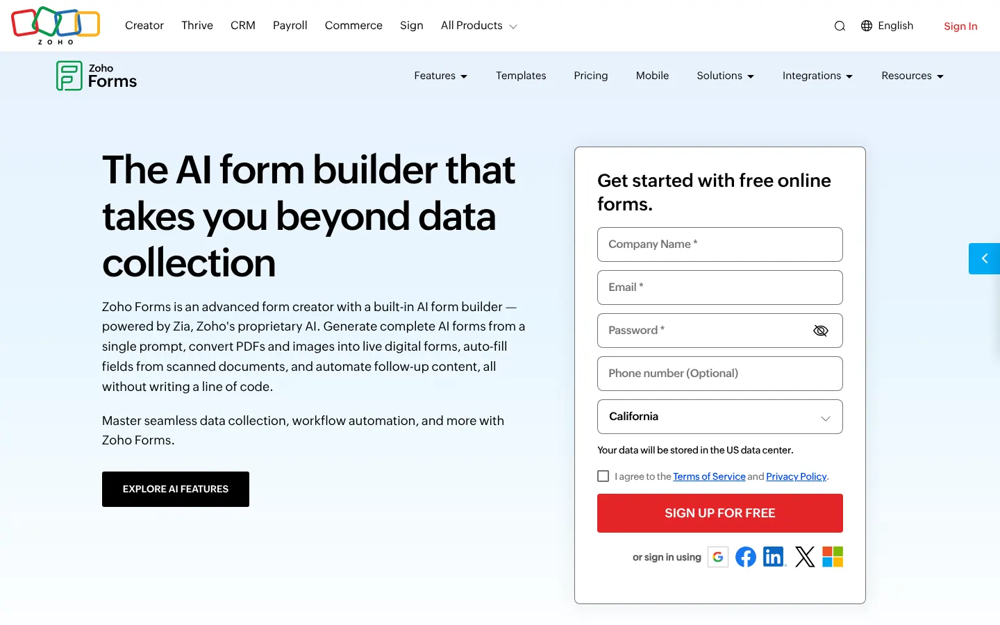
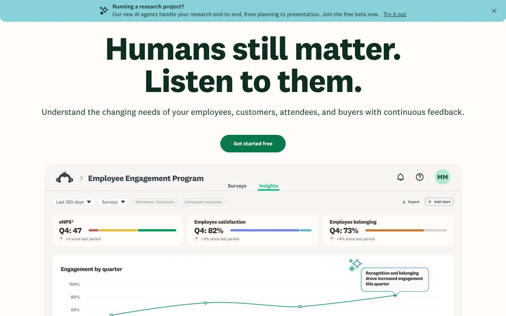

Typeform earned its fans. Its one-question-at-a-time layout makes forms feel calm and personal, and its design tools are some of the best around. The trouble is the bill. Basic costs $28 a month billed yearly and includes 100 responses a month for 1 user, and the free plan has a low response cap.

A good Typeform alternative gives you more answers for the money, room for your team, or a form that does more after someone clicks submit.

> **[Try Claritia free](https://app.tryclaritia.com/signup)** to build polished forms that end in a booked meeting with the right teammate.

In this post, we compare 8 Typeform alternatives by price, response limits and features, with the pros and cons of each.

## Main points

- Typeform Basic costs $28 a month billed yearly for 100 responses a month and 1 user.
- Every tool below includes more responses on its first paid plan, and several have large free plans.
- Check three things first: how many responses you get for the money, how many teammates can work on forms, and what happens after submit.
- Top picks: [Claritia](/), [Fillout](https://www.fillout.com/), [Tally](https://tally.so/), [Paperform](https://paperform.co/), [Jotform](https://www.jotform.com/), [Zoho Forms](https://www.zoho.com/forms/), [Cognito Forms](https://www.cognitoforms.com/) and [SurveyMonkey](https://www.surveymonkey.com/).
- Pick [Claritia](/) if you want each form to end in a booked meeting, and keep your Typeform answers flowing while you move.

## What is a Typeform alternative?

A Typeform alternative is a form builder you use in place of Typeform. You build forms, quizzes or surveys in the other tool, share them by link or on your site, and collect the answers there.

Teams switch for three main reasons. They want more responses for the price. They want more teammates on one plan. Or they want something to happen right after submit, like a follow-up email or a booked meeting.

Typical features include:

- Conditional logic that shows or skips questions based on answers.
- Design controls for fonts, colors and layout.
- A one-question layout, a page layout, or both.
- Payments and file uploads.
- Integrations with spreadsheets, CRMs and email tools.
- Steps after submit, such as follow-up emails or meeting booking.

## How to choose a Typeform alternative

Price is only part of it. These five checks tell you more:

- **Responses for the money.** How many answers the first paid plan includes each month.
- **Seats.** How many teammates can build or read forms without extra cost.
- **Form quality.** Logic and design that feel smooth on phones.
- **After submit.** Integrations, follow-up emails, routing and meeting booking.
- **Easy switch.** How fast you can rebuild your forms and keep leads flowing.

## The 8 best Typeform alternatives in 2026

| Tool | Best for | Free plan | Paid from | Responses on first paid plan |
|---|---|---|---|---|
| [Claritia](/) | Forms that book meetings | Unlimited forms, 250 submissions a month | $12 a seat a month, billed yearly | 2,000 a month |
| [Fillout](https://www.fillout.com/) | Most free responses | 1,000 responses a month | $15 a month, billed yearly | 2,000 a month |
| [Tally](https://tally.so/) | Low cost at volume | Unlimited forms and submissions (fair use) | $24 a month | Unlimited (fair use) |
| [Paperform](https://paperform.co/) | Page-style forms | 30 submissions a month | $49 a month, billed yearly | Unlimited (fair use) |
| [Jotform](https://www.jotform.com/) | Template variety | 5 forms, 100 submissions a month | $34 a month, billed yearly | 1,000 a month |
| [Zoho Forms](https://www.zoho.com/forms/) | Zoho users | 3 forms, 500 submissions a month | See their pricing page | 10,000 a month |
| [Cognito Forms](https://www.cognitoforms.com/) | Forms with math | 100 entries a month | $19 a month, billed yearly | 2,000 a month |
| [SurveyMonkey](https://www.surveymonkey.com/) | Research surveys | Basic plan, 10 questions per survey | $39 a month, billed yearly | 15,000 a year |

## 1. Claritia

[Claritia](/) is a forms, scheduling and follow-up app built for small B2B teams that want every lead from their website to reach the right rep and book a meeting before they leave the page. It builds forms from a sentence or one of 840 templates, opens the right person's calendar the moment the form is sent, routes each lead by its answers, and drafts follow-up emails in your brand's voice for you to approve. It gives you polished forms and adds what comes next, so after a visitor picks a time with the right teammate, a confirmation email with a calendar invite follows.

> **[Try Claritia free](https://app.tryclaritia.com/signup)** and rebuild your first Typeform form from one plain sentence with Tia.

### Key features

- **Booking inside the form:** The right teammate's calendar opens as soon as the form is sent, with Google Calendar and Outlook on every plan.
- **Tia, the AI form builder:** Tia drafts a form from one plain sentence, so rebuilding your Typeform forms goes fast.
- **Typeform answers:** Starter takes in answers from Typeform, so your old forms can keep running while you move. See the [Typeform connection](/integrations/typeform).
- **Styles and templates:** 18 form styles and 840 templates, with your own brand from Starter.
- **Routing:** On Pro, route by any answer to a meeting and a person.
- **High limits:** 2,000 submissions a month on Starter, and unlimited on Business.

### Pros

- **One step from form to meeting:** The visitor fills in the form and books a time in the same flow.
- **Logic for free:** Conditional logic and calculations are on every plan.
- **Fair seat pricing:** Teammates who only build forms or read answers are free.

### Cons

- **Newer tool:** Its app marketplace and community are smaller than Typeform's.
- **No Zapier or Make apps yet:** They're on the way and are yet to be listed.
- **No mobile app:** There's no native mobile app.

### Price and plans

You can start on the free plan with no card. Paid plans are priced per seat, and a seat is a teammate people can book a meeting with.

- **Free:** $0 for 1 seat and 250 submissions a month.
- **Starter:** $15 a seat a month ($12 billed yearly), with 2,000 submissions a month. Adds your own brand and answers from Typeform.
- **Pro:** $39 a seat a month ($31 billed yearly), with 5,000 submissions a month. Adds round robin and routing by answer.
- **Business:** $79 a seat a month ($63 billed yearly), with unlimited submissions. Adds partial answers and drop-off by question.

## 2. Fillout

[Fillout](https://www.fillout.com/) is a form builder for teams that want branded forms, surveys, and quizzes connected to the tools they already use. You can describe a form for its AI to build or use drag and drop, then add logic, file uploads, payments, and signatures. It also offers scheduling forms that sync with Google Calendar or Outlook, PDF generation, workflows, login forms that let people edit past answers, custom domains, and native integrations. It covers most of what Typeform users need and is the closest match on value, with 1,000 responses a month on the free plan and unlimited seats on every plan. It suits teams that want many responses and many builders at a low price.

### Key features

- **Big free plan:** 1,000 responses a month at no cost.
- **Unlimited seats:** On every plan.
- **Logic and payments:** Both on the free plan.
- **Scheduling:** Scheduling forms for free, and Calendly scheduling from Starter.

### Pros

- **More answers for less:** Starter includes 2,000 responses a month.
- **Room for the whole team:** No extra cost for more builders.

### Cons

- **Partial submissions cost more:** They're a Business feature.
- **Free plan branding:** Free forms carry a Fillout badge and skip custom themes.

### Price and plans

- **Free:** $0, with 1,000 responses a month.
- **Starter:** $15 a month billed yearly, with 2,000 responses a month.
- **Pro:** $40 a month, billed yearly.
- **Business:** $75 a month, billed yearly.

## 3. Tally

[Tally](https://tally.so/) is a form builder for individuals and teams who want to make forms by typing, much like writing in a document. You insert blocks for contact details, file uploads, ratings, signatures, and Stripe payments, then add conditional logic, calculations, hidden fields, and answer piping. Forms can be embedded or shown as popups, and submissions can go to Notion, Slack, Airtable, or Google Sheets. Tally is hosted in Europe and does not use cookie tracking. It's the cheapest way to collect large numbers of answers, since the free plan has unlimited submissions under fair use, which makes it a good fit for makers and small teams on a tight budget.

### Key features

- **Unlimited forms:** Unlimited forms and submissions for free, under fair use.
- **Logic and payments:** Both on the free plan.
- **Free integrations:** Links to Google Sheets, Notion, Airtable and webhooks.
- **Insights on Pro:** Drop-off analytics and partial submissions.

### Pros

- **Free goes far:** The free plan covers most needs at $0.
- **Doc-style editor:** You type your form like a document.

### Cons

- **Free plan branding:** Free forms show Tally branding.
- **A different look:** Its doc-style forms differ from Typeform's one-question layout.

### Price and plans

- **Free:** $0, unlimited forms and submissions under fair use.
- **Pro:** $24 a month, with two months off when you pay yearly.
- **Business:** $74 a month.

## 4. Paperform

[Paperform](https://paperform.co/) is an online form builder for small businesses and solo operators who want one form to capture details, take payment, and start the next step. Its editor works like a document, with a one question at a time mode, conditional logic, and spreadsheet style formulas for prices and scores. Forms can take bookings and Stripe payments, send contracts for e-signature through Papersign, and pass submissions to CRMs, email tools, and spreadsheets through integrations or Stepper workflows. Mixing images and text with your questions lets a form double as a landing page. Paid plans include unlimited submissions under fair use and every plan has unlimited users, which suits teams held back by Typeform's per-plan user limits.

### Key features

- **Page-like editor:** Plenty of room for content around your questions.
- **Unlimited users:** On every plan.
- **Unlimited submissions:** On Pro and Business, under fair use.
- **Free trial:** 7 days with no card needed.

### Pros

- **No user limits:** Your whole team can work on forms.
- **No counting answers:** Paid plans take unlimited submissions under fair use.

### Cons

- **Small free plan:** It takes 30 submissions a month.
- **Higher price:** Pro costs more than most Typeform alternatives here.

### Price and plans

- **Free:** 30 submissions a month.
- **Pro:** $49 a month billed yearly, or $59 billed monthly.
- **Business:** $124 a month billed yearly, or $149 billed monthly.

## 5. Jotform

[Jotform](https://www.jotform.com/) is a drag and drop form builder for businesses, schools, nonprofits, and public agencies that want to collect data, payments, and signatures without writing code. Forms can use conditional logic, answer piping, prefilled fields, and translations, and they accept one-time or recurring payments through many gateways. Submissions can become PDFs, flow into CRMs and spreadsheets, and be managed in related Jotform tools for tables, approval workflows, e-signatures, and reports. It swaps Typeform's minimal style for sheer range, with a very large template library, widgets for almost any field and a card-style form layout. It's best for solo builders who want a template for every need.

### Key features

- **Templates:** A very large template library.
- **Widgets:** Many widgets for special fields.
- **More than forms:** A card-style form layout, plus extra tools for PDFs and tables.
- **HIPAA features:** On Gold and Enterprise.
- **Mobile apps:** For filling and managing forms.

### Pros

- **A template for most needs:** You rarely start from a blank form.
- **Forms on the go:** Mobile apps help you work away from your desk.

### Cons

- **Single user:** Plans below Enterprise are for one user.
- **Caps on Bronze:** Bronze includes 25 forms and 1,000 submissions a month.

### Price and plans

- **Free:** 5 forms and 100 submissions a month.
- **Bronze:** $34 a month billed yearly ($39 monthly).
- **Silver:** $39 a month, billed yearly.
- **Gold:** $99 a month, billed yearly.

## 6. Zoho Forms

[Zoho Forms](https://www.zoho.com/forms/) is an online form builder for businesses that want to collect data and move it through review and approval steps without code. It can build a form from a prompt, turn PDFs or photos of paper forms into online forms, and read business cards or IDs to fill in fields. Forms support many field types, subforms, payments, and multi-level approvals, a mobile app collects entries offline, and data can flow into Zoho CRM. It trades flair for high limits, since paid plans start at 10,000 submissions a month, far more than Typeform's Basic plan. It's best for teams that already run on Zoho apps and need high volume.

### Key features

- **High limits:** 10,000 submissions a month on Basic.
- **Users:** Up to 10 users on Standard.
- **Zoho CRM:** A close link with Zoho CRM.
- **Mobile app:** For collecting answers on the go.

### Pros

- **Volume:** Far more submissions than Typeform's Basic plan.
- **Zoho fit:** Works closely with the Zoho apps your team may already use.

### Cons

- **Small free plan:** 3 forms and 1 user.
- **Best inside Zoho:** It fits best inside the Zoho world.

### Price and plans

- **Free:** 3 forms, 500 submissions a month and 1 user.
- **Basic:** 10,000 submissions a month.
- **Standard:** Up to 10 users.

For prices, see their pricing page.

## 7. Cognito Forms

[Cognito Forms](https://www.cognitoforms.com/) is an online form builder for organizations that want to collect data and automate the work that follows each entry. Its drag-and-drop builder handles many field types, automatic calculations, signatures and file uploads. Forms can move entries through approval workflows, generate documents, look up data from other forms and take payments through Square, Stripe, PayPal or its own Cognito Pay. It also includes controls that help teams meet HIPAA, GDPR and CCPA rules. It's a practical pick for quotes and order forms, since its calculations and repeating sections handle totals well. The free plan takes payments, and the first paid plan is one of the cheapest here.

### Key features

- **Calculations:** Calculations and repeating sections for totals.
- **Payments:** On the free plan.
- **Unlimited forms:** No cap on how many forms you keep.
- **Pro limits:** 2,000 entries a month on Pro.

### Pros

- **Good with numbers:** Totals for quotes and orders work well.
- **Low price:** The first paid plan is one of the cheapest here.

### Cons

- **Small free plan:** 100 entries a month, with Cognito Forms branding.
- **Plain style:** Its style is more practical than Typeform's.

### Price and plans

- **Free:** 100 entries a month.
- **Pro:** $19 a month billed yearly ($24 monthly), with 2,000 entries a month.

## 8. SurveyMonkey

[SurveyMonkey](https://www.surveymonkey.com/) is an online survey platform for teams that want to gather feedback from customers, employees and target markets and act on what they learn. Users build surveys and forms from templates, expert-written questions or a short AI prompt, add skip logic and branding, and send them by link, email, text message, QR code or website embed. It summarizes results with charts and AI-sorted themes for open answers, and it can reach a global panel of paid respondents. It's built for research more than lead capture, so if you use Typeform mainly for customer feedback, its analysis tools are worth a look. Annual plans count responses by the year.

### Key features

- **Survey analysis:** Tools for reading results.
- **Yearly responses:** 15,000 responses a year on Advantage.
- **Team plans:** For 3 or more users.
- **Extra responses:** $0.15 each on paid plans.

### Pros

- **Built for feedback:** Its analysis tools help you make sense of survey results.
- **Room for teams:** Team plans cover 3 or more users.

### Cons

- **Tight free plan:** Basic allows 10 questions per survey and limited responses.
- **Costly monthly plan:** Standard costs $149 a month for 1,000 responses.

### Price and plans

- **Basic:** Free, with 10 questions per survey and limited responses.
- **Standard:** $149 a month billed monthly, for 1,000 responses.
- **Advantage:** $39 a month billed yearly ($468 a year), with 15,000 responses a year.
- **Premier:** $139 a month, billed yearly.
- **Team Advantage:** $30 a user a month billed yearly, for 3 or more users.

## Which Typeform alternative should you pick?

- If you want your forms to book meetings, pick [Claritia](/). It also takes in Typeform answers while you switch.
- If you want the most free responses and seats, pick [Fillout](https://www.fillout.com/).
- If price is the main reason you're leaving, pick [Tally](https://tally.so/).
- If you need unlimited users, pick [Paperform](https://paperform.co/) or [Fillout](https://www.fillout.com/).
- If you mostly run research surveys, pick [SurveyMonkey](https://www.surveymonkey.com/).

## Questions

### What is the best Typeform alternative?

For small teams that want forms to lead to meetings, Claritia is the best alternative. For pure form building on a budget, Fillout and Tally are strong picks.

### Is there a free Typeform alternative?

Yes. Tally offers unlimited forms and submissions for free under fair use. Fillout gives you 1,000 responses a month. Claritia's free plan includes 250 submissions a month and meeting booking.

### Why is Typeform so expensive?

Typeform prices each plan by response limits and users. Basic is $28 a month billed yearly for 100 responses a month and 1 user, so costs rise as volume grows.

### Can you keep Typeform while moving to Claritia?

Yes. On Starter, Claritia takes in answers from Typeform. You can keep old forms live and book meetings from their answers. Then rebuild each form in Claritia when you're ready.

### Which Typeform alternative is cheapest?

Tally's free plan covers most needs at $0. For a paid plan, Claritia Starter is $12 a seat a month billed yearly, and Fillout Starter is $15 a month billed yearly.

## Get started

You can rebuild a Typeform form in minutes with Tia, or start from a [form template](/templates).

> **[Try Claritia free](https://app.tryclaritia.com/signup)** to build your first form and book your first meeting today.

You can also see how the [Typeform connection](/integrations/typeform) keeps answers flowing while you move.
