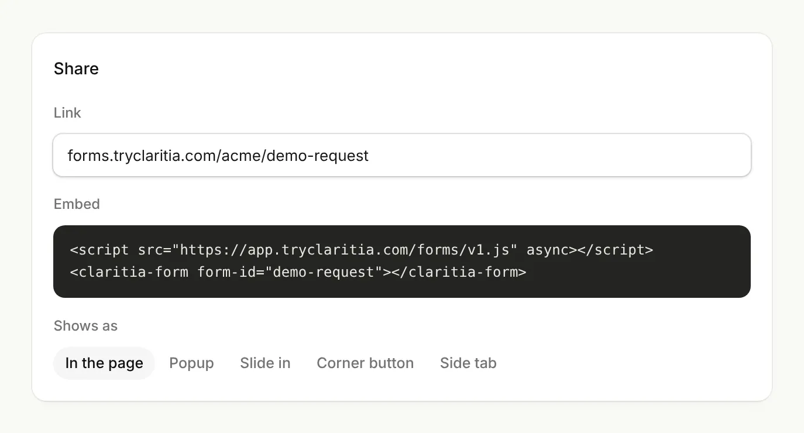
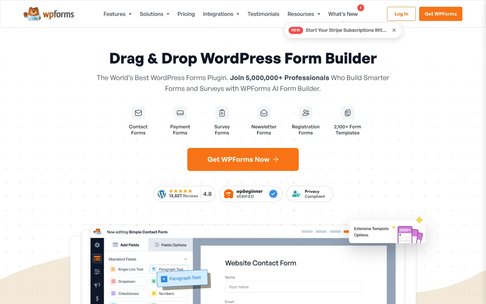
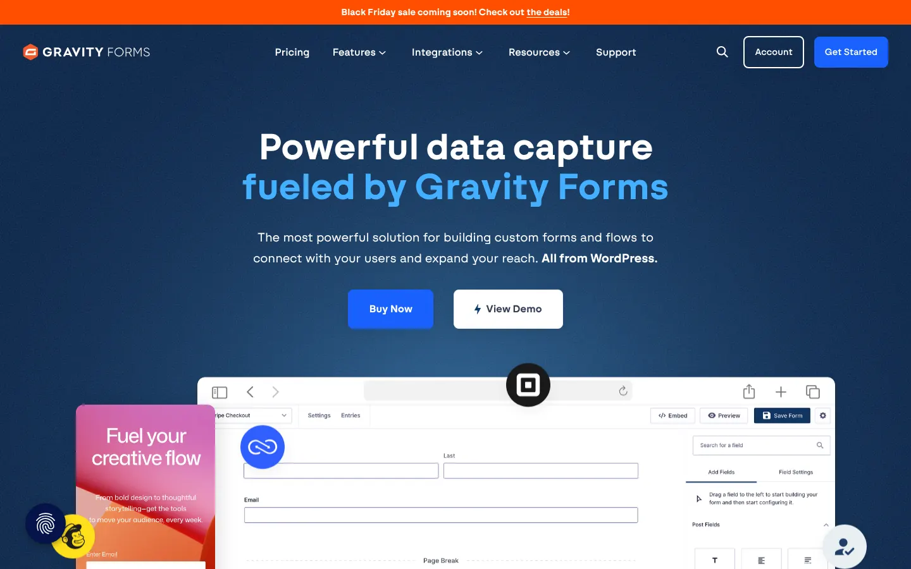
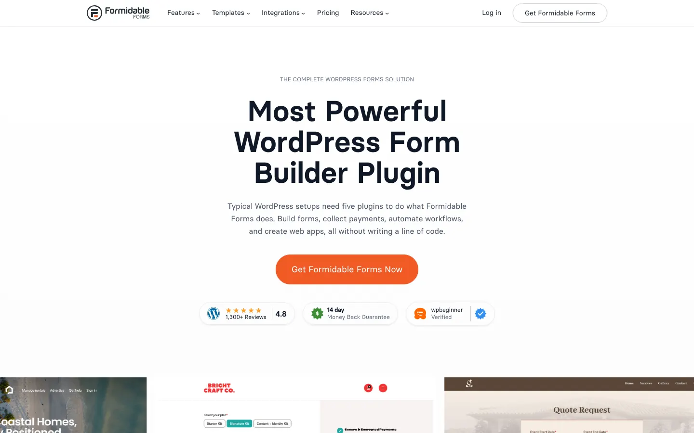
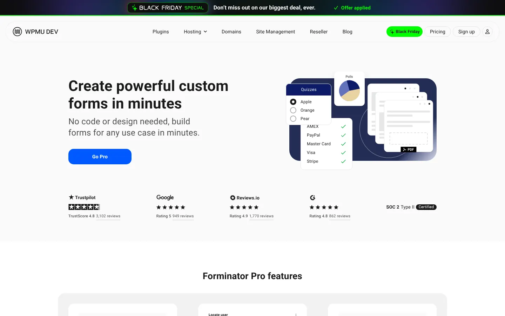

WordPress gives you two ways to add forms. You can install a plugin that runs inside your site and stores entries in your WordPress database. Or you can use a hosted form tool and embed it on your pages. Both work. The right pick depends on where you want your leads to live and who will build the forms.

A plugin keeps everything in WordPress admin. A hosted tool keeps forms working the same way across every site you run, and it adds less load to your server.

> **[Try Claritia free](https://app.tryclaritia.com/signup)** to add a form that books meetings to your WordPress site with one script tag.

Below, we compare 8 WordPress form builders, plugins and hosted tools both, with real prices.

## Main points

- WordPress forms come in two kinds: native plugins that store entries in your WordPress database, and hosted tools you embed on your pages.
- Many plugins discount the first year, so check what you pay at renewal.
- Check three things first: how the tool runs on WordPress, whether logic is in the version you'd buy, and what happens after submit.
- Top picks: [Claritia](/), [WPForms](https://wpforms.com/), [Gravity Forms](https://www.gravityforms.com/), [Formidable Forms](https://formidableforms.com/), [Fluent Forms](https://fluentforms.com/), [Ninja Forms](https://ninjaforms.com/), [Forminator](https://wpmudev.com/project/forminator-pro/) and [Jotform](https://www.jotform.com/).
- Pick [Claritia](/) if you want WordPress visitors to book a meeting with the right person.

## What is a WordPress form builder?

A WordPress form builder is a tool that adds forms to a WordPress site, such as contact forms, quote forms and lead forms. It comes in two kinds. A native plugin runs inside your site and keeps entries in your WordPress database. A hosted tool runs on its own servers, and you embed its forms on your pages.

Typical features include:

- A drag-and-drop builder for laying out fields.
- Conditional logic that shows or hides fields based on answers.
- Calculations for quotes and order totals.
- Payments through tools like Stripe and PayPal.
- CRM integrations, such as HubSpot or Salesforce.
- Partial entries, so you can see who stopped halfway.

## How to choose a WordPress form builder

Start with who will build the forms and where the answers go. Then run five checks:

- **How it runs on WordPress.** A native plugin or a hosted tool you embed.
- **Logic and calculations.** Rules that show or hide fields and do math on answers.
- **The step after submit.** CRM syncs and meeting booking.
- **Free version.** What you get before you pay.
- **Renewal price.** Many plugins discount the first year, so check what you pay after.

## The 8 best WordPress form builders in 2026

| Tool | Best for | Free plan | Paid from | How it runs on WordPress |
|---|---|---|---|---|
| [Claritia](/) | Forms that book meetings | Yes, 250 submissions a month | $12 a seat a month, billed yearly | Hosted, embedded with one script tag |
| [WPForms](https://wpforms.com/) | Beginners who want a guided builder | Yes, WPForms Lite | $49.50 a year (first year) | Native plugin |
| [Gravity Forms](https://www.gravityforms.com/) | Developers and complex sites | No free version | $59 a year | Native plugin |
| [Formidable Forms](https://formidableforms.com/) | Calculators and data apps | Yes, free version | $39.50 a year (first year) | Native plugin |
| [Fluent Forms](https://fluentforms.com/) | Every Pro feature on every plan | Yes, free version | $63 a year | Native plugin |
| [Ninja Forms](https://ninjaforms.com/) | Paying only for the add-ons you need | Yes, Core is free | $59.40 a year (first year) | Native plugin |
| [Forminator](https://wpmudev.com/project/forminator-pro/) | A strong free plugin | Yes, free plugin | $50 a year | Native plugin |
| [Jotform](https://www.jotform.com/) | Using one form tool across many sites | Yes, 5 forms and 100 submissions | $34 a month, billed yearly | Hosted, with an embed plugin |

## 1. Claritia

[Claritia](/) is a forms, scheduling and follow-up app built for small B2B teams that want every lead from their website to reach the right rep and book a meeting before they leave the page.

It builds forms from a sentence or one of 840 templates, opens the right person's calendar the moment the form is sent, routes each lead by its answers, and drafts follow-up emails in your brand's voice for you to approve.

It is a hosted tool, so there is no plugin to install or update. You paste one script tag into a Custom HTML block, the form shows on your WordPress page, and visitors book a meeting in the same flow.

> **[Try Claritia free](https://app.tryclaritia.com/signup)** and embed your first form on WordPress with one script tag.

### Key features

- **WordPress embed:** One script tag in a Custom HTML block, or a popup. See the [WordPress embed](/integrations/wordpress).
- **Booking inside the form:** On the free plan, with Google Calendar and Outlook.
- **Logic and math:** Conditional logic, step skips, calculations and hidden fields for UTM tags on the free plan.
- **Tracking tags:** Google Analytics, Google Tag Manager, Meta Pixel and Google Ads tags work on the form.
- **HubSpot:** Each form fill can go to HubSpot on Starter.

*Caption: Claritia's share panel gives you the one-line embed code and lets you show the form in the page, as a popup, a slide in, a corner button or a side tab.*

### Pros

- **No plugin to maintain:** Nothing to install or update on your site.
- **Light on your server:** The form loads from Claritia, with no database work on your site.
- **Fair seat pricing:** Teammates who only build forms or read answers are free.

### Cons

- **Entries live outside WordPress:** Answers live in Claritia's app instead of your WordPress database. If you want entries inside WordPress admin, a native plugin fits better.
- **Newer tool:** Its app marketplace and community are smaller than the big plugins.

### Price and plans

You can start on the free plan with no card. Paid plans are priced per seat, and a seat is a teammate people can book a meeting with.

- **Free:** $0 for 1 seat and 250 submissions a month.
- **Starter:** $15 a seat a month ($12 billed yearly), with 2,000 submissions a month. Adds HubSpot, e-signatures and Stripe payments.
- **Pro:** $39 a seat a month ($31 billed yearly), with 5,000 submissions a month. Adds routing by answer and removes Claritia branding.
- **Business:** $79 a seat a month ($63 billed yearly), with unlimited submissions. Adds Salesforce, partial answers and your own domain for forms.

## 2. WPForms

[WPForms](https://wpforms.com/) is a form builder plugin for WordPress site owners who want to add contact, payment, survey and registration forms without writing code. It offers a drag-and-drop editor with templates and an AI form builder, along with conditional logic, multi-page forms and calculations.

Entries are kept in the WordPress dashboard, and the plugin can send email notifications, accept Stripe payments, collect signatures and file uploads, save partial entries and pass leads to email marketing tools and CRMs.

It is the most installed form plugin on this list, with over 5 million active installs for WPForms Lite, and conditional logic is on every paid plan. Its builder is easy to learn.

### Key features

- **Free Lite version:** Over 5 million active installs.
- **Smart conditional logic:** From the Basic plan.
- **WPForms AI:** Creates and edits forms, from Basic up.
- **Form abandonment:** On Pro, so you can see who stopped halfway.
- **CRMs:** HubSpot and Salesforce on the Elite plan.

### Pros

- **Easy to learn:** A drag-and-drop builder for beginners.
- **Logic on every paid plan:** No need to buy a higher tier for it.

### Cons

- **CRMs cost more:** Integrations like HubSpot are only on Elite.
- **Renewals cost more:** First-year prices are half off, and renewals are at full price.

### Price and plans

Prices below are for the first year. Renewals are at the normal price.

- **Lite:** Free.
- **Basic:** $49.50 for the first year, then $99 a year.
- **Plus:** $99.50 for the first year, then $199 a year.
- **Pro:** $199.50 for the first year, then $399 a year.
- **Elite:** $299.50 for the first year, then $599 a year.

## 3. Gravity Forms

[Gravity Forms](https://www.gravityforms.com/) is a form plugin for WordPress professionals and site owners who want to build anything from a simple contact form to a multi-step workflow on their own site. Its visual editor offers many field types, multi-page layouts, conditional logic, calculations and save and continue.

It can take payments through Stripe, Square and other processors, register users, create posts from entries, route notifications based on answers, and send data to other tools through a REST API and webhooks.

It has long been a favorite of WordPress developers. Conditional logic is a core feature on every license.

### Key features

- **Conditional logic:** On every license.
- **HubSpot add-on:** From the Basic license.
- **Elite extras:** Partial Entries and Salesforce on Elite.
- **Advanced Conditional Logic:** An add-on for grouped rules.

### Pros

- **Built for complex forms:** A large set of add-ons covers payments and CRMs.
- **HubSpot on the first license:** No need for a top plan to reach your CRM.

### Cons

- **No free version:** And no trial.
- **More setup:** Many features come as add-ons, so setup takes more time.

### Price and plans

- **Basic:** $59 a year for 1 site.
- **Pro:** $159 a year for 3 sites.
- **Elite:** $259 a year for unlimited sites.

## 4. Formidable Forms

[Formidable Forms](https://formidableforms.com/) is a WordPress form builder plugin for freelancers, agencies and site owners who need more than a contact form. Along with drag-and-drop forms that use conditional logic, multi-page layouts and calculations, it builds quizzes, surveys, quote calculators and signature forms.

Its Views feature shows entries on the front end, so users can make directories, job boards and dashboards, and it takes payments through Stripe, PayPal or Square and sends entries to tools such as Mailchimp, HubSpot and Salesforce.

Conditional logic and calculations are on every plan, so quote forms and calculators are its strong suit. Higher plans add AI and form abandonment.

### Key features

- **Logic and calculations:** On every plan.
- **Form abandonment:** On Business and Elite.
- **AI requests:** On Business and Elite.
- **CRMs:** HubSpot and Salesforce on Elite.

### Pros

- **Good with numbers:** Calculators and quote forms on every plan.
- **Free version:** You can start before you pay.

### Cons

- **CRMs cost more:** Integrations are only on Elite.
- **Renewals cost more:** First-year prices are introductory, and renewals are at full price.

### Price and plans

Prices below are for the first year. Renewals are at the normal price.

- **Free version:** $0.
- **Basic:** $39.50 for the first year, then $79 a year.
- **Plus:** $99.50 for the first year, then $199 a year.
- **Business:** $199.50 for the first year, then $399 a year.
- **Elite:** $299.50 for the first year, then $599 a year.

## 5. Fluent Forms

[Fluent Forms](https://fluentforms.com/) is a form builder plugin for WordPress site owners who want to collect data, take payments and automate follow-up from their own site.

It offers a drag-and-drop editor with many input fields, templates and an AI form builder, plus conditional logic, multi-step forms, calculations and conversational forms that ask one question at a time. It accepts payments and donations, turns entries into PDFs, shows submission charts, exports data and sends leads to CRMs and other tools.

Every paid plan gets the full feature set, and plans differ only by number of sites. Even the single-site plan has conditional logic, partial entries and the AI form builder.

### Key features

- **All features on every Pro plan:** Plans differ only by the number of sites.
- **AI form builder:** Included.
- **Partial entries:** With save and resume.
- **Lifetime licenses:** As well as yearly ones.

### Pros

- **No tiers to compare:** The single-site plan has every feature.
- **Lifetime option:** Pay once instead of every year.

### Cons

- **Unnamed integrations:** Its pricing page lists 60+ integrations without naming each one, so check the list for your CRM.
- **Some features need Pro:** Calculations, for example, are not in the free version.

### Price and plans

- **Free version:** $0.
- **Single Site:** $63 a year.
- **Agency:** $127 a year.
- **Unlimited:** $239 a year.
- **Lifetime:** From $279.

## 6. Ninja Forms

[Ninja Forms](https://ninjaforms.com/) is a form builder plugin for WordPress site owners who want a free starting point and the choice to pay only for the features they need. The free core plugin runs inside WordPress and keeps form entries in the site's own database.

Paid add-ons bring conditional logic, multi-step forms, the option for visitors to save progress and finish later, and connections to CRMs such as HubSpot and Salesforce. Conditional logic and multi-step forms come in the Plus plan, while HubSpot, Salesforce and save progress come in Pro.

### Key features

- **Free Core plugin:** A base to start from.
- **Plus:** Conditional logic and multi-step forms.
- **Pro:** HubSpot, Salesforce and save progress.
- **Many sites:** Pro covers up to 20 sites.

### Pros

- **Pay for what you need:** Start free and add only the features you use.
- **CRMs below the top plan:** HubSpot and Salesforce come in Pro.

### Cons

- **No logic in Core:** The free Core has no conditional logic.
- **Renewals cost more:** First-year prices include a 40% discount, and renewals are at full price.

### Price and plans

Prices below are for the first year. Renewals are at normal prices, such as $99 a year for Plus.

- **Core:** Free.
- **Plus:** $59.40 for the first year.
- **Pro:** $119.40 for the first year.
- **Elite:** $299.40 for the first year.

## 7. Forminator

[Forminator](https://wpmudev.com/project/forminator-pro/) is a WordPress plugin from WPMU DEV for site owners who want forms, quizzes and polls from one plugin, starting with a free version. It builds contact, registration, login and payment forms with conditional logic, calculations, repeatable fields and save and resume.

It takes Stripe and PayPal payments and blocks spam with CAPTCHA tools, and its paid version adds Stripe subscriptions, PDFs made from entries, e-signatures, address autocomplete and n8n workflows. The free plugin has over 600,000 active installs.

### Key features

- **Conditional logic:** In the free version.
- **Payments:** Stripe and PayPal with no Pro upgrade.
- **HubSpot:** An integration listed on its plugin page.
- **Calculations:** Calculation fields that do math on answers.

### Pros

- **A lot for free:** Logic and payments without paying.
- **Low Pro price:** Pro Basic is $50 a year for 1 site.

### Cons

- **Unclear free limits:** The free listing doesn't spell out which features need Pro.
- **Plans take a moment:** It's part of a wider WPMU DEV suite, so the plans can take a moment to compare.

### Price and plans

- **Free plugin:** $0.
- **Pro Basic:** $50 a year for 1 site.

## 8. Jotform

[Jotform](https://www.jotform.com/) is a drag and drop form builder for businesses, schools, nonprofits, and public agencies that want to collect data, payments, and signatures without writing code. Forms can use conditional logic, answer piping, prefilled fields, and translations, and they accept one-time or recurring payments through many gateways.

Submissions can become PDFs, flow into CRMs and spreadsheets, and be managed in related Jotform tools for tables, approval workflows, e-signatures, and reports. It is hosted and has an official WordPress plugin, so you add a form with a shortcode or paste the embed code into a Custom HTML block.

Entries live in Jotform, so the same forms work on any site. Teams that run several sites get one place for every form.

### Key features

- **Official plugin:** For embedding forms in WordPress.
- **Conditional logic:** On the free plan.
- **AI form generator:** Free to use.
- **HubSpot:** A native integration.

### Pros

- **One tool for many sites:** Build once, embed anywhere.
- **Logic for free:** Conditional logic is on the free plan.

### Cons

- **Small free plan:** 5 forms and 100 submissions a month.
- **Script clashes:** Jotform notes its embed script can clash with other scripts on a site, and suggests the iFrame method if it does.

### Price and plans

- **Starter:** Free, with 5 forms and 100 submissions a month.
- **Bronze:** $34 a month, billed yearly.
- **Silver:** $39 a month, billed yearly.
- **Gold:** $99 a month, billed yearly.

## Which WordPress form builder should you pick?

- If you want WordPress visitors to book meetings with the right person, pick [Claritia](/).
- If you want a guided builder and your entries in WordPress admin, pick [WPForms](https://wpforms.com/).
- If you build complex forms for clients, pick [Gravity Forms](https://www.gravityforms.com/).
- If your forms do math, pick [Formidable Forms](https://formidableforms.com/).
- If you want a capable free plugin, start with [Forminator](https://wpmudev.com/project/forminator-pro/) or [Fluent Forms](https://fluentforms.com/).

## Questions

### Do I need a plugin to add a form to WordPress?

No. A plugin is one way. You can also embed a hosted form tool. Claritia embeds with one script tag in a Custom HTML block, with no plugin to install.

### Where are WordPress form entries stored?

Native plugins like WPForms and Gravity Forms store entries in your WordPress database. Hosted tools like Claritia and Jotform store them in their own app, where you can export them.

### Will a hosted form slow down my WordPress site?

A hosted form loads from the tool's own servers through a small script. It adds no database work to your site.

### Which WordPress form builder has the best free version?

WPForms Lite, Forminator, Fluent Forms and Formidable Forms all have free versions on WordPress.org. Forminator's free version includes conditional logic. Claritia's free plan works on WordPress too, with 250 submissions a month.

### Can a WordPress form send leads to HubSpot?

Yes. Claritia connects to HubSpot on Starter. Among plugins, Gravity Forms has a HubSpot add-on from Basic. WPForms and Formidable put HubSpot on their Elite plans.

## Get started

Add a form that books meetings to your WordPress site with one script tag.

> **[Try Claritia free](https://app.tryclaritia.com/signup)** to build your first form, embed it on WordPress and book your first meeting today.

You can also read about the [WordPress embed](/integrations/wordpress) or browse [form templates](/templates).
