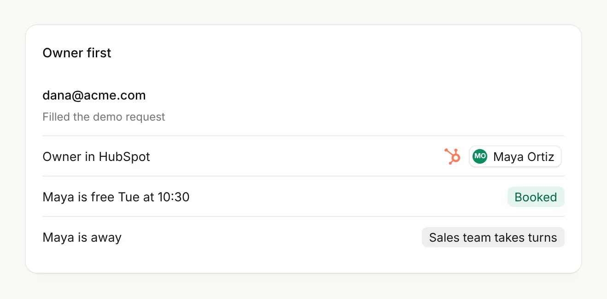

A lead books a call on your Calendly page. Then someone on your team opens HubSpot, finds the contact or makes a new one, and types in the meeting by hand. Or nobody does, and the rep walks into the call with no history on the record.

Calendly and HubSpot fix this with a direct connection. Each booking can create the HubSpot contact and log the meeting on its timeline. On the right Calendly plan, your HubSpot forms can even send each lead to the right person's calendar. The catch is knowing which parts sit on which plan.

> **[Try Claritia free](https://app.tryclaritia.com/signup)** to send each form lead to HubSpot and book the meeting with the right rep on the same page.

Below, you'll see what the Calendly HubSpot integration does and what you need on each side. Then we set it up step by step and fix the usual problems.

## Main points

- The [Calendly](https://calendly.com/) app for [HubSpot](https://www.hubspot.com/) creates a contact for each new invitee and logs each meeting on the contact's timeline.
- It needs Calendly Standard or higher. It works with HubSpot's free CRM, and you need admin rights on both sides.
- Routing from HubSpot forms and booking known contacts with their owner need Calendly Teams or Enterprise.
- Answers to your Calendly questions land in the contact's activity. Moving them into contact properties takes HubSpot workflows, which need a Professional or Enterprise HubSpot plan.
- If your bookings start on a form, [Claritia](/) sends each lead to HubSpot and books the meeting, with HubSpot on its Starter plan.

## What the integration does

Calendly built the HubSpot app, and it is a HubSpot certified app in the HubSpot marketplace. Once it's on, here is what happens each time someone books, based on Calendly's help center and its marketplace listing.

**New invitees become contacts.** Calendly checks HubSpot for the invitee's email. If there's no match, it creates a contact with the name and email, plus the phone number and the UTM source when it has them.

**Known contacts keep their details.** If the email is already in HubSpot, Calendly adds the meeting and leaves the contact's existing details as they are.

**Each meeting is logged.** Calendly creates a meeting activity titled "Meeting-Calendly: {Event name}" with the owner, the contact, the length and the number of attendees. It shows on the contact's timeline. It does not show in HubSpot's Meetings tool.

**Changes follow along.** When a meeting is canceled or moved, HubSpot updates the activity. Canceled meetings get "[Canceled]" at the start of the title, and past meetings stay on the record.

**Your questions come too.** Answers to custom questions on your booking page appear under the contact's Activity tab in HubSpot.

**Extras you can turn on.** Calendly can also send the meeting status (scheduled, completed, no show or canceled) to HubSpot's meeting outcome field. With Calendly Notetaker, it can send meeting recaps to the contact record.

**Routing, on Teams and up.** Calendly can read your existing HubSpot forms and open the right booking page after someone submits. It can also look up a known contact in HubSpot and book them with their contact owner.

## What you need

Prices checked November 2026 on [Calendly's pricing page](https://calendly.com/pricing) and HubSpot's marketplace listing.

| Part of the setup | Calendly plan | HubSpot plan |
|---|---|---|
| Contacts and meetings sync | Standard ($10 a seat a month yearly, $12 monthly) or higher | Free or paid |
| Meeting recaps | Standard Plus or Teams Plus, which add Notetaker | Free or paid |
| Routing from HubSpot forms | Teams ($16 a seat a month yearly, $20 monthly) or Enterprise | Free or paid |
| Booking known contacts with their owner | Teams or Enterprise, with managed events | Free or paid |
| Moving custom answers into contact properties | Any plan above | Professional or Enterprise, for workflows |

You'll also need:

- **Admin rights in Calendly.** Only owners and admins can connect HubSpot.
- **Admin rights in HubSpot.**
- **Room for custom properties.** Calendly's help center warns that HubSpot's free plan allows only 10 custom properties, and syncs may fail past that limit.

Calendly's free plan can't connect to HubSpot at all. If you're weighing plans, our [Calendly pricing guide](/blog/calendly-pricing) covers each one.

## Step 1: Connect HubSpot in Calendly

1. In Calendly, go to **Automations**, then **Integrations & apps**.
2. Find and select **HubSpot**, then select **Connect HubSpot**.
3. Sign in to HubSpot if it asks you to.
4. If you have more than one HubSpot account, pick the one you want and select **Choose Account**.
5. Read the permissions, tick the box to confirm, and select **Connect app**.

Calendly takes you back to its own settings once the connection is made.

## Step 2: Choose what syncs

Open the HubSpot settings in Calendly and set three switches:

- **Push Calendly events and contacts to HubSpot.** This is the main switch for the sync.
- **Push meeting status to HubSpot meeting outcome field.** Turn this on if you report on no-shows or held meetings in HubSpot.
- **Push meeting recaps to HubSpot.** Only useful if you use Calendly Notetaker.

Then pick whose meetings sync. By default, every user in your Calendly organization syncs. Choose **Specific groups** if only your sales team's meetings belong in HubSpot.

## Step 3: Book a test meeting

Book a meeting on one of your own event types with an email that isn't in HubSpot yet. Then open HubSpot and check three things:

- A new contact exists with the right name and email.
- The meeting shows on the contact's timeline.
- Your custom question answers sit under the Activity tab.

Now cancel the test meeting and check that its title starts with "[Canceled]".

## Step 4: Route leads from your HubSpot forms (Teams and up)

This step lets a lead who fills in your HubSpot form pick a time with the right person on the same page.

1. In Calendly, go to **Scheduling**, then **Routing forms**.
2. Select **+ New Routing form**, then **Import an existing form**.
3. Select **Connect**, sign in to HubSpot if asked, and choose your form. Calendly makes a mirror copy linked to the original.
4. Build your routes in the form preview. Routes can use radio buttons, dropdowns, hidden fields and the domain of the email address.
5. Select **Share** next to the form, then **Copy code**.
6. Paste that code after your HubSpot form code on your website.

Your HubSpot form stays the same. When someone submits it, Calendly shows a booking pop-up with the right booking page.

## Step 5: Book known contacts with their owner (Teams and up)

HubSpot lookup lets Calendly find a contact or company in HubSpot and send them to their owner. It uses managed events, so set one up first.

1. Open your routing form and go to the **Logic** tab.
2. Select **+ Create** and choose **Use HubSpot lookup**.
3. Pick the Contact object and find the record by full email address.
4. Send matches to a managed event, with **Contact owner** as the ownership field.
5. Select **Save**, then **Publish form**.

For this to work, each Calendly user must also be a HubSpot user who can own contacts, with the same email in both tools. For routing beyond meetings, see our guide to [HubSpot lead routing](/blog/hubspot-lead-routing).

## Step 6: Move custom answers into properties (optional)

Calendly puts answers in the activity feed, and it won't update properties on contacts HubSpot already has. To copy an answer like job title or company into a contact property, build a HubSpot workflow. HubSpot workflows need a Professional or Enterprise plan.

## What it can't do

- **It doesn't pull data back.** Calendly's help center says the integration isn't two-way. It reads the form and sends meeting details to HubSpot, and doesn't pull other data out.
- **It won't refresh known contacts.** New answers from a repeat booker don't overwrite the contact's properties.
- **It rounds short meetings.** HubSpot rounds any meeting under 15 minutes up to 15 minutes. If you change a meeting's length in HubSpot, Calendly doesn't see it.
- **It skips HubSpot's Meetings tool.** Calendly meetings live on the contact timeline only.
- **It routes on a few field types.** Routes can't use free text answers, only radio buttons, dropdowns, hidden fields and the email domain.
- **It needs a paid plan for everything.** There's no HubSpot connection on Calendly Free, and no routing on Standard.

## Common problems

**Meetings show up twice on your calendar.** You're likely running both Calendly's and HubSpot's calendar sync. Calendly suggests turning off HubSpot's calendar sync, but that affects every event in HubSpot. The same goes for duplicate Zoom events when both tools connect to Zoom.

**Every team's meetings land in HubSpot.** That's the default. Pick **Specific groups** under the sync settings, or filter meetings with Zapier if you don't use Calendly groups.

**Syncs fail on HubSpot Free.** Check your custom property count. Past 10 on the free plan, syncs may fail.

**HubSpot workflows don't trigger.** Calendly's help center points you to HubSpot support for this, since workflows run inside HubSpot.

**Your thank-you page stopped counting.** With routing from HubSpot forms, leads see a pop-up instead of a new page. Set your event type's confirmation page to redirect to your own thank-you URL.

**Lookup sends people to the wrong place.** Check that the rep exists in HubSpot, can own contacts, and uses the same email in both tools.

## Another way: Claritia

[Claritia](/) is a forms, scheduling and follow-up app built for small B2B teams that want every lead from their website to reach the right rep and book a meeting before they leave the page.

It builds forms from a sentence or one of 840 templates, opens the right person's calendar the moment the form is sent, routes each lead by its answers, and drafts follow-up emails in your brand's voice for you to approve.

It fits when your bookings start on a form and you'd rather not pay for a scheduler on top of your form tool. Here is how it works with HubSpot:

- **Contacts without duplicates.** Each form fill creates a HubSpot contact or updates the one with that email. You pick whether a match is updated or left alone. See the [HubSpot integration](/integrations/hubspot).
- **Every field mapped.** Match each question to a HubSpot contact property, such as email, phone, company or job title.
- **The owner set for you.** Use the person Claritia's routing picks, or let HubSpot's own rules decide. Contacts that have an owner keep theirs.
- **Fills on the timeline.** Each fill shows on the contact's timeline, so reps see what the lead asked for.
- **Keep Calendly if you like.** Calendly bookings can come into Claritia by webhook, and a Claritia form can end with your Calendly page. See the [Calendly integration](/integrations/calendly).

Setup takes three steps: sign in with HubSpot under Settings, then Integrations, add HubSpot on the form's Sync tab, and publish. A send that fails tries again, and a sync log shows each one.

**Plans:** HubSpot, Calendly bookings and booking pages for each person start on Starter at $15 a seat a month ($12 yearly). Routing by any answer and round robin are on Pro at $39 ($31 yearly). Booking a known lead with their HubSpot owner first is on Business at $79 ($63 yearly). See [pricing](/pricing).

*With owner first, a lead whose HubSpot owner is Maya books with Maya, and the sales team takes turns when she's away.*

**Cons:** Claritia is a newer tool with a smaller marketplace than Calendly's, and its Zapier and Make apps aren't listed yet.

## Questions

### Does Calendly integrate with HubSpot?

Yes. Calendly has its own HubSpot app, built by Calendly and certified by HubSpot. It creates contacts for new invitees and logs each meeting on the contact's timeline in HubSpot.

### Is the HubSpot Calendly integration free?

Not fully. It works with HubSpot's free CRM, but you need a paid Calendly plan. The sync starts on Standard, at $10 a seat a month billed yearly. Routing from HubSpot forms needs Teams, at $16 a seat a month billed yearly.

### Where do Calendly meetings show up in HubSpot?

On the contact's timeline, as a meeting activity titled "Meeting-Calendly" followed by the event name. They don't appear in HubSpot's Meetings tool.

### Does Calendly update existing HubSpot contacts?

It adds the new meeting to an existing contact, but it doesn't change the contact's details or properties. To copy new answers into properties, use a HubSpot workflow on a Professional or Enterprise plan.

### Can Calendly route leads from HubSpot forms?

Yes, on Teams, Teams Plus and Enterprise. You import the HubSpot form into a Calendly routing form, set routes on its dropdowns, radio buttons, hidden fields or email domain, and paste Calendly's code after your form.

### Can I keep using HubSpot Meetings instead?

Yes. If you use both, watch your calendar: Calendly's help center says running Calendly's and HubSpot's calendar sync together can create duplicate meetings. If you're choosing one scheduler, compare the options in our [Calendly alternatives guide](/blog/best-calendly-alternatives).

## Get started

The Calendly HubSpot integration takes about five minutes to connect once you're on the right plan. Test it with one booking, then add routing if you're on Teams.

> **[Try Claritia free](https://app.tryclaritia.com/signup)** if your bookings start on a form, and send each lead to HubSpot and the right rep's calendar in one step.

See how Claritia works with [HubSpot](/integrations/hubspot), or compare [Calendly alternatives](/blog/best-calendly-alternatives).
