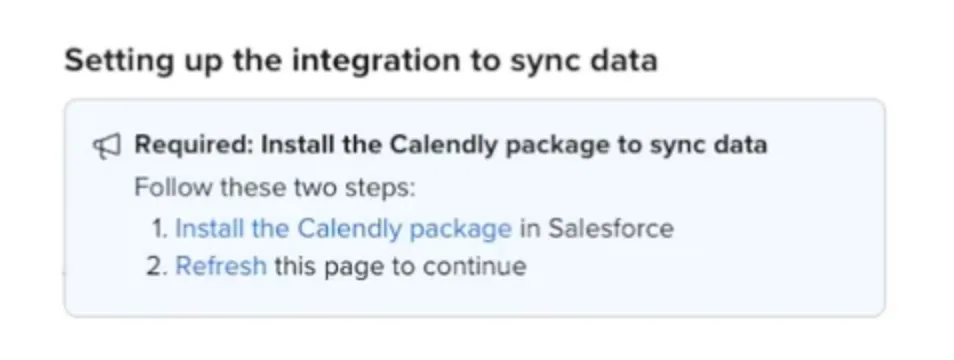
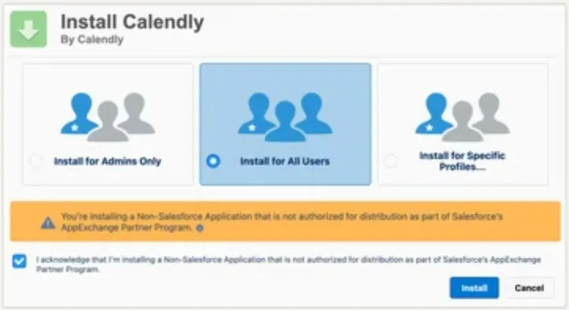
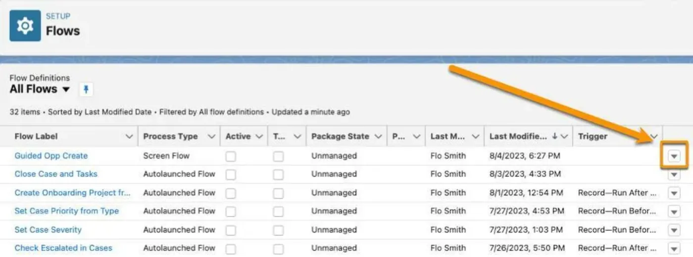
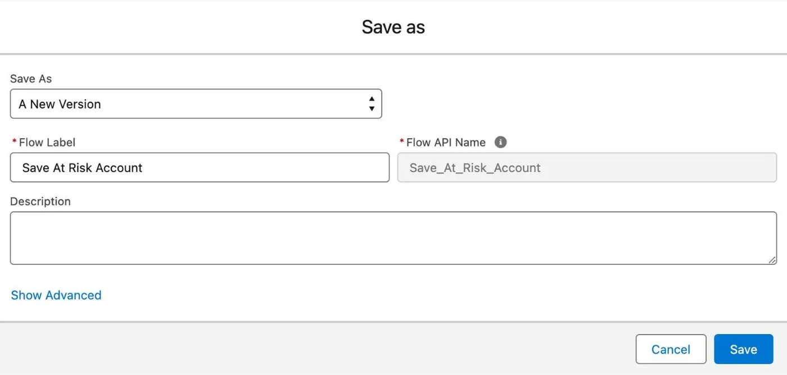
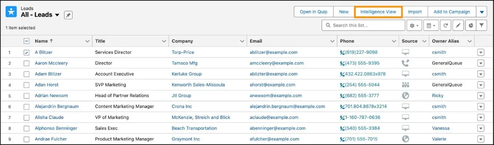
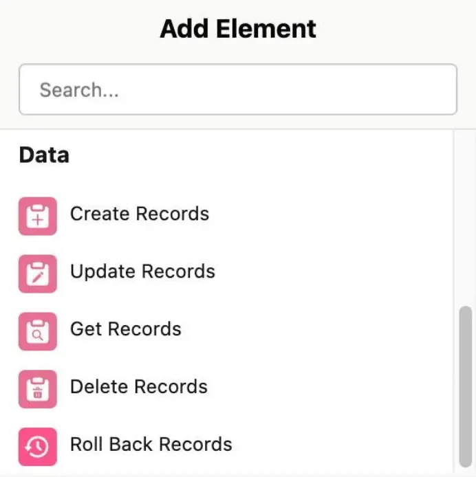
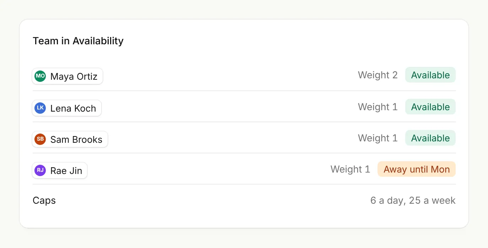

Your reps book meetings in Calendly all day. Then the same meetings have to show up in Salesforce, on the right lead, with the right owner, or your pipeline reports are wrong. Typing them in by hand takes time. In a busy week, it's the first thing that slips.

Calendly for Salesforce does this for you. It installs a package in your Salesforce org that creates leads and events as meetings are booked. It also has more rules than most integrations: a Salesforce edition minimum, a Calendly plan minimum, and routing features that only come with Enterprise.

> **[Try Claritia free](https://app.tryclaritia.com/signup)** to send each form lead to Salesforce with the right owner and the meeting already booked.

Below: what the Calendly Salesforce integration does, what you need on each side, the install steps, and fixes for the usual problems.

## Main points

- The [Calendly](https://calendly.com/) integration with [Salesforce](https://www.salesforce.com/) is a managed package. By default it adds an event to a known lead or contact, or creates a new lead and event.
- It needs Calendly Teams or Enterprise, and Salesforce Enterprise edition or higher. Professional and Group editions won't work.
- Routing with Salesforce lookup and routing by Salesforce assignment are on Calendly Enterprise only, which starts at $15,000 a year.
- After you install it, the flow templates are off. You copy them and turn the copies on before anything syncs.
- For form leads, [Claritia](/) sends each lead to Salesforce and books the meeting with the record owner, on its Business plan.

## What the integration does

Calendly's Salesforce integration is a package you install in Salesforce. It adds its own objects and flows to your org. Here is the default behavior, based on Calendly's help center.

**Bookings find the right record.** Calendly first looks for a Salesforce ID in the booking link, added as `?sfid=` followed by the ID. If there is one, the event goes on that record, which can be an account, opportunity, case, contract, campaign, contact or lead. If not, Salesforce matches on the invitee's email.

**Known people keep their owner.** If the email matches a lead or contact, Salesforce adds an event to it. The owner stays the same.

**New people become leads.** If there's no match, Salesforce creates a new lead and an event on it. Leads made this way carry a CalendlyCreated attribute, so you can report on them.

**The Calendly user owns new records.** New leads and events go to the Calendly user who got the meeting. If that user's Calendly email doesn't match their Salesforce email, the records go to the Salesforce System Administrator.

**Cancellations update the event.** When a meeting is canceled, Salesforce adds "Canceled" to the event's title and description. It doesn't delete the event.

**You can change all of it.** The package runs on Salesforce flows. A Salesforce admin can edit them to create contacts, opportunities, tasks, cases or custom objects instead of leads, or to update the lead owner to match the event owner.

**More on top.** The package can also sync routing form answers (from version 2.4), send each user's Calendly links to Salesforce for use in email templates, let reps book from inside Salesforce, and store Notetaker recaps.

**Routing by owner, on Enterprise.** Calendly can look up a lead, contact, account, opportunity or custom object in Salesforce and book the person with its owner.

## What you need

Prices checked November 2026 on [Calendly's pricing page](https://calendly.com/pricing).

| Part of the setup | Calendly plan | Salesforce edition |
|---|---|---|
| Leads, contacts and events sync | Teams ($16 a seat a month yearly, $20 monthly) or Enterprise | Enterprise or higher |
| Routing form answers in Salesforce | Teams or Enterprise | Enterprise or higher |
| Meeting recaps | Teams Plus, or Enterprise on request | Enterprise or higher |
| Routing with Salesforce lookup | Enterprise (from $15,000 a year, 50 seats minimum) | Enterprise or higher |
| Routing by Salesforce assignment | Enterprise | Enterprise or higher |
| Syncing only some Calendly groups | Enterprise | Enterprise or higher |

You'll also need:

- **Admin rights in Calendly.** Only owners and admins can connect Salesforce.
- **A Salesforce admin.** Calendly suggests a dedicated integration user to make upkeep easier, though it isn't required.
- **Matching emails.** Each rep's email should be the same in Calendly and Salesforce, or records end up with your system admin.
- **A sandbox, if you have one.** Calendly can connect to a Salesforce sandbox so you can test first.

Calendly Standard doesn't include Salesforce at all. Our [Calendly pricing guide](/blog/calendly-pricing) covers what each plan adds.

## Step 1: Connect Salesforce in Calendly

1. In Calendly, go to **Automations**, then **Integrations & apps**.
2. Under **Sales and CRM**, select **Salesforce**.
3. Select **Connect Salesforce**.
4. Enter your Salesforce login and select **Log In**.

Calendly says it doesn't use your Salesforce client ID or client secret to reach your data directly.

## Step 2: Install the Calendly package

Once Salesforce is connected, Calendly shows a box with the two steps left: install the package, then refresh.

*Calendly's reminder to install the package in Salesforce, then refresh the page. Image: [Calendly Help Center](https://calendly.com/help/how-to-integrate-calendly-with-salesforce).*

1. On the Salesforce page in Calendly, select **Install the Calendly package**.
2. In Salesforce, select **Install for All Users**, then **Install**.
3. When asked to grant third-party access, select **Yes**, then **Continue**.
4. When the install is done, select **Done**.
5. Go back to Calendly and select **Refresh** to finish the connection.

*In Salesforce, pick Install for All Users, tick the box to acknowledge the notice, and select Install. Image: [Calendly Help Center](https://calendly.com/help/how-to-integrate-calendly-with-salesforce).*

If the install fails, you're likely on Salesforce Group or Professional edition. The integration uses Salesforce's web service API, which needs Enterprise edition or higher.

## Step 3: Turn on the flows

This is the step people miss. In package version 2.3 and later, the flow templates come turned off, so admins choose when changes go live. Calendly recommends making copies and turning those on.

*The Flows list in Salesforce Setup has an Active column, so you can see which flows are off. Image: [Salesforce Trailhead](https://trailhead.salesforce.com/content/learn/modules/flow-implementation-2/deploy-your-flow-to-production).*

1. In Salesforce, open your list of flows.
2. Open a flow template, such as MapCalendlyLinkTemplate.
3. Select **Save As**, give it a flow label, and select **Save**.
4. Go back to the list, open the new flow and select **Activate**.

*Salesforce's Save As window, with the Flow Label field you fill in before you select Save. Image: [Salesforce Trailhead](https://trailhead.salesforce.com/content/learn/modules/flow-implementation-2/deploy-your-flow-to-production).*

Do this for each template you need. From version 2.5, keep the two subflow templates inside CreateEventTemplate active as they are, unless you're changing the subflows themselves.

## Step 4: Book a test meeting

Book a meeting with an email that isn't in Salesforce yet. Then check:

- A new lead exists, with the CalendlyCreated attribute.
- The event sits on that lead, owned by the rep who took the meeting.
- The owner is the rep, not your system admin. If it's the admin, the rep's emails don't match.

*The Owner Alias column in the leads list shows who owns each lead, so a test lead owned by the admin stands out. Image: [Salesforce Trailhead](https://trailhead.salesforce.com/content/learn/modules/leads_opportunities_lightning_experience/create-and-convert-leads-lightning).*

Then book again with an email that belongs to an existing contact, and check that the event lands on that contact.

## Step 5: Customize what gets created (optional)

Open your copied flows in Salesforce to change the default behavior. Common changes from Calendly's help center:

- Create a contact, opportunity, task or case instead of a lead.
- Update the lead owner to match the event owner, for leads that move to a new rep.
- Delete the event in Salesforce when a meeting is canceled or moved.
- Run the flow only when certain conditions are met, or delay the sync.

*Data elements in Flow Builder, such as Create Records, are the steps a flow uses to make or change records. Image: [Salesforce Trailhead](https://trailhead.salesforce.com/content/learn/modules/flow-basics/meet-flow-builder).*

If you base a new flow on a template, turn the template off so you don't get duplicate events.

## Step 6: Route by Salesforce owner (Enterprise)

Routing with Salesforce lookup sends known leads and customers straight to their owner's calendar.

1. Build a Calendly routing form, or import a HubSpot, Marketo or Pardot form.
2. Open the form's **Logic** tab and select **+ Create**.
3. Choose **Use Salesforce lookup**.
4. For a simple start, pick the Lead object, find the record by full email address, and set the ownership field to **Lead Owner**.
5. Choose where matches go: a managed event, an event type, an outside link or a custom message.
6. Select **Save**, then **Publish form**.

The rep has to exist in Salesforce and be able to own the records you look up. If you already route leads in Salesforce, our guide to [Salesforce lead routing](/blog/salesforce-lead-routing) covers assignment rules.

## What it can't do

- **It doesn't work on lower Salesforce editions.** Group and Professional editions can't install it.
- **It doesn't reassign known records.** By default, an existing lead or contact keeps its owner, even if a different rep took the meeting.
- **It doesn't clean up cancellations.** Canceled events stay in Salesforce with "Canceled" in the title. A rescheduled meeting also keeps "canceled" in its title unless an admin changes the flow.
- **It doesn't route by owner on Teams.** Salesforce lookup routing and routing by Salesforce assignment are Enterprise only.
- **It isn't a quick switch.** Changing what gets created means editing Salesforce flows, so you'll want an admin who knows them.
- **It has limits with encryption.** Routing doesn't work on fields with Shield probabilistic encryption. With deterministic encryption, it only matches exact, case-sensitive values.

## Common problems

**The install fails.** Check your Salesforce edition. It must be Enterprise or higher.

**Nothing shows up in Salesforce.** The flow templates are off by default. Copy them and activate the copies, as in Step 3.

**You get every event twice.** You likely have both a template and your copy active. Turn off the template.

**New leads belong to the system admin.** The rep's email in Calendly doesn't match their Salesforce email. Make them the same.

**Your routing tool reassigns Calendly leads.** Calendly suggests three fixes: skip leads that have the CalendlyCreated attribute, skip leads that already have an owner, and add a 5 to 10 minute wait before your routing rules run.

**You're on the old package.** Version 1 is unmanaged, and version 2 is managed, so it updates without a reinstall. Moving up means removing version 1 first, and your changes to it don't carry over. List them before you start.

**Only some teams should sync.** By default, the whole Calendly organization syncs. On Enterprise, you can limit it to chosen groups.

## Another way: Claritia

[Claritia](/) is a forms, scheduling and follow-up app built for small B2B teams that want every lead from their website to reach the right rep and book a meeting before they leave the page.

It builds forms from a sentence or one of 840 templates, opens the right person's calendar the moment the form is sent, routes each lead by its answers, and drafts follow-up emails in your brand's voice for you to approve.

It fits when your Salesforce leads start on a web form. Here is how it works with Salesforce:

- **Leads or contacts.** You pick what new people become. An email Salesforce already has links to that record, so you don't get duplicates. See the [Salesforce integration](/integrations/salesforce).
- **Custom fields too.** Match each question to a Salesforce field, including custom fields that end in `__c`.
- **Your choice of owner.** Use the person Claritia's routing picks, or let Salesforce assignment rules run on each new record.
- **Booking with the owner.** A lead Salesforce already knows books with its owner first. New leads go to the team's round robin.
- **Fills as tasks.** Each fill shows as a completed task on the lead or contact.
- **Keep Calendly if you like.** Calendly bookings can come into Claritia by webhook, and a Claritia form can end with your Calendly page. See the [Calendly integration](/integrations/calendly).

Setup is three steps: sign in with Salesforce under Settings, then Integrations, add Salesforce on the form's Sync tab and match each field, then publish. You don't need API keys. A send that fails tries again, and a sync log shows each one.

*Team settings in Claritia decide how often each rep gets new leads, who's away and how many meetings each can take.*

**Plans:** Salesforce is on Business at $79 a seat a month ($63 yearly). Taking Calendly bookings starts on Starter at $15 ($12 yearly). See [pricing](/pricing).

**Cons:** Claritia is a newer tool with a smaller marketplace than Calendly's, and its Zapier and Make apps aren't listed yet. Salesforce sits on its top plan.

## Questions

### Does Calendly integrate with Salesforce?

Yes. Calendly has a managed package that you install in Salesforce from Calendly's integration settings. It creates leads and events as meetings are booked and canceled.

### Which Calendly plan includes Salesforce?

Teams, Teams Plus and Enterprise. Teams costs $16 a seat a month billed yearly, or $20 monthly. Routing with Salesforce lookup and by Salesforce assignment needs Enterprise, which starts at $15,000 a year.

### Does Calendly work with Salesforce Professional edition?

No. Calendly's help center says your Salesforce edition must be Enterprise or higher, because the integration uses Salesforce's web service API. Group and Professional editions show an error during the install.

### Does Calendly create leads or contacts in Salesforce?

By default, it adds an event to an existing lead or contact when the email matches, and creates a new lead when it doesn't. An admin can change the flow to create contacts, opportunities or other records instead.

### Can Calendly change the lead owner in Salesforce?

New leads go to the Calendly user who took the meeting. Existing leads and contacts keep their owner unless an admin edits the flow to update the lead owner to match the event owner.

## Get started

The Calendly Salesforce integration comes down to four steps: connect, install the package, turn on the flows and test. Add Salesforce lookup routing once that works, if you're on Enterprise.

> **[Try Claritia free](https://app.tryclaritia.com/signup)** to send each form lead to Salesforce with the right owner and the meeting already booked.

See how Claritia works with [Salesforce](/integrations/salesforce), or read our guide to [Salesforce lead routing](/blog/salesforce-lead-routing).
