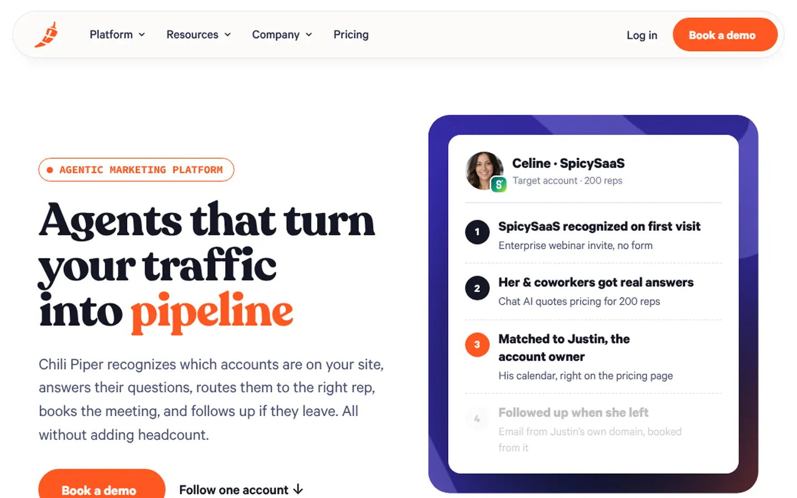

Chili Piper and Calendly both turn a form fill into a booked meeting with the right rep. On a demo, they can look almost the same: a lead fills in a form, a calendar pops up, and the meeting lands with a rep picked by your rules. Yet one starts at $15,000 a year and the other has a free plan.

The gap in price reflects a gap in scope. Chili Piper is built for revenue teams that route every lead, contact and account through Salesforce, with handoffs between SDRs and AEs. Calendly is a scheduling tool that added routing on its Teams plan. This guide shows where that difference matters and where it doesn't.

> **[Try Claritia free](https://app.tryclaritia.com/signup)** to route each form lead to the right rep and book the meeting on the same page, with monthly billing.

In this post, we compare Chili Piper and Calendly on routing, form booking, CRM depth, follow-up, price and contract terms, then give a clear pick for each kind of team.

## Main points

- Pick [Chili Piper](https://www.chilipiper.com/) if you run a large inbound motion on Salesforce and need territories, account matching, SDR to AE handoffs and no-show follow-up in one tool.
- Pick [Calendly](https://calendly.com/) if you want routing forms and round robin at a per-seat price, with monthly billing and a free plan to try.
- Chili Piper Growth starts at $15,000 a year with 15 seats, and every plan is billed yearly. Calendly Teams is $16 a seat a month billed yearly, or $20 monthly.
- Calendly routes from its own forms or your HubSpot, Pardot or Marketo forms. Chili Piper books from any web form and routes any Salesforce object.
- Pick [Claritia](/) if you're a small team and want form routing with monthly billing and a free start.

## Chili Piper vs Calendly at a glance

| | [Chili Piper](https://www.chilipiper.com/) | [Calendly](https://calendly.com/) |
|---|---|---|
| Best for | Revenue teams routing every lead in Salesforce | Teams that want routing on a booking tool |
| Free plan | None listed, book a demo | Yes, 1 event type |
| Routing from | Starts at $15,000 a year (Growth, 15 seats) | $16 a seat a month billed yearly (Teams) |
| Billing | Yearly only, multi-year discounts | Monthly or yearly |
| Forms it books from | Any web form, plus G2, LinkedIn and others | Calendly, HubSpot, Pardot and Marketo forms |
| Salesforce routing | Any lead, contact, account or custom object | Sends meetings to Salesforce on Teams, lookup routing on Enterprise |
| Round robin | Weights, caps, meeting limits, fairness rules | On Teams |
| No-show and abandoned form follow-up | Yes | Not listed |

Prices checked November 2026.

## What is Chili Piper?

[Chili Piper](https://www.chilipiper.com/) is a meeting booking and lead routing platform for B2B revenue teams that want inbound buyers to book with the right rep right away. When someone submits a form, it qualifies them, routes them by rules such as company size, region or account owner, and shows that rep's calendar on the spot. It also routes Salesforce records by rep workload, identifies visiting companies, runs an AI chat, blocks fake bookings and sends reps a brief before each meeting. It also shares leads fairly across reps and follows up when buyers miss a meeting or leave a form. AI chat, account identification and other agents sit on its higher plans, and every seat includes ChiliCal, its scheduling links.

## What is Calendly?

[Calendly](https://calendly.com/) is scheduling software for professionals and teams who want people to book meetings without trading emails. You connect your calendars, set hours, buffers, and daily limits, and share booking links for one-on-one, multi-host, or group meetings. It sends email and text reminders, offers routing forms that send website leads to the right teammate, and collects payments. Newer tools include an AI assistant that finds times over email and a notetaker that writes meeting recaps. Round robin and routing forms come on its Teams plan. It connects to HubSpot from Standard and to Salesforce from Teams, and it sells the notetaker and the email scheduling assistant as add-ons.

## Price and contract terms

This is the first thing most teams notice.

| | Chili Piper | Calendly |
|---|---|---|
| Entry plan with routing | Growth, from $1,250 a month ($15,000 a year) | Teams, $16 a seat a month billed yearly ($20 monthly) |
| Seats included | 15, then $45 a seat a month | Pay per seat |
| Next plan | Scale, from $3,500 a month ($42,000 a year), 30 seats, then $50 a seat a month | Enterprise, from $15,000 a year, from 50 seats |
| Largest plan | Enterprise, from 250 seats | Enterprise, as above |
| Billing | Yearly only | Monthly or yearly |
| Free plan | None listed | Yes |

Chili Piper's pricing FAQ says all plans are billed annually and monthly billing isn't available. Longer contracts get discounts: 15% off for 2 years, 25% for 3 years and 40% for 4 years. Each plan also includes a yearly pool of AI credits, used for enrichment and agents: 45,000 on Growth and 150,000 on Scale. If you only want the calendar, ChiliCal is sold on its own at $12 a user a month, with a 200 seat minimum.

To put it in numbers: 15 seats on Calendly Teams cost $2,880 a year billed yearly. The same 15 seats on Chili Piper Growth cost $15,000 a year.

## Lead routing

Chili Piper's routing is broad. It routes any lead, contact, account or custom Salesforce object. You manage territories and assignment rules in one table and reuse a rule across every form, chat and handoff. It can match leads to accounts, dedupe and merge, and convert leads or create opportunities. Round robin supports weighting, caps and meeting limits, and it can adjust for no-shows, cancellations and spam to keep the split fair.

Calendly's routing lives on Teams. Forms screen invitees and route them by their answers, and Teams can route by the owner set in HubSpot. Routing by Salesforce lookup and Microsoft Dynamics sit on Enterprise. Round robin shares meetings across teammates. It covers the common case, where a form answer or a HubSpot owner decides who the lead meets.

## Booking from forms

Chili Piper books meetings from any web form on your site. It also books from G2, LinkedIn and other third-party tools, from marketing emails in HubSpot, Pardot and Marketo, and inside your product. A hot lead can connect to a rep live, straight from the form.

Calendly routes from its own forms or from your existing HubSpot, Pardot or Marketo forms. If your site uses one of those, Calendly can show the right rep's calendar after submit. Other form tools may need its own forms instead.

## Handoffs and follow-up

Chili Piper is built for teams with SDRs and AEs. An SDR can book the right AE in one click from inbound or outbound work, with live handoffs between them and controls against favoritism. It follows up on no-shows, cancellations and abandoned forms, can send those emails from the rep's own domain, and lets you set SLAs so no lead goes cold.

Calendly lets you book meetings on behalf of teammates and sends reminders from Standard. Its pricing page doesn't list automatic follow-up for abandoned forms or no-shows.

## Integrations

Chili Piper lists Salesforce, HubSpot, Google and Outlook calendars, Slack, Microsoft Teams, Marketo, Bombora, 6sense and Leadfeeder. It also connects to Gong Engage, Salesloft and Outreach, and to enrichment tools such as Clay, Apollo, ZoomInfo, Lusha and LeadIQ.

Calendly connects HubSpot, Mailchimp and Zapier from Standard, adds Salesforce and Marketo on Teams, and adds Microsoft Dynamics on Enterprise.

## Pros and cons

### Chili Piper

Pros:

- **Deep Salesforce routing:** Any object, one assignment table, account matching.
- **Books from anywhere:** Any web form, third-party sites, emails and your product.
- **SDR and AE handoffs:** One-click booking with fairness controls.
- **Follow-up built in:** No-shows, cancellations and abandoned forms.

Cons:

- **High entry price:** Growth starts at $15,000 a year.
- **Yearly contracts only:** No monthly billing.
- **No free plan listed:** You book a demo to start.

### Calendly

Pros:

- **Low entry price:** Routing on Teams at $16 a seat a month billed yearly.
- **Monthly billing:** $20 a seat a month on Teams.
- **Free plan:** Try the basics before you buy.
- **Routing from your forms:** HubSpot, Pardot and Marketo forms on Teams.

Cons:

- **Salesforce lookup routing costs more:** It sits on Enterprise, from $15,000 a year.
- **Narrower form support:** Routing works with its own forms and three marketing tools.
- **Less follow-up:** No abandoned form or no-show follow-up listed.

## Which should you pick?

- **Pick Chili Piper** if you have SDRs and AEs, run Salesforce, and route leads, contacts and accounts by territory.
- **Pick Chili Piper** if you need to book from any form, follow up on no-shows and abandoned forms, and can sign a yearly contract.
- **Pick Calendly** if you want routing forms and round robin for a team of any size at a per-seat price.
- **Pick Calendly** if your forms run on HubSpot, Pardot or Marketo and a form answer or HubSpot owner is enough to pick the rep.

If you're a small team that wants form routing without a yearly contract, there's a third path.

## A third option: Claritia

[Claritia](/) gives small teams forms that turn visitors into leads, plus meetings that book them with the right person. The form picks the meeting, and the meeting picks the person. You can pay month to month and start on a free plan. See [Claritia Routing](/products/routing).

What it offers next to Chili Piper and Calendly:

- **Route by any answer:** On Pro, rules read the answers in order and book a meeting or a person. Everyone else goes to a team.
- **Fair round robin:** Weights, priority, daily and weekly caps, and away days on Pro.
- **See why:** A routing log shows the rule that matched and why each person was picked.
- **Owner first:** On Business, a known lead books with their owner in [HubSpot](/integrations/hubspot) or [Salesforce](/integrations/salesforce).
- **Follow-up:** Workflows send a follow-up the next day until the lead books, and Pro adds no-show follow-up with the reschedule link.

Pro is $39 a seat a month ($31 billed yearly), and Business is $79 ($63 billed yearly). See [pricing](/pricing) for every plan.

Claritia isn't a match for everything Chili Piper does. It's a newer tool with a smaller app marketplace. It has no Zapier or Make apps listed yet, Salesforce sits on Business, and it doesn't route custom Salesforce objects or run AI chat on your site.

## Questions

### Is Chili Piper better than Calendly?

For large revenue teams on Salesforce, Chili Piper does more: routing of any Salesforce object, territories, SDR to AE handoffs and follow-up on no-shows and abandoned forms. For teams that need routing forms and round robin at a lower price, Calendly is enough.

### How much does Chili Piper cost compared to Calendly?

Chili Piper Growth starts at $15,000 a year with 15 seats, billed yearly. Calendly Teams costs $16 a seat a month billed yearly, so 15 seats cost $2,880 a year.

### Does Chili Piper offer monthly billing?

No. Chili Piper's pricing page says all plans are billed annually and monthly billing isn't available. Calendly offers both.

### Can Calendly route leads like Chili Piper?

Partly. Calendly Teams routes leads from its own forms and from HubSpot, Pardot and Marketo forms, and can route by HubSpot owner. Routing by Salesforce lookup needs Enterprise.

### What is a cheaper alternative to Chili Piper?

Calendly Teams and Claritia Pro both route form leads with monthly billing. Claritia Pro is $31 a seat a month billed yearly and adds a routing log and caps for each rep.

## Get started

Pick Chili Piper for full revenue team routing and Calendly for routing on a budget. If you're a small team, try Claritia.

> **[Try Claritia free](https://app.tryclaritia.com/signup)** to build a form that routes each lead to the right rep and books the meeting on the spot.

You can also compare more tools in our [Chili Piper alternatives](/blog/best-chili-piper-alternatives) and [lead routing software](/blog/best-lead-routing-software) guides.
