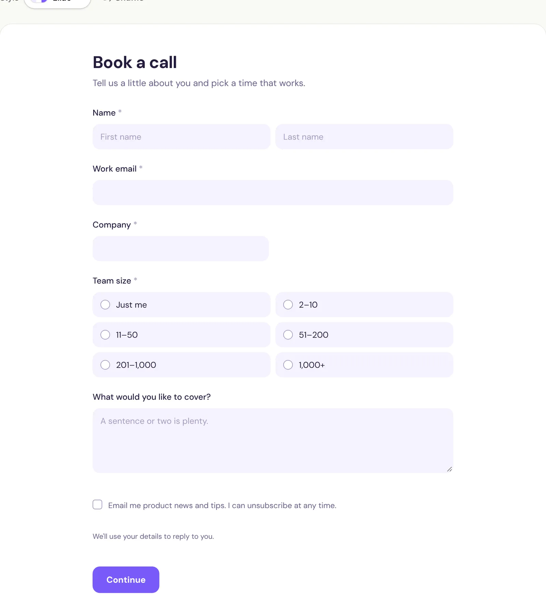
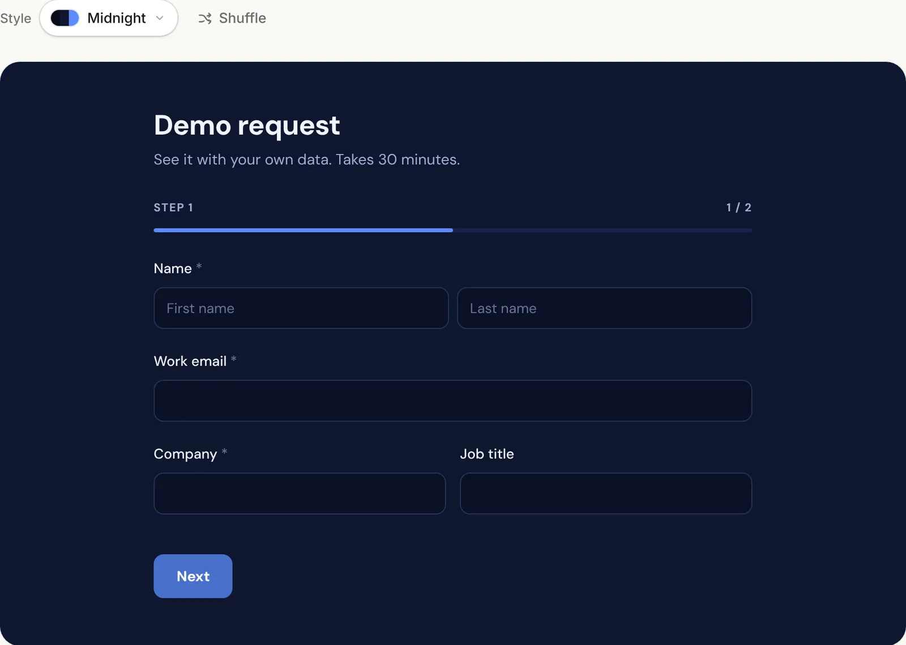
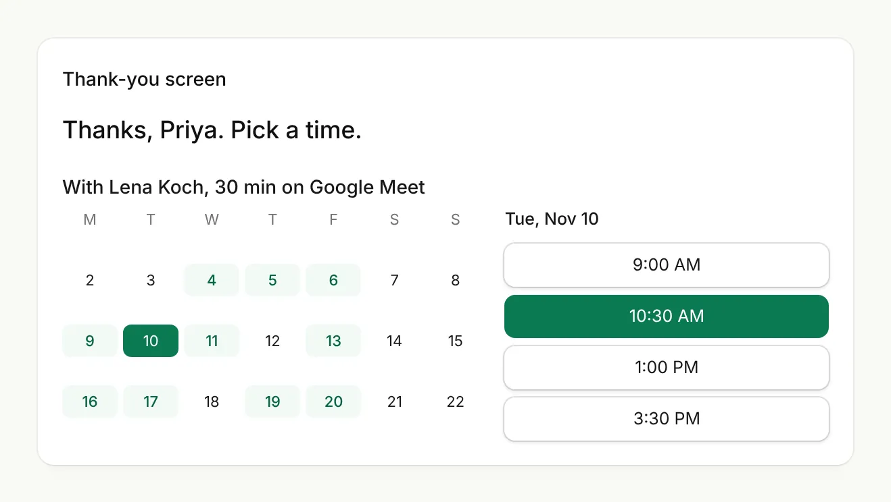

Your demo request form is where buyers who are ready to talk raise their hand. Yet many demo forms still ask a dozen questions, then end on a plain "Thanks, we'll be in touch." The lead waits for an email, and in the meantime may book a call with someone else.

A good request a demo form does two jobs. It asks just enough to send the lead to the right person and prepare the call. Then it lets them book that call on the spot. Getting both right is mostly a matter of what you leave out.

> **[Try Claritia free](https://app.tryclaritia.com/signup)** to build a demo request form that ends on the right rep's calendar, so the lead books before they leave.

Below: what to ask, what to skip, three layouts you can copy, and what should happen the moment someone hits submit.

## Main points

- A demo request form needs a name, a work email, a company and one or two questions that shape the call.
- Skip anything a rep can look up or ask on the call, such as revenue, address or a long list of features.
- Use a short form for most sites, a two-page qualifying form when reps need context, and a longer form for large accounts.
- The best next step is a calendar right after submit, with the right rep picked and the name and email filled in.
- Tools that do this: [Claritia](/), [Chili Piper](https://www.chilipiper.com/), [Default](https://www.default.com/) and [RevenueHero](https://www.revenuehero.io/).

## What is a demo request form?

A demo request form is a web form where a buyer asks to see your product with someone from your team. It collects who they are and what they need, so the right rep can run a useful demo. The best ones also let the buyer pick a time before they leave the page.

It's one of the highest-intent forms on a B2B site. For how it compares with newsletter, quote and contact forms, see our [lead capture form examples](/blog/lead-capture-form-examples).

## What to ask on a demo request form

Every field should help you do one of three things: reach the lead, send them to the right person, or prepare the call.

| Field | Why ask it | Required? |
|---|---|---|
| Name | To greet them and fill the invite | Yes |
| Work email | To reach them, and to filter out students and job seekers | Yes |
| Company | To look them up before the call | Yes |
| Team size | To pick the right rep or plan | Usually |
| Job title | To know if you're talking to the buyer or a user | Optional |
| What they want to get done | To shape the demo around their problem | Optional, but useful |
| When they hope to start | To tell a project from browsing | Optional |
| A time to meet | To book the demo now | Yes, if you can |

Keep the campaign source in hidden fields too. UTM tags, the page and the referrer tell you which ad or post brought each demo request, and the lead never sees them.

## What to skip

Each extra question is one more reason to close the tab. Leave these off your demo form:

- **Phone number, unless you'll call.** If reps book by calendar and meet on video, a phone field only adds friction.
- **Revenue or funding.** Reps can look it up, and many buyers won't share it on a form.
- **A long feature checklist.** Ask what they want to get done instead. One open answer tells you more.
- **Address and country, when the email domain tells you enough.** Ask for region only if it changes who takes the call.
- **"How did you hear about us?" as a required field.** Hidden fields catch most of this for you. Make it optional if you want it.
- **CAPTCHA puzzles.** Use quiet spam checks, such as a honeypot and disposable email blocking, instead.

If you need more detail to qualify, ask it on a second page or with conditional logic, so only some leads see it. Our guide to [lead qualification](/blog/lead-qualification) covers which questions are worth asking.

## 3 demo request form examples

Each example says when to use it, what it asks and why it works, with a free template to start from. All three end on a calendar.

### 1. The short demo form

**When to use it:** Most B2B sites, especially when any rep can take any demo.

**Fields:**

- Name
- Work email
- Company
- Team size
- What would you like to cover? (optional)
- Pick a time

**Why it works:** Four quick fields, one open question, then the calendar. It's short enough that a busy buyer finishes it on a phone, and the open question still gives the rep something to prepare.

Start from the [book a call template](/templates/general-book-a-call).

*Caption: The book a call template asks four quick fields and one open question before the calendar.*

### 2. The qualifying demo form

**When to use it:** When different reps cover different team sizes, or when you want context before every call.

**Fields, page 1:**

- Name
- Work email
- Company
- Job title

**Fields, page 2:**

- Team size
- What do you use today? (dropdown)
- What do you want to get done?
- When are you hoping to start?

**Then:** Pick a time.

**Why it works:** The first page feels quick, so the longer questions come after the lead has started. Team size and timing let you route the lead, and the current tool tells the rep which story to tell in the demo.

Start from the [demo request template](/templates/saas-demo-request).

*Caption: Page 1 of the demo request template keeps to name, work email, company and job title.*

### 3. The enterprise demo form

**When to use it:** Large accounts with security reviews, several teams and a buying group.

**Fields, in five short pages:**

- **About you:** name, work email, job title, phone, company and website.
- **Your team:** how many people will use it, which teams and where they are.
- **Your needs:** the problem to solve, the tool they use today and what matters most.
- **Security and buying:** what they need, whether they'll send a security questionnaire, when they'll decide, who else decides and whether there's budget.
- **The demo:** what it should cover, who will join and how long they can meet.

**Then:** Pick a time.

**Why it works:** Large buyers are used to longer forms, and these answers can stand in for much of a discovery call. Pages that don't apply are skipped, so a small team doesn't wade through security questions.

Start from the [enterprise demo request template](/templates/saas-enterprise-demo), or browse all [demo request templates](/templates/category/demo-request).

## What should happen after someone submits

Most demo forms lose people in the moment after submit. Here's what should happen instead:

1. **The calendar opens right away.** The lead picks a time on the thank-you screen, with their name and email already filled in.
2. **The right rep is picked.** Rules read the answers, such as team size or region, and show that rep's calendar. A round robin shares the rest fairly.
3. **The invite goes out.** A confirmation with the calendar invite and a video link, then reminders a day and an hour before.
4. **Leads who aren't a fit get a different next step.** A student or a tiny team might get a guide or a self-serve signup instead of a sales call.
5. **The rep gets the answers.** The lead lands in your CRM with every answer, and the team gets an alert in Slack or Microsoft Teams.
6. **Leads who don't book get a nudge.** A short follow-up the next day with the booking link. Our [sales follow-up email templates](/blog/sales-follow-up-email) include one for this.

A buyer who picks a time on the page doesn't sit in an inbox waiting for a reply, and your rep doesn't spend the morning chasing them.

*Caption: In Claritia, the thank-you screen opens the right rep's calendar as soon as the form is sent.*

## Common mistakes

- **Ending on "We'll be in touch."** The lead has to wait, and you have to chase them.
- **The same form for every lead.** A five-person team and a 5,000-person company get the same 15 questions.
- **Every question required.** Make the open questions optional, so the form never stops someone who is ready to book.
- **No hidden fields.** You can't tell which campaign brings in demos that close.
- **Sending every demo to one inbox.** Leads wait while someone decides whose turn it is.

## Tools for demo request forms

### Claritia

[Claritia](/) is a forms, scheduling and follow-up app for small B2B teams. It gets each website lead to the right rep and booked into a meeting before they leave the page.

It builds forms from a sentence or one of 840 templates, opens the right person's calendar the moment the form is sent, routes each lead by its answers, and drafts follow-up emails in your brand's voice for you to approve.

Booking inside the form, conditional logic and hidden fields are on the free plan. Starter adds HubSpot, a follow-up the next day until they book, and Slack alerts. Routing by any answer and round robin with weights come on Pro. See how [Claritia routing](/products/routing) works.

Claritia is newer than the other tools here, with a smaller marketplace, and its Zapier and Make apps aren't listed yet.

### Chili Piper

[Chili Piper](https://www.chilipiper.com/) is a meeting booking and lead routing platform for B2B revenue teams that want inbound buyers to book with the right rep right away. When someone submits a form, it qualifies them, routes them by rules such as company size, region or account owner, and shows that rep's calendar on the spot.

It also routes Salesforce records by rep workload, identifies visiting companies, runs an AI chat, blocks fake bookings and sends reps a brief before each meeting. It works on top of your existing demo form and suits larger sales teams.

### Default

[Default](https://www.default.com/) is a go-to-market platform for B2B revenue and RevOps teams that want inbound leads qualified, routed, and booked without manual work. When a visitor submits a demo form, it enriches the record from a chain of data providers, checks it against ideal customer rules, assigns a rep by round robin or territory, and opens that rep's branded scheduler.

It also offers a Chrome extension, two-way CRM sync, an API, and access for AI agents through MCP.

### RevenueHero

[RevenueHero](https://www.revenuehero.io/) is a lead routing and scheduling tool for B2B demand gen, sales, and RevOps teams that want each qualified lead booked with the right rep. It matches leads to accounts and owners already in the CRM, routes the rest by territory and other rules, and runs round robin with weights, caps, and paired AE and SE booking.

It logs the reason behind every assignment, returns credit for no-shows, and syncs meetings to HubSpot, Salesforce, or Attio.

## Questions

### What should be on a demo request form?

A name, a work email, a company, team size and one open question about what they want to get done. End it with a calendar so the lead can book the demo right away.

### How many fields should a request a demo form have?

Four to six for most sites. Larger accounts will answer more, so an enterprise form can run longer if it uses pages and skips the ones that don't apply.

### Should a demo request form ask for a phone number?

Only if your reps will call. If demos are booked by calendar and held on video, leave it off or make it optional.

### What happens after someone requests a demo?

The best forms open a calendar on the thank-you screen, pick the right rep and send an invite with reminders. If the lead doesn't book, a follow-up goes out the next day with the booking link.

### How do you qualify leads on a demo request form?

Ask two or three questions that change what happens next, such as team size, timeline or current tool. Then route good fits to a rep's calendar and send others a guide or signup link.

### Where can I find a free demo request form template?

Claritia has free templates for short, qualifying and enterprise demo forms, each with booking at the end. Browse the [demo request templates](/templates/category/demo-request).

## Get started

Cut your demo form down to the fields that change the next step, and let the lead book before they leave. The demo you book today beats the one you chase next week.

> **[Try Claritia free](https://app.tryclaritia.com/signup)** to start from a demo request template and book your first demo on the spot.

You can also see how [Claritia forms](/products/forms) work, or connect your demo form to [HubSpot](/integrations/hubspot).
