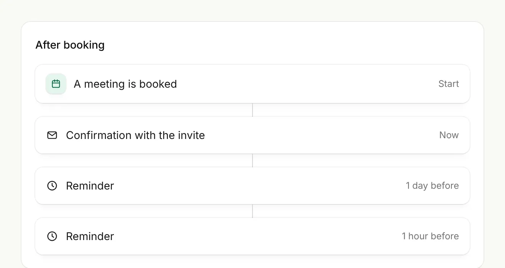
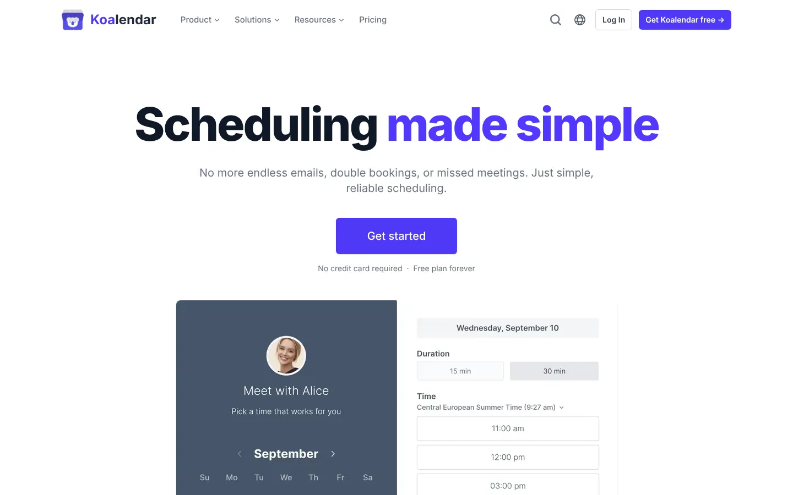
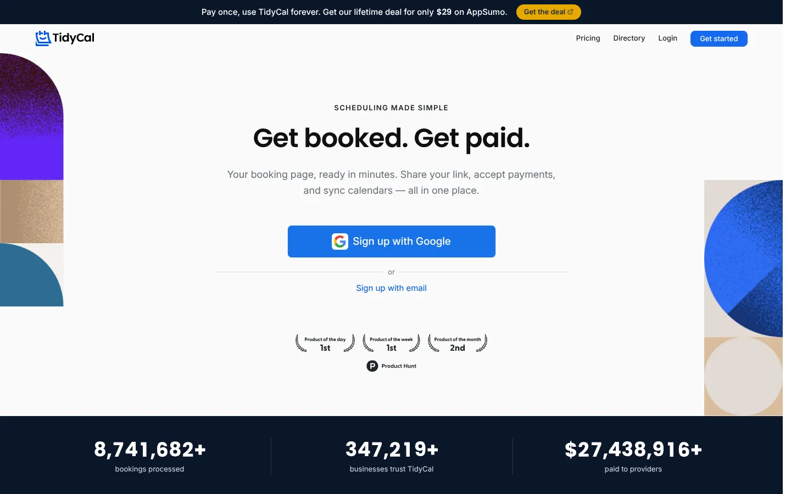
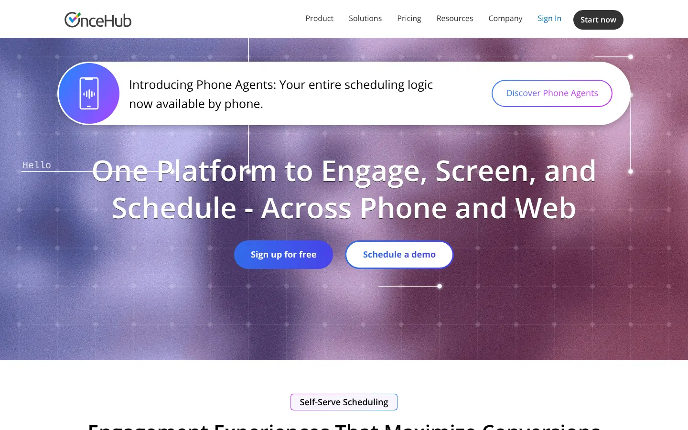
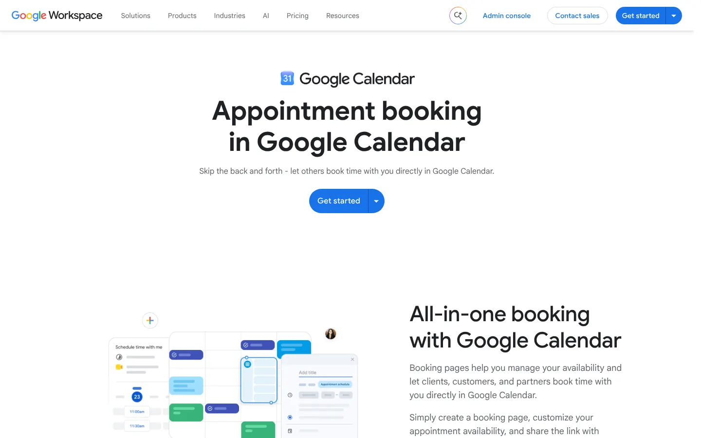

Calendly's free plan is where many people start. It gives one person one event type, one connected calendar and a booking page you can shape. That covers a single intro call, until you want a second kind of meeting, a reminder that cuts no-shows, or two calendars checked together.

You don't have to pay to get past those limits. Several tools give more for free than Calendly does, each in a different place. Match the free plan to the limit that hurts you most.

> **[Try Claritia free](https://app.tryclaritia.com/signup)** to put booking inside a form at $0, with reminders a day and an hour before each meeting.

Below, we compare 9 free Calendly alternatives on what their free plan includes, so you can see what you gain and give up before you switch.

## Main points

- Calendly Free gives you one event type and one calendar, with no reminders and Calendly branding on your page.
- For more meeting types at $0, [Zcal](https://zcal.co/), [Cal.com](https://cal.com/), [Koalendar](https://koalendar.com/) and [TidyCal](https://tidycal.com/) all offer unlimited links or booking types.
- For reminders at $0, look at [Claritia](/), [Zcal](https://zcal.co/), [Cal.com](https://cal.com/) and [Zoho Bookings](https://www.zoho.com/bookings/).
- Top picks: [Claritia](/), [Zcal](https://zcal.co/), [Cal.com](https://cal.com/), [Koalendar](https://koalendar.com/), [TidyCal](https://tidycal.com/), [Zoho Bookings](https://www.zoho.com/bookings/), [OnceHub](https://www.oncehub.com/), [YouCanBookMe](https://youcanbook.me/) and [Google Calendar appointment schedules](https://workspace.google.com/resources/appointment-scheduling/).
- Pick [Claritia](/) if your bookings start on your website and you want a form in front of the calendar for free.

## What is a free Calendly alternative?

A free Calendly alternative is a scheduling tool with a $0 plan that never ends, which you use in place of Calendly's free plan. It shares a booking link, checks your calendar for busy times and adds each booking to it. Free trials that run out after two weeks don't count.

Typical free plan features include:

- A booking page or link.
- Sync with one or more calendars.
- A video link on each meeting.
- Email notices, and on some tools, reminders.

People switch to get more event types, reminders, a second calendar, questions before booking, or payments, all without paying.

If you're comparing paid plans for a team, our [Calendly alternatives guide](/blog/best-calendly-alternatives) covers routing and team pricing. This post sticks to what you get for $0.

## How to choose a free Calendly alternative

Start with the limit that pushed you off Calendly Free, then check these five things:

- **Event types.** How many kinds of meetings you can offer. Calendly Free has one.
- **Calendars.** How many calendars the tool checks before it shows a time. Calendly Free checks one.
- **Reminders.** Whether the free plan sends any before the meeting. Calendly Free doesn't.
- **Branding.** Whether the tool's name stays on your page. On most free plans, it does.
- **The hard cap.** A booking limit, a single user, or a feature that only works on paid plans.

## The 9 best free Calendly alternatives in 2026

Prices checked November 2026.

| Tool | Best for | Event types on free | Reminders on free | Paid from |
|---|---|---|---|---|
| [Claritia](/) | A form in front of the calendar | 1 meeting type, unlimited forms | Yes, a day and an hour before | $12 a seat a month, billed yearly |
| [Zcal](https://zcal.co/) | The fullest free plan for one person | Unlimited links | Yes, by email | $7 a user a month, billed yearly |
| [Cal.com](https://cal.com/) | Unlimited links plus text alerts | Unlimited links | Yes, email and SMS | $12 a user a month, billed yearly |
| [Koalendar](https://koalendar.com/) | Many event types and languages | Unlimited | No, on Pro | $6.99 a seat a month, billed yearly |
| [TidyCal](https://tidycal.com/) | Paid sessions and one-time pricing | Unlimited | Custom emails are paid | $29 one time |
| [Zoho Bookings](https://www.zoho.com/bookings/) | People who use Zoho or Microsoft 365 | 1 user | Yes | $6 a user a month, billed yearly |
| [OnceHub](https://www.oncehub.com/) | Approval before a booking is confirmed | 1 booking link | Standard notices | $10 a seat a month, billed yearly |
| [YouCanBookMe](https://youcanbook.me/) | A free page with payments and polls | 1 booking page, 30 bookings a month | On Individual | $8.10 a month, billed yearly |
| [Google Calendar appointment schedules](https://workspace.google.com/resources/appointment-scheduling/) | Google Calendar users | 1 booking page | On paid Google plans | Paid Google Workspace or Google One plan |

## 1. Claritia

[Claritia](/) is a forms, scheduling and follow-up app built for small B2B teams that want every lead from their website to reach the right rep and book a meeting before they leave the page.

It builds forms from a sentence or one of 840 templates, opens the right person's calendar the moment the form is sent, routes each lead by its answers, and drafts follow-up emails in your brand's voice for you to approve.

Its free plan puts the booking inside a form, so a visitor answers your questions and picks a time on the same page. Workflows then send reminders and follow-ups.

> **[Try Claritia free](https://app.tryclaritia.com/signup)** with no card, and add booking to your first form today.

### Key features

- **Booking inside forms:** On the free plan, with name and email filled in from the form.
- **Reminders on free:** A confirmation with a calendar invite, then reminders a day and an hour before.
- **Calendars and video:** Google Calendar or Outlook, with a Google Meet, Teams or Zoom link on each meeting.
- **Unlimited forms:** With conditional logic, 840 [templates](/templates) and 250 submissions a month.

*Caption: On the free plan, each booking gets a confirmation with the invite and reminders a day and an hour before.*

### Pros

- **You learn who's booking:** The form asks your questions before the calendar opens.
- **No-shows drop without paying:** Reminders and reschedule links come on the free plan.
- **Free teammates:** People who only build forms or read answers never need a seat.

### Cons

- **One meeting type on free:** The same as Calendly. A second meeting type means Starter.
- **Branding stays until Pro:** Claritia branding comes off on the Pro plan.
- **Newer tool:** Its marketplace is smaller, and Zapier and Make apps aren't listed yet.

### Price and plans

You can start on the free plan with no card. Paid plans are priced per seat, and a seat is a teammate people can book a meeting with.

- **Free:** $0 for 1 seat, with 1 meeting type on 1 calendar and 250 submissions a month.
- **Starter:** $15 a seat a month ($12 billed yearly). Adds unlimited meeting types, 6 calendars per seat and [Calendly bookings](/integrations/calendly) brought in while you switch.
- **Pro:** $39 a seat a month ($31 billed yearly). Adds round robin and removes Claritia branding.
- **Business:** $79 a seat a month ($63 billed yearly). Adds owner first and unlimited submissions.

## 2. Zcal

[Zcal](https://zcal.co/) is a scheduling app for individuals, teams, and class hosts who want booking pages and meeting polls in one place. Booking pages can carry custom fonts, colors, layouts, welcome videos, and custom questions, and they sync with Google, Outlook, and Apple calendars.

Teams can use round robin and collective events, while group events, sign-up sheets, and polls handle classes and groups. It sends confirmations and reminders and connects to Zoom, Stripe, and Zapier. One person gets unlimited links and unlimited calendar accounts, which fixes both of Calendly Free's main limits at once. Email reminders, meeting polls and group events also come free.

### Key features

- **Unlimited links:** Plus unlimited calendar accounts across Google, Outlook and Apple.
- **Email reminders:** Automated, on the free plan.
- **Polls and groups:** Meeting polls, and group events with up to 5 people per time slot.
- **Payments:** Stripe on free, with a 3% fee on each payment.

### Pros

- **Fixes Calendly's two big limits:** More than one link and more than one calendar.
- **Video links included:** Zoom, Google Meet and Microsoft Teams on free.

### Cons

- **Branding stays:** Removing Zcal branding needs Pro.
- **One reminder:** Multiple reminders and custom reminder text are on paid plans.

### Price and plans

- **Free:** $0 for one person.
- **Pro:** $7 a user a month, billed yearly. Adds teams, round robin and SMS reminders.
- **Business:** $12 a user a month, billed yearly. Adds custom domains and unlimited teams.

Both paid plans come with a 14-day free trial.

## 3. Cal.com

[Cal.com](https://cal.com/) is scheduling software for individuals and companies that want booking links they can shape around their own process. It syncs calendars, detects time zones, sends reminders, and runs video calls through Zoom, Google Meet, Microsoft Teams, or its own Cal Video.

Teams can use round robin, collective events where every host must be free, routing forms, and workflows, plus admin tools such as SAML SSO and audit logs. Its source code is published on GitHub.

Its free plan is built for one user and doesn't cap links or calendars, and it also sends email and SMS notifications. The open code means you can host it yourself.

### Key features

- **Unlimited links and calendars:** For one user.
- **Notifications:** Email and SMS on free.
- **Payments and CRM:** Stripe and PayPal, plus two-way Salesforce and HubSpot sync.
- **Calendly import:** Bring your Calendly events over in one click.

### Pros

- **Text alerts at $0:** Few free plans send SMS.
- **Easy move:** The one-click Calendly import saves setup time.

### Cons

- **One user only:** Shared availability and round robin need Teams.
- **Branding stays:** Removing Cal.com branding is a Teams feature.

### Price and plans

- **Free:** $0 for one user.
- **Teams:** $12 a user a month billed yearly ($16 monthly).
- **Organizations:** $28 a user a month billed yearly ($37 monthly).

## 4. Koalendar

[Koalendar](https://koalendar.com/) is a scheduling app for small businesses, consultants, educators, and teams that want a simple booking page clients can use from any device. You create booking pages with your logo and colors, connect Google, Outlook, or iCloud calendars, and add custom questions.

It detects time zones, sends email and SMS reminders, supports group, collective, and round robin bookings, takes Stripe payments, and offers booking pages in many languages. Its free plan gives you unlimited event types, booking pages and bookings. That helps a solo pro who offers several kinds of meetings.

### Key features

- **Unlimited event types:** And unlimited booking pages and bookings.
- **Three calendar types:** Google, Outlook and iCloud sync.
- **Languages:** Booking pages in 30+ languages.
- **Phone apps:** For iPhone and Android, plus a Calendly import.

### Pros

- **No cap on meeting types:** The clearest fix for Calendly's one-event limit.
- **Good for clients abroad:** Pages show in your client's language.

### Cons

- **No reminders on free:** Email and SMS reminders are on Pro.
- **Branding and payments cost more:** Both need Pro.

### Price and plans

- **Free:** $0, with unlimited bookings and event types.
- **Pro:** $6.99 a seat a month billed yearly ($9.99 monthly).

## 5. TidyCal

[TidyCal](https://tidycal.com/) is a booking tool for coaches, consultants, and solo service providers who want a simple booking page that also takes payment. You list each service as a booking type and connect a Google, Microsoft, or Apple calendar to avoid double bookings.

Clients can pay through Stripe or PayPal when they book, buy session packages or recurring sessions, and get automated email and SMS reminders. It is made by Sumo Group, the company behind AppSumo.

The free plan has unlimited booking types and bookings and lets you take paid bookings right away. When you outgrow it, you can buy a lifetime plan once instead of paying monthly.

### Key features

- **Unlimited booking types:** With no booking cap.
- **Paid bookings:** Stripe and PayPal, with a 1% platform fee.
- **Group and package bookings:** Plus recurring bookings, on free.
- **Lifetime plans:** Pay once from $29.

### Pros

- **Charge for sessions at $0:** Payments work on the free plan.
- **No monthly bill later:** Lifetime plans keep costs flat.

### Cons

- **One calendar on free:** The same limit as Calendly Free.
- **No auto video links on free:** Zoom, Meet and Teams links start on Individual Lifetime.

### Price and plans

- **Free:** $0, with one calendar.
- **Individual Lifetime:** $29 once, with 10 calendar connections.
- **Agency Lifetime:** $79 once, adding round robin.
- **Pro:** $12 a month or $99 a year, removing TidyCal branding.

## 6. Zoho Bookings

[Zoho Bookings](https://www.zoho.com/bookings/) is appointment scheduling software for businesses of any size that want meetings to land on their calendar without back and forth. It offers one-on-one, group, collective, and resource-based event types, with workspaces for branches or departments, staff roles, and booking limits.

Routing forms qualify leads before they book, workflows send email and SMS and update records, and it connects with Zoho CRM, Zoho Desk, and other Zoho apps. It has a forever free plan for one user, with reminders and two-way calendar sync. It fits in easily if you already work in Zoho apps or Microsoft 365.

### Key features

- **Reminders on free:** Notification emails and reminders.
- **Two-way calendar sync:** Zoho, Google and Microsoft 365 or Outlook.com.
- **Online meetings:** Included on the free plan.
- **Microsoft Teams:** Zoho Bookings can add a Teams link to each virtual meeting.

### Pros

- **Reminders without paying:** A clear step up from Calendly Free.
- **Low first paid plan:** Basic is $6 a user a month billed yearly.

### Cons

- **One user:** The free plan is for one person.
- **Built around Zoho:** Its deeper ties, like Zoho CRM and Bigin sync, matter most if you use Zoho apps.

### Price and plans

- **Free:** $0 for one user.
- **Basic:** $6 a user a month billed yearly ($8 monthly).
- **Premium:** $9 a user a month billed yearly ($12 monthly).

## 7. OnceHub

[OnceHub](https://www.oncehub.com/) is a scheduling and engagement platform for sales, service, support, and recruiting teams that want to screen visitors and book them with the right person. It offers branded booking pages, booking hubs, routing forms that qualify people before they book, and AI chat and phone agents that answer questions and schedule calls.

Its scheduling engine handles one-on-one, multi-host, and group meetings, creates video links and reminders, and connects to CRMs and Zapier. Its free Basic plan is close to Calendly Free in size, with one user, one connected calendar and one booking link. It adds control, like approval before a booking is confirmed and booking pages in more than one language.

### Key features

- **Booking with approval:** Confirm each request yourself.
- **Calendars:** Google, Microsoft 365, Exchange and iCloud.
- **Video links:** Zoom, Google Meet, Microsoft Teams and Webex.

### Pros

- **Approval at $0:** Useful when you screen who gets your time.
- **Wide calendar support:** Including Exchange.

### Cons

- **One booking link:** No more meeting types than Calendly Free.
- **Basic notifications:** Custom email and text notices start on Schedule.

### Price and plans

- **Basic:** Free for one user.
- **Schedule:** $10 a seat a month billed yearly ($12 monthly).
- **Route:** $19 a seat a month billed yearly ($23 monthly).
- **Engage:** $39 a seat a month billed yearly ($47 monthly).

## 8. YouCanBookMe

[YouCanBookMe](https://youcanbook.me/) is an online scheduling tool for small and midsize businesses that want a branded booking page tied to their calendars. It syncs with Google, Apple, Outlook, and Fastmail calendars, and offers booking forms with conditional questions, approval of requests before they are confirmed, password protected pages, and paid bookings through Stripe.

It sends confirmations, reminders, and follow-ups by email and SMS, triggers webhooks, and reports on bookings, no-shows, and revenue. Its free plan gives you one booking page and one calendar, with up to 30 bookings a month, and inside that limit you get payments, polls and custom questions. It suits people who book a few calls a week.

### Key features

- **Custom questions:** Add your own questions to the booking form.
- **Video links:** Zoom, Microsoft Teams and Google Meet.
- **Payments:** Stripe for cards, Apple Pay and Google Pay.
- **Polls and single-use links:** Both on free.

### Pros

- **Questions before booking:** Calendly Free doesn't let you screen like this.
- **Payments at $0:** Take payment when people book.

### Cons

- **30 bookings a month:** A busy week can hit the cap.
- **Reminders cost more:** Custom reminder emails and texts start on Individual.

### Price and plans

- **Free:** $0, with 30 bookings a month.
- **Individual:** $8.10 a month billed yearly ($9 monthly).
- **Professional:** $11.70 a month billed yearly ($13 monthly).
- **Team:** $16.20 a member a month billed yearly ($18 monthly).

## 9. Google Calendar appointment schedules

[Google Calendar appointment schedules](https://workspace.google.com/resources/appointment-scheduling/) is a booking feature built into Google Calendar for people who want others to pick an open time without leaving their own calendar. You set the length, hours, buffers, and daily limits, add booking form questions, and share a booking page link or embed it on a website.

It checks your calendars to prevent double bookings, sends confirmation emails, and on eligible paid accounts adds reminders, guest email checks, and Stripe payments. It is already in your calendar if you have a Google account, and a personal account gets one booking page. If you live in Google Calendar, it's the easiest place to start.

### Key features

- **Booking page:** One page with a personal Google account.
- **Google Meet:** Or an in-person location.
- **Limits:** Buffer time, maximum bookings per day and how far ahead people can book.

### Pros

- **Nothing to sign up for:** You already have it.
- **Useful limits at $0:** Buffers, a daily cap and a booking window work on a personal account.

### Cons

- **No reminders on free:** Google lists automatic email reminders as a premium feature.
- **One schedule:** More than one schedule, checks across calendars and payments are premium too.

### Price and plans

- **Personal Google account:** Free, with one booking page.
- **Workspace or Google One:** Eligible paid plans add the premium features. See Google's pricing page.

## Which free Calendly alternative should you pick?

- If your bookings start on your website and you want questions before the calendar, pick [Claritia](/).
- If you want the most at $0 as one person, pick [Zcal](https://zcal.co/).
- If you want text notifications and CRM sync for free, pick [Cal.com](https://cal.com/).
- If you offer many meeting types to clients in other countries, pick [Koalendar](https://koalendar.com/).
- If you sell sessions and dislike subscriptions, pick [TidyCal](https://tidycal.com/).

## Questions

### Is there a free Calendly alternative with unlimited event types?

Yes. Zcal and Cal.com give unlimited links on free, and Koalendar and TidyCal give unlimited event or booking types. Calendly Free allows one event type.

### Which free Calendly alternative sends reminders?

Claritia sends reminders a day and an hour before on free. Zcal sends email reminders, Cal.com sends email and SMS notifications, and Zoho Bookings includes reminders on its free plan.

### Does Calendly have a free plan?

Yes. Calendly Free gives one event type, one calendar connection and one-on-one meetings, with a booking page you can customize. Reminders and removing Calendly branding need a paid plan.

### Can I move my Calendly links to a free tool?

Cal.com and Koalendar both offer a one-click Calendly import. Claritia's Starter plan takes in bookings from Calendly, so both tools can run side by side while you swap links.

### Which free scheduling tool removes its branding?

Most free plans keep their branding. On the tools here, removing it needs a paid plan. In Claritia, it comes off on Pro.

## Get started

Pick the free plan that fixes the limit you hit in Calendly. If your meetings start on your website, start with a form that books them.

> **[Try Claritia free](https://app.tryclaritia.com/signup)** to build a booking form, connect Google Calendar or Outlook, and take your first meeting today.

You can also compare more [free scheduling software](/blog/best-free-scheduling-software) or see how [Claritia Meetings](/products/meetings) works.
