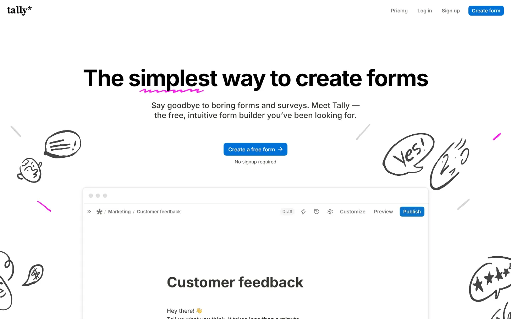
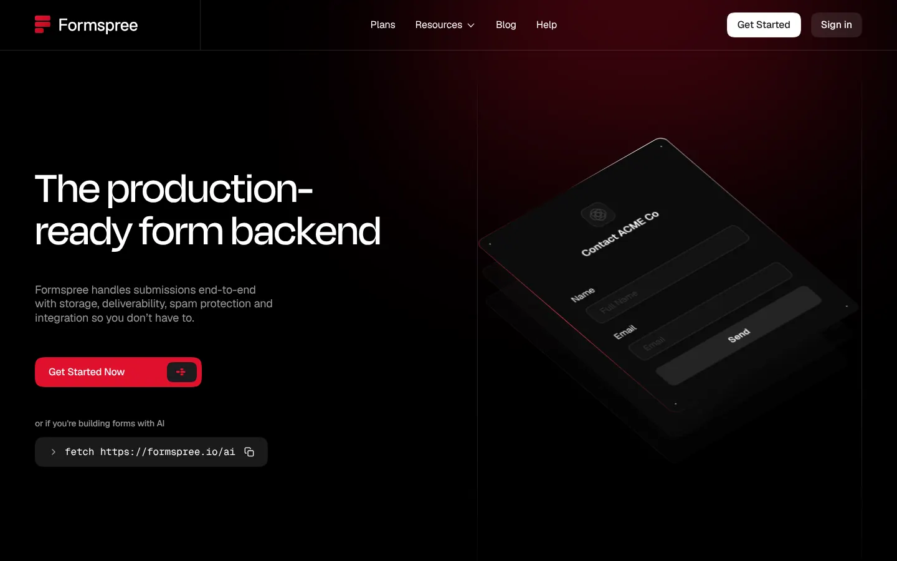

You have a website and you need a form on it: a contact form, a quote request or a sign-up. Writing one in HTML is the easy part. The hard part is everything behind it, like storing the answers, sending you an email, stopping spam and keeping it working when you're not looking.

A free HTML form builder does that work for you. You build the form in a visual editor, copy a short piece of code and paste it into your page. The answers land in your account, and you never touch a server.

> **[Try Claritia free](https://app.tryclaritia.com/signup)** to build a form, paste one script tag into any site and let each lead book a meeting on the spot.

In this post, we compare 7 free tools that give you a form for any HTML site. You'll see what each free plan allows, and how to embed a form step by step.

## Main points

- A free HTML form builder gives you a form you can paste into any website as a snippet of code.
- Free plans differ most in monthly answer limits, branding and what happens after someone hits submit.
- If you'd rather write the HTML yourself, a form backend such as [Formspree](https://formspree.io/) stores the answers for you.
- Top picks: [Claritia](/), [Tally](https://tally.so/), [Fillout](https://www.fillout.com/), [Jotform](https://www.jotform.com/), [Cognito Forms](https://www.cognitoforms.com/), [Google Forms](https://www.google.com/forms/about/) and [Formspree](https://formspree.io/).
- Pick [Claritia](/) if the form should turn into a booked meeting, and [Tally](https://tally.so/) if you need the most free answers.

## What is a free HTML form builder?

A free HTML form builder is a tool that lets you make a web form without code and put it on any HTML page for free. You build the form in the tool, then copy an embed code, usually a script tag or an iframe, into your site. The tool hosts the form, saves each answer and sends you a note.

It works on hand-coded sites and on site builders like WordPress, Webflow, Framer, Squarespace and Shopify, since all of them accept a piece of HTML.

Typical features include:

- An embed code to paste into your page, plus a share link.
- Display options such as inline, popup or full page.
- Spam protection, so bots don't fill your inbox.
- Email alerts for each new answer.
- Logic that shows or skips questions.
- Integrations that send answers to a sheet, CRM or email tool.

## How to choose a free HTML form builder

Most free plans look alike until you hit a limit. Check these five things before you paste any code:

- **Monthly answers.** Free limits range from 50 to unlimited within fair use.
- **Branding.** Most free forms show the tool's badge. Check what it costs to remove it.
- **How it embeds.** A script tag that fits the page is nicer than a fixed-height iframe that scrolls on phones.
- **Spam protection.** A public form without it fills up with junk.
- **What happens after submit.** An email, a thank-you page, a sheet, a CRM or a booked meeting.

## The 7 best free HTML form builders in 2026

Prices checked November 2026.

| Tool | Best for | Free plan | Paid from | How it embeds |
|---|---|---|---|---|
| [Claritia](/) | Forms that book a meeting | Unlimited forms, 250 submissions a month | $12 a seat a month, billed yearly | One script tag, inline or popup |
| [Tally](https://tally.so/) | Most free answers | Unlimited forms and submissions (fair use) | $24 a month | Standard, popup or full page |
| [Fillout](https://www.fillout.com/) | A big free plan for teams | 1,000 responses a month | $15 a month, billed yearly | Embed on every plan |
| [Jotform](https://www.jotform.com/) | Templates for any form | 5 forms, 100 submissions a month | $34 a month, billed yearly | Copy and paste embed code |
| [Cognito Forms](https://www.cognitoforms.com/) | Forms with prices and totals | 100 entries a month | $19 a month, billed yearly | Seamless or iframe code |
| [Google Forms](https://www.google.com/forms/about/) | Quick, simple forms | Free with a Google account | Comes with Google Workspace | Embed HTML |
| [Formspree](https://formspree.io/) | Your own HTML form | 50 submissions a month | $10 a month, billed yearly | Your form posts to it |

## 1. Claritia

[Claritia](/) is a forms, scheduling and follow-up app built for small B2B teams that want every lead from their website to reach the right rep and book a meeting before they leave the page. It builds forms from a sentence or one of 840 templates, opens the right person's calendar the moment the form is sent, routes each lead by its answers, and drafts follow-up emails in your brand's voice for you to approve. Tia, the AI form builder, drafts the form, and you paste one script tag into your page to show it inline, as a popup or as a side tab. The last page can be a calendar, so each lead books a meeting before they leave.

> **[Try Claritia free](https://app.tryclaritia.com/signup)** and put your first form on your site with one script tag.

### Key features

- **One script tag:** Works on any site, on every plan. See the steps for [WordPress](/integrations/wordpress) and [Webflow](/integrations/webflow).
- **Ways to show it:** In the page, as a popup, slide in, corner button or side tab.
- **Spam protection:** Cloudflare Turnstile, a hidden trap and disposable email blocking.
- **Logic for free:** Multi-page forms, show-if logic and calculations on every plan.
- **Booking inside the form:** People pick a time with the right person on the last page.

### Pros

- **Light on your page:** The script loads after the page, so your site draws first.
- **Keep your own form:** Claritia can also listen for your existing form's send and open the calendar.
- **Answers keep coming:** Past 250 on Free, forms keep working and every answer is saved.

### Cons

- **Branding on lower plans:** Removing Claritia branding needs Pro.
- **Newer tool:** Its app marketplace is smaller, and its Zapier and Make apps aren't listed yet.

### Price and plans

You can start on the free plan with no card. Paid plans are priced per seat, and a seat is a teammate people can book a meeting with.

- **Free:** $0 for 1 seat and 250 submissions a month.
- **Starter:** $15 a seat a month ($12 billed yearly). Adds redirect on completion, custom brand and integrations like HubSpot and Google Sheets.
- **Pro:** $39 a seat a month ($31 billed yearly). Removes Claritia branding and adds routing.
- **Business:** $79 a seat a month ($63 billed yearly). Adds your own domain and partial answers.

## 2. Tally

[Tally](https://tally.so/) is a form builder for individuals and teams who want to make forms by typing, much like writing in a document. You insert blocks for contact details, file uploads, ratings, signatures, and Stripe payments, then add conditional logic, calculations, hidden fields, and answer piping. Forms can be embedded or shown as popups, and submissions can go to Notion, Slack, Airtable, or Google Sheets. Tally is hosted in Europe and does not use cookie tracking. It has the biggest free plan here, with unlimited forms and submissions within fair use, and you can embed a form as a standard, popup or full page form. Its help pages say all three embed types are free.

### Key features

- **Unlimited free answers:** Within fair use.
- **Three embed types:** Standard, popup and full page.
- **Logic and webhooks:** On the free plan.
- **Works with site builders:** WordPress, Webflow, Framer and more.

### Pros

- **No answer cap:** Volume doesn't push you to pay.
- **Easy to learn:** Building feels like typing a note.

### Cons

- **Branding on Free:** Removing it needs Pro.
- **Pro for extras:** Custom domains, custom CSS and partial submissions need Pro.

### Price and plans

- **Free:** $0, unlimited within fair use.
- **Pro:** $24 a month.
- **Business:** $74 a month.

Yearly billing gives two months off.

## 3. Fillout

[Fillout](https://www.fillout.com/) is a form builder for teams that want branded forms, surveys, and quizzes connected to the tools they already use. You can describe a form for its AI to build or use drag and drop, then add logic, file uploads, payments, and signatures. It also offers scheduling forms that sync with Google Calendar or Outlook, PDF generation, workflows, login forms that let people edit past answers, custom domains, and native integrations. It gives you 1,000 responses a month for free, with embedding on every plan and unlimited seats, so it suits teams who want a big free plan and a modern editor.

### Key features

- **Embedding on every plan:** Free included.
- **1,000 free responses:** A month.
- **Drag and drop or AI:** Two ways to build.
- **Unlimited seats:** On every plan.

### Pros

- **Generous free plan:** Enough for most small sites.
- **Room for the team:** No cost per builder.

### Cons

- **Fillout badge:** Free forms show it, and Starter shows light branding.
- **Custom domains cost more:** They're on Business.

### Price and plans

- **Free:** $0, 1,000 responses a month.
- **Starter:** $15 a month billed yearly, 2,000 responses.
- **Pro:** $40 a month billed yearly, 5,000 responses.
- **Business:** $75 a month billed yearly, unlimited responses.

## 4. Jotform

[Jotform](https://www.jotform.com/) is a drag and drop form builder for businesses, schools, nonprofits, and public agencies that want to collect data, payments, and signatures without writing code. Forms can use conditional logic, answer piping, prefilled fields, and translations, and they accept one-time or recurring payments through many gateways. Submissions can become PDFs, flow into CRMs and spreadsheets, and be managed in related Jotform tools for tables, approval workflows, e-signatures, and reports. It has more than 20,000 templates, and when your form is ready, you copy its embed code and paste it into your site builder or page. The free plan is small, so it fits low-volume forms. For more on its editor, see our list of [drag and drop form builders](/blog/best-drag-and-drop-form-builders).

### Key features

- **Embed code:** Copy and paste into any page.
- **20,000+ templates:** A starting point for almost anything.
- **Drag and drop builder:** With widgets for extra fields.
- **AI form builder:** Create forms with AI.

### Pros

- **Templates for everything:** You rarely start blank.
- **Easy embed:** No coding needed.

### Cons

- **Small free plan:** 5 forms and 100 submissions a month, with Jotform branding.
- **Single user:** Plans below Enterprise are for one user.

### Price and plans

- **Starter:** Free, 5 forms and 100 submissions a month.
- **Bronze:** $34 a month billed yearly, or $39 monthly.
- **Silver:** $39 a month billed yearly, or $49 monthly.
- **Gold:** $99 a month billed yearly, or $129 monthly.

## 5. Cognito Forms

[Cognito Forms](https://www.cognitoforms.com/) is an online form builder for organizations that want to collect data and automate the work that follows each entry. Its drag-and-drop builder handles many field types, automatic calculations, signatures and file uploads. Forms can move entries through approval workflows, generate documents, look up data from other forms and take payments through Square, Stripe, PayPal or its own Cognito Pay. It also includes controls that help teams meet HIPAA, GDPR and CCPA rules. It gives you two embed codes. Seamless puts the form right into your page, and iframe keeps it in its own frame for sites where Seamless clashes. It suits quotes and order forms, and the free plan even takes payments.

### Key features

- **Seamless and iframe embeds:** Pick the one that suits your site.
- **Prefill:** Pass data into the form from your page.
- **Calculations:** Prices, totals and dates.
- **Payments:** On the free plan.

### Pros

- **Good at quotes:** Totals and repeating sections work well.
- **Paid forms for free:** Take payments before you upgrade.

### Cons

- **Small free plan:** 100 entries a month and 1 user.
- **Cognito branding:** Shown on free forms.

### Price and plans

- **Free:** 100 entries a month and 1 user.
- **Pro:** $19 a month billed yearly, or $24 monthly. 2,000 entries a month.
- **Higher plans:** More users and entries. See their pricing page.

## 6. Google Forms

[Google Forms](https://www.google.com/forms/about/) is the survey and form tool in Google Workspace, made for people and teams who want to gather answers from any device with little setup. You pick question types, arrange them with drag and drop, add logic that shows questions based on earlier answers, or build quizzes that test knowledge. Forms can be shared by email, link, or embed. Responses appear as live charts and can be exported to Google Sheets for deeper analysis. It's free with a Google account. To embed a form, open its More menu, pick Embed HTML, copy the code and paste it into your page. It suits simple forms where looks don't matter much.

### Key features

- **Embed HTML:** Copy and paste from the More menu.
- **Google Sheets:** Answers go straight to a sheet.
- **Sharing:** By link, email or embed.
- **Quizzes:** With grading.

### Pros

- **Free and familiar:** Most people already know it.
- **Fast to set up:** A form in minutes.

### Cons

- **Looks like Google Forms:** Few design options to match your site.
- **No booking or payments:** Neither is built in.

### Price and plans

- **Personal:** Free with a Google account.
- **Business:** Comes with Google Workspace. See their pricing page.

## 7. Formspree

[Formspree](https://formspree.io/) is a form backend for developers, designers and agencies who build their own HTML or JavaScript forms and do not want to run a server for them. A form posts to a Formspree endpoint, which saves each submission to an inbox, filters spam, checks fields on the server and accepts file uploads. It sends notification emails and autoresponses, routes submissions by rules, connects to tools such as Slack, Google Sheets and Airtable, and offers an API and React library. You build the form with your own markup and styles, then point its action at your Formspree address, which makes it the right pick for developers and anyone with a hand-coded site.

### Key features

- **Bring your own form:** Any markup, styles or scripts.
- **One line to connect:** Set the form's action to your Formspree address.
- **Spam filtering:** Basic filtering on the free plan.
- **Unlimited forms:** On every plan.

### Pros

- **Full control:** The form looks exactly as you code it.
- **No builder to learn:** Plain HTML is enough.

### Cons

- **You write the form:** There's no visual editor.
- **Tight free plan:** 50 submissions a month, 1 team member, no file uploads, no custom thank-you page and a 30-day archive.

### Price and plans

- **Free:** $0, 50 submissions a month.
- **Personal:** $10 a month billed yearly, 200 submissions.
- **Professional:** $20 a month billed yearly, 2,000 submissions.
- **Business:** $60 a month billed yearly, 20,000 submissions.

## How to embed a form on an HTML site

Most tools follow the same four steps:

1. **Build and publish the form.** Some tools, like Google Forms, only show the form once it's published.
2. **Copy the embed code.** Look for Share, Embed or Publish in the tool. Pick inline or popup if it asks.
3. **Paste it where the form should go.** On a hand-coded site, paste it into the page's HTML. In WordPress, use a Custom HTML block. In Webflow, use an Embed element.
4. **Test it on a phone.** Send a test answer and check that it reaches you.

A Claritia embed is two lines. The first loads the script, and the second places the form:

- ``
- `<claritia-form form-id="FORM_ID"></claritia-form>`

Replace FORM_ID with your form's ID from the Share tab. If you write your own form instead, a backend like Formspree only needs the form's action set to your address, such as `<form action="https://formspree.io/f/{form_id}" method="post">`.

## Which free HTML form builder should you pick?

- If each form should end in a booked meeting, pick [Claritia](/).
- If you need the most free answers, pick [Tally](https://tally.so/).
- If your team needs a big free plan with many builders, pick [Fillout](https://www.fillout.com/).
- If your form adds up prices, pick [Cognito Forms](https://www.cognitoforms.com/).
- If you code your own forms, pick [Formspree](https://formspree.io/).
- If you need a quick internal form, [Google Forms](https://www.google.com/forms/about/) is enough.

## Questions

### How do I add a form to my HTML website for free?

Build the form in a free tool such as Claritia, Tally or Fillout, copy its embed code and paste it into your page's HTML where the form should appear. The tool hosts the form and saves each answer.

### Can I make an HTML form without a backend?

Yes. A form builder or a form backend acts as your backend. With Formspree, you write the HTML and set the form's action to your Formspree address. With Claritia, you paste a script tag and the form, its storage and spam checks come with it.

### Which free form builder has no submission limit?

Tally offers unlimited forms and submissions on its free plan, within fair use. Fillout's free plan is next, with 1,000 responses a month.

### Do embedded forms work on WordPress and Webflow?

Yes. Paste the code into a Custom HTML block in WordPress or an Embed element in Webflow. Claritia embeds work on WordPress, Webflow, Framer, Shopify and Squarespace on every plan.

### Will an embedded form slow down my site?

It depends on the tool. Claritia's script loads after the page, so your page draws first. An iframe adds a second page inside yours, so test your page speed after you add one.

### Can I remove the branding on a free form?

Usually not. Most tools, including Tally, Fillout, Jotform and Cognito Forms, show their branding on free forms. Claritia removes it on Pro.

## Get started

Pick a tool, build the form and paste the code into your page. It takes a few minutes, and you can test it before anyone sees it.

> **[Try Claritia free](https://app.tryclaritia.com/signup)** to build your first form and put it on your site with one script tag.

You can also browse [840 free form templates](/templates) or see how [Claritia forms](/products/forms) work.
