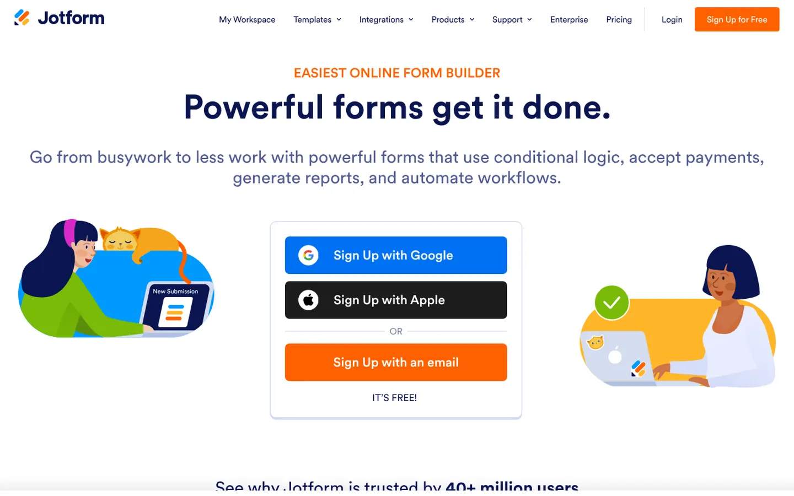

Google Forms and Jotform are two of the most common places people start when they need a form. Google Forms is free with a Google account and sends answers straight to Google Sheets. Jotform has a free plan too, plus a huge template library and fields for payments and signatures. On the surface they look like they do the same job.

They don't fit the same people, though. Pick the wrong one and you hit a wall later: a 5 form cap, a missing payment field, or a form that doesn't look like your business. This guide helps you see which wall you're likely to hit first.

> **[Try Claritia free](https://app.tryclaritia.com/signup)** to import a Google Form in one step and end it with a booked meeting.

In this post, we compare Google Forms and Jotform on price, limits, logic, payments, design and teamwork, then give a clear pick for each kind of team.

## Main points

- Pick [Google Forms](https://www.google.com/forms/about/) if you want free internal forms, surveys or quizzes, with answers in Google Sheets and teammates editing together.
- Pick [Jotform](https://www.jotform.com/) if your forms face customers and need payments, e-signatures, special fields or a template for almost any use.
- Jotform's free plan stops at 5 forms and 100 submissions a month. Its paid plans start at $34 a month billed yearly, for one user.
- Google Forms branches by section only, and it has no payment field. Jotform includes conditional logic on its free plan.
- Pick [Claritia](/) if your forms collect leads and each one should end in a booked meeting.

## Google Forms vs Jotform at a glance

| | [Google Forms](https://www.google.com/forms/about/) | [Jotform](https://www.jotform.com/) |
|---|---|---|
| Best for | Internal forms, surveys and quizzes | Customer forms with payments and signatures |
| Free plan | Free with a Google account | 5 forms, 100 submissions a month |
| Paid from | Part of Google Workspace | $34 a month billed yearly ($39 monthly) |
| Logic | Go to a section based on an answer | Conditional logic, free |
| Payments | No payment field | Yes, 10 payment submissions a month on free |
| E-signatures | No | Yes, 10 signed documents a month on free |
| Users | Share with collaborators | 1 user until Enterprise |
| Where answers go | Google Sheets | Your Jotform account, plus its integrations |

Prices checked November 2026.

## What is Google Forms?

[Google Forms](https://www.google.com/forms/about/) is the survey and form tool in Google Workspace, made for people and teams who want to gather answers from any device with little setup. You pick question types, arrange them with drag and drop, add logic that shows questions based on earlier answers, or build quizzes that test knowledge. Forms can be shared by email, link, or embed. Responses appear as live charts and can be exported to Google Sheets for deeper analysis. It's free to use, and any form can become a quiz with an answer key and points.

## What is Jotform?

[Jotform](https://www.jotform.com/) is a drag and drop form builder for businesses, schools, nonprofits, and public agencies that want to collect data, payments, and signatures without writing code. Forms can use conditional logic, answer piping, prefilled fields, and translations, and they accept one-time or recurring payments through many gateways. Submissions can become PDFs, flow into CRMs and spreadsheets, and be managed in related Jotform tools for tables, approval workflows, e-signatures, and reports. It says it has more than 20,000 templates, handles file uploads, and adds HIPAA features on its top plan. Its card layout can also show one question at a time.

## Price and limits

This is where the two tools differ most.

Google Forms costs nothing to use with a Google account. Businesses that want their own domain, admin controls and Workspace features pay for Google Workspace, and Forms comes with it. You don't buy Forms on its own.

Jotform prices by forms and submissions. Every plan, the free one too, is for one user. Here is what each plan allows:

| Jotform plan | Price billed yearly | Price billed monthly | Forms | Submissions a month |
|---|---|---|---|---|
| Starter | Free | Free | 5 | 100 |
| Bronze | $34 a month | $39 a month | 25 | 1,000 |
| Silver | $39 a month | $49 a month | 50 | 2,500 |
| Gold | $99 a month | $129 a month | 100 | 10,000 |
| Enterprise | Custom | Custom | Unlimited | Unlimited |

Two more limits on Jotform's free plan matter. It stores 500 submissions in total, and it shows Jotform branding on your forms. Jotform offers a 30-day money back guarantee on paid plans and up to 50% off for nonprofits and schools.

Google Forms has limits too, but they sit inside each form. A form can hold up to 300 pieces of content, such as questions, images and videos, and up to 75 sections.

## Building forms and design

Google Forms is quick to learn. You add questions one after another, pick a question type, and you're done. You can change the theme color, font and header image, and add images or YouTube videos between questions. That's about the limit of the design control. Most Google Forms look like Google Forms.

Jotform gives you far more to work with. Its drag-and-drop editor has many field types and widgets, and the template library means you rarely start from a blank page. You can switch to the card layout for a one-question-at-a-time feel. The trade-off is that the editor has more menus, so a simple form takes a little longer to build.

## Logic and question types

Google Forms has the core question types: short answer, paragraph, multiple choice, checkboxes, dropdown, file upload, linear scale, rating, grids, date and time. Its logic works through sections. On a choice question, you can send people to a chosen section based on their answer, or end the form. You can't show or hide a single question in the middle of a page.

Jotform includes conditional logic on its free plan. You can show or hide fields, skip pages and change what happens at the end based on answers. Its logic can also send emails to different people, run calculations and change the thank-you page. Along with logic, it has fields Google Forms lacks, like payments and signatures.

## Payments, signatures and file uploads

Google Forms has no payment question type and no e-signature field. File uploads work, with two catches from Google's help pages. Responders must sign in to a Google account to upload. And you can't use the upload question when the form sits in a shared drive.

Jotform covers all three. The free plan includes 10 payment submissions and 10 signed documents a month, and the limits rise on each paid plan. Storage is 100 MB on free and grows to 100 GB on Gold.

## Teamwork and where answers go

Google Forms was built for teams in Google Workspace. You can add collaborators who edit the form with you, and answers flow into a shared Google Sheet. If your team already lives in Sheets and Drive, this is the easier fit.

Jotform's plans below Enterprise are for one user. Answers land in your Jotform account, and from there you can send them on through its integrations. Its HubSpot connection, for example, can create contacts, deals and tickets from a submission. For a team that shares form work, the single-user plans are the biggest drawback.

## Pros and cons

### Google Forms

Pros:

- **Free:** Anyone with a Google account can use it.
- **Google Sheets:** Answers go straight to a sheet your team already uses.
- **Built for sharing:** Collaborators can edit a form together.
- **Quizzes:** Answer keys, points and grading are built in.

Cons:

- **Basic design:** Few ways to make a form look like your business.
- **Section logic only:** No show or hide on single questions.
- **No payments or signatures:** You need another tool for both.
- **Uploads need a Google sign-in:** That puts off customers without an account.

### Jotform

Pros:

- **Templates for almost anything:** More than 20,000, by its own count.
- **Payments and e-signatures:** Both are on the free plan, with monthly caps.
- **Logic on free:** Conditional logic doesn't need an upgrade.
- **More than contacts:** Integrations like HubSpot can create deals and tickets.

Cons:

- **Small free plan:** 5 forms, 100 submissions a month and 500 stored in total.
- **One user:** Team access starts on Enterprise.
- **Busier editor:** More menus to learn than Google Forms.

## Which should you pick?

- **Pick Google Forms** if the form is for your team, your class or a quick survey. It's free, simple and lands in Google Sheets.
- **Pick Jotform** if the form faces customers and needs a payment, a signature or a special field, and one person builds the forms.
- **Pick Google Forms** if several people need to edit forms together and you don't want to pay per user.
- **Pick Jotform** if you need HIPAA features, which sit on its Gold plan.

If neither fits because your form should start a sales conversation, read on.

## A third option: Claritia

[Claritia](/) is a forms, scheduling and follow-up app built for small B2B teams that want every lead from their website to reach the right rep and book a meeting before they leave the page. It builds forms from a sentence or one of 840 templates, opens the right person's calendar the moment the form is sent, routes each lead by its answers, and drafts follow-up emails in your brand's voice for you to approve. It fills the gap both tools leave, which is what happens after a lead hits submit, since a Claritia form can end with a booking step on the same page. See [Claritia Forms](/products/forms) for the full list.

What it adds for each group:

- **For Google Forms users:** You can [import a Google Form](/integrations/google-forms) on the free plan by pasting its link. Your Google Form isn't changed.
- **For Jotform users:** Unlimited forms on every plan, and teammates who only build forms or read answers are free.
- **For both:** Conditional logic, calculations and hidden fields for UTM tags on the free plan. Stripe payments and e-signatures start on Starter.

Claritia's free plan gives 1 seat and 250 submissions a month. Starter is $15 a seat a month ($12 billed yearly) and raises that to 2,000. See [pricing](/pricing) for every plan.

Be fair to the others, too. Claritia is a newer tool, so its app marketplace and community are smaller. It has no Zapier or Make apps listed yet. And it has no quiz grading like Google Forms.

## Questions

### Is Jotform better than Google Forms?

It depends on the form. Jotform is better for customer forms that need payments, signatures or polished design. Google Forms is better for free internal forms, quizzes and teams that share work in Google Sheets.

### Is Google Forms free?

Yes. Anyone with a Google account can build forms in Google Forms. Businesses can also get it as part of a paid Google Workspace plan.

### Is Jotform free?

Jotform has a free Starter plan with 5 forms and 100 submissions a month, for one user. It shows Jotform branding, and paid plans start at $34 a month billed yearly.

### Can Google Forms take payments?

No. Google Forms has no payment question type. Jotform has payment fields on every plan, and Claritia adds Stripe payments on Starter.

### Can I move my Google Forms to another tool?

Yes. Claritia imports a Google Form on its free plan from the form's edit link. Labels, help text, options and required questions stay the same.

## Get started

Start with the tool that matches where your form lives today. If your form should turn a visitor into a booked meeting, try Claritia.

> **[Try Claritia free](https://app.tryclaritia.com/signup)** to import your first Google Form and add a booking step at the end.

You can also compare more options in our [Google Forms alternatives](/blog/best-google-forms-alternatives) and [Jotform alternatives](/blog/best-jotform-alternatives) guides.
