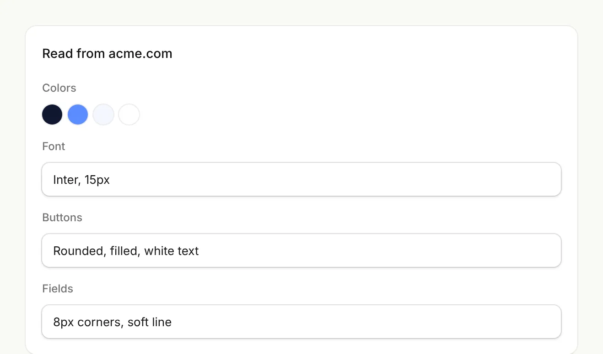

Google Forms and Typeform sit at two ends of the form builder world. Google Forms is free, plain and quick, and its answers land in Google Sheets. Typeform is paid, polished and built around one question at a time. Many teams start on Google Forms and wonder whether Typeform is worth the money.

It depends on who fills in the form. A form for your own team rarely needs to look special. A form on your website that asks a stranger for their details often does.

> **[Try Claritia free](https://app.tryclaritia.com/signup)** to import a Google Form, give it your brand on Pro and end it with a booked meeting.

Below, we compare the two on price, response limits, design, logic, uploads and teamwork, then give a pick for each kind of form.

## Main points

- Pick [Google Forms](https://www.google.com/forms/about/) for internal forms, surveys, sign-ups and quizzes, where free and fast matter more than looks.
- Pick [Typeform](https://www.typeform.com/) for customer-facing forms where design and a calm, one-question flow help people finish.
- Typeform's free plan allows 10 responses a month, and Basic costs $28 a month billed yearly for 100 responses and 1 user.
- Google Forms branches by section. Typeform has branching, scores and calculations, even on free.
- Pick [Claritia](/) if your form collects leads and each one should end in a booked meeting.

## Google Forms vs Typeform at a glance

| | [Google Forms](https://www.google.com/forms/about/) | [Typeform](https://www.typeform.com/) |
|---|---|---|
| Best for | Internal forms, surveys and quizzes | Branded customer forms |
| Free plan | Free with a Google account | 10 responses a month |
| Paid from | Part of Google Workspace | $28 a month billed yearly ($39 monthly) |
| Layout | All questions on a page, split by sections | One question at a time |
| Logic | Go to a section based on an answer | Branching, scores and calculations |
| Design | Theme color, font and header image | Themes, your logo, and no branding from Plus |
| Payments | No payment field | On paid plans |
| Teamwork | Collaborators edit together | 1 user on Basic, 3 on Plus, 5 on Business |

Prices checked November 2026.

## What is Google Forms?

[Google Forms](https://www.google.com/forms/about/) is the survey and form tool in Google Workspace, made for people and teams who want to gather answers from any device with little setup. You pick question types, arrange them with drag and drop, add logic that shows questions based on earlier answers, or build quizzes that test knowledge.

Forms can be shared by email, link, or embed. Responses show up as live charts, and you can export them to Google Sheets. It's free, and any form can become a quiz with an answer key, points and feedback.

## What is Typeform?

[Typeform](https://www.typeform.com/) is an online form builder for marketing, product, HR, and customer teams that want forms, surveys, and quizzes people actually finish. It builds conversational forms that adapt to each answer, can draft and brand a form from a written prompt, and accepts video and audio replies.

Responses can go to tools like HubSpot, Google Sheets, and Notion, take Stripe payments, book Calendly meetings, and feed AI summaries of themes and sentiment. It's a paid form builder where each question fills the screen, so people move through one answer at a time. Its plans also include logic, hidden fields and a Salesforce integration.

## Price and response limits

Google Forms costs nothing with a Google account. Businesses that want their own domain and admin controls pay for Google Workspace, and Forms comes with it.

Typeform charges by plan, and each plan has a monthly response limit:

| Typeform plan | Yearly | Monthly | Responses a month | Users |
|---|---|---|---|---|
| Free | $0 | $0 | 10 | 1 |
| Basic | $28 a month | $39 a month | 100 | 1 |
| Plus | $56 a month | $79 a month | 1,000 | 3 |
| Business | $91 a month | $129 a month | 10,000 | 5 |

People often miss the response limit. Typeform's free plan takes 10 responses a month across all your forms. When you hit your limit, Typeform says your forms go private until the next month or until you upgrade. If you expect a few hundred answers a month, plan on Plus at least.

Google Forms has limits inside each form instead. A form can hold up to 300 pieces of content, such as questions, images and videos, and up to 75 sections.

## Design and the form experience

Here Typeform is at its best. One question at a time keeps people focused, and the layout looks good on a phone. You can add your logo and pick themes, and Plus removes Typeform branding and adds a custom subdomain. For a lead form on your homepage, that polish can be worth paying for.

Google Forms lets you change the theme color, font and header image, and add images or videos between questions. Most Google Forms still look like Google Forms. That's fine for a staff survey, but it can feel out of place on a company website.

## Logic and question types

Google Forms covers the core question types: short answer, paragraph, multiple choice, checkboxes, dropdown, file upload, linear scale, rating, grids, date and time. Its logic works through sections. On a choice question, you send people to a chosen section based on their answer, or end the form.

Typeform's free plan includes branching, scores and calculations. You can recall earlier answers in later questions and use hidden fields to pass in data like a name or a campaign tag. With these, you can build a quiz that gives each person a result, or a lead form that skips questions that don't apply.

## Uploads, payments and quizzes

Google Forms has file uploads, but responders must sign in to a Google account to use them. It has no payment question type. Its quiz tools are strong, with answer keys, points, automatic grading and feedback.

Typeform's pricing FAQ says paid plans add payment and file upload questions. It also offers knowledge quizzes and outcome quizzes. Grading with an answer key, the way a teacher would use it, is where Google Forms stays ahead.

## Teamwork and where answers go

Google Forms makes teamwork easy. You add collaborators who edit the form with you, and answers flow into a shared Google Sheet. There's no seat price to think about.

Typeform includes 1 user on Basic, 3 on Plus and 5 on Business. Answers stay in Typeform, where you can view and download them, and its integrations send them on to tools like Google Sheets, HubSpot and Slack. More than 500 apps connect through Zapier.

## Pros and cons

### Google Forms

Pros:

- **Free:** Anyone with a Google account can use it.
- **Google Sheets:** Answers go straight to a shared sheet.
- **Easy teamwork:** Collaborators edit forms together.
- **Quizzes:** Answer keys, points and grading are built in.

Cons:

- **Plain look:** Hard to make it match your brand.
- **Section logic only:** No show or hide on a single question.
- **No payments:** You need another tool to take money.
- **Uploads need a Google sign-in:** That puts off many customers.

### Typeform

Pros:

- **Form experience:** Calm, one-question layout that looks good on phones.
- **Logic on free:** Branching, scores and calculations.
- **Brand control:** Themes, logo and no branding from Plus.
- **Integrations:** HubSpot, Salesforce, Google Sheets and more.

Cons:

- **Low response caps:** 10 a month on free and 100 on Basic.
- **Price climbs fast:** 1,000 responses a month means Plus at $56 billed yearly.
- **Users cost more:** Basic is for one person.

## Which should you pick?

- **Pick Google Forms** if the people filling in the form are your team, students or members who already trust you.
- **Pick Typeform** if the form sits on your website and has to win over strangers.
- **Pick Google Forms** if you need quizzes with grading, or you collect lots of answers on no budget.
- **Pick Typeform** if you want branching, scores and calculations in a form that looks like your brand.

If your form's job is to turn a visitor into a sales call, look at one more option.

## A third option: Claritia

[Claritia](/) is a forms and meetings tool for small teams. A Claritia form can end with a booking step, so the lead picks a time with the right person on the same page. Workflows then send reminders and a follow-up. See [Claritia Forms](/products/forms).

How it compares with both:

- **From Google Forms:** [Import a Google Form](/integrations/google-forms) on the free plan by pasting its edit link. Questions, options and required fields come across, and your Google Form isn't changed.
- **From Typeform:** On Starter, Claritia takes in answers from [Typeform](/integrations/typeform), so your old forms keep working while you move.
- **On the free plan:** Unlimited forms, 250 submissions a month, conditional logic, calculations and hidden fields for UTM tags.
- **Your brand:** Custom brand on Starter, and Tia can dress a form in your site's look on Pro.

*Caption: Claritia reads a website's colors, font, buttons and fields, then styles the form to match.*

Starter is $15 a seat a month ($12 billed yearly). See [pricing](/pricing) for every plan.

Claritia has limits too. It's a newer tool with a smaller app marketplace and community. It has no Zapier or Make apps listed yet, and it doesn't grade quizzes like Google Forms.

## Questions

### Is Typeform better than Google Forms?

Typeform is better for branded forms that face customers, thanks to its one-question layout and logic. Google Forms is better for free internal forms, quizzes and team work in Google Sheets.

### Is Typeform worth paying for?

It can be if the form is a key part of your website and the design helps people finish. If you expect hundreds of answers a month, price it on Plus, since Basic stops at 100.

### Does Typeform have a free plan like Google Forms?

Yes, but it's much smaller. Typeform's free plan takes 10 responses a month across all forms. Google Forms is free with a Google account.

### Can Google Forms show one question at a time?

Not as a layout setting. You can put each question in its own section, so people see one per page, but it won't feel like Typeform.

### Can I move from Google Forms to a branded form builder?

Yes. Claritia imports a Google Form on its free plan from the form's edit link. You can then add your brand, logic and a booking step.

## Get started

Use Google Forms when free and fast is enough, and Typeform when the form must look the part. If your form should book meetings, try Claritia.

> **[Try Claritia free](https://app.tryclaritia.com/signup)** to import your first Google Form and add a booking step at the end.

You can also compare more tools in our [Google Forms alternatives](/blog/best-google-forms-alternatives) and [Typeform alternatives](/blog/best-typeform-alternatives) guides.
