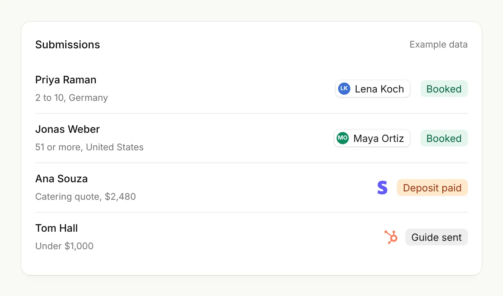
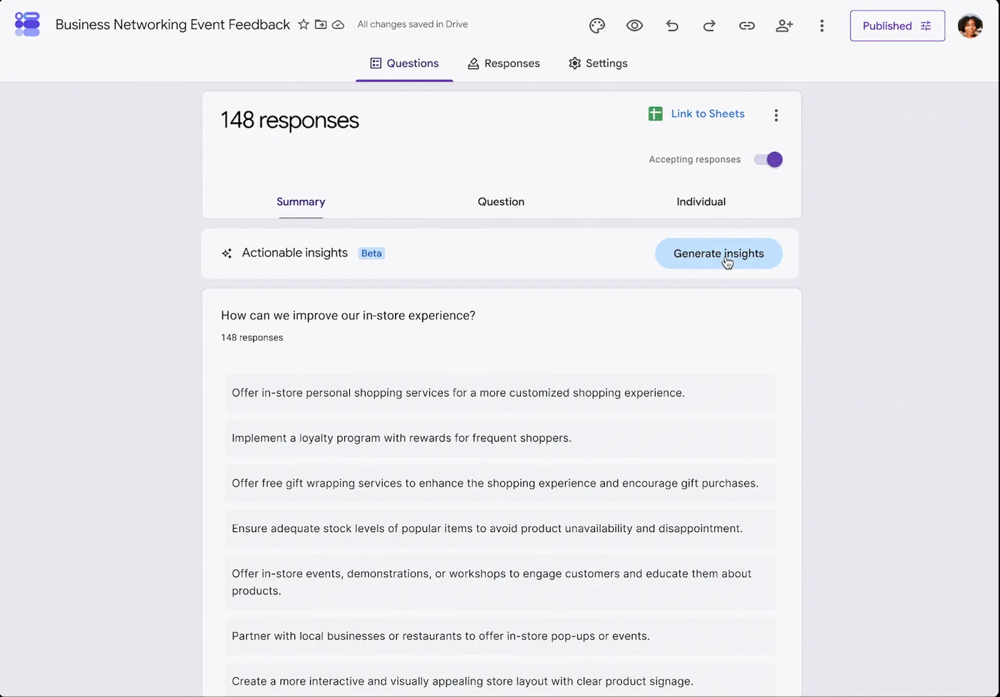
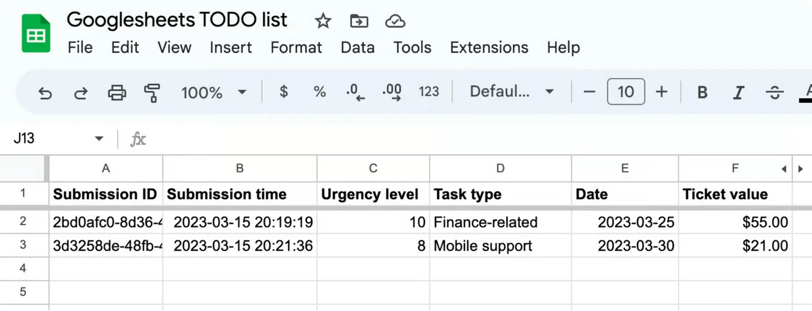
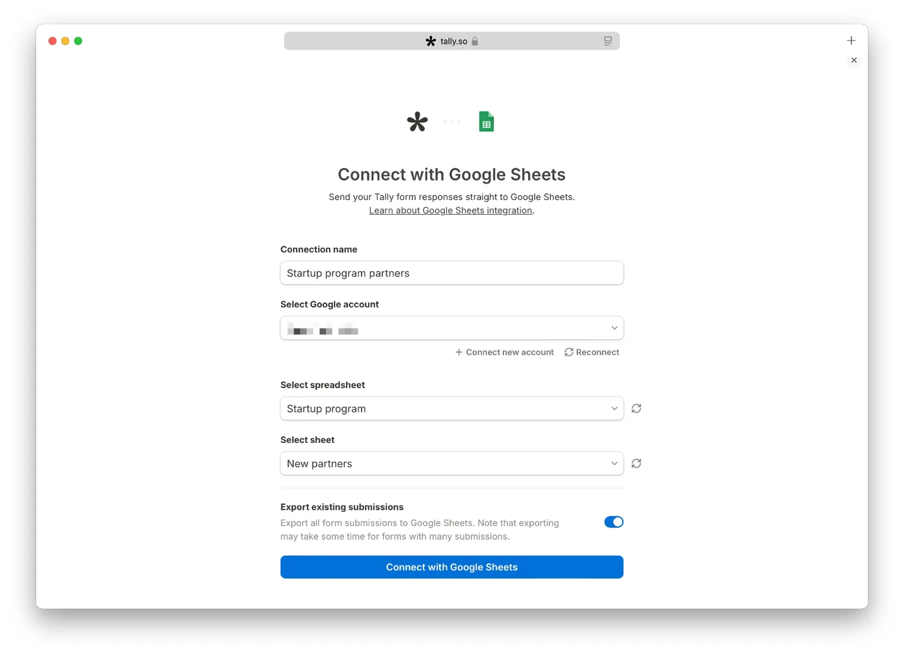
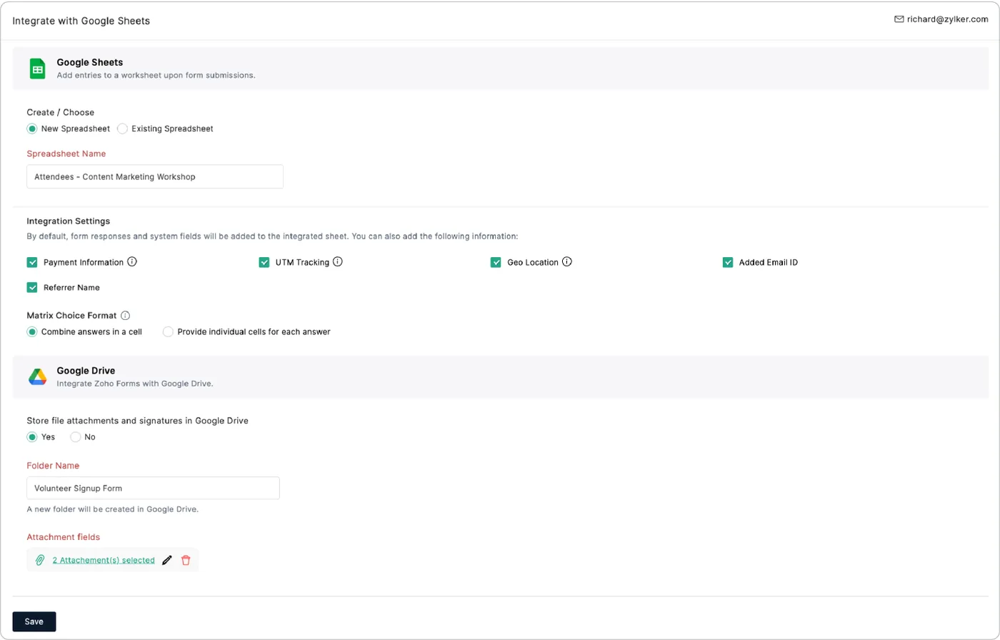

Many small teams run on a Google Sheet. Orders, sign-ups, leads and client lists all live in rows that the whole team can see. The slow part is getting answers into it: copying from emails, pasting from a form tool and fixing the column that went wrong.

A form builder for Google Sheets does that for you. Each time someone sends the form, their answers land as a new row in the sheet you pick. The right tool also keeps up when you add a question, never adds the same row twice and doesn't lose an answer when Google is slow.

> **[Try Claritia free](https://app.tryclaritia.com/signup)** to build a form that adds each answer to Google Sheets and books the meeting before the visitor leaves.

Below are 8 form builders that send answers to Google Sheets, and how to set one up in a few minutes.

## Main points

- Every tool below adds each form answer to Google Sheets as a new row, either through a linked sheet or a built-in integration.
- [Google Forms](https://www.google.com/forms/about/), [Fillout](https://www.fillout.com/), [Tally](https://tally.so/), [Jotform](https://www.jotform.com/) and [Zoho Forms](https://www.zoho.com/forms/) include Google Sheets on their free plans.
- Check three things: what happens when you add a question, whether old answers can be sent too, and whether the tool retries when a send fails.
- Top picks: [Claritia](/), [Google Forms](https://www.google.com/forms/about/), [Fillout](https://www.fillout.com/), [Tally](https://tally.so/), [Jotform](https://www.jotform.com/), [Paperform](https://paperform.co/), [Typeform](https://www.typeform.com/) and [Zoho Forms](https://www.zoho.com/forms/).
- Pick [Claritia](/) if the form should also book a meeting and send the lead to your CRM.

## What is a form builder for Google Sheets?

A form builder for Google Sheets is a form tool that sends every answer to a Google Sheet on its own. You connect your Google account once and pick a sheet. From then on, each new submission adds a row, with one column for each question.

People use them for order lists, event sign-ups, lead lists, job applications and anything else a team tracks in a spreadsheet. The sheet becomes the shared list, and the form does the typing.

Typical features include:

- A new row for each answer, in a new or existing sheet.
- One column per question, in the order you choose.
- A time stamp for each row.
- Old answers sent when you first connect.
- Files and signatures saved to Google Drive.
- Retries when a send fails.

## How to choose a form builder for Google Sheets

Most tools can add a row. These checks tell them apart:

- **The plan that includes it.** Some tools put Google Sheets on the free plan. Others make it a paid feature.
- **New questions.** Find out if a question you add later gets its own column, or if you have to map it by hand.
- **Repeat sends.** A good tool won't add the same answer twice if a send runs again.
- **Failed sends.** Check that answers are saved in the form tool first, so nothing is lost if Google is busy.
- **What else the form does.** Logic, payments and a booked meeting may matter more than the sheet.

## The 8 best form builders for Google Sheets in 2026

Prices checked November 2026.

| Tool | Best for | Free plan | Google Sheets on | Paid from |
|---|---|---|---|---|
| [Claritia](/) | Lead forms that book meetings | Yes, 250 submissions a month | Starter | $12 a seat a month, billed yearly |
| [Google Forms](https://www.google.com/forms/about/) | Quick internal forms | Free with a Google account | Every account | Comes with Google Workspace |
| [Fillout](https://www.fillout.com/) | A big free plan | Yes, 1,000 responses a month | Free plan | $15 a month, billed yearly |
| [Tally](https://tally.so/) | Free forms with no submission cap | Yes, unlimited within fair use | Free plan | $24 a month, billed monthly |
| [Jotform](https://www.jotform.com/) | Updating rows that already exist | Yes, 5 forms and 100 submissions | Free plan | $34 a month, billed yearly |
| [Paperform](https://paperform.co/) | Building a form from your sheet | Yes, 30 submissions a month | Every plan | $49 a month, billed yearly |
| [Typeform](https://www.typeform.com/) | Branded, one-question forms | Yes, 10 responses a month | Free plan | $28 a month, billed yearly |
| [Zoho Forms](https://www.zoho.com/forms/) | High volume at a low price | Yes, 3 forms and 500 submissions | Free plan | $10 a month, billed yearly |

## 1. Claritia

[Claritia](/) is a forms, scheduling and follow-up app for small B2B teams. It gets each website lead to the right rep and booked into a meeting before they leave the page.

It builds forms from a sentence or one of 840 templates, opens the right person's calendar the moment the form is sent, routes each lead by its answers, and drafts follow-up emails in your brand's voice for you to approve.

Its [Google Sheets integration](/integrations/google-sheets) adds a row for each fill on Starter. Forms that end in a meeting still add the fill, with the booking after it.

> **[Try Claritia free](https://app.tryclaritia.com/signup)** and connect Google Sheets in a few minutes on Starter.

### Key features

- **A row per fill:** Each fill adds one row to the sheet you pick, or to a new one.
- **New questions, new columns:** Add a question and the sheet gets its column on the next fill.
- **Never twice:** A send that runs again finds its row first, so nothing is added twice.
- **Never lost:** Every fill is saved in Claritia first, and the send tries again if Google Sheets is busy.
- **Clear rows:** Each row starts with when it was sent, the fill's ID and the form.
- **Booking inside the form:** The right person's calendar opens as soon as the form is sent.

*Every fill is saved in Claritia first, with who the lead booked and what happens next.*

### Pros

- **More than a sheet:** The same fill can go to HubSpot, Slack and your sheet at once.
- **Safe sync:** No lost answers and no double rows.
- **Free teammates:** People who only build forms or read answers don't need a seat.

### Cons

- **Sheets needs Starter:** On the free plan, answers go out as a CSV.
- **Newer tool:** Its marketplace is smaller, and Zapier and Make apps aren't listed yet.

### Price and plans

You can start on the free plan with no card. Paid plans are priced per seat, and a seat is a teammate people can book a meeting with.

- **Free:** $0 for 1 seat and 250 submissions a month, with CSV export.
- **Starter:** $15 a seat a month ($12 billed yearly). Adds Google Sheets, Airtable, Notion and CRMs.
- **Pro:** $39 a seat a month ($31 billed yearly). Adds routing by answer and round robin.
- **Business:** $79 a seat a month ($63 billed yearly). Adds unlimited submissions and Salesforce.

## 2. Google Forms

[Google Forms](https://www.google.com/forms/about/) is the survey and form tool in Google Workspace, made for people and teams who want to gather answers from any device with little setup. You pick question types, arrange them with drag and drop, add logic that shows questions based on earlier answers, or build quizzes that test knowledge.

Forms can be shared by email, link, or embed. Responses appear as live charts and can go to Google Sheets for closer analysis.

You link a form to a new or existing spreadsheet from the Responses tab, and Google Sheets puts the answers in a table. Form collaborators get access to a new response sheet on their own.

### Key features

- **Linked sheet:** Create a new spreadsheet or pick one you have.
- **Answers as a table:** Google Sheets formats the data for you.
- **Unlink any time:** Old data stays, and new answers stop.
- **Shared editing:** Several people can work on one form.

*The Link to Sheets button sits at the top of the Responses tab in Google Forms. Image: [Google Workspace Updates](https://workspaceupdates.googleblog.com/2026/11/get-actionable-insights-with-gemini-in-Google-Forms.html).*

### Pros

- **Free and built in:** No other account or integration to set up.
- **Fits Google Workspace:** The sheet sits in your Drive like any other file.

### Cons

- **Basic design:** Few ways to match your brand.
- **No payments or booking:** Neither is built in.

### Price and plans

- **Personal:** Free with a Google account.
- **Business:** Comes with Google Workspace. See their pricing page.

## 3. Fillout

[Fillout](https://www.fillout.com/) is a form builder for teams that want branded forms, surveys, and quizzes connected to the tools they already use. You can describe a form for its AI to build or use drag and drop, then add logic, file uploads, payments, and signatures.

It also offers scheduling forms that sync with Google Calendar or Outlook, PDF generation, workflows, login forms that let people edit past answers, custom domains, and native integrations.

Google Sheets is among the integrations on every plan, the free one too, and the free plan allows 1,000 responses a month with unlimited seats.

### Key features

- **Google Sheets on free:** Along with Airtable, Notion, HubSpot and webhooks.
- **Logic and calculations:** On the free plan.
- **Payments:** Collect payments on the free plan.
- **Unlimited seats:** On every plan.

*Each Fillout response becomes a row, starting with its submission ID and time. Image: [Fillout Help Center](https://www.fillout.com/help/google-sheets).*

### Pros

- **Big free plan:** 1,000 responses a month is a lot of rows.
- **Team friendly:** Everyone can build forms at no extra cost.

### Cons

- **Free plan branding:** Free forms show a Fillout badge.
- **Partial answers cost more:** Partial submissions are on Business.

### Price and plans

- **Free:** $0, with 1,000 responses a month.
- **Starter:** $15 a month, billed yearly.
- **Pro:** $40 a month, billed yearly.
- **Business:** $75 a month, billed yearly.

## 4. Tally

[Tally](https://tally.so/) is a form builder for individuals and teams who want to make forms by typing, much like writing in a document. You insert blocks for contact details, file uploads, ratings, signatures, and Stripe payments, then add conditional logic, calculations, hidden fields, and answer piping.

Forms can be embedded or shown as popups, and submissions can go to Notion, Slack, Airtable, or Google Sheets. Tally is hosted in Europe and does not use cookie tracking.

Its Google Sheets integration is free for all users. When you connect an existing form, it can send all past answers to the sheet, and you can move or delete columns without breaking the sync.

### Key features

- **Free Google Sheets:** A new row for each submission.
- **Past answers too:** Export existing submissions when you connect.
- **Sync log:** See each send and resend any that failed.
- **Several sheets:** Connect one form to more than one spreadsheet.

*The Export existing submissions toggle is how Tally sends past answers when you connect. Image: [Tally Help Center](https://tally.so/help/google-sheets-integration).*

### Pros

- **No submission cap:** Unlimited forms and submissions within fair use.
- **Clear help:** Tally emails you the first time a sync starts failing.

### Cons

- **Partial answers skip the sheet:** Partial submissions don't trigger the integration.
- **Times in UTC:** You add a formula to show your local time.

### Price and plans

- **Free:** $0, unlimited within fair use.
- **Pro:** $24 a month, billed monthly.
- **Business:** $74 a month, billed monthly.

Yearly billing gives two months off.

## 5. Jotform

[Jotform](https://www.jotform.com/) is a drag and drop form builder for businesses, schools, nonprofits, and public agencies that want to collect data, payments, and signatures without writing code. Forms can use conditional logic, answer piping, prefilled fields, and translations, and they accept one-time or recurring payments through many gateways.

Submissions can become PDFs, flow into CRMs and spreadsheets, and be managed in related Jotform tools for tables, approval workflows, e-signatures, and reports.

Its Google Sheets integration sends new answers to your sheet right away. Jotform also lists ways to update existing rows from a form and to add rows to a new spreadsheet.

### Key features

- **Instant rows:** New answers reach the sheet as they arrive.
- **Update rows:** Change existing data in a sheet from a form.
- **Free data integrations:** Google Sheets is among them.
- **Large template library:** Ready-made forms for most uses.

### Pros

- **More than adding rows:** Useful for stock lists or records you update.
- **Mature tool:** Templates and widgets for almost any form.

### Cons

- **Small free plan:** 5 forms and 100 submissions a month.
- **One user:** Paid plans are for a single user until Enterprise.

### Price and plans

- **Starter:** Free, with 5 forms and 100 submissions a month.
- **Bronze:** $34 a month, billed yearly.
- **Silver:** $39 a month, billed yearly.
- **Gold:** $99 a month, billed yearly.

## 6. Paperform

[Paperform](https://paperform.co/) is an online form builder for small businesses and solo operators who want one form to capture details, take payment, and start the next step. Its editor works like a document, with a one question at a time mode, conditional logic, and spreadsheet style formulas for prices and scores.

Forms can take bookings and Stripe payments, send contracts for e-signature through Papersign, and pass submissions to CRMs, email tools, and spreadsheets through integrations or Stepper workflows.

It can also start from your sheet. Type /google in a blank form, pick the spreadsheet, and Paperform turns each column heading into a question and sets up a row for each submission.

### Key features

- **Form from a sheet:** Column headings become questions.
- **Add a row:** The built-in integration adds each submission.
- **Stepper workflows:** Look up, update and format rows, on every plan.
- **Zapier and Make:** For teams that already use them.

*Typing a slash in the Paperform editor opens the menu with Import questions from Google Sheets. Image: [Paperform Help Center](https://paperform.co/help/articles/quick-integrations/).*

### Pros

- **Fastest setup:** Start from the sheet you already have.
- **Updates rows too:** A returning client can update their row through Stepper.

### Cons

- **Tiny free plan:** 30 submissions a month.
- **Sheet changes need care:** Paperform says changing a connected sheet later can push answers into the wrong columns.

### Price and plans

- **Free:** $0, with 30 submissions a month.
- **Pro:** $49 a month, billed yearly.
- **Business:** $124 a month, billed yearly.

## 7. Typeform

[Typeform](https://www.typeform.com/) is an online form builder for marketing, product, HR, and customer teams that want forms, surveys and quizzes people finish. It builds conversational forms that adapt to each answer, can draft and brand a form from a written prompt, and accepts video and audio replies.

Responses can go to tools like HubSpot, Google Sheets, and Notion, take Stripe payments, book Calendly meetings, and feed AI summaries of themes and sentiment.

Its native Google Sheets integration syncs as results come in. Typeform's free plan includes integrations, but it allows only 10 responses a month.

### Key features

- **Native Google Sheets:** Answers sync as they arrive.
- **One question at a time:** A layout people find easy to finish.
- **Logic and calculations:** On the free plan.
- **AI form creation:** Build a form from a prompt.

### Pros

- **Polished forms:** Strong design control for customer-facing forms.
- **Many integrations:** Excel Online, Notion and HubSpot too.

### Cons

- **Low response caps:** 10 a month on free and 100 on Basic.
- **Payments cost more:** Payment and file upload questions need a paid plan.

### Price and plans

- **Free:** $0, with 10 responses a month.
- **Basic:** $28 a month billed yearly ($39 monthly).
- **Plus:** $56 a month billed yearly ($79 monthly).
- **Business:** $91 a month billed yearly ($129 monthly).

## 8. Zoho Forms

[Zoho Forms](https://www.zoho.com/forms/) is an online form builder for businesses that want to collect data and move it through review and approval steps without code. It can build a form from a prompt, turn PDFs or photos of paper forms into online forms, and read business cards or IDs to fill in fields.

Forms support many field types, subforms, payments, and multi-level approvals, a mobile app collects entries offline, and data can flow into Zoho CRM.

It pushes entries to a new or existing Google Sheet and can save file uploads and signatures to Google Drive. Google Sheets is on the free plan.

### Key features

- **Sheets and Drive:** Rows in Sheets, files and signatures in Drive.
- **New or existing sheet:** Make one on the spot or use your own.
- **Approvals:** Multi-level approvals, from Standard.
- **Offline app:** Collect entries with no signal.

*One Zoho Forms screen sets the spreadsheet, the extra columns to add and the Drive folder for files. Image: [Zoho Forms User Guide](https://help.zoho.com/portal/en/kb/forms/integrations/google-sheets/articles/google-sheets-integration).*

### Pros

- **Cheap volume:** 10,000 submissions a month on the $10 Basic plan.
- **Free plan:** 500 submissions a month with Google Sheets.

### Cons

- **3 forms on free:** Enough to try, not to run a business.
- **Built around Zoho:** Its deepest ties are to Zoho apps.

### Price and plans

- **Free:** $0, with 3 forms and 500 submissions a month.
- **Basic:** $10 a month, billed yearly.
- **Standard:** $25 a month, billed yearly.
- **Professional:** $50 a month, billed yearly.

## Which form builder for Google Sheets should you pick?

- If your form should book a meeting and fill a sheet, pick [Claritia](/).
- If you need a quick internal form at no cost, pick [Google Forms](https://www.google.com/forms/about/).
- If you want a free plan with room to grow, pick [Fillout](https://www.fillout.com/) or [Tally](https://tally.so/).
- If your form should update rows that already exist, pick [Jotform](https://www.jotform.com/) or [Paperform](https://paperform.co/).
- If you send a lot of forms on a small budget, pick [Zoho Forms](https://www.zoho.com/forms/).

## How to send form answers to Google Sheets

The steps are much the same in every tool. Here they are in Claritia:

1. **Connect Google Sheets.** Go to Settings, then Integrations, and sign in with Google.
2. **Pick the sheet.** Open the form's Sync tab, add Google Sheets and pick a sheet, or make a new one. You can paste the link of a sheet you already have.
3. **Publish the form.** New fills land in the sheet as they come in.
4. **Send a test.** Fill in the form once and check the new row.

A few tips for any tool:

- Keep the connected tab for raw answers. Build charts and totals in another tab.
- Add or move columns before you connect, or check the mapping after.
- If rows stop coming in, reconnect your Google account. Paperform, for example, says the link can expire after six months or a password change.

## Questions

### What is the best form builder for Google Sheets?

For free internal forms, Google Forms is built in. For lead forms that also book meetings, Claritia sends each fill to Google Sheets from Starter. Fillout and Tally include the sync on their free plans.

### Can I connect a form to a Google Sheet I already have?

Yes. Google Forms, Claritia, Tally, Paperform and Zoho Forms all let you pick an existing spreadsheet. In Claritia, paste the sheet's link in the form's Sync tab.

### What happens when I add a new question to the form?

It depends on the tool. In Claritia, the sheet gets a new column for it on the next fill. In some other tools, you map the new question to a column by hand.

### Can I send old answers to Google Sheets?

Some tools can. Tally offers to export existing submissions when you set up the integration, so past answers show up as rows. Check your tool's help page before you rely on it.

### Is there a free form builder for Google Sheets?

Yes. Google Forms is free, and Fillout, Tally, Jotform, Zoho Forms and Typeform include Google Sheets on their free plans, each with its own response limit.

## Get started

Pick a form builder that sends each answer to your sheet and doesn't lose any. If the form is for leads, let it book the meeting too.

> **[Try Claritia free](https://app.tryclaritia.com/signup)** to build your first form and connect Google Sheets on Starter.

You can also read about the [Google Sheets integration](/integrations/google-sheets) or see all [integrations](/integrations).
