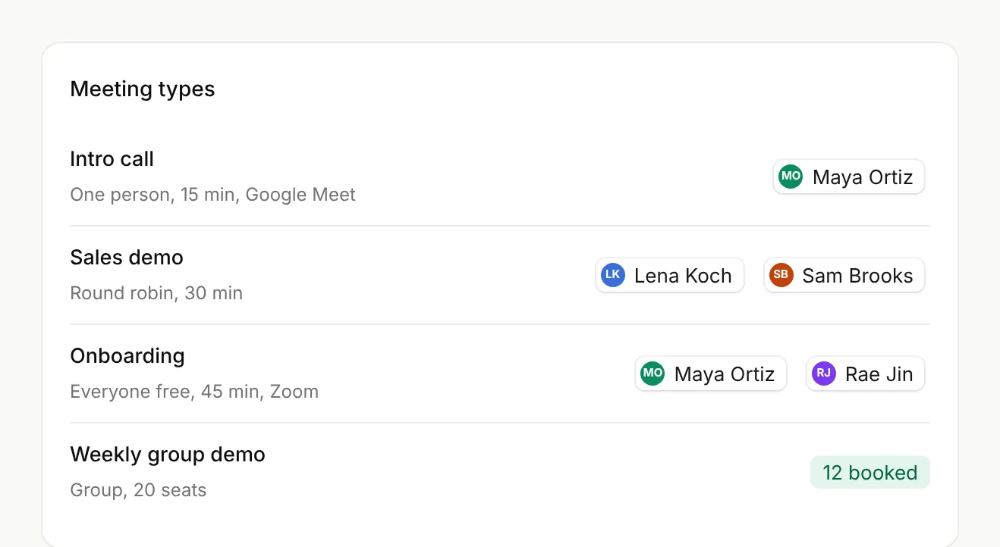
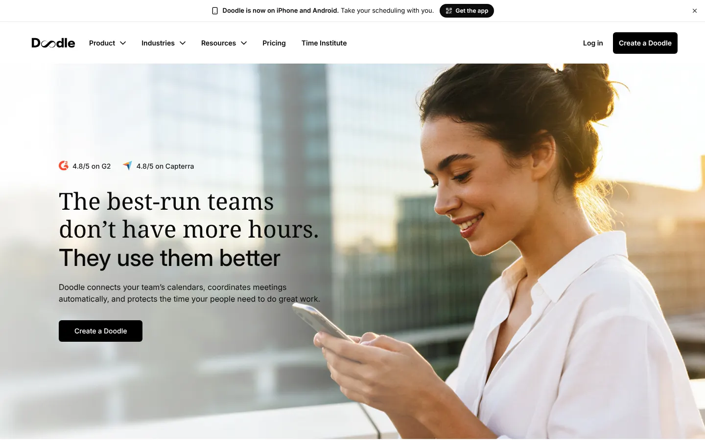
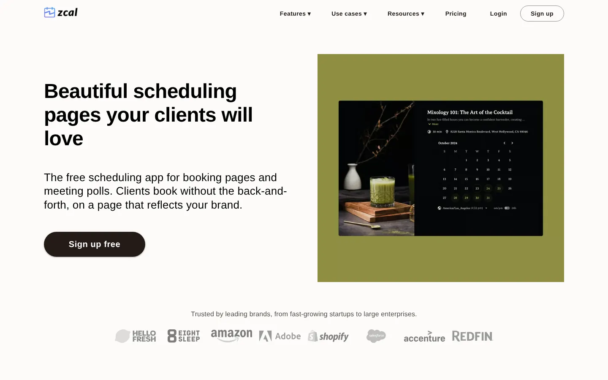
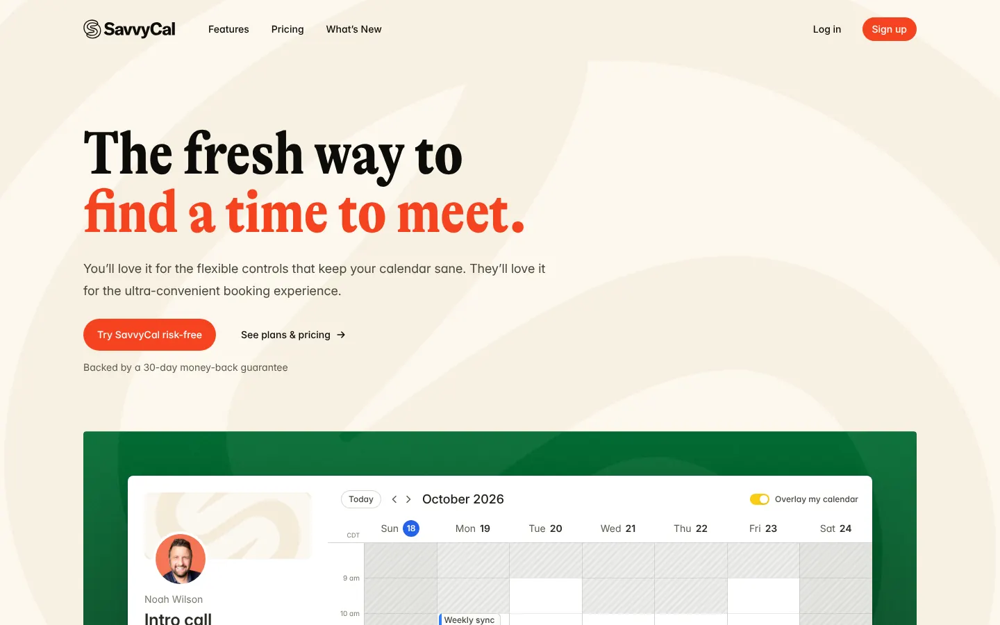
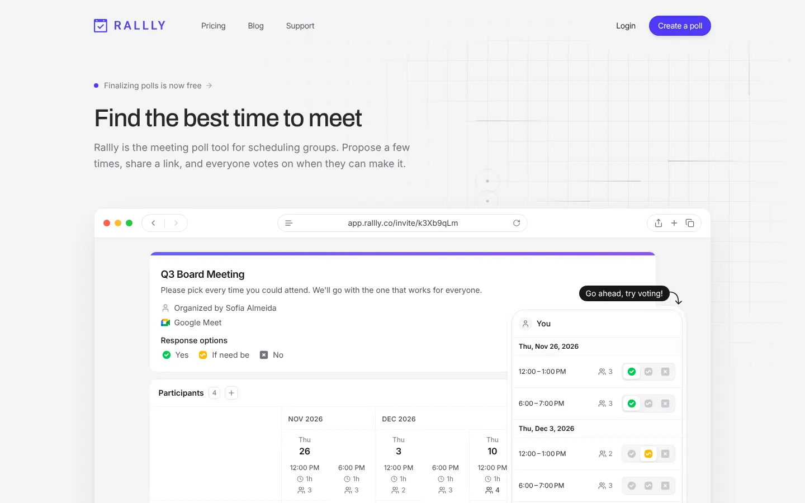
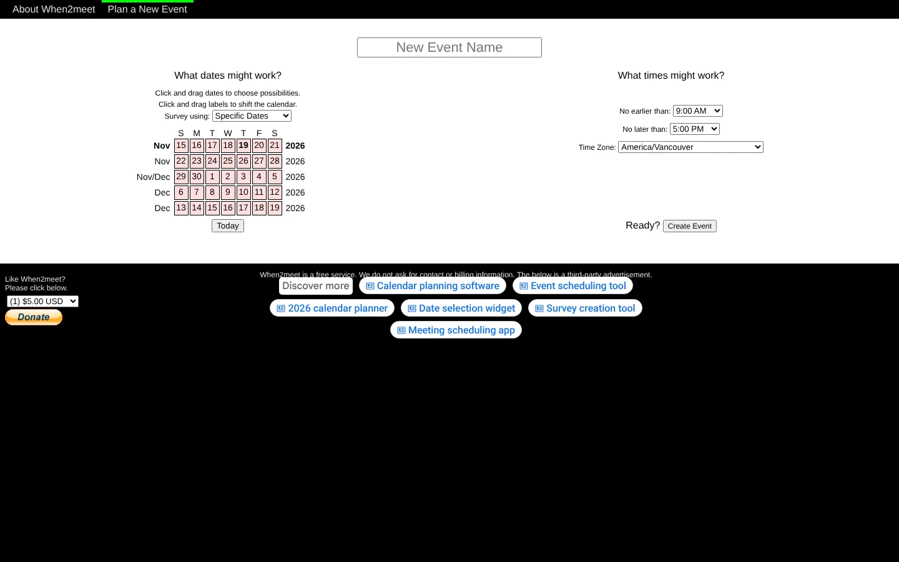

Finding a time for six people by email is slow. Someone replies to all with three options, two people answer, one suggests next week instead, and the thread runs for days. By the time you pick a slot, half the group has filled it with something else.

A group meeting scheduler fixes this in one of two ways. A meeting poll lets everyone vote on a few times, so you can see the best one at a glance. A group event lets many people book the same slot, up to a guest limit, which suits classes, demos and info sessions.

> **[Try Claritia free](https://app.tryclaritia.com/signup)** and run meeting polls and group meetings with a guest limit from your booking page on Starter.

Below, we explain how group scheduling works and how to set up a group meeting step by step. Then we compare 8 tools on polls, group events and price.

## Main points

- A group meeting scheduler does one of two jobs. A meeting poll finds one time for many people, and a group event lets many people book one slot up to a limit.
- Free meeting polls: [Zcal](https://zcal.co/), [Calendly](https://calendly.com/), [SavvyCal](https://savvycal.com/), [Rallly](https://rallly.co/) and [When2meet](https://www.when2meet.com/). [Doodle](https://doodle.com/en/) gives you one free poll.
- Group events with a limit: [Claritia](/) on Starter, [Zcal](https://zcal.co/) on free with up to 5 people per slot, Doodle sign-up sheets and [Cal.com](https://cal.com/) seats.
- Top picks: [Claritia](/), [Doodle](https://doodle.com/en/), [Zcal](https://zcal.co/), [Calendly](https://calendly.com/), [SavvyCal](https://savvycal.com/), [Rallly](https://rallly.co/), [When2meet](https://www.when2meet.com/) and [Cal.com](https://cal.com/).
- Pick [Claritia](/) if you want polls, group meetings and one-on-one booking from one page, with reminders sent for you.

## What is a group meeting scheduler?

A group meeting scheduler is a tool that helps three or more people land on one meeting time without a long email thread. It either collects votes on a few proposed times or opens one time slot that many people can book.

The two formats solve different problems:

- **Meeting polls.** You propose a few times and share one link. Everyone marks the times they can make, and you confirm the one that works for the most people. Use it for board meetings, project kickoffs or a dinner with friends.
- **Group events.** You set one time and a guest limit, and people book a seat until it's full. Use it for webinars, classes, group demos and office hours.

## How to choose a group meeting scheduler

Check these five things before you pick:

- **Which format you need.** A poll to agree on one time, a group event with a guest limit, or both.
- **What voters must do.** The best tools let people vote or book without making an account.
- **Time zones.** Each person should see the options in their own time zone.
- **What happens at the end.** Some tools send a calendar invite to everyone when you confirm. Others leave that to you.
- **The free cap.** One poll, three open polls, or 5 people per slot. Find the limit you'll hit first.

## How to schedule a group meeting

The steps depend on the format. For a meeting poll:

1. **Pick 3 to 5 times.** Fewer options make the vote faster. Microsoft suggests 3 to 5 for Outlook's Scheduling Poll.
2. **Add the details.** A title, a short agenda, and the place or video link.
3. **Share one link.** Send it by email, Slack or chat. Most tools don't ask voters to sign up.
4. **Set a deadline.** Tools like Doodle can send reminders to people who haven't voted yet.
5. **Confirm the time.** Pick the option with the most yes votes and send the calendar invite.

For a group event with a guest limit:

1. **Create the event.** Set the length, the time and the location.
2. **Set the guest limit.** Pick how many people can book each slot.
3. **Turn on reminders.** A reminder before the event cuts no-shows.
4. **Share the link.** Each person books a seat until the slot is full.

## The 8 best group meeting schedulers in 2026

Prices checked November 2026.

| Tool | Best for | Meeting polls | Group events with a limit | Paid from |
|---|---|---|---|---|
| [Claritia](/) | Polls, group meetings and one-on-one booking in one place | Starter | Starter | $12 a seat a month, billed yearly |
| [Doodle](https://doodle.com/en/) | A poll and a sign-up sheet on one free account | 1 on free | 1 sign-up sheet on free | See their pricing page |
| [Zcal](https://zcal.co/) | The most group features for free | Free | Up to 5 per slot on free | $7 a user a month, billed yearly |
| [Calendly](https://calendly.com/) | Polls next to a familiar booking link | Free | Standard | $10 a seat a month, billed yearly |
| [SavvyCal](https://savvycal.com/) | Free polls, with booking on paid plans | Free | Group mode on Basic | $10 a user a month, billed yearly |
| [Rallly](https://rallly.co/) | Simple polls with no sign-up | Free, up to 3 open | No | $6 a seat a month, billed yearly |
| [When2meet](https://www.when2meet.com/) | A quick free availability grid | Free | No | Free, funded by donations |
| [Cal.com](https://cal.com/) | Seats on a free booking link | Not on its plan list | Seats on free | $12 a user a month, billed yearly |

## 1. Claritia

[Claritia](/) is a forms, scheduling and follow-up app built for small B2B teams that want every lead from their website to reach the right rep and book a meeting before they leave the page.

It builds forms from a sentence or one of 840 templates, opens the right person's calendar the moment the form is sent, routes each lead by its answers, and drafts follow-up emails in your brand's voice for you to approve.

For groups, Starter adds meeting polls and group meetings with a guest limit, next to your one-on-one meeting types. Pro adds meetings with everyone free, for calls where every host must attend. Times show in each visitor's own time zone and language on every plan.

> **[Try Claritia free](https://app.tryclaritia.com/signup)** and set up your first group meeting on Starter.

### Key features

- **Meeting polls:** On Starter, on the same account as your booking pages.
- **Group meetings:** One slot with a guest limit, on Starter.
- **Meetings with everyone free:** Only times when every chosen host is free, on Pro.

*In Claritia, a group demo with 20 seats sits next to one-on-one and everyone-free meeting types.*

### Pros

- **All formats in one place:** Polls, group meetings and one-on-one booking share one calendar setup.
- **Booking inside forms:** Ask your questions first, then open the calendar.
- **Free teammates:** People who only build forms or read answers never need a seat.

### Cons

- **No polls on free:** Meeting polls and group meetings start on Starter.
- **Newer tool:** Its marketplace is smaller, and Zapier and Make apps aren't listed yet.

### Price and plans

You can start on the free plan with no card. Paid plans are priced per seat, and a seat is a teammate people can book a meeting with.

- **Free:** $0 for 1 seat, with 1 meeting type on 1 calendar.
- **Starter:** $15 a seat a month ($12 billed yearly). Adds meeting polls, group meetings with a guest limit and single-use links.
- **Pro:** $39 a seat a month ($31 billed yearly). Adds meetings with everyone free and round robin.
- **Business:** $79 a seat a month ($63 billed yearly). Adds owner first and unlimited submissions.

## 2. Doodle

[Doodle](https://doodle.com/en/) is a scheduling tool for people and teams who need to find a time with a group or let others book them from a link. Its group polls let you offer a few times, collect votes from anyone without a Doodle account, and send calendar invites when you confirm.

It also offers booking pages, one-to-one links and sign-up sheets, and it reads Outlook, Google and Apple calendars. For groups, it has both formats: group polls to agree on a time, and sign-up sheets with a cap on how many people join each session.

### Key features

- **Group polls:** See who has replied, then confirm the winner and send invites to everyone who answered.
- **Sign-up sheets:** Set a limit on attendees per session, so no session overfills.
- **Time zones:** Doodle says everyone sees poll times in their own time zone.

### Pros

- **Both formats:** Polls and sign-up sheets in one account.
- **No account for guests:** Voters and attendees only need the link.

### Cons

- **One of each on free:** One group poll and one sign-up sheet.
- **Paid extras:** Deadlines, reminders and polls with more than 20 time slots need a paid plan, and the free plan shows ads.

### Price and plans

- **Free:** $0, with one group poll, booking page, 1:1 link and sign-up sheet.
- **Pro:** Priced per seat, for one person. Adds unlimited polls and sheets, deadlines and reminders.
- **Team:** Priced per seat, for two or more people. Adds co-hosts, an admin console and custom branding.
- **Enterprise:** From USD 15,000 a year.

Doodle's pricing page didn't show Pro and Team prices when we checked.

## 3. Zcal

[Zcal](https://zcal.co/) is a scheduling app for individuals, teams, and class hosts who want booking pages and meeting polls in one place. Booking pages can carry custom fonts, colors, layouts, welcome videos, and custom questions, and they sync with Google, Outlook, and Apple calendars.

Teams can use round robin and collective events, while group events, sign-up sheets, and polls handle classes and groups. It sends confirmations and reminders and connects to Zoom, Stripe, and Zapier.

Its free plan covers both group formats: unlimited meeting polls, and group events with up to 5 people per time slot. Paid plans remove the guest cap.

### Key features

- **Meeting polls:** Unlimited, on the free plan.
- **Group events:** Up to 5 people per slot on free, and no limit on Pro or Business.
- **Collective events:** Meetings where every chosen teammate is free, on Pro.

### Pros

- **Most group features at $0:** Polls and group events on one free plan.
- **Cheap next step:** Pro is $7 a user a month, billed yearly.

### Cons

- **Small groups on free:** Five people per slot won't fit a webinar.
- **Branding stays:** Removing Zcal branding needs Pro.

### Price and plans

- **Free:** $0 for one person.
- **Pro:** $7 a user a month, billed yearly. Removes the group event cap and adds teams.
- **Business:** $12 a user a month, billed yearly.

Both paid plans come with a 14-day free trial.

## 4. Calendly

[Calendly](https://calendly.com/) is scheduling software for professionals and teams who want people to book meetings without trading emails. You connect your calendars, set hours, buffers, and daily limits, and share booking links for one-on-one, multi-host, or group meetings.

It sends email and text reminders, offers routing forms that send website leads to the right teammate, and collects payments. Newer tools include an AI assistant that finds times over email and a notetaker that writes meeting recaps.

Meeting polls and one-off meetings are on every plan, Free included. Group and collective meeting types, which let many people book one slot or need several hosts, start on Standard.

### Key features

- **Meeting polls:** On the free plan, to settle one time with a group.
- **One-off meetings:** A one-time link for a single meeting, on free.
- **Multi-person meeting types:** Group and collective types from Standard.

### Pros

- **Free polls:** No paid plan needed to run a vote.
- **Grows with you:** Group events and reminders are one upgrade away.

### Cons

- **No group events on free:** Multi-person meeting types need Standard.
- **No reminders on free:** Automations and reminders need Standard.

### Price and plans

- **Free:** $0, with one event type and meeting polls.
- **Standard:** $10 a seat a month, billed yearly.
- **Teams:** $16 a seat a month, billed yearly.
- **Enterprise:** From $15,000 a year.

## 5. SavvyCal

[SavvyCal](https://savvycal.com/) is a scheduling tool for professionals and teams who want booking links that feel easy for both the host and the guest. Guests see a full week of open times and can lay their own calendar over the link to spot a match.

Hosts set buffers, limits, preferred times, and time blocks, put links on their own domain, and take Stripe payments. It also supports round robin, collective, and group links, meeting polls, and reminder workflows.

SavvyCal lets you use meeting polls for free. Letting people book from your links needs Basic or Premium, and Basic includes unlimited polls and group mode.

### Key features

- **Meeting polls:** Free to use, and unlimited on paid plans.
- **Group mode:** Group links on Basic.
- **Calendar overlay:** Guests can lay their own calendar over your link for free.

### Pros

- **Free polls:** You can run group votes without paying.
- **Kind to guests:** The calendar overlay helps people spot a time that suits them too.

### Cons

- **No booking on free:** People can book from your links only on a paid plan.
- **No trial:** SavvyCal offers a 30-day money-back guarantee instead.

### Price and plans

- **Free:** Set up links and use meeting polls.
- **Basic:** $10 a user a month billed yearly ($12 monthly).
- **Premium:** $17 a user a month billed yearly ($20 monthly). Adds custom domains, no branding and Stripe payments.

## 6. Rallly

[Rallly](https://rallly.co/) is an open-source meeting poll tool for groups that want to agree on one time without a long email thread. You propose a few times, share a link, and everyone marks the times they can make, with no account needed to create a poll or vote.

Each person sees the options in their own time zone. When you pick a time, Rallly emails a calendar invite to everyone. Voters can answer yes, no or if need be, which helps when no time suits everyone.

### Key features

- **No sign-up:** Create a poll and vote without an account.
- **Unlimited participants:** No cap on who can vote, even on free.
- **Calendar invites:** Finalize the poll and everyone gets an invite by email.

### Pros

- **Fast to set up:** Rallly says a poll takes less than a minute.
- **No ads:** Rallly says it doesn't show ads or sell your data.

### Cons

- **Polls only:** No group events or booking pages.
- **Three open polls on free:** Finalize or close one to open another.

### Price and plans

- **Hobby:** Free, with up to 3 open polls and 30 days of poll retention.
- **Pro:** $6 a seat a month, billed yearly. Adds unlimited open polls, custom branding and the option to hide votes.

## 7. When2meet

[When2meet](https://www.when2meet.com/) is a free survey tool for groups that want to see when everyone is available. You name the event, drag across the dates or days of the week that might work, and set the earliest time, the latest time and a time zone.

Then you share the link, and each person marks when they're free, so you can see where the group overlaps. It doesn't ask for contact or billing details, and it runs on donations and third-party ads.

### Key features

- **Dates or weekdays:** Survey specific dates, or days of the week for a meeting that repeats.
- **Time range:** Limit the grid to the hours you'd consider.
- **Time zone:** Set the zone for the event when you create it.

### Pros

- **Free with no catch:** No plans, no sign-up and no limits listed.
- **Good for repeating meetings:** The weekday mode suits a weekly class or club.

### Cons

- **Ads on the page:** Third-party ads appear below the planner.
- **Few extras:** There's little to set up beyond dates, hours and a time zone.

### Price and plans

When2meet is free. You can donate from its home page if you like it.

## 8. Cal.com

[Cal.com](https://cal.com/) is scheduling software for individuals and companies that want booking links they can shape around their own process. It syncs calendars, detects time zones, sends reminders, and runs video calls through Zoom, Google Meet, Microsoft Teams, or its own Cal Video.

Teams can use round robin, collective events where every host must be free, routing forms, and workflows, plus admin tools such as SAML SSO and audit logs. Its source code is published on GitHub.

For groups, its free plan lets you offer seats, so several people book the same time slot. Collective events and dynamic group links need Teams.

### Key features

- **Seats:** Several people book one slot, on the free plan.
- **Automatic time zones:** Each booker sees times in their own zone.
- **Collective events:** Every chosen host must be free, on Teams.

### Pros

- **Group sessions at $0:** Seats work on the free plan.
- **Open code:** You can host it yourself.

### Cons

- **No polls on its plan list:** Its pricing page lists no meeting polls, so pair it with a poll tool.
- **One user on free:** Team features need Teams.

### Price and plans

- **Free:** $0 for one user.
- **Teams:** $12 a user a month, billed yearly.
- **Organizations:** $28 a user a month, billed yearly.

## Which group meeting scheduler should you pick?

- If you want polls, group meetings and one-on-one booking from one page, pick [Claritia](/).
- If you want the most group features for free, pick [Zcal](https://zcal.co/).
- If you only need a quick vote with no sign-up, pick [Rallly](https://rallly.co/) or [When2meet](https://www.when2meet.com/).
- If you already use [Calendly](https://calendly.com/) for one-on-one calls, use its free meeting polls.
- If you run classes or sessions with a cap, pick a tool with group events, like [Claritia](/), [Zcal](https://zcal.co/) or [Doodle](https://doodle.com/en/) sign-up sheets.

## Questions

### What is the best free group meeting scheduler?

For polls, Zcal, Calendly, SavvyCal, Rallly and When2meet are all free. Zcal also gives free group events with up to 5 people per slot. For group meetings with a larger guest limit, Claritia's Starter plan costs $12 a seat a month billed yearly.

### How do I find a time that works for everyone?

Send a meeting poll with 3 to 5 options. Each person marks the times they can make, and you confirm the one with the most yes votes. Then send one calendar invite to the whole group.

### What's the difference between a meeting poll and a group event?

A poll finds one time that suits a set group of people. A group event fixes the time first, and anyone with the link books a seat until the guest limit is reached.

### Can I schedule a group meeting in Outlook?

Yes. Outlook's Scheduling Poll, in the new Outlook and Outlook on the web for work accounts, suggests times from everyone's free and busy times. Our [Teams meeting scheduler guide](/blog/microsoft-teams-meeting-scheduler) shows the steps.

### How do group polls handle time zones?

Doodle and Rallly show poll times in each person's own time zone. When2meet asks you to set a time zone for the event. Our guide on how to [schedule meetings across time zones](/blog/schedule-meetings-across-time-zones) has more tips.

## Get started

Decide first whether you need a poll or a group event, then pick the tool with the right free cap. If you want both next to your one-on-one booking, you can set them up in one place.

> **[Try Claritia free](https://app.tryclaritia.com/signup)** and add meeting polls and group meetings with a guest limit when you move to Starter.

You can also compare [free meeting schedulers](/blog/best-free-meeting-scheduler) or see how [Claritia Meetings](/products/meetings) works.
