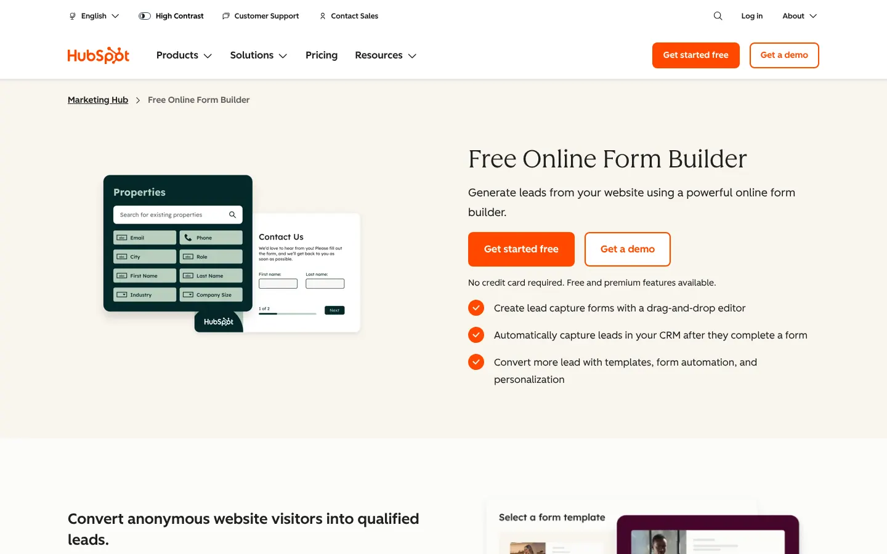
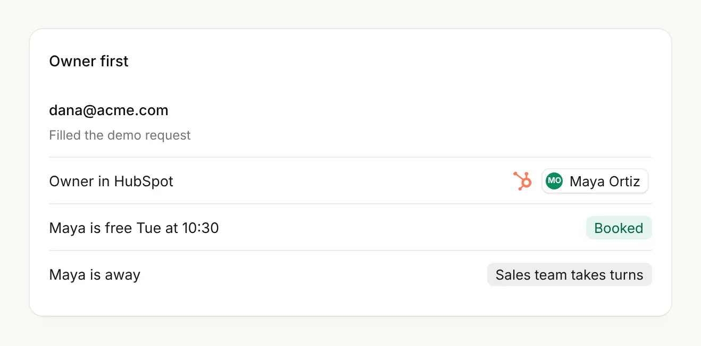

You want a form on your website that puts every lead straight into HubSpot. HubSpot has a form builder for that, and you can start for free. Then the questions pile up. Where is the embed code? Why are submissions landing in spam? Why is the logic button locked?

Most of the answers come down to two things: where a setting lives in the form editor, and which HubSpot plan it needs. Once you know both, a working HubSpot web form takes about as long as writing its questions.

> **[Try Claritia free](https://app.tryclaritia.com/signup)** to build a form with free conditional logic that sends each lead to HubSpot and books the meeting on the same page.

In this post, you'll create a HubSpot form step by step, embed it on your site, add a pop-up, and see what each HubSpot plan includes for forms.

## Main points

- HubSpot forms are free to build on every plan, and each submission creates or updates a contact in your HubSpot CRM.
- Multi-step forms and form styling need a Starter plan. Conditional logic needs Marketing Hub or Content Hub Professional, which starts at $800 a month billed yearly.
- To embed a HubSpot form, publish it, copy the embed code, and add your site's domain in HubSpot's tracking settings, or submissions get marked as spam.
- Pop-up forms are built with HubSpot's CTA tool, which needs Marketing Hub or Content Hub Starter.
- If you need logic or booking without a bigger plan, form builders like [Claritia](/) and [Fillout](https://www.fillout.com/) still send leads to HubSpot.

## What is a HubSpot form?

A HubSpot form is a form you build in HubSpot's Marketing Hub that saves each answer to your HubSpot CRM. Each field connects to a contact or company property, so a submission creates or updates a record. You can place it on HubSpot pages, embed it on any website, or share it as a standalone page.

[HubSpot forms](https://www.hubspot.com/products/marketing/forms) is the form builder in HubSpot's Marketing Hub for marketers who want website visitors to become CRM contacts automatically. Users build forms in a drag-and-drop editor or from templates for newsletter signups, downloads, event registration and more, then embed them on a site or publish them as standalone pages.

Each submission is saved to the contact database, can trigger a follow-up email or nurture campaign, and feeds reports on views, submissions and conversion rate.

## What you need

- **A HubSpot account.** The free plan is enough to build and embed a form. HubSpot's pricing page lists it as free for up to 2 users.
- **Edit forms permission.** HubSpot requires it to create or edit forms.
- **Access to your website.** You'll paste an embed code into a page, or use HubSpot's WordPress plugin.
- **The HubSpot tracking code** on that site, if you want form analytics or pop-ups on pages outside HubSpot.

### What each HubSpot plan includes for forms

HubSpot doesn't list form features on its pricing page, so this table comes from its knowledge base articles on creating, styling and embedding forms. Prices are from HubSpot's Marketing Hub pricing page. Prices checked November 2026.

| Plan | Price | What it adds for forms |
|---|---|---|
| Free | $0, for up to 2 users | Forms, fields tied to CRM properties, hidden fields, thank-you message or redirect, embed code and share link |
| Starter | $7 a seat a month billed yearly, or $10 billed monthly, as a new-customer offer (listed at $20) | Multi-step forms with up to 20 steps, a progress bar, form styling, and pop-ups through the CTA tool |
| Professional | $800 a month billed yearly, or $890 monthly on a yearly commitment, with 3 core seats | Conditional logic, CSS through the form developer code, AI form translation, and links to marketing campaigns |
| Enterprise | $3,600 a month, with 5 core seats | Everything in Professional, with more seats, marketing contacts and HubSpot Credits |

A few notes on the table:

- **Onboarding fees.** Professional has a required one-time onboarding fee of $3,000, and Enterprise has one of $7,000.
- **Hubs matter.** Styling works on Marketing Hub, Content Hub or Service Hub Starter. Conditional logic needs Marketing Hub or Content Hub Professional.
- **Meeting redirects.** Sending someone to a scheduling page with conditional logic needs Sales Hub or Service Hub Enterprise.
- **Follow-up emails.** HubSpot's forms FAQ says Professional and Enterprise accounts can use workflows to send an email after a submission.

## Step 1: Create the form

1. In HubSpot, go to **Marketing**, then **Forms**. On some accounts, it sits under **More** first.
2. Click **Create form** in the top right.
3. Select the **Form Editor**, then click **Next**.
4. Pick a template and click **Use template**, or choose **Start from blank**.

If your account has more than one brand, you can pick the brand the form belongs to from your profile menu before you start.

## Step 2: Add fields and connect them to properties

Click the **+** icon in the top left, open **Fields**, and drag a field type onto the form. In the **Edit field** panel, connect it to an existing property, or click **Create new property** to make one.

The property decides where the answer is stored. A field tied to the company name property, for example, can create or update a company and link it to the contact.

A few things to know:

- **Email is required by default.** HubSpot needs it to create a contact, and it checks the address is valid before the form sends.
- **Hidden fields** pass a value you set without showing the field, which helps for things like a lead source. A required field can't be hidden.
- **Not every property type works.** Calculation, rollup, rich text, URL and date and time picker properties aren't supported in forms.
- **Phone fields show a country code** based on the visitor's location. You can't hide it on the default phone property.

## Step 3: Add steps and logic

On a Starter, Professional or Enterprise plan, you can split a long form into steps. Hover between two steps in the editor and click the **+** icon. A form can have up to 20 steps, and Marketing Hub Starter adds an optional progress bar.

Conditional logic needs Marketing Hub or Content Hub Professional or Enterprise. Click the logic icon, then **Add logic**, and build a rule: if a field matches a value, then show or hide fields, show or hide steps, or redirect the visitor. Each form can hold up to 200 rules with 10 conditions each.

If you're on Free or Starter and need logic, this is the step where many teams look at another form tool. More on that below, or see our guide to [multi-step forms](/blog/multi-step-form).

## Step 4: Style the form

Styling needs Marketing Hub, Content Hub or Service Hub Starter or higher. Click the styling icon on the left. You can change fields, buttons, body text, headings, the background and the progress bar, or pick a quick style.

Styles apply to all steps at once. If you need full control with your own CSS, the form developer code is on Marketing Hub or Content Hub Professional. The new editor doesn't offer raw HTML forms.

## Step 5: Choose what happens after submit

Click the contents icon, then **On submit**. You have two options:

- **Show a thank-you message**, which you can edit in the panel.
- **Redirect** to a HubSpot page, a URL, a meeting link or a payment link.

To send a new lead to a booking page, pick a meeting link here. Choosing a different page for each answer needs conditional logic, and a redirect to a scheduling page by answer needs Sales Hub or Service Hub Enterprise.

## Step 6: Set notifications and contact settings

Click the settings icon to open the form's settings. The ones most teams change:

- **Notify contact owner.** Sends an alert to the contact's owner. If the contact has no owner, no alert goes out.
- **Add users to notify.** Pick people or teams who get every submission.
- **Email domains to block.** Block a domain, or switch on **Block free email providers** for B2B forms.
- **Lifecycle stage.** Set the stage for new and existing records. HubSpot won't move a record's stage backwards.
- **Create new contacts from unknown email addresses.** Stops HubSpot from matching a submission to a returning visitor's cookie.

If you want each lead to get an owner automatically, our guide to [HubSpot lead routing](/blog/hubspot-lead-routing) walks through the workflow.

## Step 7: Preview and publish

Click **Preview** in the top right to test the form on desktop, tablet and phone. You can step through pages and logic, but preview mode doesn't send submissions.

When it looks right, click **Review and update**, then **Update** at the bottom of the right panel. The form is now live, and HubSpot offers three ways to share it.

## Step 8: Embed the form on your site

After you publish, choose one of these:

- **Embed with HubSpot:** Pick a HubSpot website page, landing page or CTA to place the form on.
- **Get embed code:** Copy the code and paste it into an HTML block on your own site.
- **Copy a share link:** Send people to the form on its own page. The link can't be edited, and anyone with it can open the form.

Before you embed on an outside site, add that site's domain to your HubSpot tracking settings. HubSpot marks submissions from domains it doesn't know as spam. Install the HubSpot tracking code on the page too, or you won't see analytics for the form.

On WordPress, HubSpot's WordPress plugin handles the tracking code and can insert forms for you. Changes you make to the form in HubSpot show up on your site on their own.

## Step 9: Add a pop-up form

In HubSpot, pop-up forms are built with the CTA tool. It needs Marketing Hub or Content Hub Starter or higher.

1. Go to **Marketing**, then **CTAs**, and click **Create**.
2. Open the **Pop-ups** tab and pick a type: a banner fixed to the page, a pop-up box on a schedule, or a slide-in from the corner.
3. Choose a template, then drag in a **Form (New Editor)** module and pick your form. One CTA holds one form, and it can't hold a meeting module too.
4. Turn on **Close after submission** in the form module if the pop-up should close once someone sends it.
5. Set where and when it shows, then publish.

For pop-ups on pages outside HubSpot, the tracking code or the WordPress plugin must be installed.

## Common problems

- **Submissions land in spam.** The site's domain isn't in your tracking settings. Add it and test again.
- **No analytics on an embedded form.** The HubSpot tracking code isn't on the page.
- **The logic or styling options are locked.** Logic needs Marketing Hub or Content Hub Professional, and styling needs a Starter plan.
- **Owners get no alert.** Notify contact owner only works when the contact already has an owner.
- **You want a submission cap.** HubSpot can't limit how many times a form is sent. You'd have to watch the count and unpublish it.
- **You want the form inside an email.** HubSpot doesn't support forms in emails. Link to a page with the form, or use a CTA.
- **Your own HTML form isn't syncing.** HubSpot's non-HubSpot forms tool only collects plain HTML forms with an email field. It skips forms in iframes or single-page apps, and it ignores hidden fields.
- **The validation text is wrong.** HubSpot doesn't let you edit messages like "Please complete this mandatory field" in the form tool. A developer has to change it with a script.

## When another form builder fits better

HubSpot's own forms are a good fit when you're already paying for Marketing Hub Professional, or when a short contact form is all you need. If you want logic, booking or more design on a smaller plan, these tools still send each lead to HubSpot.

### Claritia

[Claritia](/) is a forms, scheduling and follow-up app built for small B2B teams that want every lead from their website to reach the right rep and book a meeting before they leave the page.

It builds forms from a sentence or one of 840 templates, opens the right person's calendar the moment the form is sent, routes each lead by its answers, and drafts follow-up emails in your brand's voice for you to approve.

Conditional logic, multi-page forms with a progress bar, hidden fields for UTM tags, and popup embeds are on every plan, free included. The [HubSpot integration](/integrations/hubspot) starts on Starter at $15 a seat a month ($12 billed yearly):

- **Contacts without duplicates:** Each fill creates a HubSpot contact or updates the one with that email.
- **Field mapping:** Match each question to a HubSpot property, like company or job title.
- **Owners:** Use the person Claritia's routing picks, or let HubSpot's own rules decide.
- **Timeline:** Each fill shows on the contact's timeline in HubSpot.
- **Keep your HubSpot forms:** Claritia can hear your HubSpot form send and open the right calendar on the same page.

On Business, at $79 a seat a month ($63 billed yearly), a lead HubSpot already knows books with their contact owner first.

*With owner first, a lead Maya owns in HubSpot books with Maya, and the sales team takes turns when she's away.*

Claritia is a newer tool with a smaller marketplace, and its Zapier and Make apps aren't listed yet.

### Fillout

[Fillout](https://www.fillout.com/) is a form builder for teams that want branded forms, surveys, and quizzes connected to the tools they already use. You can describe a form for its AI to build or use drag and drop, then add logic, file uploads, payments, and signatures.

It also offers scheduling forms that sync with Google Calendar or Outlook, PDF generation, workflows, login forms that let people edit past answers, custom domains, and native integrations.

Its pricing page lists HubSpot among the integrations included on the free plan, which gives you 1,000 responses a month. Paid plans start at $15 a month billed yearly.

For six more options with prices and how each one connects, see our list of the [best HubSpot Forms alternatives](/blog/best-hubspot-forms-alternatives).

## Questions

### Are HubSpot forms free?

Yes. You can create, embed and share HubSpot forms on the free plan, and each submission goes to your CRM. Multi-step forms and styling need a Starter plan, and conditional logic needs Marketing Hub or Content Hub Professional.

### How do I create a form in HubSpot?

Go to Marketing, then Forms, and click Create form. Pick the Form Editor, start from a template or a blank form, add fields tied to properties, then click Review and update to publish.

### How do I embed a HubSpot form on my website?

Publish the form, choose Get embed code, and paste the code into an HTML block on your page. Add your site's domain to HubSpot's tracking settings first, or submissions are marked as spam.

### Can I make a pop-up form in HubSpot?

Yes, with the CTA tool on Marketing Hub or Content Hub Starter or higher. Create a pop-up box, banner or slide-in CTA, and add a Form (New Editor) module with your form.

### Do HubSpot forms have conditional logic?

Yes, on Marketing Hub or Content Hub Professional or Enterprise. You can show or hide fields and steps, or redirect visitors, with up to 200 rules per form.

### Can I use another form builder with HubSpot?

Yes. Claritia sends each fill to HubSpot as a contact on Starter, with conditional logic on every plan. Fillout includes HubSpot on its free plan.

## Get started

Build your first HubSpot form on the free plan, embed it, and check that a test entry reaches your CRM. If you need logic or a booked meeting right after the form, try a builder that keeps HubSpot as your CRM.

> **[Try Claritia free](https://app.tryclaritia.com/signup)** to build a form, connect HubSpot and book your first meeting today.

You can also read about the [HubSpot integration](/integrations/hubspot) or browse free [form templates](/templates).
