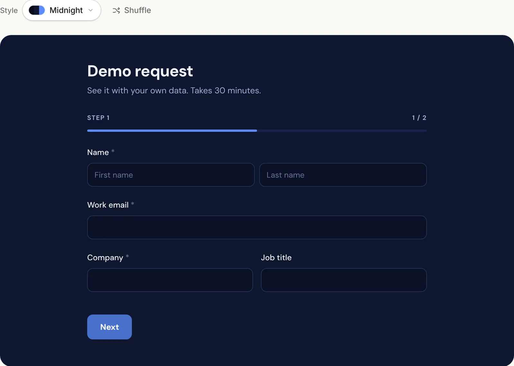
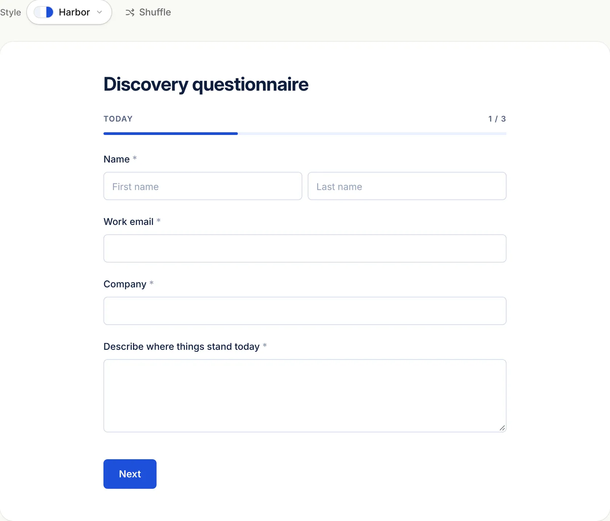
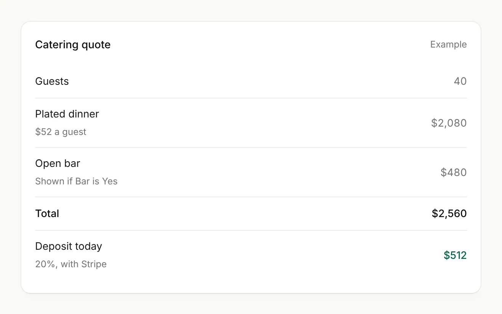

Every lead capture form has the same job: turn a visitor into someone you can follow up with. But a demo request and a newsletter signup are very different asks. Use the same fields on both, and one of them will feel too long or too thin.

The fix is to match each form to the offer. Ask only what you need for the next step, keep the campaign data, and give the lead something to do the moment they submit. The examples below show what that looks like for the forms most small teams use.

> **[Try Claritia free](https://app.tryclaritia.com/signup)** to start from a ready-made lead capture form and book the meeting right after submit.

Below are 10 lead capture form examples, with the fields each one should ask, why each field is there, and a free template to start from.

## Main points

- A good lead capture form asks only what you need for the next step. A newsletter needs an email. A quote needs scope and timing.
- High-intent forms, like demo requests, quotes and consultations, can ask more because the lead wants something specific.
- Low-intent forms, like newsletters and content downloads, should ask two or three fields at most.
- Every form should keep the campaign source in hidden fields and end with a clear next step, such as a booked call or the file.
- Each example below links to free templates you can use in [Claritia](/), with logic, hidden fields and booking on the free plan.

## What is a lead capture form?

A lead capture form is a web form that collects a visitor's contact details and a few answers in return for something they want, like a demo, a quote or a guide. The answers become a lead your team can follow up with.

For the full picture of how lead capture works, with popups, chat and landing pages, read our guide on [what lead capture is](/blog/what-is-lead-capture). This post sticks to the forms themselves.

## What every lead capture form needs

Before the examples, here are the parts that belong on almost every form:

- **Name and email.** The minimum to follow up. Use a work email field on B2B forms.
- **One to three questions that shape the next step.** Team size, budget, timeline or what they need.
- **Hidden fields.** UTM tags, the page and the referrer, so you know which campaign brought the lead in.
- **A consent line.** Say what you'll do with their details, and ask before adding them to a newsletter.
- **A next step.** A booked call, a download, a price or a clear time when you'll reply.

## 10 lead capture form examples

### 1. Demo request form

**Who it's for:** Software and service companies selling to businesses.

**Fields to ask:**

- Name
- Work email
- Company
- Team size
- What they want to see in the demo
- A time to meet

**Why these fields:** Team size tells you which rep or plan fits. The "what to see" question lets the rep prepare. A work email filters out students and job seekers.

**Next step:** Book the demo inside the form, on the right rep's calendar. A lead who picks a time now doesn't wait for an email.

Start from a [demo request template](/templates/category/demo-request).

*Caption: The first page of questions in Claritia's SaaS demo request template.*

### 2. Quote request form

**Who it's for:** Agencies, trades, cleaning, catering, moving and other service businesses.

**Fields to ask:**

- Name, email and phone
- The service they need
- Project size, such as rooms, guests or square feet
- Location
- When they need it done
- Budget range

**Why these fields:** Size, location and timing are what you need to price the job. A budget range saves you from writing quotes for jobs that won't close.

**Next step:** Send the quote, or book a short call to scope it. Use conditional logic to show only the questions for the service they picked.

Start from a [quote request template](/templates/category/quote).

### 3. Free consultation form

**Who it's for:** Consultants, coaches, lawyers, accountants and agencies.

**Fields to ask:**

- Name and email
- Company or role
- The main problem they want help with
- How soon they want to start
- A time for the call

**Why these fields:** The problem question tells you whether you can help before you spend an hour on a call. Timing shows how ready they are.

**Next step:** Book the consultation in the same flow, with a reminder a day and an hour before so they show up.

Start from a [consultation template](/templates/category/consultation).

*Caption: The first page of questions in Claritia's consulting discovery template.*

### 4. Newsletter signup form

**Who it's for:** Any business with a blog, a store or a regular update.

**Fields to ask:**

- Email
- First name, if you'll use it in emails
- Topics they care about, if you send more than one list

**Why these fields:** This is the lowest-effort ask on your site. Every extra field cuts signups, so keep it to an email and maybe a name.

**Next step:** A welcome email, and the contact added to your email tool, such as Mailchimp or Kit.

Start from a [newsletter signup template](/templates/category/newsletter).

### 5. Content download form

**Who it's for:** Teams that offer a guide, a report, a checklist or a template in return for an email.

**Fields to ask:**

- Name
- Work email
- Company
- Role, as a dropdown

**Why these fields:** The guide is the trade, so ask a little more than a newsletter, but not much. Role tells you who to follow up with and who to just nurture.

**Next step:** Send them straight to the file, then follow up a day later with one helpful email.

Start from a [content download template](/templates/category/content-download).

### 6. Webinar registration form

**Who it's for:** Teams that run live sessions, product tours or workshops.

**Fields to ask:**

- Name
- Email
- Company and role
- Which session or date
- A question they want answered live

**Why these fields:** The session choice puts them on the right list. The question gives you content for the talk and a reason to follow up after.

**Next step:** A confirmation with a calendar invite and a reminder before it starts.

Start from a [webinar registration template](/templates/category/webinar).

### 7. Contact sales form

**Who it's for:** Any B2B site with a "Talk to sales" button.

**Fields to ask:**

- Name
- Work email
- Company
- What it's about, as a dropdown: sales, support, partnerships or something else
- Message

**Why these fields:** The dropdown is the most useful field here. It sends support questions to support and keeps sales leads with sales.

**Next step:** Route each answer to the right team. Sales leads can book a call on the spot.

Start from a [contact form template](/templates/category/contact).

### 8. Callback request form

**Who it's for:** Insurance, finance, home services and anyone who sells by phone.

**Fields to ask:**

- Name
- Phone number
- Best time to call
- What it's about

**Why these fields:** The person wants a call, not an email thread, so the phone number and a time window are what matter. Keep it short.

**Next step:** Alert the right rep in Slack or Teams so the call happens while the lead is still waiting.

Start from a [callback request template](/templates/category/callback).

### 9. Price calculator form

**Who it's for:** Businesses whose price depends on a few choices, like guests, hours, rooms or add-ons.

**Fields to ask:**

- The choices that set the price
- Name and email, after the price is shown or just before
- Date or timing

**Why these fields:** People want a number before they talk to you. Showing a price as they answer earns the email at the end, because they want to keep the quote.

**Next step:** Take a deposit with Stripe, or book a call to confirm the details.

Start from a [calculator template](/templates/category/calculator).

*Caption: A quote form that prices each choice as the lead answers, then takes a deposit with Stripe.*

### 10. Waitlist form

**Who it's for:** New products, sold-out classes and services with a queue.

**Fields to ask:**

- Email
- Name
- Company or role
- What they want to use it for

**Why these fields:** The use case question helps you pick who to let in first and how to welcome them.

**Next step:** A confirmation email that says what happens next and roughly when.

Start from a [waitlist template](/templates/category/waitlist).

## Lead capture form examples at a glance

| Form | Intent | Fields | Next step |
|---|---|---|---|
| Demo request | High | 5 to 6 | Book the demo |
| Quote request | High | 5 to 7 | Send the quote or book a call |
| Free consultation | High | 4 to 5 | Book the consultation |
| Newsletter signup | Low | 1 to 2 | Welcome email |
| Content download | Low | 3 to 4 | The file, then a follow-up |
| Webinar registration | Medium | 4 to 5 | Calendar invite and reminder |
| Contact sales | Medium | 4 to 5 | Routed reply or a booked call |
| Callback request | High | 3 to 4 | A call from the right rep |
| Price calculator | Medium | Varies | A deposit or a call |
| Waitlist | Low | 2 to 4 | Confirmation email |

The rule of thumb: the more the lead wants from you, the more you can ask. For tips on which answers to sort and route by, see our guide to [lead qualification](/blog/lead-qualification).

## Common mistakes in lead capture forms

- **The same form everywhere.** A newsletter box with eight fields, or a demo form with two.
- **Asking for a phone number you won't call.** If you only email, don't ask.
- **No hidden fields.** Leads arrive with no record of the ad or page that brought them.
- **A dead end after submit.** A plain "Thanks" with no booking, file or clear reply time.
- **Questions every lead must answer, even when they don't apply.** Use conditional logic to show them only when an earlier answer calls for it.
- **No spam protection.** Bots fill in public forms, so block disposable emails and use a honeypot.

## How Claritia helps with lead capture forms

[Claritia](/) is a forms, scheduling and follow-up app built for small B2B teams that want every lead from their website to reach the right rep and book a meeting before they leave the page.

It builds forms from a sentence or one of 840 templates, opens the right person's calendar the moment the form is sent, routes each lead by its answers, and drafts follow-up emails in your brand's voice for you to approve.

Every example above starts as a free template. Logic, calculations, hidden fields, spam protection and booking inside the form are on the free plan. Stripe deposits, redirects and integrations with CRMs, Slack and email tools start on Starter, and routing by answer comes on Pro.

For more tools, compare the [best lead capture software](/blog/best-lead-capture-software) or the [best lead generation form builders](/blog/best-lead-generation-form-builders).

## Questions

### What should a lead capture form include?

A name, an email and one to three questions that shape the next step, plus hidden fields for the campaign source. End with a clear next step, like a booked call or the file they asked for.

### How many fields should a lead capture form have?

As few as the offer allows. A newsletter needs one or two. A demo or quote request can ask five or six, because the lead wants something specific and expects a few questions.

### What is the best lead capture form for B2B?

A demo request or contact sales form that asks for a work email, company and team size, then books a call with the right rep inside the form.

### Should I ask for a phone number on a lead capture form?

Only if you'll call. Make it optional on most forms, and required on callback requests where the call is the point.

### Where can I find lead capture form templates?

Claritia has free templates for demo requests, quotes, consultations, newsletters, downloads, webinars and more. Browse the [lead generation templates](/templates/category/lead-generation) to start.

## Get started

Pick the example that matches your offer, cut every field you won't use, and give the lead a next step on the spot.

> **[Try Claritia free](https://app.tryclaritia.com/signup)** to start from a free template and book your first meeting today.

You can also browse all [form templates](/templates) or see how [Claritia forms](/products/forms) work.
