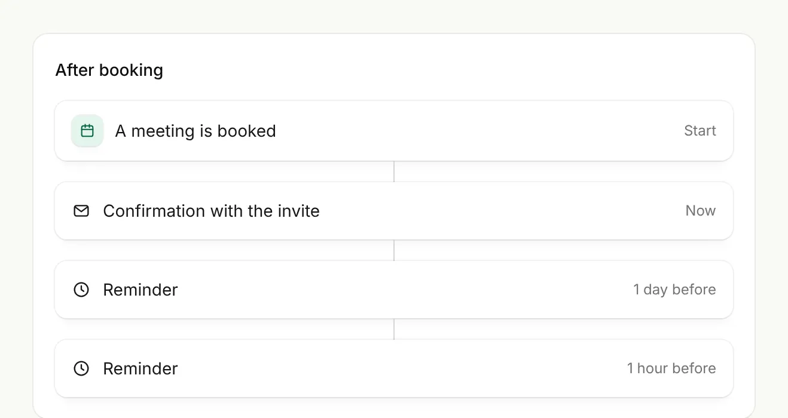
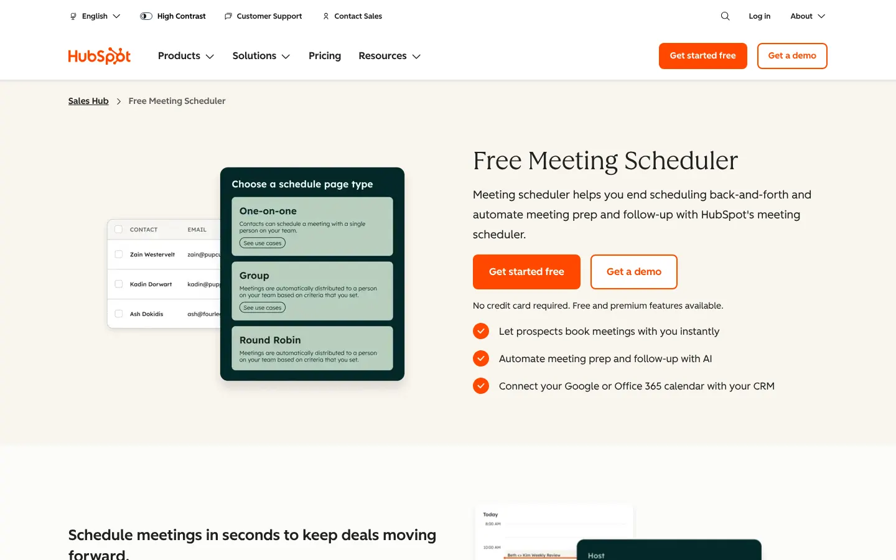

A prospect booked a demo last Tuesday. Since then, a stack of other meetings has landed in the same calendar. When your call comes up, they're in the middle of something else, or they forgot what the call was about. You wait five minutes, then write the "are you joining?" email.

A short reminder the day before changes that. It brings the meeting back to mind, says what you'll cover and puts the link one tap away. People who can't make it get a polite way to move the time instead of skipping the call.

> **[Try Claritia free](https://app.tryclaritia.com/signup)** to send a reminder a day and an hour before every meeting booked from your forms, on every plan.

Below are 8 meeting reminder email templates for B2B meetings, the steps to send one, and tools that send them for you.

## Main points

- A meeting reminder email confirms the time, the link and what the meeting is for, and offers a way to reschedule.
- Send the first reminder a day before and a second one about an hour before.
- Use a plain subject line with the meeting name and time, such as "Tomorrow at 2pm: {company} demo."
- If someone hasn't accepted the invite, send a polite nudge two or three days before, not on the day.
- Tools that send reminders for you: [Claritia](/), [HubSpot Meetings](https://www.hubspot.com/products/sales/schedule-meeting) and [Calendly](https://calendly.com/).

## What is a meeting reminder email?

A meeting reminder email is a short message sent before a scheduled meeting to confirm the time, the place or video link, and what the meeting will cover. It goes to the people invited, a day or an hour before. In sales, it also keeps the deal moving by reminding the buyer why they booked.

It's different from the calendar invite. The invite holds the time. The reminder gives the reason to show up and a way to move the time if it no longer works. For client appointments like consultations or classes, see our [appointment reminder templates](/blog/appointment-reminder-templates) instead.

## What a good meeting reminder email includes

- **A subject line with the time.** People should see when the meeting is without opening the email.
- **The meeting name and who's on it.** Especially when a new person joins from your side.
- **One line on the purpose.** What you'll cover, or what they'll get out of it.
- **The video link or address.** Placed where it's easy to tap.
- **A way to reschedule.** A link, so a conflict turns into a new time.
- **Something to prepare, if needed.** A question to think about, or who else to bring.

## How to send a reminder email

Seven steps, with an example at the end:

1. **Pick the timing.** A day before for most meetings, plus an hour before for sales calls.
2. **Write the subject line.** Put the meeting name and time first: "Reminder: intro call tomorrow at 10am."
3. **Open with the facts.** Day, date, time with the time zone, and the link.
4. **Add one line of purpose.** "We'll go through your current setup and show the parts that fit."
5. **Give a way out.** Add a reschedule link, so a clash ends in a new time.
6. **Send from a person.** Use the host's name and an inbox where replies reach them.
7. **Schedule it or automate it.** Most email tools let you schedule a send. A scheduling tool can send it from the booking on its own.

Example: "Subject: Tomorrow at 10am: intro call with {your company}. Hi {first name}, a quick reminder that we're talking tomorrow, {date}, at 10am {time zone}. Here's the link: {video link}. We'll spend 20 minutes on {their goal}. If the time no longer works, pick another here: {reschedule link}. {your name}"

## 8 meeting reminder email templates

Each template has a line on when to send it, the email itself and why it works. Swap the words in curly brackets for your own details.

### 1. Sales demo reminder

**When to send it:** A day before a product demo.

> **Subject:** Tomorrow at {time}: your {product} demo
>
> Hi {first name},
>
> Looking forward to showing you {product} tomorrow, {date}, at {time} {time zone}.
>
> **Join here:** {video link}
>
> You mentioned you want to {goal from their form}, so I'll start there and keep the rest short.
>
> If someone else on your team should see it, feel free to forward this email. If the time no longer works, pick a new one here: {reschedule link}
>
> {your name}

**Why it works:** It ties the demo to what the buyer asked for, and invites the other people who need to say yes.

### 2. Intro call reminder

**When to send it:** A day before a first call with a new lead.

> **Subject:** Reminder: intro call tomorrow at {time}
>
> Hi {first name},
>
> A quick reminder that we're talking tomorrow, {date}, at {time} {time zone}, for {length} minutes.
>
> **Link:** {video link}
>
> To make the most of it, think about one thing: {a question about their goal or current setup}.
>
> Need to move it? Pick another time here: {reschedule link}
>
> {your name}

**Why it works:** One question to think about gets the lead ready to talk, without homework.

### 3. Client meeting reminder

**When to send it:** A day before a meeting with an existing client.

> **Subject:** {day} at {time}: {project name} check-in
>
> Hi {first name},
>
> Here's a reminder of our {project name} check-in on {day}, {date}, at {time} {time zone}.
>
> **Where:** {video link or address}
>
> **What we'll cover:**
>
> 1. {Topic one}
> 2. {Topic two}
> 3. {Decision we need from you}
>
> If there's anything you'd like to add, reply and I'll put it on the list.
>
> {your name}

**Why it works:** A short agenda shows the meeting is worth the time. Naming the decision up front helps the client come ready to make it.

### 4. Internal meeting reminder

**When to send it:** The day before, or the morning of, a team meeting.

> **Subject:** {meeting name} at {time} today
>
> Hi team,
>
> Reminder that {meeting name} is today at {time} in {room or video link}.
>
> Before we meet, please {read the doc, update your numbers, add your topics}: {link}
>
> If you can't make it, reply with your update and I'll share it.
>
> {your name}

**Why it works:** It asks for prep in one line and gives people who can't join a way to still take part.

### 5. Second reminder, an hour before

**When to send it:** About an hour before any meeting.

> **Subject:** Starting in an hour: {meeting name}
>
> Hi {first name},
>
> We're on at {time} {time zone}, about an hour from now.
>
> **Join here:** {video link}
>
> Running late? Reply to this email and I'll wait.
>
> {your name}

**Why it works:** Short enough to read on a phone between meetings, with the link right at the top.

### 6. Polite nudge when someone hasn't confirmed

**When to send it:** Two or three days before, when the invite still shows no reply.

> **Subject:** Still good for {day} at {time}?
>
> Hi {first name},
>
> I sent an invite for {meeting name} on {day} at {time} {time zone}, and wanted to check the time still works.
>
> If it does, a quick yes is all I need. If not, pick a time that suits you better: {reschedule link}
>
> {your name}

**Why it works:** It asks for a one-word answer and makes changing the time easy, so you find out early instead of on the day.

### 7. Reminder after a reschedule

**When to send it:** Right after the meeting moves, and again a day before the new time.

> **Subject:** New time: {meeting name} on {day} at {time}
>
> Hi {first name},
>
> Thanks for moving our {meeting name}. Here's the new time: {day}, {date}, at {time} {time zone}.
>
> **Link:** {video link}
>
> Please go by the new time in your calendar, and ignore the old one.
>
> {your name}

**Why it works:** It clears up which time counts, which stops people from joining the old slot.

### 8. Reminder a week ahead

**When to send it:** A week before a meeting that was booked a month or more ago.

> **Subject:** Next {day}: {meeting name}
>
> Hi {first name},
>
> We have {meeting name} booked for next {day}, {date}, at {time} {time zone}.
>
> Since we set it up a while ago, I wanted to check it's still on your plan. Here's what we agreed to cover: {topic}.
>
> If things have changed, you can pick a new time here: {reschedule link}
>
> {your name}

**Why it works:** Meetings booked far ahead are the easiest to forget. A week's notice leaves time to move it without a scramble.

## When to send each meeting reminder

| Reminder | When to send | Goal |
|---|---|---|
| A week ahead | 7 days before, for meetings booked a month or more out | Check it's still on |
| Polite nudge | 2 to 3 days before, if the invite has no reply | Get a yes or a new time |
| Day before | About 24 hours before | Bring back the purpose |
| Hour before | About 60 minutes before | Get them on the call |
| After a reschedule | Right away, then a day before | Confirm the new time |

If the meeting doesn't happen at all, a no-show follow-up comes next. Our [sales follow-up email templates](/blog/sales-follow-up-email) include one, plus emails for after a demo and after a call.

## Tools that send meeting reminders for you

Writing each reminder by hand works for a few meetings a week. Once your team books more, scheduling tools send them from the booking. Prices checked November 2026.

### Claritia

[Claritia](/) is a forms, scheduling and follow-up app built for small B2B teams that want every lead from their website to reach the right rep and book a meeting before they leave the page.

It builds forms from a sentence or one of 840 templates, opens the right person's calendar the moment the form is sent, routes each lead by its answers, and drafts follow-up emails in your brand's voice for you to approve.

For reminders and follow-ups, here's what each plan includes:

- **Every plan, free included:** A confirmation email with the calendar invite, reminders a day and an hour before, and emails when a meeting moves or is canceled.
- **Starter, $15 a seat a month ($12 billed yearly):** Your own wording and times, a follow-up the next day until a form lead books, and emails from your own [Gmail](/integrations/gmail) or [Outlook](/integrations/outlook).
- **Pro, $39 a seat a month ($31 billed yearly):** A no-show follow-up with the reschedule link, a thank-you after a held meeting, and follow-up emails from your own domain.

*Caption: Claritia sends the confirmation with the invite, then reminders a day and an hour before the meeting.*

Claritia has a smaller marketplace, and its Zapier and Make apps aren't listed yet. SMS reminders on Pro and Business are still coming soon.

### HubSpot Meetings

[HubSpot Meetings](https://www.hubspot.com/products/sales/schedule-meeting) is the meeting scheduler inside HubSpot's CRM, built for sales and service teams that want prospects to book time and have every meeting recorded. You connect a Google or Office 365 calendar, then share a booking link or embed it on a web page or in live chat.

It supports round robin and group meeting links, logs booked meetings on contact records, can start email sequences, and uses AI to prepare meeting context and follow-ups.

Each scheduling page can send a booking confirmation and up to three reminder emails before the meeting, timed in weeks, days, hours or minutes. Reminders only go out when your calendar is connected, and changing their subject and text needs an assigned Sales or Service seat.

### Calendly

[Calendly](https://calendly.com/) is scheduling software for professionals and teams who want people to book meetings without trading emails. You connect your calendars, set hours, buffers, and daily limits, and share booking links for one-on-one, multi-host, or group meetings.

It sends email and text reminders, offers routing forms that send website leads to the right teammate, and collects payments. Newer tools include an AI assistant that finds times over email and a notetaker that writes meeting recaps.

Automatic reminders aren't on Calendly's free plan. They start on Standard at $10 a seat a month billed yearly, and Teams, at $16 a seat a month billed yearly, adds round robin and lead routing.

## Questions

### How do you write a reminder email for a meeting?

Put the meeting name and time in the subject line. In the email, give the day, date, time zone and link, one line on what you'll cover, and a reschedule link. Sign it from the host.

### How do you send a reminder email politely?

Keep it short, thank them for their time, and make changing the time easy. "Wanted to check the time still works" reads as helpful. "Don't forget" can read as a scold.

### When should you send a meeting reminder email?

A day before and about an hour before. For meetings booked weeks ahead, add one a week out. If someone hasn't accepted the invite, nudge them two or three days before.

### What is a good subject line for a meeting reminder?

The meeting name and time, such as "Tomorrow at 2pm: {company} demo" or "Starting in an hour: weekly check-in." Plain subjects tell people what's inside before they open it.

### Can you automate meeting reminder emails?

Yes. Claritia sends reminders a day and an hour before on every plan. HubSpot Meetings can send up to three reminder emails per scheduling page, and Calendly sends reminders from its Standard plan.

### What do you send if someone misses the meeting?

A short note with a link to pick a new time, sent soon after. Our [sales follow-up email templates](/blog/sales-follow-up-email) include a no-show email you can copy.

## Get started

Start with the day-before reminder for your demos and intro calls, then add the hour-before one. Once both send from the booking, every meeting gets a reminder without anyone writing it.

> **[Try Claritia free](https://app.tryclaritia.com/signup)** to send reminders a day and an hour before every meeting booked from your forms.

You can also see how [Claritia meetings](/products/meetings) work, or start from a free [demo request template](/templates/category/demo-request).
