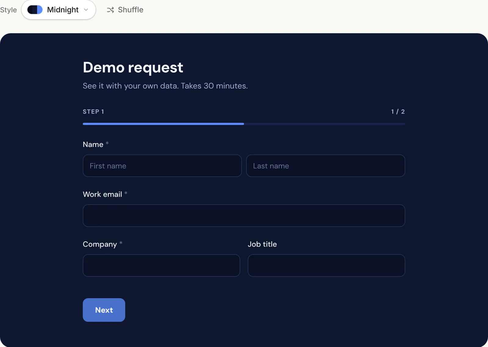
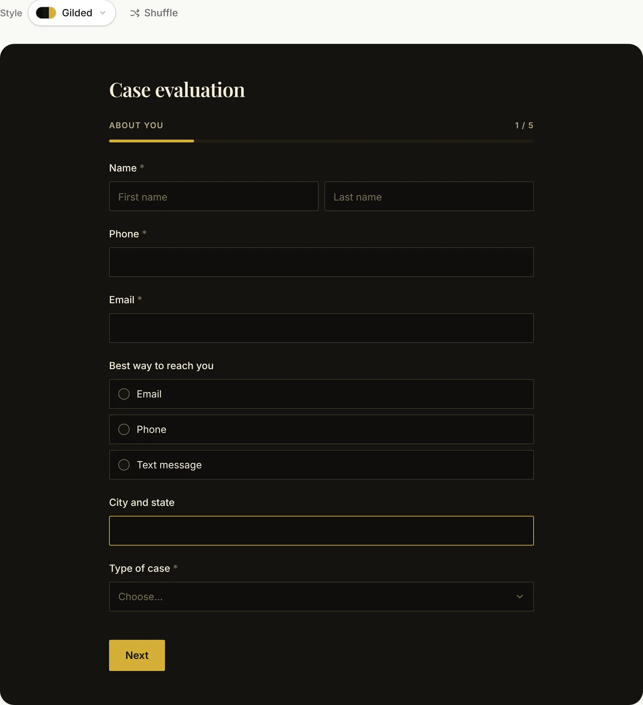
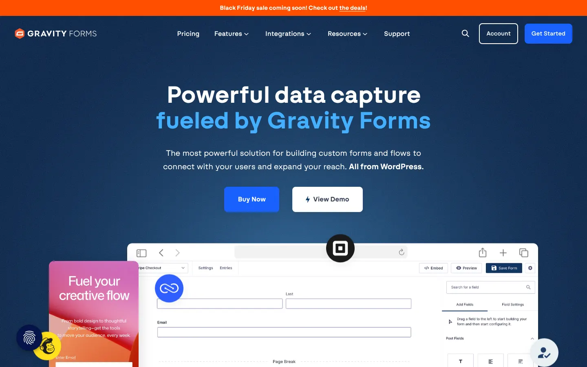

A long form on one page looks like work. A visitor sees twenty fields stacked up and decides to come back later. Most never do.

A multi-step form asks the same questions in small groups, one page at a time. People start with something easy, see how far they've come, and skip what doesn't apply to them. The form feels shorter, though the questions stay the same.

> **[Try Claritia free](https://app.tryclaritia.com/signup)** to build a multi-step form with a progress bar and page skips on the free plan, and end it on a booked meeting.

Below: when to use one, how to split your questions, and six example forms you can try.

## Main points

- A multi-step form splits one form into short pages, with a Next button between them and a progress bar on top.
- It beats a single page when you need more than a handful of answers, or when different people need different questions.
- Put easy questions first, keep one topic per step, and skip steps that don't apply to the person.
- Saving partial answers shows you where people stop, and lets you follow up with the ones who left.
- Builders that do it well: [Claritia](/), [Typeform](https://www.typeform.com/), [Fillout](https://www.fillout.com/), [Tally](https://tally.so/) and [Gravity Forms](https://www.gravityforms.com/).

## What is a multi-step form?

A multi-step form is a form split into several short pages, where people answer one group of questions, click Next, and move to the next group. A progress bar shows how far they've come, and logic can skip pages that don't apply.

You'll also hear it called a multi-page form, a step form or a wizard. A close cousin shows one question per screen, the way [Typeform](https://www.typeform.com/) does.

## When a multi-step form beats a single page

A multi-step form is the better choice when:

- **You need more than six or seven answers.** Intake forms, applications and quote requests feel lighter in small groups.
- **Different people need different questions.** A person with a family law case and a person with a work issue shouldn't see the same details page.
- **You want the easy part first.** A first step with one or two simple choices gets people started.
- **The form ends in something.** A price, a score or a booked meeting makes a natural last step.

For a newsletter signup or a three-field contact form, a single page is still better. A Next button there only adds a click.

## How a multi-step form works

1. **The visitor sees step one.** It usually holds a few easy questions or a single choice.
2. **They click Next.** The form checks the answers on that page before it moves on, so mistakes get fixed early.
3. **Logic picks the next page.** Based on the answers so far, the form shows the next page or jumps past ones that don't apply.
4. **The progress bar moves.** People see how much is left.
5. **The last step sends the form.** Then they see a thank-you screen, a result, or a calendar to book a call.

## How to split questions into steps

- **Start easy.** Ask a simple choice first, like what they need or their team size. Typing a name and email is more work than tapping a button.
- **One topic per step.** Group questions people think of together: contact details, the project, the budget, the timeline.
- **Keep steps short.** Three to five questions a page is a good aim. If a page needs scrolling on a phone, split it.
- **Place contact details with care.** On lead forms, name and email often work better on a later step. On intake forms, they can go first, since the person already plans to finish.
- **Save the hard questions for later.** Long text answers and file uploads go near the end.

## Progress bars

A progress bar shows people where they are and how much is left.

Keep it honest. If logic skips pages, the bar should jump ahead too, not stall. For a very long form, a step count like "Step 2 of 5" can be clearer than a bar. In Claritia, multi-page forms come with a progress bar on every plan, Free included.

## Skipping steps that don't apply

Page skips are what make a long form feel short. A rule reads an answer and jumps past the pages that don't fit. Someone with no dependents never sees the dependents page. Someone who'll set up a tool on their own skips the page that books a setup call.

Keep the rules simple and test each path. For more on rules, see our guide to [form builders with conditional logic](/blog/best-form-builder-with-conditional-logic).

## Saving partial answers

Some people will leave halfway. Saving partial answers keeps what they typed, so you can see which step loses the most people and fix it. On a lead form, you also get an email to follow up with.

If you keep unfinished answers, say so near the form, and follow up only when your privacy policy allows it. In Claritia, partial answers and drop-off by question are on the Business plan.

## Multi-step form examples

Each example below is a real template you can fill in now. See all of them on the [multi-page form templates](/templates/multi-page) page, with over 300 forms that take people through one page at a time.

### Demo request

[Demo request](/templates/saas-demo-request) has 8 questions over 2 pages. The first page asks for name, work email, company and job title. The second, "A bit about your team", asks about team size, current tools, goals and timing. It qualifies the lead and books a meeting with a rep at the end.

*Step 1 of 2 in the demo request template asks only for name, work email, company and job title.*

### Discovery questionnaire

[Discovery questionnaire](/templates/consulting-discovery) has 9 questions over 3 pages: where things stand today, where you want to be, and who decides. The consultant reads the answers before the first call.

### Onboarding survey

[Onboarding survey](/templates/saas-onboarding-survey) has 22 questions over 5 pages, from team and tools to goals and setup help. Anyone who picks "I'll set it up myself" skips the setup call page. Everyone else picks days and times for a call.

### Case evaluation

[Case evaluation](/templates/legal-case-evaluation) has 26 questions over 5 pages. The type of case decides the next step: a personal injury case sees injury details, a family matter sees family questions, and a work or business case sees those. It ends with a timeline, documents and a consent box.

*The case evaluation template asks the type of case on the first page, and that answer picks the next page.*

### Tax prep intake

[Tax prep intake](/templates/accounting-tax-intake) has 32 questions over 7 pages. People with no dependents skip the dependents page, and only those with self-employment income see the business income page. It ends with uploads and a signature.

### Job application

[Job application](/templates/hr-job-application) has 30 questions over 6 pages: about you, the role, experience, education, a few questions, then uploads and consent. Someone with no experience yet skips the experience page.

## Common mistakes

- **Steps for the sake of steps.** A four-field form split over four pages only adds clicks.
- **A hard first step.** A long text box or a file upload up front stops people before they start.
- **No way back.** People should be able to go back and fix an answer without losing the rest.
- **Untested skips.** A rule that sends someone to the wrong page breaks the form for that whole group.
- **Nothing after the last step.** End with a clear next step, like a booked call or a note on when you'll reply.

## Multi-step form builders

### Claritia

[Claritia](/) is a forms, scheduling and follow-up app for small B2B teams. It gets each website lead to the right rep and booked into a meeting before they leave the page.

It builds forms from a sentence or one of 840 templates, opens the right person's calendar the moment the form is sent, routes each lead by its answers, and drafts follow-up emails in your brand's voice for you to approve.

Multi-page forms, the progress bar, conditional logic and page skips are on every plan, Free included, with 250 submissions a month. The last page can be a calendar, so a lead books with the right person.

Partial answers and drop-off by question are on Business at $79 a seat a month ($63 billed yearly). It's newer than the tools below, and its Zapier and Make apps aren't listed yet.

### Typeform

[Typeform](https://www.typeform.com/) is an online form builder for marketing, product, HR, and customer teams that want forms, surveys and quizzes people finish. It builds conversational forms that adapt to each answer, can draft and brand a form from a written prompt, and accepts video and audio replies.

Responses can go to tools like HubSpot, Google Sheets, and Notion, take Stripe payments, book Calendly meetings, and feed AI summaries of themes and sentiment.

It shows one question per screen, and logic with branching is on the free plan. The free plan takes only 10 responses a month. Partial responses start on Basic at $28 a month billed yearly, and question drop-off analysis starts on Business.

### Fillout

[Fillout](https://www.fillout.com/) is a form builder for teams that want branded forms, surveys, and quizzes connected to the tools they already use. You can describe a form for its AI to build or use drag and drop, then add logic, file uploads, payments, and signatures.

It also offers scheduling forms that sync with Google Calendar or Outlook, PDF generation, workflows, login forms that let people edit past answers, custom domains, and native integrations.

Its free plan includes multi-page forms, conditional logic, a way for people to resume forms in progress, and 1,000 responses a month. Viewing partial submissions starts on Business at $75 a month billed yearly.

### Tally

[Tally](https://tally.so/) is a form builder for individuals and teams who want to make forms by typing, much like writing in a document. You insert blocks for contact details, file uploads, ratings, signatures, and Stripe payments, then add conditional logic, calculations, hidden fields, and answer piping.

Forms can be embedded or shown as popups, and submissions can go to Notion, Slack, Airtable, or Google Sheets. Tally is hosted in Europe and does not use cookie tracking.

You can make single-page or multi-page forms for free, with unlimited submissions within fair use. Partial submissions and drop-off analytics come with Pro at $24 a month, billed monthly.

### Gravity Forms

[Gravity Forms](https://www.gravityforms.com/) is a form plugin for WordPress professionals and site owners who want to build anything from a simple contact form to a multi-step workflow on their own site. Its visual editor offers many field types, multi-page layouts, conditional logic, calculations and save and continue.

It can take payments through Stripe, Square and other processors, register users, create posts from entries, route notifications based on answers, and send data to other tools through a REST API and webhooks.

Its conditional logic can hide whole pages, and save and continue lets people finish later. Partial Entries and one-question-at-a-time Conversational Forms come with the Elite license at $259 a year. The Basic license is $59 a year for one site.

Prices checked November 2026.

## Questions

### What is the difference between a multi-step form and a multi-page form?

Most people use the terms the same way: both split one form into pages with a Next button. Some use "multi-step" for forms that show one question per screen.

### Do multi-step forms get more people to finish?

They often help on long forms, since each page looks short and people see their progress. On very short forms they don't. Test both versions and compare how many people finish.

### How many steps should a multi-step form have?

As few as the questions need. Three to five questions per step is a good aim, so a 15-question form might have three to five steps. Skip any step that doesn't apply to the person.

### Can a multi-step form save answers if someone leaves?

Yes, on many builders. Claritia keeps partial answers on Business. Tally keeps partial submissions on Pro, Fillout on Business and Gravity Forms with its Partial Entries add-on.

### Which multi-step form builder is free?

Claritia, Fillout and Tally all have multi-page forms on their free plans. Claritia adds a progress bar, page skips and booking inside the form at $0, with 250 submissions a month.

## Get started

Take your longest form and split it into short steps, with the easy questions first and skips for pages that don't apply. Then compare how many people reach the end.

> **[Try Claritia free](https://app.tryclaritia.com/signup)** to build a multi-step form from a sentence or a template and let it end in a booked meeting.

Browse the [multi-page form templates](/templates/multi-page) or see what [Claritia forms](/products/forms) can do.
