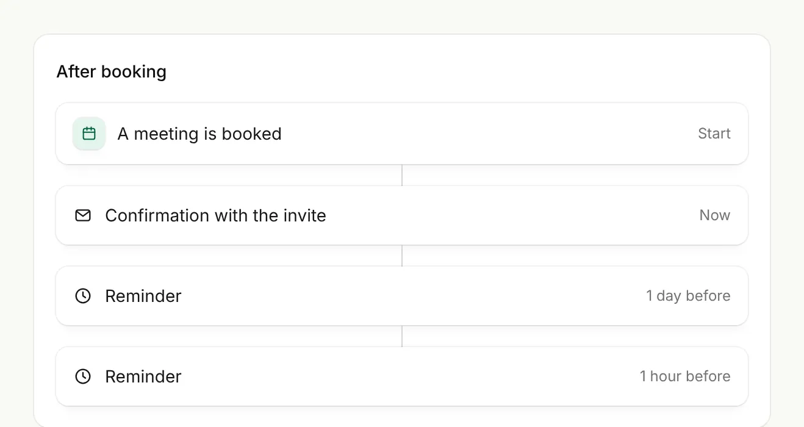

A lead asks for a demo, then never picks a time. Another has a good first call, says they'll talk to their team, and goes quiet. Neither of them said no. They got busy, and nobody sent the next email.

Plenty of inbound deals stall in these gaps. The fix is a short follow-up, sent at the right moment, that makes the next step easy. Writing each one from scratch is why teams skip them.

> **[Try Claritia free](https://app.tryclaritia.com/signup)** to follow up with every form lead the next day until they book a meeting, on Starter.

Below are 9 sales follow-up email templates for inbound leads, each with when to send it. At the end, we show how to send them on a schedule without writing each by hand.

## Main points

- A sales follow-up email asks for one next step, such as booking a time, reading a quote or replying with a yes or no.
- Send the first follow-up within a day. A lead who asked for a demo yesterday still remembers why.
- Match the email to the moment: a demo request with no booking, a first call, a no-show, a quote, a quiet week, a last try.
- Keep each email short, with the booking link or the one question in plain view, and stop as soon as they book or reply.
- Tools that send follow-ups for you: [Claritia](/), [HubSpot Sales Hub](https://www.hubspot.com/products/sales) and [Close](https://www.close.com/).

## What is a sales follow-up email?

A sales follow-up email is a message you send to a lead after they take a step with you, such as asking for a demo, joining a call or getting a quote. It reminds them where things stand and asks for the next step. For inbound leads, that step is usually a booked meeting or a quick reply.

Inbound leads came to you first, so your follow-up can be warm and direct. You don't need to explain who you are. You need to make the next step take less than a minute. If you're not sure which leads count as inbound, see [what an inbound lead is](/blog/what-is-an-inbound-lead).

## What a good sales follow-up email includes

- **A clear subject line.** Name the thing they did: their demo request, your call, the quote.
- **One reason for writing.** A recap, a missed meeting or a question. Pick one.
- **One next step.** A booking link, a yes or no question, or a document to read.
- **Their own words.** Something from their form or the call, so the email reads as written for them.
- **A short length.** Most follow-ups fit in a few lines.
- **A real person.** Your name and an inbox a reply will reach.

## 9 sales follow-up email templates

Each template has a line on when to send it, the email itself and why it works. Swap the words in curly brackets for your own details.

### 1. After a demo request with no booking

**When to send it:** The next day, when someone filled your demo form but didn't pick a time.

> **Subject:** Your demo request for {company}
>
> Hi {first name},
>
> Thanks for asking for a demo of {product} yesterday. You said you want to {goal from their form}.
>
> The quickest way to see if we can help is a 30-minute call. Pick any time that suits you here: {booking link}
>
> If none of the times work, reply with two that do and I'll make one of them happen.
>
> {your name}

**Why it works:** It uses their own answer from the form, gives one link, and offers a way out if the calendar doesn't fit.

### 2. Follow-up email after a sales call

**When to send it:** The same day as your first call, within a few hours if you can.

> **Subject:** Notes from our call, and next steps
>
> Hi {first name},
>
> Thanks for your time today. Here's what I heard.
>
> You want to {their main problem}, and today you use {current tool}. What matters most is {their top need}, by {their timeline}.
>
> As promised, here's {the pricing or resource you mentioned}: {link}
>
> The next step we agreed on is {next step}. I've held {day and time}. If that no longer works, pick a new time here: {booking link}
>
> {your name}

**Why it works:** A short recap shows you listened and gives them something to forward. It ends on a date, so "let me know" never becomes the plan.

### 3. After a no-show

**When to send it:** 10 to 15 minutes after the start time, once it's clear they won't join.

> **Subject:** Sorry we missed each other
>
> Hi {first name},
>
> I was on the call for {meeting name} at {time} but didn't see you. No problem, things come up.
>
> If you still want to talk, pick a new time here: {reschedule link}
>
> {your name}

**Why it works:** No guilt and no long message. The reschedule link does the work while the meeting is still on their mind.

### 4. After sending a quote

**When to send it:** 2 to 3 business days after the quote goes out.

> **Subject:** Any questions on the quote?
>
> Hi {first name},
>
> I sent the quote for {project or plan} on {day}. Have you had a chance to look at it?
>
> If a part is unclear or doesn't fit your budget, tell me which one and I'll see what we can change.
>
> If you'd rather go through it together, here's a 15-minute slot: {booking link}
>
> {your name}

**Why it works:** It asks for the objection directly. A quote often stalls on one line item, and this gives the lead a reason to name it.

### 5. A check-in a week later

**When to send it:** About a week after your last email, when the lead hasn't replied.

> **Subject:** Still working on {their goal}?
>
> Hi {first name},
>
> Checking in on {their goal}. Is it still something you're working on?
>
> If it is, I'm happy to pick up where we left off: {booking link}
>
> If the timing has changed, reply "later" and I'll check back in a month or two.
>
> {your name}

**Why it works:** A one-word reply is easy to send. Even "later" tells you where the lead stands and when to write again.

### 6. After a demo

**When to send it:** Within a day of the demo.

> **Subject:** Your {product} demo, plus a link to try it
>
> Hi {first name},
>
> Thanks for joining the demo today. You asked about {their question}, so here's a short answer: {answer or link}
>
> If you want to try it with your own data, you can start here: {signup link}
>
> Want me to walk {colleague's name} through it too? Share this link so they can pick a time: {booking link}
>
> {your name}

**Why it works:** It answers the question they raised and makes it easy to bring in the other people who need to say yes.

### 7. When they need to check with their team

**When to send it:** 3 to 5 days after they said they'd talk to their boss or team.

> **Subject:** Anything I can send your team?
>
> Hi {first name},
>
> You mentioned you'd talk to {team or boss} about {product}. To make that easier, here's a one-page summary: {link}
>
> It covers {the two or three things they care about} and what it costs for a team your size.
>
> If they have questions, I'm happy to join a short call with everyone: {booking link}
>
> {your name}

**Why it works:** It gives your contact something to forward, so the pitch doesn't depend on what they remember from your call.

### 8. After they cancel a meeting

**When to send it:** Right after they cancel, or the next morning.

> **Subject:** Want to pick a new time?
>
> Hi {first name},
>
> I saw our {meeting name} on {day} was canceled. No problem at all.
>
> When you're ready, you can grab a new time here: {booking link}
>
> If something changed on your side, a one-line reply helps me know whether to check back later.
>
> {your name}

**Why it works:** It keeps the door open the moment the meeting drops, while the lead still meant to talk to you.

### 9. The last try

**When to send it:** After two or three follow-ups with no reply, about two weeks after the last one.

> **Subject:** Should I stop following up?
>
> Hi {first name},
>
> I've written a few times about {their goal} and haven't heard back, so I'll guess the timing isn't right.
>
> I'll stop emailing for now. If things change, you can book a time any day here: {booking link}
>
> Thanks, and good luck with {their project}.
>
> {your name}

**Why it works:** A clear end gives the lead an easy reason to reply, even with a no. Either answer beats silence, and the booking link stays in their inbox.

## When to send each follow-up

| Moment | When to send | Goal |
|---|---|---|
| Demo request with no booking | The next day | Get a time booked |
| First sales call | The same day | Recap and confirm the next step |
| No-show | 10 to 15 minutes after the start time | Rebook |
| Demo | Within a day | Answer questions and bring in others |
| Quote sent | 2 to 3 business days later | Find the objection |
| Waiting on their team | 3 to 5 days later | Help your contact make the case |
| Canceled meeting | Right away or the next morning | Rebook |
| No reply | About a week later | Get a yes, a no or a "later" |
| Last try | About two weeks after the last email | Close the loop |

A few rules that apply to all of them:

- **Stop when they book or reply.** A "just checking in" to someone who booked yesterday shows you weren't paying attention.
- **Space them out.** Two or three follow-ups over two to three weeks is plenty for most inbound leads.
- **Send from a person.** Use your own name and inbox, so a reply reaches someone who can answer it.
- **Send in their working hours.** Check the lead's time zone before you schedule anything.

## How Claritia sends follow-ups on its own

[Claritia](/) is a forms, scheduling and follow-up app built for small B2B teams that want every lead from their website to reach the right rep and book a meeting before they leave the page.

It builds forms from a sentence or one of 840 templates, opens the right person's calendar the moment the form is sent, routes each lead by its answers, and drafts follow-up emails in your brand's voice for you to approve.

Several of the templates above can run as workflows, so they go out at the right time without anyone remembering to send them:

- **Demo request with no booking (template 1):** On Starter, a lead who fills your form but doesn't book gets a follow-up the next day, until they book.
- **No-show (template 3):** On Pro, a no-show follow-up goes out with the reschedule link.
- **After a held meeting:** On Pro, a thank-you email goes out once the meeting is done.
- **Moved or canceled (template 8):** On every plan, emails go out when a meeting moves or is canceled.
- **Reminders:** On every plan, a confirmation with the calendar invite, then reminders a day and an hour before.

*Caption: After each booking, Claritia sends the confirmation with the invite, then reminders a day and an hour before.*

On Starter, you set your own wording and times, and emails can go out from your own [Gmail](/integrations/gmail) or [Outlook](/integrations/outlook). On Pro, follow-up emails go out from your own domain.

The AI drafts follow-up emails in your brand's voice, and nothing sends until you approve it. Starter is $15 a seat a month ($12 billed yearly) and Pro is $39 ($31 billed yearly). Teammates who only build forms or read results are free.

Claritia has real limits too. It's a newer tool with a smaller marketplace, its Zapier and Make apps aren't listed yet, and built-in SMS reminders on Pro and Business are still coming soon. For now, texts go through your own Twilio number on Starter and up.

## Other tools for sales follow-up emails

Claritia follows up from the form and the meeting. If your follow-up lives in a CRM pipeline, these tools fit better.

### HubSpot Sales Hub

[HubSpot Sales Hub](https://www.hubspot.com/products/sales) is HubSpot's sales software for sales teams that want to find prospects, work deals and forecast revenue from one workspace tied to the CRM. It tracks leads and deals in pipelines, sends automated email sequences, places and logs calls from a dialer, records meetings, and scores deals by how likely they are to close.

AI tools point out accounts showing buying signals, draft follow-ups and suggest CRM updates, while managers get forecasts, coaching tools and reports. A rep enrolls a contact in a sequence, and HubSpot sends a timed series of emails and tasks. Sequences start on the Professional plan.

### Close

[Close](https://www.close.com/) is a sales CRM for small and growing businesses that want their reps to call, email and text leads without switching between tools. It logs every call, email, text, note and meeting on the lead record, builds smart lists of leads that need attention, and runs automated follow-up workflows across email, phone and SMS.

It also records and transcribes meetings, reports on rep activity, and includes an AI agent named Chloe that can qualify leads and book meetings. Automated workflows that send email and SMS start on its Growth plan.

For prices and a side-by-side look, see our list of the [best lead follow-up software](/blog/best-lead-follow-up-software).

## Questions

### How do you write a follow-up email after a sales call?

Thank them, recap what you heard in two or three lines, send anything you promised, and confirm the next step with a date. Add a booking link in case that date no longer works.

### How soon should you send a follow-up email after a sales call?

The same day, while the call is fresh for both of you. For a demo request with no booking, the next day works well.

### How many follow-up emails should you send?

For most inbound leads, two or three over two to three weeks, then a last try. Stop as soon as they book or reply.

### What do you say in a follow-up email when there's no response?

Keep it short and ask a question that's easy to answer, such as whether the project is still on. Offer "later" as an answer, and include your booking link.

### What is a good subject line for a sales follow-up email?

One that names what they did or what you're sending, such as "Your demo request for {company}" or "Notes from our call." Plain subjects tell the lead what's inside.

### Can you automate sales follow-up emails?

Yes. Claritia sends a follow-up the next day until a form lead books on Starter, and a no-show follow-up with the reschedule link on Pro. CRMs like HubSpot and Close run sequences and workflows too.

## Get started

Pick the three moments where your leads go quiet most often, and set up a follow-up for each. Once they run on their own, every lead gets a second chance to book.

> **[Try Claritia free](https://app.tryclaritia.com/signup)** to send reminders before every meeting today, then follow up with form leads until they book on Starter.

You can also see how [Claritia meetings](/products/meetings) work, or start from a free [demo request template](/templates/category/demo-request).
