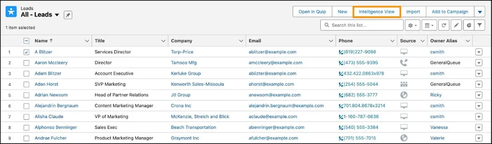
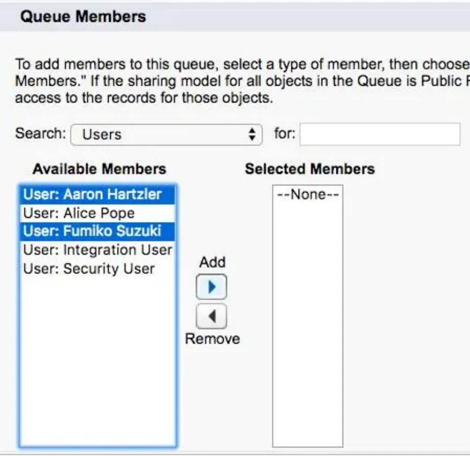
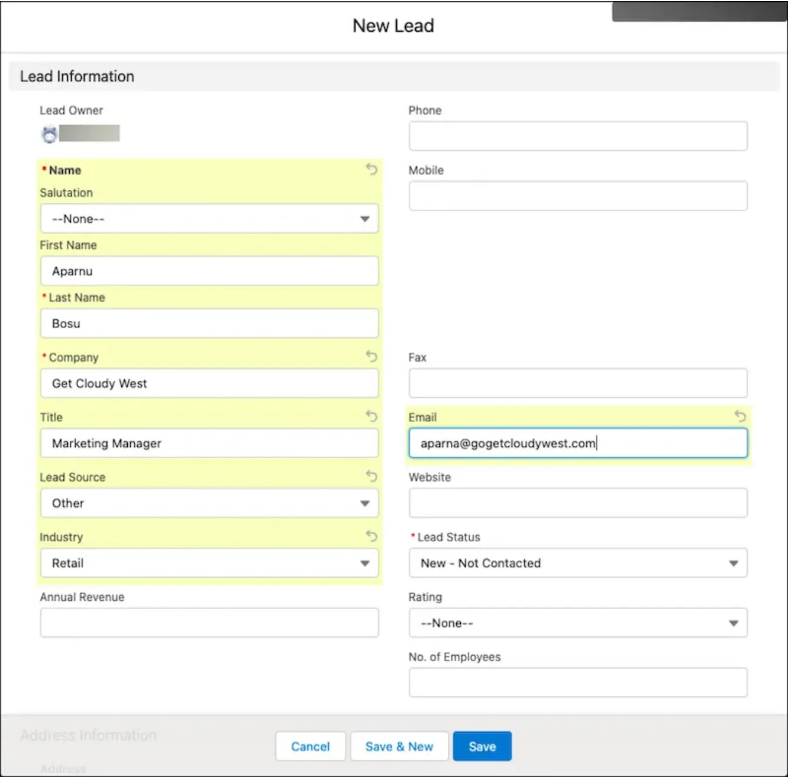
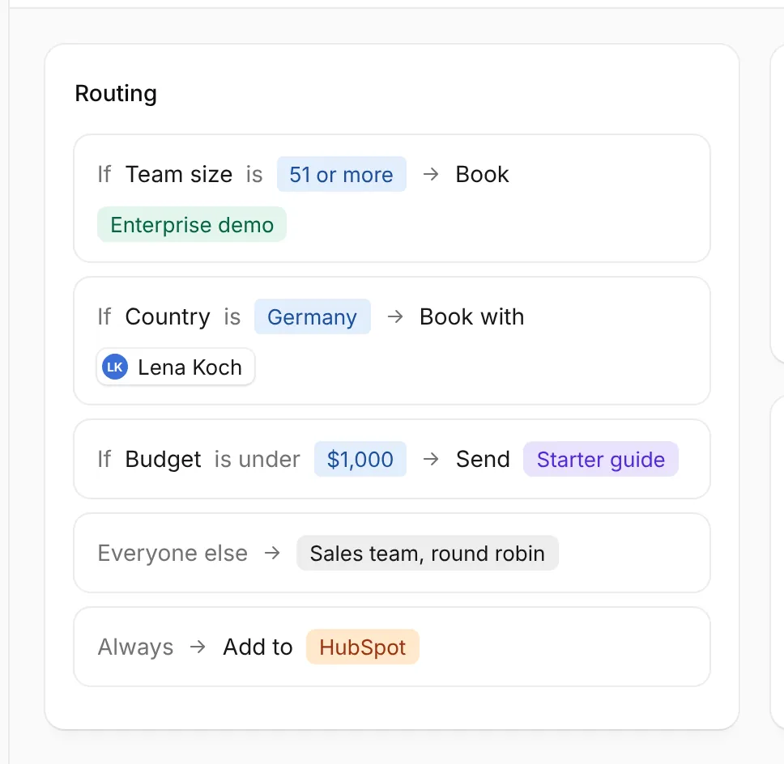

Leads pour into Salesforce from web forms, imports and your team. Without routing, they all land with one default owner, or in a queue someone has to sort by hand. The lead who filled in your demo form at 9 am is still waiting at lunch, because no one knew it was theirs.

Salesforce has routing built in. Lead assignment rules can send each lead to the right rep or queue the moment it's created. They also have limits, and the most common one surprises people: there's no round robin button.

> **[Try Claritia free](https://app.tryclaritia.com/signup)** to send form leads to Salesforce with the right owner and the meeting already booked.

In this post, you'll set up lead routing in Salesforce step by step, add a simple round robin, fix the usual problems, and see when an add-on tool makes sense.

## Main points

- Salesforce routes leads with lead assignment rules. Only one lead assignment rule can be active at a time, and it holds a list of entries checked in order.
- The first entry that matches wins and assigns the lead to a user or a queue. Add a catch-all entry at the end.
- There's no round robin setting. The usual fix is a formula field that numbers leads, with one rule entry per rep.
- Assignment rules don't know about time off, workload or meetings. Tools like [LeanData](https://www.leandata.com/), [Distribution Engine](https://www.distributionengine.com/) and [Chili Piper](https://www.chilipiper.com/) fill those gaps.
- For form leads, [Claritia](/) sends each lead to Salesforce and books the meeting with the right owner, on its Business plan.

## What is lead routing in Salesforce?

Lead routing in Salesforce means giving each new lead record an owner based on rules. The owner can be a user, such as a sales rep, or a queue that a team works from. Salesforce's main tool for this is the lead assignment rule, set up in Setup. For the basics of routing in general, read [what lead routing is](/blog/what-is-lead-routing).

*In the leads list, the Owner Alias column shows who owns each lead, a rep or a queue such as GeneralQueue. Image: [Salesforce Trailhead](https://trailhead.salesforce.com/content/learn/modules/leads_opportunities_lightning_experience/create-and-convert-leads-lightning).*

## What you need

- **Admin access** to Setup in your Salesforce org.
- **Your routing rules on paper.** Who gets which lead, and who gets the rest.
- **The lead fields your rules need**, such as Country, State, Industry, Lead Source or a company size field.
- **Queues**, if a team should share leads from one list.
- **A sandbox**, if you have one, to test before you change live routing.

## Step 1: Write your rules in order

Assignment rules check each entry from the top down and stop at the first match. So the order matters as much as the rules. Write them as a short list, most specific first:

1. Leads from companies with more than 1,000 employees go to the enterprise queue.
2. Leads from Germany, Austria and Switzerland go to the DACH rep.
3. Leads from the United States go to the US team.
4. Everyone else goes to the general queue.

The last line is your catch-all. Without it, a lead that matches nothing won't be assigned by the rule.

## Step 2: Set a default lead owner

In Setup, open Lead Settings and pick a default lead owner. When an assignment rule can't find an owner for a web lead, Salesforce gives it to this person or queue. Pick someone who checks it every day, or a queue your team watches.

## Step 3: Create queues for your teams

If a team should share leads, create a queue for it in Setup under Queues. Pick Lead as the object and add the team members. A queue keeps leads in one list until someone takes them. That's handy, but it's also where leads wait, so the team needs a habit of picking them up.

*The Queue Members section of a new queue, where you move users from Available Members into the queue. Image: [Salesforce Trailhead](https://trailhead.salesforce.com/content/learn/projects/customize-an-org-to-support-a-new-business-unit/automate-your-business-process).*

## Step 4: Create the lead assignment rule

1. In Setup, search for Lead Assignment Rules and click New.
2. Name the rule and mark it active. Only one lead assignment rule can be active, so this one replaces any rule that was active before.
3. Open the rule and add a rule entry for each line from Step 1.
4. For each entry, set the sort order, the criteria, and the user or queue to assign.
5. If you like, pick an email template so the new owner gets an alert.
6. Add the catch-all entry last, with no criteria.

Keep each entry to one clear idea, so you can tell later why a lead went where it did.

## Step 5: Add a simple round robin

Lead assignment rules have no round robin setting. Salesforce's own help shows a workaround that uses fields on the lead:

1. Add an auto-number field to the lead, so every new lead gets the next number.
2. Add a formula field that turns that number into a rep number. With three reps, the formula uses MOD to give 1, 2 or 3, then starts again.
3. In your assignment rule, add one entry per rep: rep number equals 1 goes to the first rep, 2 to the second, and so on.

This shares leads evenly, but it's rigid. When a rep joins, leaves or goes on holiday, someone has to change the formula and the entries by hand.

## Step 6: Make sure the rule runs

An active rule doesn't run on every lead by default. Check each way leads come in:

- **Web-to-lead:** Leads from Salesforce web-to-lead forms go through the active rule.
- **Leads your team creates:** The "Assign using active assignment rule" checkbox on the lead form decides it. Add it to the page layout, or to the Lightning record page if you use Dynamic Forms.
- **Apex code and the API:** Leads created in code skip the rule unless the code asks for it. Ask your developer to set the assignment rule option.
- **Flows:** A flow that creates leads may skip the rule too. Check Salesforce's help for how to apply assignment rules from a flow, and test it.
- **Imports:** Check the assignment option in the import tool before you load a file.

## Step 7: Test with real examples

Create one test lead for each rule entry, plus one that should hit the catch-all. Check the owner on each, and check that the alert email arrived. Then watch new leads for a week and fix the order of any entries that clash.

*The New Lead form in Salesforce, where you fill in the fields your rules check, such as Industry or Lead Source, for each test lead. Image: [Salesforce Trailhead](https://trailhead.salesforce.com/content/learn/modules/prospect-tracking-with-salesforce-leads-quick-look/track-prospects-with-salesforce-leads).*

## Common problems

- **The rule didn't run.** The lead came in by code, a flow or an import that skipped assignment. See Step 6.
- **The wrong rep got the lead.** An earlier entry matched first. Move the more specific entry higher.
- **Everything goes to the default owner.** No entry matched, or the active rule is a different one. Remember only one rule is active.
- **Reps on holiday keep getting leads.** Assignment rules don't check time off. You have to edit the entries, or use a tool that knows who's away.
- **A customer lands with a new rep.** Assignment rules look at the lead's own fields. They don't check whether the company is already an account someone owns.
- **Owners flip back.** If you also sync owners with another system, such as HubSpot, the two can overwrite each other. Pick one system to own assignment.

## Tools for lead routing in Salesforce

Assignment rules cover a lot for free, but they stop at the owner field. When you need fair rotation with time off, account matching, or a meeting booked on the spot, an add-on helps. For a full comparison, see our list of the [best lead routing software](/blog/best-lead-routing-software).

### Claritia

[Claritia](/) is a forms, scheduling and follow-up app built for small B2B teams that want every lead from their website to reach the right rep and book a meeting before they leave the page.

It builds forms from a sentence or one of 840 templates, opens the right person's calendar the moment the form is sent, routes each lead by its answers, and drafts follow-up emails in your brand's voice for you to approve.

Each form lead goes to Salesforce as a lead or a contact, matched by email so it doesn't make duplicates, and you choose whether Claritia's routing or your Salesforce assignment rules set the owner.

*Claritia's routing rules run top to bottom like an assignment rule, with a round robin for everyone else.*

A lead Salesforce already knows books with its owner first, new leads go to the team's round robin, and each fill shows as a completed task on the record.

*Claritia keeps a log for every lead, so you can see which rule matched and why that rep got it.*

The [Salesforce integration](/integrations/salesforce) is on Business, at $79 a seat a month ($63 billed yearly). Claritia is a newer tool with a smaller app marketplace than the Salesforce-native tools, and its Zapier and Make apps aren't listed yet.

### LeanData

[LeanData](https://www.leandata.com/) is a revenue orchestration platform for B2B marketing, sales, operations, and customer success teams that want every lead and account handled by the right person.

It matches leads to accounts and opportunities, routes them by territory rules, round robin, and service levels, and keeps an audit trail of each decision, with deep Salesforce support. Its BookIt tool lets prospects schedule with the assigned rep, and Journeys tracks buying groups across a deal.

Its Standard edition covers round robin, territory and account-based routing, plus matching leads to accounts, while Advanced and Premium add contacts, accounts and any Salesforce object. Pricing is by quote, based on features, objects and the number of Salesforce users or queues, and onboarding is billed apart.

### Distribution Engine

[Distribution Engine](https://www.distributionengine.com/) is a lead routing and case assignment app built inside Salesforce for revenue operations teams and Salesforce admins who want every record to reach the right rep fast, without writing code.

It assigns leads, cases and other records by round robin, territory, skills, workload, availability and account ownership, matches inbound leads to existing accounts, and reassigns work that misses its response target.

A companion product, Booking Engine, books meetings and hands qualified leads to reps inside Salesforce. It installs from the Salesforce AppExchange, and plans start at $20 a user a month, billed yearly, with a minimum of 5 licenses and a 30-day free trial.

### Chili Piper

[Chili Piper](https://www.chilipiper.com/) is a meeting booking and lead routing platform for B2B revenue teams that want inbound buyers to book with the right rep right away.

When someone submits a form, it qualifies them, routes them by rules such as company size, region or account owner, and shows that rep's calendar on the spot. It also routes Salesforce records by rep workload, identifies visiting companies, runs an AI chat, blocks fake bookings and sends reps a brief before each meeting.

It works with Salesforce and HubSpot, and its Growth plan adds form routing, territory and assignment rules, and fair lead distribution, with meetings booked from the form. Growth starts at $15,000 a year with 15 seats, billed yearly only.

Prices checked November 2026.

## Questions

### Does Salesforce have built-in lead routing?

Yes. Lead assignment rules assign each new lead to a user or queue based on criteria you set. They're set up in Setup under Lead Assignment Rules.

### How many lead assignment rules can be active in Salesforce?

One. You can create several rules, but only one lead assignment rule is active at a time. Put all your entries in that one rule, in the order you want them checked.

### Can Salesforce do round robin lead assignment?

Not with a single setting. The common workaround is an auto-number field and a formula field that numbers leads 1, 2, 3 and so on, with one rule entry per rep. Add-on tools handle round robin with time off and weights.

### Why are my Salesforce assignment rules not working?

Most often the lead came in a way that skips the rule, such as Apex code, a flow or an import with assignment turned off. Also check that the rule you edited is the active one.

### Where do leads go if no assignment rule matches?

Web leads go to the default lead owner set in Lead Settings. Add a catch-all entry at the end of your rule so every lead gets an owner you chose.

### Can a Salesforce lead go to the account owner?

Not with standard assignment rules, since they read the lead's own fields. Tools like LeanData match leads to accounts. In Claritia, a lead Salesforce already knows books with its owner on Business.

## Get started

Write your rules in order, add a catch-all, and test each way leads come in. When you need time off, owner matching or a booked meeting, add a tool on top.

> **[Try Claritia free](https://app.tryclaritia.com/signup)** to build a form that sends leads to Salesforce and books the meeting with the right owner.

You can also see the [Salesforce integration](/integrations/salesforce) or how [Claritia routing](/products/routing) works.
