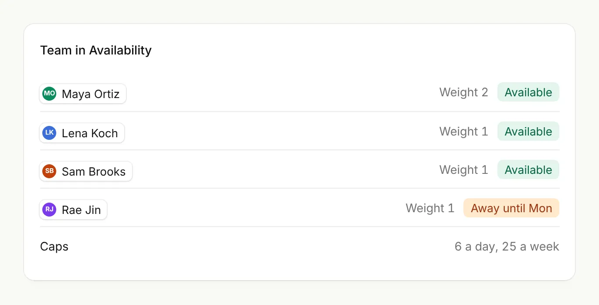

SavvyCal and Calendly do the same basic job. You share a link, people pick a time, and the meeting lands on your calendar with a video link. Both handle team scheduling, both connect to HubSpot, and both start at the same price for one person.

The differences show up in two places. SavvyCal puts a lot of care into what the person booking sees, and it gives round robin on its first paid plan. Calendly has a free plan, routing forms, text reminders and a long list of extras for sales teams.

> **[Try Claritia free](https://app.tryclaritia.com/signup)** to let form answers pick the meeting and the person, with booking inside forms on the free plan.

Below, we compare SavvyCal and Calendly on free plans, price, the booking page, team scheduling, routing, reminders, payments and integrations, then pick one for each kind of user.

## Main points

- Pick [SavvyCal](https://savvycal.com/) if you book many calls with outside people and want them to see their own calendar next to yours.
- Pick [Calendly](https://calendly.com/) if you want a free booking link, routing forms, text reminders or a mobile app.
- SavvyCal has no free booking. Its free account covers setup and meeting polls, and links need a paid plan. Calendly's free plan gives one event type and one calendar.
- Both start at $10 a user a month billed yearly. Round robin is on SavvyCal Basic at $10, and on Calendly Teams at $16 a seat a month billed yearly.
- Pick [Claritia](/) if your meetings start from a website form and the answers should pick the meeting and the person.

## SavvyCal vs Calendly at a glance

| | [SavvyCal](https://savvycal.com/) | [Calendly](https://calendly.com/) |
|---|---|---|
| Best for | Founders, consultants and teams booking outside calls | Sales teams and anyone who wants to start free |
| Free plan | Setup and meeting polls, no booking links | 1 event type, 1 calendar |
| Paid from | $10 a user a month billed yearly ($12 monthly) | $10 a seat a month billed yearly ($12 monthly) |
| Round robin | Basic | Teams, $16 billed yearly ($20 monthly) |
| Calendars checked | Unlimited | 1 on Free, 6 on paid plans |
| Routing forms | Not offered | Teams |
| Payments | Stripe on Premium | Stripe and PayPal from Standard |
| CRM | HubSpot and Close on Basic | HubSpot from Standard, Salesforce from Teams |
| Mobile app | No | Yes |
| Try before you buy | 30-day money-back guarantee | 14-day free trial |

Prices checked November 2026.

## What is SavvyCal?

[SavvyCal](https://savvycal.com/) is a scheduling tool for professionals and teams who want booking links that feel easy for both the host and the guest. Guests see a full week of open times and can lay their own calendar over the link to spot a match.

Hosts set buffers, limits, preferred times, and time blocks, put links on their own domain, and take Stripe payments. It also supports round robin, collective, and group links, meeting polls, and reminder workflows. You can rank your open times so your best ones show first, and AI assistants such as Claude and ChatGPT can book through it.

## What is Calendly?

[Calendly](https://calendly.com/) is scheduling software for professionals and teams who want people to book meetings without trading emails. You connect your calendars, set hours, buffers, and daily limits, and share booking links for one-on-one, multi-host, or group meetings.

It sends email and text reminders, has routing forms that send website leads to the right teammate, and collects payments. Newer additions include an AI assistant that finds times over email and a notetaker that writes meeting recaps. The notetaker and the email assistant, called Callie, come with the Standard Plus and Teams Plus plans.

## Free plans

This is the clearest gap between the two.

Calendly's free plan has no time limit. You get one event type, one connected calendar and unlimited one-on-one meetings on a booking page you can customize, plus the mobile app and browser extension. Reminders, more event types and payments need a paid plan.

SavvyCal lets you sign up, connect your calendars, build your links and use meeting polls for free. To let people book from your links, you need Basic or Premium. There's no self-serve trial either. Instead, every plan comes with a 30-day money-back guarantee.

If you want to book meetings for $0, Calendly wins.

## Pricing and plans

| Plan level | SavvyCal | Calendly |
|---|---|---|
| Free | Setup and polls only | $0, 1 event type |
| First paid plan | Basic, $10 a user a month billed yearly ($12 monthly) | Standard, $10 a seat a month billed yearly ($12 monthly) |
| Round robin | Included in Basic | Teams, $16 a seat a month billed yearly ($20 monthly) |
| Branding and payments | Premium, $17 a user a month billed yearly ($20 monthly) | Payments from Standard |
| AI add-ons | AI assistant access included | Standard Plus and Teams Plus |
| Large companies | Volume pricing past 50 users | Enterprise, from $15,000 a year and 50 seats |

For one person, the two cost the same on their first paid plan. For a team that shares meetings, SavvyCal costs less. A round robin team of five pays $600 a year on SavvyCal Basic and $960 a year on Calendly Teams, both billed yearly.

SavvyCal doesn't let you mix Basic and Premium seats on one subscription. It gives nonprofits, educators and students 25% off.

## The booking page

SavvyCal built its product around the person booking. They see a full week of your open times, and they can lay their own Google, Microsoft or Fastmail calendar over yours to find a time that suits both. Only they see their events. You can also rank your times, so the ones you'd like to fill come first.

Calendly's booking page is the one most people already know. It shows a calendar and the open times for the day the person picks. On Standard and up, you can remove Calendly branding.

If the feel of booking matters, for example when you ask a busy client for time, SavvyCal has the edge.

## Team scheduling and routing

SavvyCal puts round robin, collective links where everyone must be free, and group links on Basic. Each host in a rotation can have a priority from 1 to 9, their own hours and their own meeting limits. You can also add a fixed host who joins every meeting while others rotate.

Calendly puts round robin on Teams, along with centrally managed event types. Teams also adds forms that screen invitees and route each lead to the right person, from Calendly's own forms or your HubSpot, Pardot or Marketo forms. It can route by the owner set in HubSpot, and Enterprise adds routing by Salesforce lookup.

SavvyCal says it doesn't offer routing forms. So if leads need to go to a person based on their answers, Calendly is the one to pick. If you only need a fair rotation at a lower price, SavvyCal does it for less.

## Reminders and workflows

SavvyCal includes workflows on every paid plan: confirmation, reminder and thank-you emails in your own words, plus Zapier or webhook steps. On Premium, emails come from your own address. SavvyCal says it doesn't send SMS reminders.

Calendly adds automated reminders and follow-ups from Standard, and it sends both email and text reminders. Its free plan doesn't include automated reminders.

## Payments

SavvyCal takes payment through Stripe on Premium. The meeting isn't confirmed until the payment goes through, and Stripe Tax can handle sales tax, VAT and GST.

Calendly collects payments through Stripe or PayPal from Standard. Its paid plans also list payment links, prepaid meeting packages and invoices, which suit consultants who sell sessions.

## Integrations and AI

SavvyCal connects Google, Microsoft 365, iCloud and Fastmail calendars, with no limit on how many. It links to Zoom, Google Meet, Microsoft Teams and Whereby, to HubSpot and Close for CRM, and to Slack, Zapier, webhooks and an API.

Calendly connects HubSpot, Mailchimp and Zapier from Standard, adds Salesforce and Marketo on Teams, and Microsoft Dynamics on Enterprise. It also lists Google Analytics and Meta Pixel from Standard. For AI, Calendly sells its Notetaker and Callie through the Plus plans, while SavvyCal includes access for AI assistants that support MCP.

## Pros and cons

### SavvyCal

Pros:

- **Calendar overlay:** Guests see their own calendar next to your open times.
- **Round robin on the first plan:** Basic includes team links at $10 a user billed yearly.
- **Unlimited calendars:** Every calendar you use is checked for conflicts.

Cons:

- **No free booking:** Links only take bookings on a paid plan.
- **No routing forms or SMS:** SavvyCal says it offers neither today.
- **No mobile app:** You manage it in the browser.
- **Payments cost more:** Stripe payments need Premium.

### Calendly

Pros:

- **Free plan:** One event type and one calendar for $0.
- **Routing forms:** Route leads from Calendly, HubSpot, Pardot or Marketo forms on Teams.
- **Text reminders and a mobile app:** Useful for busy hosts.
- **Enterprise depth:** Salesforce lookup routing, SSO and audit logs.

Cons:

- **Small free plan:** One event type and no automated reminders.
- **Round robin costs more:** It needs Teams at $16 a seat a month billed yearly.
- **Calendar cap:** Six calendars on paid plans.

## Which should you pick?

- **Pick SavvyCal** if you book calls with clients, investors or partners and want the booking to feel easy for them.
- **Pick SavvyCal** if your team needs round robin and you want to pay less per seat.
- **Pick Calendly** if you want to start free, or you need text reminders and a mobile app.
- **Pick Calendly** if leads should be routed to the right rep based on their form answers.

If your meetings start from a form on your own site, there's one more option to weigh.

## A third option: Claritia

[Claritia](/) is a forms, scheduling and follow-up app built for small B2B teams that want every lead from their website to reach the right rep and book a meeting before they leave the page.

It builds forms from a sentence or one of 840 templates, opens the right person's calendar the moment the form is sent, routes each lead by its answers, and drafts follow-up emails in your brand's voice for you to approve. See [Claritia Meetings](/products/meetings).

What it adds next to SavvyCal and Calendly:

- **Booking inside forms:** On the free plan, with Google Calendar and Outlook.
- **Routing by any answer:** On Pro, with a routing log that shows why each person was picked. See [Claritia Routing](/products/routing).
- **Round robin:** Weights, priority, daily and weekly caps and away days on Pro.
- **Keep Calendly running:** On Starter, [Calendly bookings](/integrations/calendly) come into Claritia while you move.

*A Claritia round robin team: Maya has a weight of two, one rep is away until Monday, and caps limit meetings per day and per week.*

Starter is $15 a seat a month ($12 billed yearly), and Pro is $39 ($31 billed yearly). See [pricing](/pricing) for every plan.

Claritia has limits too. Its round robin costs more than SavvyCal's, it has no calendar overlay, and it's a newer tool with a smaller app marketplace. Its Zapier and Make apps aren't listed yet.

## Questions

### Is SavvyCal better than Calendly?

For booking calls with outside people, SavvyCal's calendar overlay makes it easier for the guest to find a time, and its round robin costs less. For a free plan, routing forms, text reminders or a mobile app, Calendly is the better fit.

### Is SavvyCal free?

You can sign up, connect calendars, set up links and use meeting polls for free. To let people book from your links, you need Basic at $10 a user a month billed yearly, or Premium at $17.

### Is SavvyCal cheaper than Calendly?

For one person, they cost the same: $10 a month billed yearly on SavvyCal Basic and Calendly Standard. For teams, SavvyCal is cheaper, since round robin is on Basic and Calendly needs Teams at $16 a seat billed yearly.

### Does SavvyCal have routing forms?

No. SavvyCal says it doesn't offer routing forms today. Calendly has them on Teams, and Claritia routes by any form answer on Pro.

### Does SavvyCal have a free trial?

No self-serve trial. Every SavvyCal plan has a 30-day money-back guarantee instead, and teams can email SavvyCal to try it first. Calendly has a 14-day free trial.

## Get started

Pick SavvyCal for the booking experience and cheaper team links, and Calendly for a free plan and lead routing. If your meetings start from a form, try Claritia.

> **[Try Claritia free](https://app.tryclaritia.com/signup)** to build a form that routes each lead and books the meeting on the same page.

You can also compare more tools in our [Calendly alternatives](/blog/best-calendly-alternatives) guide or see every plan in [Calendly pricing](/blog/calendly-pricing).
