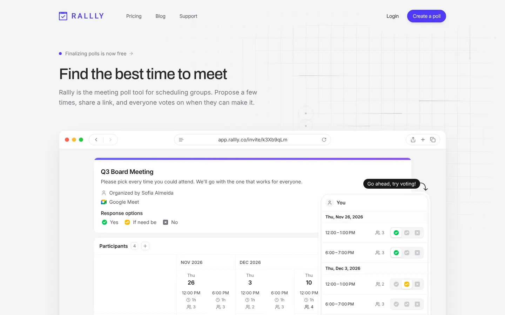
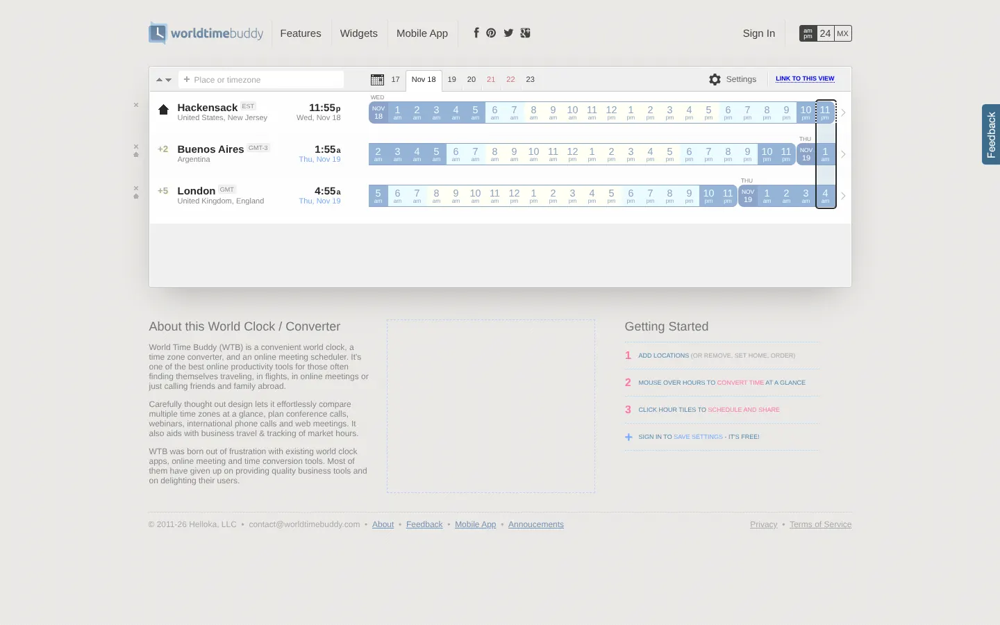

You write "Tuesday at 10" in an email, and the other person shows up an hour early. Or a client in Sydney books Wednesday morning, which turns out to be your Tuesday evening. Time zone mistakes are small, but each one costs a meeting, and sometimes a client's trust.

Most of them come from doing the math by hand. Someone converts a time in their head, forgets that clocks changed last weekend, or writes "EST" in a month when New York is on EDT. The fix is to let your tools do the converting, and to check a few things before you hit send.

> **[Try Claritia free](https://app.tryclaritia.com/signup)** to share a booking page that shows each visitor times in their own time zone and language, on every plan.

In this guide, we walk through seven steps to book meetings across time zones, the problems people hit most, and the tools that help.

## Main points

- Let a booking page do the math. Tools like [Claritia](/), [Cal.com](https://cal.com/) and [YouCanBookMe](https://youcanbook.me/) show each guest your open times in their own time zone.
- Set your working hours in your own time zone first, so people abroad only see times when you're really free.
- For a group spread across countries, find the overlap with [World Time Buddy](https://www.worldtimebuddy.com/) or the [timeanddate.com Meeting Planner](https://www.timeanddate.com/worldclock/meeting.html), then send a poll in a tool like [Rallly](https://rallly.co/).
- Name cities, not abbreviations. "CST" can mean US Central Standard Time or China Standard Time.
- Double-check the weeks around daylight saving changes, when the gap between two cities can shift by an hour.

## What you need

Before you start, have these four things ready:

- **A calendar with the right time zone.** Google Calendar or Outlook, set to where you are now.
- **Your working hours.** The hours you're willing to take calls, in your own time zone.
- **Where each person is.** A city for each guest, since a city tells you the time zone and its daylight saving rules.
- **A tool that converts times.** A booking page or poll that shows each guest their local time.

## Step 1: Check your own time zone and working hours

Every tool starts from your calendar, so a wrong setting there spreads to every booking. In Google Calendar, you can change the time zone for all your calendars, and Google says your calendar shows local time when you travel.

Google Calendar can also show additional time zones on your calendar grid. Add the zones of the people you meet most, and you'll see their hours next to yours.

Then set your working hours in your booking tool. Add a minimum notice, so nobody books a slot an hour away while you're asleep, and a daily cap if late calls tire you out.

In Claritia, working hours, buffers, notice and daily caps come on every plan. See [Claritia Meetings](/products/meetings) for how availability works.

## Step 2: Find the overlap in working hours

Before you offer times, look at where everyone's workday overlaps. A world clock lines up the hours side by side, so you can see the overlap at a glance. Here is one moment on a weekday in late November 2026:

| City | Local time | Time zone then |
|---|---|---|
| San Francisco | 8:00 AM | UTC-8 |
| New York | 11:00 AM | UTC-5 |
| London | 4:00 PM | UTC+0 |
| Berlin | 5:00 PM | UTC+1 |
| Bangalore | 9:30 PM | UTC+5:30 |
| Sydney | 3:00 AM the next day | UTC+11 |

No hour fits a normal workday in all six cities. When that happens, you have three fair choices:

- **Rotate the hard slot.** Move the meeting each week so the same people aren't always up early or late.
- **Split the group.** Hold one call for the Americas and Europe and another for Europe and Asia.
- **Share notes or a recording.** Let people who can't attend catch up.

Pick cities instead of zone names when you use a world clock. The timeanddate.com planner, for example, asks you to choose a city such as London instead of UTC or GMT, because the UK moves its clocks in summer.

## Step 3: Share a booking page that shows the guest's time zone

For one-on-one calls, a booking page removes nearly all of the math. You set your hours once in your own zone. Each guest opens the link and sees your open times in their own local time, and the meeting lands on both calendars at the right hour.

Check three things on your page before you share it:

- **The time zone is shown.** Guests should see which zone the times are in.
- **Guests can change it.** Someone who is traveling may want to book in the zone they'll be in.
- **The language fits.** A page in the guest's own language makes dates easier to read.

Claritia shows each visitor's time zone and language on every plan. Cal.com detects time zones on its free plan, and YouCanBookMe detects time zone and language for each booker.

## Step 4: Use a meeting poll for a group

When three or more people must agree on a time, use a meeting poll. Pick 3 to 5 options inside the overlap you found in Step 2, share one link, and let everyone vote.

Make sure each voter sees the options in their own time zone. Doodle and Rallly both do this. When2meet asks you to set one time zone for the event, so state it in your message too.

In Claritia, meeting polls come on Starter. Our guide to [group meeting schedulers](/blog/group-meeting-scheduler) compares more poll tools.

## Step 5: Write every time with a city

Sometimes you still need to put times in an email. When you do, name the city and add the other person's time in brackets:

- **Clear:** Tuesday, December 1, at 10:00 AM New York time (4:00 PM in Berlin).
- **Unclear:** Tuesday at 10 EST.

Abbreviations cause mix-ups. CST can be US Central or China Standard Time, and IST can be India, Israel or Irish Standard Time. People also write EST all year, when New York switches to EDT in summer.

Even better, send a booking link instead of a list of times. In Claritia, Starter can also copy your open times into an email for you.

## Step 6: Send a calendar invite, not just a time

A time typed in a chat message stays fixed in the writer's zone. A calendar invite converts itself. Google says an event shows up in the local time zone of each person you invite, even if they're somewhere else.

So once a time is agreed, send a real invite from your calendar or booking tool. Add the video link inside it, so nobody has to search their inbox on the day. Claritia adds a Google Meet, Teams or Zoom link to each meeting it books.

## Step 7: Double-check around daylight saving changes

Clocks don't change on the same day everywhere. The US moves its clocks on the second Sunday in March and the first Sunday in November. The EU changes on the last Sunday in March and the last Sunday in October.

For a few weeks each spring and fall, New York and London are 4 hours apart instead of 5. In 2027, the US changes on March 14 and November 7, and the EU on March 28 and October 31.

Places in the southern hemisphere that use daylight saving change in the opposite season, and many places never change. A weekly meeting stays fixed in the zone it was created in, so for some guests it can move by an hour during these weeks.

## Common problems

- **A guest booked the wrong time.** The page probably showed your zone, not theirs. Open your link from a private window and check which time zone it shows.
- **Your own invites look an hour off.** Your calendar or computer may still be set to a zone you traveled from. Check the time zone setting in your calendar.
- **People book calls at midnight.** Your working hours may be missing, or set in the wrong zone. Set them again and add a minimum notice.
- **The same people always get bad slots.** Rotate the time, or split the meeting by region.
- **The date is off by a day.** Tuesday evening in California is already Wednesday in Sydney. Write the date with the city, and let the invite convert it.
- **A recurring meeting moved.** Daylight saving started or ended in one country first. Confirm the time with the group during those weeks.

## Tools for scheduling across time zones

### Claritia

[Claritia](/) is a forms, scheduling and follow-up app built for small B2B teams that want every lead from their website to reach the right rep and book a meeting before they leave the page.

It builds forms from a sentence or one of 840 templates, opens the right person's calendar the moment the form is sent, routes each lead by its answers, and drafts follow-up emails in your brand's voice for you to approve.

Its booking pages show each visitor's time zone and language on every plan, with working hours, buffers, notice and daily caps. It connects [Google Calendar](/integrations/google-calendar) or [Outlook](/integrations/outlook), and Starter adds meeting polls. It's a newer tool, so its marketplace is smaller than the big names.

### Cal.com

[Cal.com](https://cal.com/) is scheduling software for individuals and companies that want booking links they can shape around their own process. It syncs calendars, detects time zones, sends reminders, and runs video calls through Zoom, Google Meet, Microsoft Teams, or its own Cal Video.

Teams can use round robin, collective events where every host must be free, routing forms, and workflows, plus admin tools such as SAML SSO and audit logs. Its source code is published on GitHub. Automatic time zone detection is on its free plan, which is built for one user.

### YouCanBookMe

[YouCanBookMe](https://youcanbook.me/) is an online scheduling tool for small and midsize businesses that want a branded booking page tied to their calendars. It syncs with Google, Apple, Outlook, and Fastmail calendars, and offers booking forms with conditional questions, approval of requests before they are confirmed, password protected pages, and paid bookings through Stripe.

It sends confirmations, reminders, and follow-ups by email and SMS, triggers webhooks, and reports on bookings, no-shows, and revenue. It detects each booker's time zone and language, and supports more than 40 languages. Its free plan has one booking page and 30 bookings a month.

### Rallly

[Rallly](https://rallly.co/) is an open-source meeting poll tool for groups that want to agree on one time without a long email thread. You propose a few times, share a link, and everyone marks the times they can make, with no account needed to create a poll or vote.

Each person sees the options in their own time zone, so nobody converts times by hand. When you pick a time, Rallly emails a calendar invite to everyone. The free plan allows up to 3 open polls.

### World Time Buddy

[World Time Buddy](https://www.worldtimebuddy.com/) is a world clock, time zone converter and meeting planner for people who work with others in other countries. You add cities or time zones, and it lines up their hours in rows, so you can hover over an hour to see the local time everywhere.

Click an hour to pick a time, then share it as a link or add it to Google Calendar or Outlook. It's free to use, and signing in saves your settings.

### timeanddate.com Meeting Planner

The [timeanddate.com Meeting Planner](https://www.timeanddate.com/worldclock/meeting.html) is a free web tool for finding a good time to call people in other time zones. You pick a date and add the cities where people are, and it shows how the hours line up in each place.

It adjusts for daylight saving time on its own. The same site's Event Time Announcer makes a page you can share that shows the local time of an event in cities around the world.

## Questions

### What is the best time to schedule a meeting across time zones?

Pick an hour inside everyone's working day. Between the US East Coast and Western Europe, that's usually the US morning. When no hour fits everyone, rotate the slot so the same people don't always take the late call.

### What is the best time zone meeting scheduler?

For one-on-one calls, use a booking page that shows each guest their own time zone, such as Claritia, Cal.com or YouCanBookMe. For groups, use a poll that does the same, such as Rallly or Doodle. Our list of [free meeting schedulers](/blog/best-free-meeting-scheduler) compares more options.

### How do I show my availability in someone else's time zone?

Share a booking link. The tool shows your open times in the visitor's time zone. If you must write times in an email, add the city, like "10:00 AM New York time".

### Does Google Calendar handle time zones?

Yes. Google says an event shows up in each invited person's local time zone, and you can show additional time zones on your calendar grid. Appointment schedules let you set the time zone of your availability.

### How do I schedule a recurring meeting across time zones?

Set it in the time zone of the person it matters most to, and tell the group which city it follows. Check the time again in March, October and November, when clocks change on different dates.

### Should I write meeting times in UTC?

UTC is common inside engineering teams, but many guests would rather not convert it. Write the time in a city's local time and add the guest's time in brackets, or send a calendar invite that converts it for them.

## Get started

Set your hours once in your own zone, then let a booking page or poll convert the times for everyone else. Send a real calendar invite, and check again when clocks change.

> **[Try Claritia free](https://app.tryclaritia.com/signup)** to connect your calendar, set your working hours and share a booking page that shows each guest their own time.

You can also compare [plans and prices](/pricing) or read our guide to [group meeting schedulers](/blog/group-meeting-scheduler).
