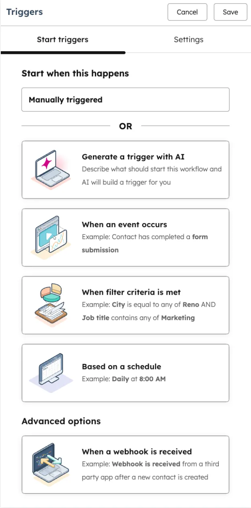
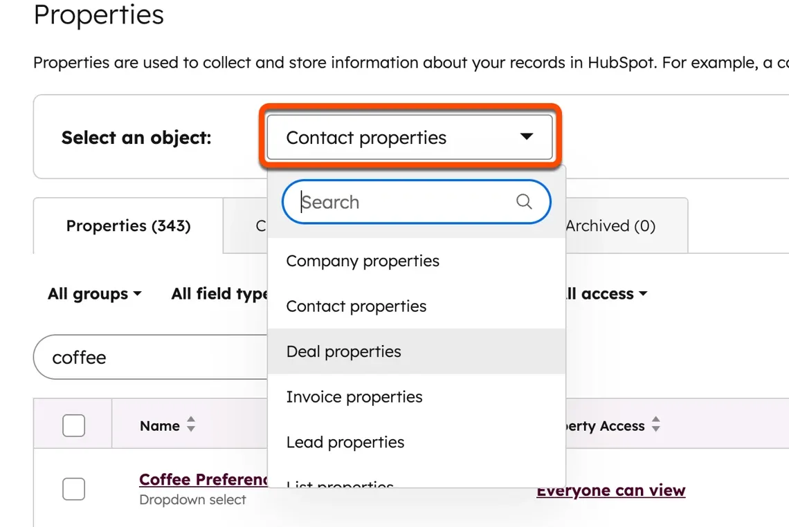
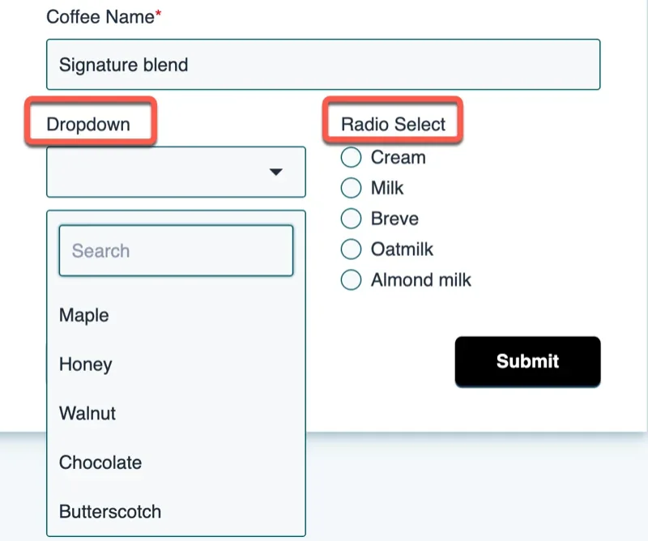
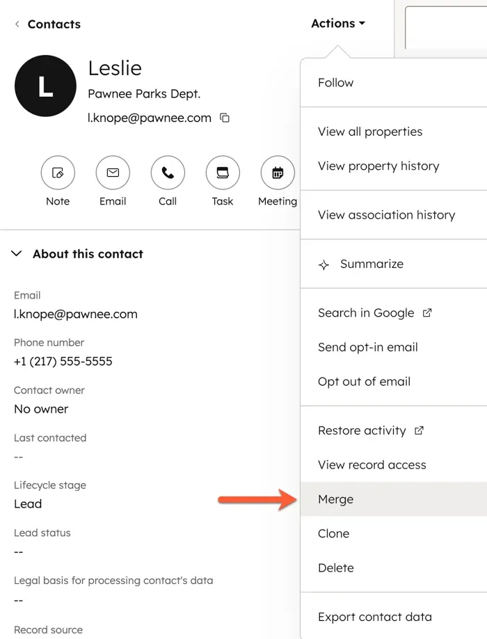

You built a Typeform that people finish. The answers pile up in Typeform's results, and someone exports a CSV each week to load into HubSpot. By then the hot leads have cooled, and the sales team never sees what each person said.

It doesn't have to work like that. Typeform has its own HubSpot app that sends each response straight into your CRM as a contact, and can also fill in a company and a deal. It works on every Typeform plan, including Free, and with HubSpot's free CRM.

> **[Try Claritia free](https://app.tryclaritia.com/signup)** to send each form answer to HubSpot and book the meeting with the right rep before the lead leaves the page.

Below: what the integration does, what you need on each side, how to connect it step by step, and how to fix the usual problems.

## Main points

- [Typeform](https://www.typeform.com/) has a native [HubSpot](https://www.hubspot.com/) integration, built by Typeform and certified by HubSpot.
- It creates or updates HubSpot contacts, companies and deals from each response. You map each question to a HubSpot property.
- It works on all Typeform plans, including Free, and with HubSpot Free. Typeform Free only takes 10 responses a month, though.
- It sends answers. It doesn't book a meeting or follow up, so anything after submit has to be built in HubSpot.
- If you want the lead to book right after the form, [Claritia](/) can take Typeform answers or replace the form, then send the contact to HubSpot on its Starter plan.

## What the integration does

Typeform built the HubSpot app, and HubSpot lists it as a certified app in its marketplace. Here is what it does, based on Typeform's integration page, its HubSpot listing and its pricing page.

**Responses become HubSpot records.** Each response can create or update a contact, a company and a deal in HubSpot. One response can fill all three.

**You choose where each answer goes.** You map each Typeform question to a HubSpot property, such as first name, email, company or a custom property you made.

**Known contacts are updated.** In its own product notes, Typeform says a contact is updated when the email matches one already in HubSpot. A company is matched on its company domain name, and for deals you pick the property that marks a match.

**Old responses can go too.** Typeform's HubSpot listing says you can send all your data to HubSpot, even responses you collected before you set up the integration.

**Zapier covers the rest.** Through [Zapier](https://zapier.com/), Typeform also lists actions like filling out a HubSpot form or adding someone to a HubSpot contact list when they finish your typeform.

## What you need

Prices checked November 2026 on [Typeform's pricing page](https://www.typeform.com/pricing/) and HubSpot's marketplace listing.

| Typeform plan | Price yearly | Price monthly | Responses a month | HubSpot integration |
|---|---|---|---|---|
| Free | $0 | $0 | 10 | Yes |
| Basic | $28 a month | $39 a month | 100 | Yes |
| Plus | $56 a month | $79 a month | 1,000 | Yes |
| Business | $91 a month | $129 a month | 10,000 | Yes |

On the HubSpot side, HubSpot's marketplace lists every feature of the Typeform app as available with HubSpot Free. You'll also need:

- **A HubSpot login** that can connect apps to your account.
- **Your HubSpot properties ready.** Make any custom properties in HubSpot before you map, so they show up in the list.
- **An email question.** Contacts need an email to match on, so add one and make it required.
- **A paid HubSpot plan for follow-up automation.** HubSpot workflows, which you'd use to assign owners or create follow-up tasks after submit, need a Professional or Enterprise plan.

*Follow-up after a form starts in HubSpot's workflow triggers, for example when a contact completes a form submission. Image: [HubSpot Knowledge Base](https://knowledge.hubspot.com/workflows/create-workflows).*

Watch the response cap most. Ten responses a month on Free will test the connection, but they won't run lead capture. Our [Typeform pricing guide](/blog/typeform-pricing) covers each plan.

## Step 1: Plan your fields

Before you connect anything, write a short list with two columns: each question in your typeform, and the HubSpot property it should fill. Mark which record each one belongs to: contact, company or deal.

Then check HubSpot. Every property on your list should exist there, so create the missing ones now. Keep the list open while you map in the next steps.

*HubSpot's Properties settings, where you pick contact, company or deal properties and create the ones you're missing. Image: [HubSpot Knowledge Base](https://knowledge.hubspot.com/properties/create-and-edit-properties).*

## Step 2: Connect HubSpot in Typeform

1. Open your form in Typeform and go to the **Connect** panel.
2. Find HubSpot and select **Connect**.
3. Sign in to HubSpot and pick the account you want to use.
4. Allow Typeform the access it asks for.

You can also connect while you build. In the Create panel, select **+ Add content** and choose **Create with HubSpot**. Typeform checks that the right HubSpot account is connected, then maps each new question to a matching HubSpot field as you add it.

## Step 3: Map each question

For each question, pick the HubSpot property it should fill from the **Map to** list. Work through contacts first, then companies and deals if you use them.

A few tips:

- Map your email question to HubSpot's Email property, so contacts match instead of doubling up.
- Map hidden fields too, such as a UTM source, so you know where the lead came from.
- If a property is grayed out, the question type doesn't fit that kind of property. Pick a different property or change the question.

*Dropdown and radio select are two of HubSpot's property field types, and each type takes a different kind of answer. Image: [HubSpot Knowledge Base](https://knowledge.hubspot.com/properties/property-field-types-in-hubspot).*

## Step 4: Choose how matches work

For contacts, the email decides. For companies, the company domain name decides. For deals, choose a property, such as the deal name, that marks a deal as the same one.

If you don't map an email for contacts, choose other properties to match on. Typeform has said that with no match properties, a new contact is created each time someone submits.

## Step 5: Turn it on and test

Finish and save the mapping. Then fill in your typeform with a test email and check HubSpot:

- A new contact exists with the right email.
- Each mapped answer sits in the right property.
- The company and deal exist, if you mapped them.

Submit again with the same email and check that the contact was updated, not copied. Keep in mind that test responses you send through a published form count toward your monthly limit.

## What it can't do

- **It can't book a meeting.** The integration moves answers into HubSpot. Booking a time needs a separate scheduler, such as Typeform's own Calendly connection.
- **It doesn't follow up.** Owner rotation, emails and tasks after submit are built in HubSpot, and workflows need Professional or higher.
- **It only fills contacts, companies and deals.** The HubSpot listing shows no other record types.
- **Some questions can't be mapped.** Questions whose type doesn't fit a HubSpot property are grayed out.
- **It stops when you hit your cap.** When you reach 100% of your monthly responses, Typeform puts your forms in private mode until the next month or an upgrade. No new leads reach HubSpot in that time.

## Common problems

**Responses stopped reaching HubSpot.** Check your response count first. At your plan's limit, forms go private and stop collecting. Typeform emails you at 90% and 100%.

**Contacts are doubling up.** Your email question isn't mapped to HubSpot's Email property, or you chose no other properties to match on.

*If doubles already got in, the Merge option in a contact's Actions menu combines two records into one. Image: [HubSpot Knowledge Base](https://knowledge.hubspot.com/records/merge-records).*

**Some contacts arrive with blanks.** People skipped questions. Typeform's HubSpot listing suggests making the key questions required.

**A question won't map.** The property type and question type don't fit. Change one of them, or map to a different property.

**A property you need isn't in the list.** Create it in HubSpot first, then reopen the mapping.

**Older responses are missing.** If you need responses from before you connected, Typeform's HubSpot listing says you can send those to HubSpot too.

## Another way: Claritia

[Claritia](/) is a forms, scheduling and follow-up app built for small B2B teams that want every lead from their website to reach the right rep and book a meeting before they leave the page.

It builds forms from a sentence or one of 840 templates, opens the right person's calendar the moment the form is sent, routes each lead by its answers, and drafts follow-up emails in your brand's voice for you to approve.

You can use it two ways with Typeform and HubSpot.

**Keep your Typeform.** Each Typeform answer comes into Claritia by webhook the moment it's sent, checked with your Typeform secret. It becomes a contact in Claritia, then goes on to HubSpot, your sheets, Slack and email lists, with workflows sending reminders and follow-ups. See the [Typeform integration](/integrations/typeform).

**Or rebuild the form in Claritia.** Then the lead books the meeting on the same page, right after the last question. With HubSpot connected, Claritia does the following:

- **Contacts without duplicates.** Each fill creates a contact or updates the one with that email, and you pick whether a match is updated. See the [HubSpot integration](/integrations/hubspot).
- **Every field mapped.** Match each question to a HubSpot contact property.
- **The owner set for you.** Use the person Claritia's routing picks, or let HubSpot's own rules decide.
- **Fills on the timeline.** Reps see what the lead asked for on the contact in HubSpot.

*When a Claritia form is sent, the thank-you screen opens the right rep's calendar.*

Claritia's free plan takes 250 submissions a month, with conditional logic and multi-page forms included. HubSpot, Typeform answers and follow-up the next day until they book start on Starter at $15 a seat a month ($12 yearly). Routing by any answer is on Pro at $39 ($31 yearly). See [pricing](/pricing).

**Cons:** Claritia is a newer tool with a smaller marketplace than Typeform's, and its Zapier and Make apps aren't listed yet. Its HubSpot connection writes contacts, while Typeform's can also fill companies and deals.

## Questions

### Does Typeform integrate with HubSpot?

Yes. Typeform has a native HubSpot app, built by Typeform and certified by HubSpot. It sends each response to HubSpot as a contact, and can also create or update a company and a deal.

### Is the Typeform HubSpot integration free?

Yes, the integration itself is on every Typeform plan, including Free, and works with HubSpot Free. The limit is responses: Typeform Free takes 10 a month, and Basic, at $28 a month billed yearly, takes 100.

### Does Typeform update existing HubSpot contacts?

Yes. When the email in a response matches a contact in HubSpot, Typeform updates that contact instead of making a new one. Map your email question to HubSpot's Email property for this to work.

### Can Typeform create deals in HubSpot?

Yes. You can map questions to deal properties, and one response can create a contact, a company and a deal at the same time.

### Why aren't my Typeform responses showing in HubSpot?

Check three things: that HubSpot is still connected in the Connect panel, that your email question is mapped, and that you haven't hit your monthly response limit. At the limit, Typeform puts your forms in private mode.

### What's the best HubSpot form alternative to Typeform?

It depends on what you need after submit. Our list of [HubSpot Forms alternatives](/blog/best-hubspot-forms-alternatives) compares 8 form builders on how they connect to HubSpot, what they cost and where they fall short.

## Get started

Connect Typeform to HubSpot, map your email question first, and test with one response before you share the form. Watch your monthly response limit once it's live.

> **[Try Claritia free](https://app.tryclaritia.com/signup)** to send each form answer to HubSpot and book the meeting with the right rep before the lead leaves the page.

See how Claritia works with [Typeform](/integrations/typeform), or compare [HubSpot Forms alternatives](/blog/best-hubspot-forms-alternatives).
