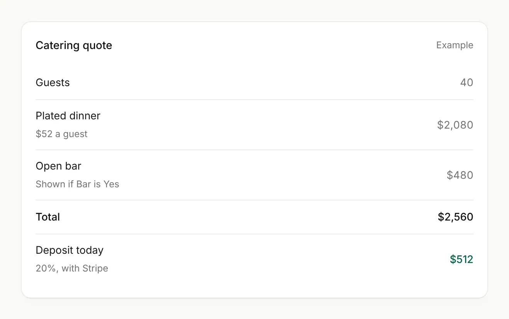

Typeform pricing is based on responses. Each plan gives you a set number of form responses a month, shared across all your forms, plus a set number of users. When you run out, your forms stop taking answers until the next month or until you pay for more. That makes the response limit the number that matters most.

The free plan adds to the confusion. It exists, but it's small, and many people only find its limit after they've shared a form.

> **[Try Claritia free](https://app.tryclaritia.com/signup)** to get 250 form submissions a month on the free plan, with conditional logic and meeting booking included.

Below is every Typeform plan, what the free plan leaves out, the extra costs and when another tool may fit better.

## Main points

- Yes, [Typeform](https://www.typeform.com/) is free, but the free plan allows only 10 responses a month across all your forms.
- Paid plans are Basic at $28 a month billed yearly ($39 monthly), Plus at $56 ($79), Business at $91 ($129) and Growth Flow at $266 ($379).
- Each plan has a monthly response limit: 100 on Basic, 1,000 on Plus and 10,000 on Business and Growth Flow.
- Removing Typeform branding starts on Plus. Salesforce, drop-off analysis and conversion tracking start on Business.
- If you want more free responses and forms that book meetings, [Claritia](/) gives you 250 submissions a month for $0.

## Is Typeform free?

Yes. Typeform has a free plan with unlimited forms, but it only takes 10 responses a month in total, across every form in your account. Unused responses don't carry over to the next month.

The free plan is better than its limit suggests. Typeform says it includes logic with branching, scores and calculations, custom endings, embedding, response exports, basic reports, integrations, API access and Typeform AI for building forms.

You can try paid features in trial mode, but you need a paid plan to publish a form that uses them. For most real forms, 10 responses a month runs out in a day.

## Typeform pricing: how much does Typeform cost?

[Typeform](https://www.typeform.com/) has a free plan, four main paid plans and Enterprise. There's also a Talent plan for HR teams. Prices are per account, and each plan includes a set number of users.

| Plan | Price monthly | Price yearly | Main limits |
|---|---|---|---|
| Free | $0 | $0 | 10 responses a month, Typeform branding |
| Basic | $39 a month | $28 a month | 100 responses a month, 1 user |
| Plus | $79 a month | $56 a month | 1,000 responses a month, 3 users |
| Business | $129 a month | $91 a month | 10,000 responses a month, 5 users |
| Growth Flow | $379 a month | $266 a month | 10,000 responses a month, 5 users |
| Enterprise | Custom | Custom | Custom responses and seats |

Prices checked November 2026 on [Typeform's pricing page](https://www.typeform.com/pricing/). Typeform says yearly billing saves up to 30%. Billed yearly, you save $132 a year on Basic, $276 on Plus and $456 on Business.

Each paid plan also has a maximum you can reach with extra responses: 750 a month on Basic, 2,500 on Plus and 50,000 on Business and Growth Flow.

## Typeform Basic

**Who it fits:** One person who runs a few forms with modest traffic, like a lead form for a small service business.

**What it adds:** 100 responses a month for 1 user, unlimited forms and questions, payments, file uploads up to 1 GB, partial responses, hidden fields, logic, scores and calculations. It connects to HubSpot, Google Sheets, Slack, Airtable, Pipedrive, Mailchimp, Calendly and more than 500 apps through Zapier.

**Limits:** Typeform branding stays on your forms. There's no custom subdomain, no reCAPTCHA and no redirect to a web page after submit. You can add responses only up to 750 a month.

**Price:** $28 a month billed yearly, or $39 billed monthly.

## Typeform Plus

**Who it fits:** Small teams that want their forms to look fully on brand.

**What it adds:** 1,000 responses a month and 3 users. You can remove Typeform branding, use premium themes and a custom subdomain, redirect people to a web page after submit, and block spam with reCAPTCHA. File uploads go up to 2 GB.

**Limits:** No Salesforce, no drop-off analysis and no conversion tracking with Google Analytics, Google Tag Manager or Meta Pixel. The response maximum is 2,500 a month.

**Price:** $56 a month billed yearly, or $79 billed monthly.

## Typeform Business

**Who it fits:** Marketing teams with real traffic that need to see where people drop off.

**What it adds:** 10,000 responses a month and 5 users. It adds question drop-off analysis, conversion tracking with Google Analytics, Google Tag Manager and Meta Pixel, the Salesforce integration, forms in more than one language, priority support and 4 GB of file uploads. You can set up to 3 partial submit points instead of 1.

**Limits:** No data enrichment, Smart Insights, video questions or signature questions. Those are on Growth Flow.

**Price:** $91 a month billed yearly, or $129 billed monthly.

## Typeform Growth Flow

**Who it fits:** Growth and marketing teams that want Typeform to enrich and follow up with leads.

**What it adds:** Everything in Business, plus enrichment of 1,500 responses a month, Smart Insights, AI clarifying questions, video questions and answers, signature questions, blocking of duplicate responses, and email and text follow-ups. The Contacts & Automations add-on is included at no extra cost.

**Limits:** Still 10,000 responses and 5 users. The 14-day free trial needs a credit card.

**Price:** $266 a month billed yearly, or $379 billed monthly.

## Typeform Talent and Enterprise

**Talent** is for HR and people teams. It starts at $119 a month billed yearly ($169 monthly) and includes 3,000 responses a month, 3 users, video questions and answers, reCAPTCHA, forms in more than one language and AI clarifying questions.

**Enterprise** is for large organizations with 6 or more users. It adds custom limits on responses and seats, single sign-on, HIPAA compliance, a choice of US or EU data center, custom domains and branding, a dedicated success manager and help with setup. You get a price from Typeform's sales team.

## What the free plan leaves out

Typeform's free plan has more features than most people expect. It's short on volume, and a few things are paid only:

- **Responses.** 10 a month across all forms is enough to test. A live form will use it up fast.
- **Payments and file uploads.** Typeform lists these as paid features.
- **Partial responses.** Saving answers from people who leave early needs a paid plan.
- **Your own brand.** Removing Typeform branding needs Plus or higher.
- **More users.** Extra team members start on Plus, with 3 users.
- **Paid features on live forms.** You can try them in trial mode, but you can't publish a form that uses them.

## Extra costs to watch

The plan price is only part of the bill. Watch for these:

- **Responses run out mid-month.** Typeform emails you at 90% and 100% of your limit. At 100%, your forms go into Private mode until the next month starts or you upgrade.
- **Extra responses.** You can buy responses as an add-on or turn on auto-upgrade, but only up to your plan's maximum.
- **Test answers count.** Responses you send yourself through a published form count toward the limit. Deleting a response doesn't give it back.
- **Contacts & Automations.** This add-on costs $25 a month for 2,400 actions on Plus and up, or $75 a month for 12,000 actions on Business and up. It's billed monthly.
- **Users are capped.** Basic has 1 user, Plus 3 and Business 5. More than that means Enterprise.
- **No refund on cancel.** Cancelling takes effect at the end of the period you paid for, and Typeform doesn't refund the time left. You can't pause a plan.
- **Cancelling locks some forms.** When you cancel, forms that use paid features go into trial mode and can't take responses until you upgrade or remove those features. Extra seats are removed too.

## Is Typeform worth it?

Typeform is worth it if the look of your form matters most. Its one-question-at-a-time style is calm and polished, and logic and calculations are included even on the free plan.

The cost climbs with volume. Basic gives you 100 responses a month for $28 billed yearly, which is fine for a small form but low for a busy lead form.

In practice, many people need Plus, since it removes the branding and adds teammates, at $56 a month billed yearly. If you need Salesforce or conversion tracking, you're looking at Business at $91 billed yearly.

Typeform also stops at the form. If your goal is to book a meeting with each lead, you'll connect it to a scheduling tool, which is another bill.

## Typeform alternatives

If Typeform's response limits don't fit your traffic, we compared other tools in [the best Typeform alternatives](/blog/best-typeform-alternatives).

[Claritia](/) is one of them. It's a forms and meetings tool for small teams. The lead fills in the form, and the right person's calendar opens before they leave the page.

- **Free:** $0 for 1 seat and 250 submissions a month, with unlimited forms, conditional logic, calculations, file uploads, hidden fields and booking inside forms.
- **Starter:** $15 a seat a month ($12 billed yearly). Adds 2,000 submissions, Stripe payments, e-signatures, redirects and HubSpot.
- **Pro:** $39 a seat a month ($31 billed yearly). Adds 5,000 submissions, routing by answer and removes Claritia branding.
- **Business:** $79 a seat a month ($63 billed yearly). Adds unlimited submissions, partial answers, drop-off by question and Salesforce.

*Caption: This Claritia form adds up the price as people answer, then takes a deposit with Stripe.*

Teammates who only build forms or read answers don't need a seat. Claritia is newer, with a smaller app marketplace than Typeform, and its Zapier and Make apps aren't listed yet. On Starter, you can also bring [Typeform answers into Claritia](/integrations/typeform) while you move. See all [form features](/products/forms).

## Questions

### Is Typeform free?

Yes. Typeform has a free plan with unlimited forms, logic and integrations. It only takes 10 responses a month across all your forms, and your forms show Typeform branding.

### How many responses do you get on Typeform for free?

10 a month in total, shared by every form in your account. The count resets each month, and unused responses don't roll over.

### How much does Typeform cost per month?

Billed monthly, Basic is $39, Plus is $79, Business is $129 and Growth Flow is $379. Billed yearly, they cost $28, $56, $91 and $266 a month.

### What happens when you reach your Typeform response limit?

Typeform emails you at 90% and 100%. At 100%, your forms go into Private mode until the next month or until you upgrade. You can also add responses up to your plan's maximum.

### Which Typeform plan removes the branding?

Plus and every plan above it. Plus costs $56 a month billed yearly, or $79 billed monthly.

### Does Typeform offer a free trial?

Growth Flow has a 14-day free trial that needs a credit card. On other plans, you can try paid features in trial mode, but you need to pay to publish forms that use them.

## Get started

If you want more free responses and forms that end in a booked meeting, you can start on Claritia's free plan. Describe your form to Tia, the AI form builder, or pick a template.

> **[Try Claritia free](https://app.tryclaritia.com/signup)** to build your first form and book your first meeting today.

You can also browse our [form templates](/templates) or compare plans on the [pricing page](/pricing).
