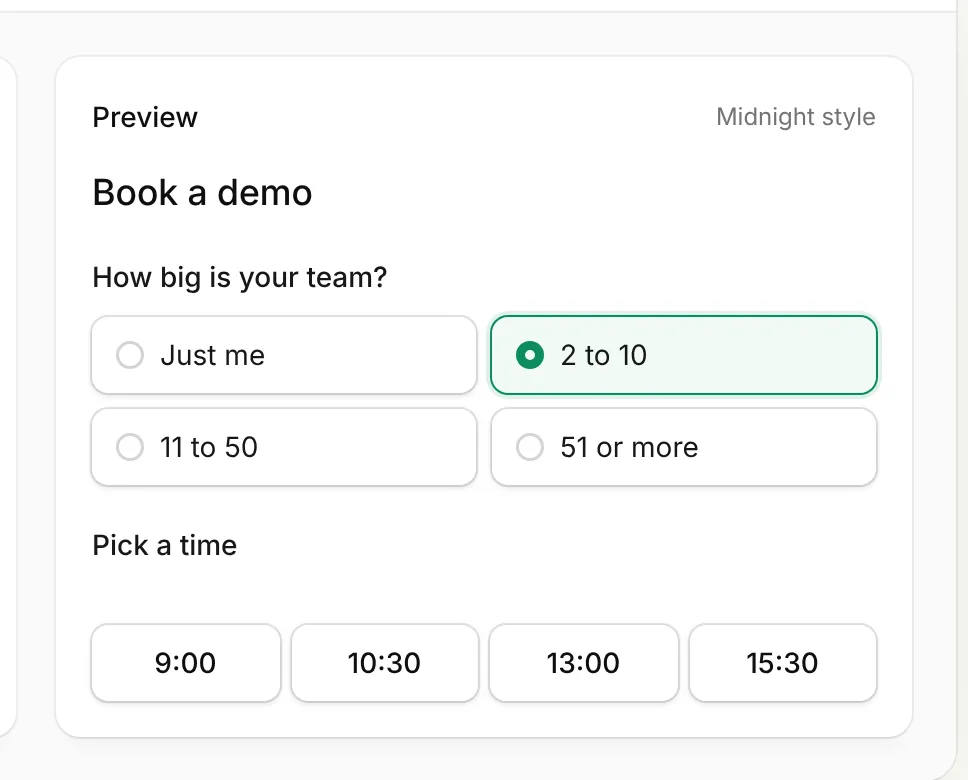

Typeform and Jotform are well known form builders, made for forms that face customers. Yet they feel very different. Typeform shows one question at a time and puts design first. Jotform puts every field, widget and template you might need into one editor.

The choice usually comes down to two things: how many answers you collect each month, and how the form should feel. Get the first wrong and you pay for responses you can't use. Get the second wrong and the form won't match your brand.

> **[Try Claritia free](https://app.tryclaritia.com/signup)** to build a form that books the meeting on the same page, with 250 submissions a month on the free plan.

Below, we compare Typeform and Jotform on price, response limits, design, logic, payments, users and integrations, then give a clear pick for each kind of team.

## Main points

- Pick [Typeform](https://www.typeform.com/) if the look and feel of the form matters most, you collect a modest number of answers, and you want a few teammates on one account.
- Pick [Jotform](https://www.jotform.com/) if you need more submissions for the money, payment and signature fields, or a template for almost any form.
- For about the same monthly price, Jotform Bronze allows 1,000 submissions a month, while Typeform Basic allows 100.
- Typeform's free plan takes 10 responses a month. Jotform's free plan takes 100 submissions across 5 forms.
- Pick [Claritia](/) if your form collects leads and each one should end in a booked meeting.

## Typeform vs Jotform at a glance

| | [Typeform](https://www.typeform.com/) | [Jotform](https://www.jotform.com/) |
|---|---|---|
| Best for | Branded, one-question-at-a-time forms | Many form types, payments and signatures |
| Free plan | 10 responses a month | 5 forms, 100 submissions a month |
| Paid from | $28 a month billed yearly ($39 monthly) | $34 a month billed yearly ($39 monthly) |
| Answers on the entry plan | 100 a month | 1,000 a month |
| Forms | Unlimited | 25 on Bronze |
| Users | 1 on Basic, 3 on Plus, 5 on Business | 1 until Enterprise |
| Logic | Branching, scores and calculations, on free | Conditional logic, on free |
| Payments | On paid plans | On every plan, with monthly caps |

Prices checked November 2026.

## What is Typeform?

[Typeform](https://www.typeform.com/) is an online form builder for marketing, product, HR, and customer teams that want forms, surveys, and quizzes people actually finish. It builds conversational forms that adapt to each answer, can draft and brand a form from a written prompt, and accepts video and audio replies.

Responses can go to tools like HubSpot, Google Sheets, and Notion, take Stripe payments, book Calendly meetings, and feed AI summaries of themes and sentiment. Each question fills the screen, and the next one slides in after the person answers.

Its plans include logic, hidden fields and a long list of integrations, and it's a common pick for lead forms, quizzes and customer feedback where the brand matters.

## What is Jotform?

[Jotform](https://www.jotform.com/) is a drag and drop form builder for businesses, schools, nonprofits, and public agencies that want to collect data, payments, and signatures without writing code. Forms can use conditional logic, answer piping, prefilled fields, and translations, and they accept one-time or recurring payments through many gateways.

Submissions can become PDFs, flow into CRMs and spreadsheets, and be managed in related Jotform tools for tables, approval workflows, e-signatures, and reports. By its own count it has more than 20,000 templates, and next to forms it also offers apps. A card layout shows one question at a time, so you can get a Typeform-like feel inside Jotform.

## Price and response limits

Both tools are cheaper when you pay yearly. Typeform says yearly billing saves up to 30%, and Jotform says up to 20%.

| Typeform plan | Yearly | Monthly | Responses a month | Users |
|---|---|---|---|---|
| Free | $0 | $0 | 10 | 1 |
| Basic | $28 a month | $39 a month | 100 | 1 |
| Plus | $56 a month | $79 a month | 1,000 | 3 |
| Business | $91 a month | $129 a month | 10,000 | 5 |
| Growth Flow | $266 a month | $379 a month | 10,000 | 5 |

| Jotform plan | Yearly | Monthly | Submissions a month | Forms |
|---|---|---|---|---|
| Starter | Free | Free | 100 | 5 |
| Bronze | $34 a month | $39 a month | 1,000 | 25 |
| Silver | $39 a month | $49 a month | 2,500 | 50 |
| Gold | $99 a month | $129 a month | 10,000 | 100 |

The gap at the low end is large. At $39 a month paid monthly, Typeform Basic gives you 100 responses and Jotform Bronze gives you 1,000. You reach 1,000 a month on Typeform at Plus, which costs $79 a month paid monthly.

What happens at the cap matters too. Typeform's pricing page says that when you reach 100% of your responses, your forms go private until the next month starts or you upgrade. You can buy extra responses up to a ceiling of 750 on Basic, 2,500 on Plus and 50,000 on Business.

Jotform counts forms as well as submissions, so Bronze stops at 25 forms. Its free plan also stores only 500 submissions in total. Typeform has unlimited forms on every paid plan.

## Design and the form experience

Typeform's main strength is how a form feels. One question at a time keeps people focused, and the layout looks clean on a phone. Plus removes Typeform branding and adds a custom subdomain.

Jotform gives you both styles. The classic layout puts many fields on a page, which suits long forms like applications and orders. The card layout shows one question at a time. It has many design settings, though the editor has more menus to learn. Free forms carry Jotform branding.

## Logic and question types

Both tools include logic on their free plans. Typeform's free plan covers branching, scores and calculations. Its plans also offer multiple endings and hidden fields to personalize a form.

Jotform's conditional logic covers a lot of ground. You can show or hide fields, skip pages, run calculations, require fields, change the thank-you page and send emails to different people based on answers.

Typeform suits short, guided flows where each answer leads to the next question. Jotform suits long forms with many fields that depend on each other.

## Payments, files and signatures

Typeform's pricing FAQ says paid plans add payment and file upload questions, partial responses and more team members. File storage is 1 GB on Basic and grows on higher plans. It also lists a signature question.

Jotform includes payments and e-signatures on every plan, with monthly caps. The free plan allows 10 payment submissions and 10 signed documents a month, and Bronze allows 100 of each. Jotform Sign lets you send documents such as NDAs and waivers for e-signature. HIPAA features sit on Gold.

## Users and teamwork

This is a clear difference. Typeform plans include more users as you move up: 1 on Basic, 3 on Plus and 5 on Business, with Enterprise for 6 or more.

Jotform's plans below Enterprise are for one user. If several people need to build or manage forms, you need Enterprise, which has custom pricing.

## Integrations

Both connect to the usual apps. Typeform's plan comparison lists HubSpot, Salesforce, Google Sheets, Slack, Calendly, Pipedrive, Mailchimp and Airtable, plus more than 500 apps through Zapier. Its HubSpot connection maps any question to a HubSpot property.

Jotform lists Google Sheets, Salesforce, HubSpot, Slack, Stripe, PayPal, Square and Zapier among its featured integrations. Its HubSpot connection can create contacts, deals and tickets from a submission.

## Pros and cons

### Typeform

Pros:

- **Form experience:** Its one-question layout is calm and on-brand.
- **Unlimited forms:** On every paid plan.
- **Team seats:** 3 users on Plus and 5 on Business.
- **Logic on free:** Branching, scores and calculations.

Cons:

- **Low response caps:** 10 a month on free and 100 on Basic.
- **Forms pause at the cap:** They go private until next month unless you upgrade or buy more.
- **Payments cost extra:** Payment and upload questions need a paid plan.

### Jotform

Pros:

- **More answers for the money:** 1,000 submissions a month on Bronze.
- **Payments and signatures on free:** With monthly caps.
- **Range:** Templates, widgets, PDFs, tables and apps.
- **Two layouts:** Classic for long forms, cards for one question at a time.

Cons:

- **One user:** Team access needs Enterprise.
- **Form caps:** 5 forms on free and 25 on Bronze.
- **Small free storage:** 500 stored submissions in total on free.

## Which should you pick?

- **Pick Typeform** if the form is a key part of your brand and you collect a few hundred answers a month or fewer.
- **Pick Jotform** if you collect thousands of answers a month and want to keep the bill low.
- **Pick Jotform** if your forms take payments or signatures, or you need HIPAA features.
- **Pick Typeform** if three to five people share one account.

If what you really want is for each form to turn a lead into a meeting, neither tool does that on its own.

## A third option: Claritia

[Claritia](/) is a forms and meetings tool for small teams. A Claritia form can end with a booking step, so the lead picks a time with the right person on the same page. On Pro, routing rules read the answers and pick the meeting and the person. See [Claritia Forms](/products/forms).

*A Claritia form can end on a time picker, so the lead books on the same page.*

Why Typeform and Jotform users look at it:

- **Room on free:** Unlimited forms and 250 submissions a month, with conditional logic and calculations.
- **Seat pricing that fits teams:** You pay for people others can book with. Teammates who only build forms or read answers are free.
- **Keep Typeform running:** On Starter, Claritia takes in answers from [Typeform](/integrations/typeform), so old forms stay live while you move.
- **Payments and signatures:** Stripe payments and e-signatures start on Starter.

Starter is $15 a seat a month ($12 billed yearly) with 2,000 submissions a month. See [pricing](/pricing) for every plan.

To be fair, Claritia is a newer tool, so its app marketplace and community are smaller than either of these. It has no Zapier or Make apps listed yet, and it has far fewer templates than Jotform, with 840.

## Questions

### Is Typeform better than Jotform?

Typeform is better for the look and feel of short, branded forms. Jotform is better for volume, payments, signatures and long forms. Pick by your monthly answer count and the fields you need.

### Which is cheaper, Typeform or Jotform?

Jotform is cheaper per answer. Both entry plans cost $39 a month paid monthly, but Jotform Bronze allows 1,000 submissions a month and Typeform Basic allows 100.

### Does Jotform have a Typeform-style layout?

Yes. Jotform offers card forms that show one question at a time, along with its classic layout.

### Does Typeform have a free plan?

Yes. Typeform's free plan includes unlimited forms and 10 responses a month across all of them, with logic, embedding and integrations.

### Can more than one person use Jotform?

Jotform's Starter, Bronze, Silver and Gold plans are for one user. Multiple users come with Jotform Enterprise.

## Get started

Choose Typeform for feel and Jotform for volume. If your forms should end in a booked meeting, try Claritia.

> **[Try Claritia free](https://app.tryclaritia.com/signup)** to rebuild your first form from one sentence and add a booking step at the end.

You can also compare more tools in our [Typeform alternatives](/blog/best-typeform-alternatives) and [Jotform alternatives](/blog/best-jotform-alternatives) guides.
