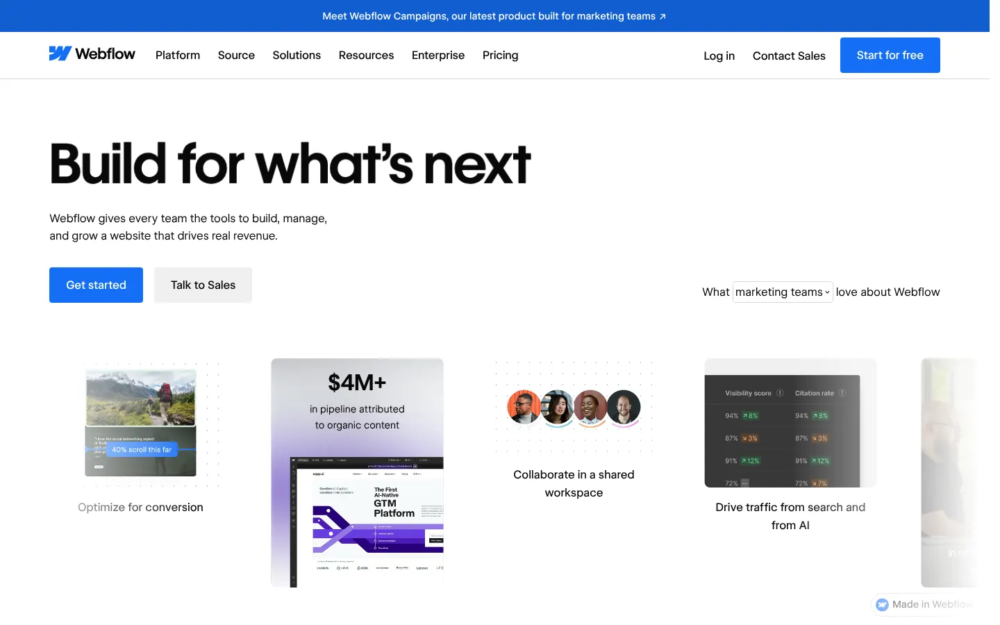
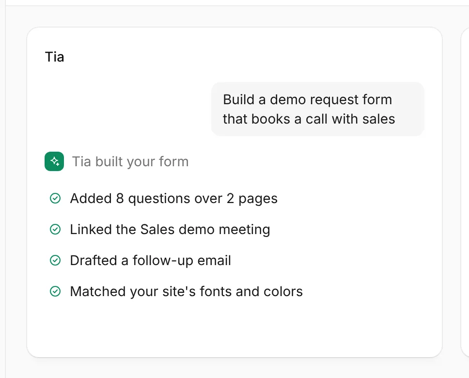
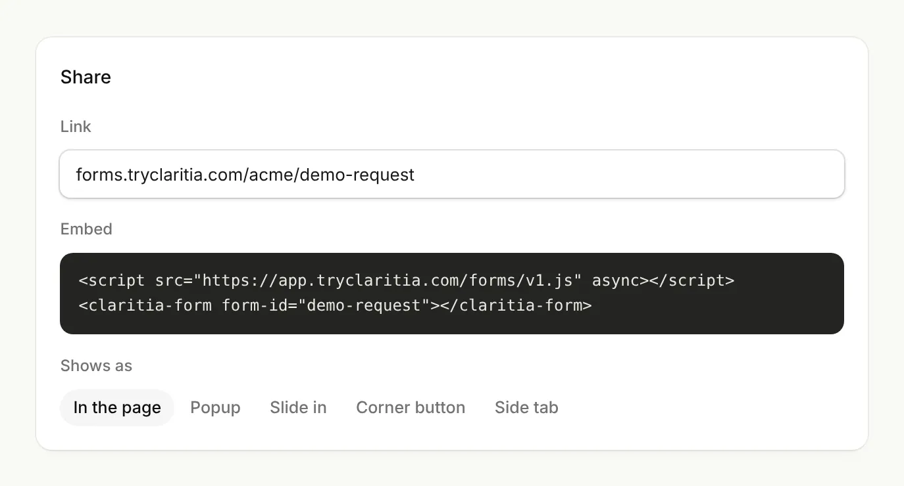
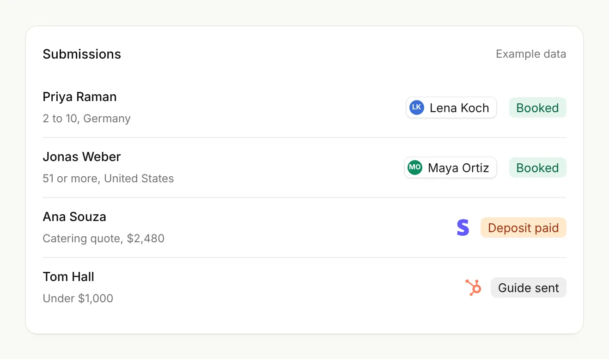
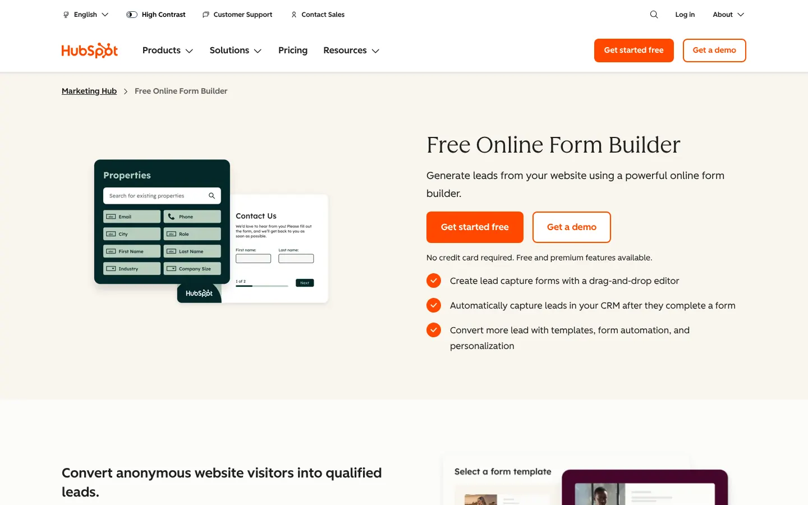
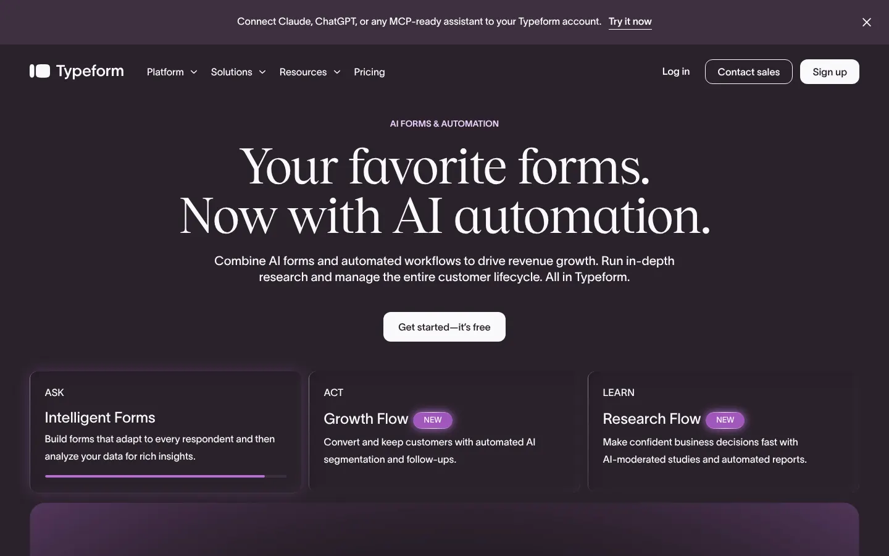

Webflow makes it easy to drop a form on a page. You add a form block, style it like the rest of your site, and submissions land in your site settings with an email to your team. For a simple contact form, that's all you need.

The trouble starts when the form has to do more. You want to split a long form into steps, hide questions that don't apply, send each lead to HubSpot, or let a good lead book a call before they leave. The form block wasn't built for any of that.

> **[Try Claritia free](https://app.tryclaritia.com/signup)** to put a multi-step form with logic on your Webflow site in one Embed element, and let each lead book a meeting on the same page.

In this guide, you'll see what Webflow's native form does on each plan, then two ways to get more from it, step by step.

## Main points

- [Webflow](https://webflow.com/) forms collect fields on a single page. The free Starter plan allows 50 form submissions per site, and paid site plans allow unlimited submissions.
- Steps, show-if logic and progress bars aren't settings on the form block. Webflow's own integrations directory points to apps and embeds for them.
- You can replace the form with a [Claritia](/) form in one Embed element, with pages, logic and booking on every plan.
- Or keep your Webflow form: Claritia opens the right calendar when it sends, and on Starter it takes Webflow form fills by webhook.
- To send a Webflow form to HubSpot, use the [HubSpot](https://www.hubspot.com/products/marketing/forms) app for Webflow, HubSpot's tracking code, or a form tool such as Claritia that connects to HubSpot.

## What Webflow forms do

[Webflow](https://webflow.com/) is a visual website platform for marketing, design and development teams that want to build, run and grow a website without filing a ticket for every change. You design pages on a visual canvas, manage content in its CMS and publish without a developer.

It also hosts the site and adds AI tools, testing and personalization, plus a form block that saves each submission and emails your team.

The form block holds the usual fields: text, email, dropdowns, checkboxes and a submit button. Webflow's pricing page says each site can collect submissions, send notification emails you can edit, and export submissions as a CSV file. How many submissions you get depends on the site plan.

Prices checked November 2026.

| Site plan | Price monthly | Price yearly | Form submissions | File uploads in forms |
|---|---|---|---|---|
| Starter | $0 | $0 | 50 per site | No |
| Basic | $25 a month | $15 a month | Unlimited | No |
| Premium | From $39 a month | From $25 a month | Unlimited | Yes, up to 10 MB a file |

Premium costs more as you add bandwidth. Prices are per site. Webflow's pricing page also lists custom code from Basic up, which matters if you plan to paste in a form from another tool.

## Where Webflow forms fall short

The form block is fine for a contact form. These are the gaps people hit next:

- **No steps.** Every field sits on one page. Webflow's integrations directory lists apps such as Formly and Inputflow to add multi-step flows and progress indicators to the form block.
- **No conditional logic.** You can't show a question only when an earlier answer calls for it, or skip a section, without an app or custom code.
- **A tight free limit.** On Starter, a site gets 50 form submissions. Paid site plans lift the cap.
- **No CRM by default.** Submissions stay in Webflow and your inbox. Getting them into HubSpot takes an app, a tracking script or a webhook.
- **Nothing after submit.** The lead sees a thank-you message, then has to wait for someone to reply.

## What you need

- A Webflow site on a paid site plan, if you'll paste code. Webflow lists custom code from the Basic plan up.
- Access to the Webflow Designer for the page where the form goes.
- A free [Claritia](https://app.tryclaritia.com/signup) account.
- A HubSpot account, if you want leads to land there. Claritia's HubSpot connection starts on Starter.

## Step 1: Choose to replace or keep your Webflow form

There are two ways to do this, and both end with the lead in Claritia.

**Replace it** if you want steps, logic, prices or a booked meeting inside the form. You build the form in Claritia and paste one snippet into Webflow.

**Keep it** if you like your Webflow form as it is. Claritia hears the form send and opens the right calendar on the same page. On Starter, Webflow form fills also come into Claritia by webhook, so they book and get follow-ups the same way.

## Step 2: Build the form in Claritia

Describe the form to Tia, Claritia's AI form builder, in a sentence. For example: "a demo request form for a design agency that asks about budget and books a call." Tia writes the questions and pages. You can also start from one of 840 [form templates](/templates).

*Tia turns one sentence into a demo request form you can then edit.*

Then shape it:

- **Split it into pages.** Multi-page forms with a progress bar are on every plan, Free included.
- **Add logic.** Show a question only when an earlier answer calls for it, and skip pages that don't apply. Also on every plan.
- **Keep the campaign data.** Hidden fields catch UTM tags, the page and the referrer.
- **End on a calendar.** Link a meeting type, so a qualified lead picks a time before they leave.

*A form that asks a qualifying question and ends on a time picker, so the lead books inside the form.*

## Step 3: Add an Embed element in Webflow

Open the form's Share tab in Claritia and copy the embed code. It's two lines:

- ``
- `<claritia-form form-id="FORM_ID"></claritia-form>`

In the Webflow Designer, drag an Embed element to the spot where the form should go. Paste the code and save. The snippet from the Share tab already carries your form's ID in place of FORM_ID.

The form can sit in the page, or open as a popup, a slide-in, a corner button or a side tab. The script loads after the page, so your Webflow page draws first.

*The Share tab gives you the form link, the embed code, and a choice of in page, popup, slide in, corner button or side tab.*

## Step 4: Or keep your Webflow form

If you'd rather keep the form you have, skip steps 2 and 3. Add the Claritia script to the page and point Claritia at your Webflow form. When the form sends, the right calendar opens on the same page and the lead books.

*After the form sends, the right rep's calendar opens on the same page.*

To save every Webflow fill in Claritia too, use the webhook route on Starter. Webflow can fire a webhook on each form submission, and Claritia treats those fills like its own: they book, sync and get follow-ups.

## Step 5: Connect HubSpot and your other tools

Every lead goes to Claritia first, then on to the tools you connect. On Starter, connect [HubSpot](/integrations/hubspot) in one click, and each form fill becomes a HubSpot contact, matched by email.

*Each fill shows in Claritia's submissions list with who the lead booked with and the next step.*

The same plan adds Google Sheets, Airtable, Notion, Slack, Microsoft Teams and email tools like Mailchimp. Webhooks and CSV export work on every plan.

## Step 6: Publish and test

Publish your Webflow site. Then fill in the form yourself, on a phone as well as a laptop:

- Check that each page and skip works with different answers.
- Check that the answer shows in Claritia and in HubSpot.
- Book a test meeting and make sure the invite reaches your calendar.

## Webflow form to HubSpot: your options

If HubSpot is your CRM, you have four ways to get Webflow form answers into it. Webflow's own HubSpot page lists the first three.

1. **The HubSpot app for Webflow.** Install it from the Webflow Apps Marketplace and map your Webflow form's fields to HubSpot contact properties, or embed a HubSpot form instead. Webflow notes that the newer form editor and embed styling features need HubSpot Marketing Hub Professional or Enterprise.
2. **HubSpot's tracking code.** Add it in Webflow's site settings and turn on HubSpot's option to capture forms that aren't HubSpot forms. There's no field mapping: answers arrive as single-line text properties.
3. **Webflow's API.** A developer sets up a webhook on form submissions and writes each one to HubSpot through its API. You get full control, but someone has to build and maintain it.
4. **A form tool that connects to HubSpot.** Claritia sends each form fill to HubSpot on Starter, and it can book the meeting first. See the [Webflow integration](/integrations/webflow) for the setup.

## Common problems

- **The embed doesn't show on the live site.** Embeds run on the published site, not always in the Designer. Publish, then check the page. Also check that your site plan includes custom code.
- **Submissions stopped on a free site.** The Starter plan allows 50 form submissions per site. Move to a paid site plan, or send fills to a form tool with its own limits.
- **No notification emails.** Check the recipient address in the form settings and your spam folder. Webflow's help center has a full checklist for missing emails.
- **HubSpot fields come in as plain text.** That's how HubSpot's capture of outside forms works. Map fields with the HubSpot app, or use a tool that maps them for you.
- **Files are too big.** Native form uploads need Premium and cap each file at 10 MB.
- **Spam fills.** Claritia uses Cloudflare spam protection, a honeypot and a rate limit on every plan.

## Tools for Webflow forms

### Claritia

[Claritia](/) is a forms, scheduling and follow-up app built for small B2B teams that want every lead from their website to reach the right rep and book a meeting before they leave the page.

It builds forms from a sentence or one of 840 templates, opens the right person's calendar the moment the form is sent, routes each lead by its answers, and drafts follow-up emails in your brand's voice for you to approve.

On Webflow, it works with one Embed element, or alongside the form you already have. Pages, logic, the progress bar and booking are free. HubSpot and Webflow form fills by webhook start on Starter at $15 a seat a month ($12 billed yearly). It's a newer tool, and its Zapier and Make apps aren't listed yet.

### HubSpot forms

[HubSpot forms](https://www.hubspot.com/products/marketing/forms) is the form builder in HubSpot's Marketing Hub for marketers who want website visitors to become CRM contacts automatically. Users build forms in a drag-and-drop editor or from templates for newsletter signups, downloads, event registration and more, then embed them on a site or publish them as standalone pages.

Each submission is saved to the contact database, can trigger a follow-up email or nurture campaign, and feeds reports on views, submissions and conversion rate. On Webflow, the HubSpot app embeds these forms or maps your Webflow form to HubSpot. HubSpot lists conditional logic and multi-step forms as premium features.

### Typeform

[Typeform](https://www.typeform.com/) is an online form builder for marketing, product, HR, and customer teams that want forms, surveys, and quizzes people actually finish. It builds conversational forms that adapt to each answer, can draft and brand a form from a written prompt, and accepts video and audio replies.

Responses can go to tools like HubSpot, Google Sheets, and Notion, take Stripe payments, book Calendly meetings, and feed AI summaries of themes and sentiment.

Its Webflow app, approved by Webflow, embeds a form without custom code and works on a free Webflow account. For now it supports the standard inline embed only. Typeform's free plan takes 10 responses a month, and Basic costs $28 a month billed yearly.

### Jotform

[Jotform](https://www.jotform.com/) is a drag and drop form builder for businesses, schools, nonprofits, and public agencies that want to collect data, payments, and signatures without writing code. Forms can use conditional logic, answer piping, prefilled fields, and translations, and they accept one-time or recurring payments through many gateways.

Submissions can become PDFs, flow into CRMs and spreadsheets, and be managed in related Jotform tools for tables, approval workflows, e-signatures, and reports.

Jotform has no Webflow Marketplace app, so you paste its embed code into a Code Embed element. Its free plan includes 5 forms and 100 submissions a month, and Bronze costs $34 a month billed yearly.

For more tools that give you a form to paste into any site, see our list of [free HTML form builders](/blog/free-html-form-builder).

## Questions

### How do I add a form in Webflow?

Open the Add panel in the Designer and drag a form block onto the page. Style it, set where notification emails go, and publish. For steps or logic, paste a form from another tool into an Embed element instead.

### How many form submissions does Webflow allow?

The free Starter plan allows 50 form submissions per site. Basic, Premium and higher site plans allow unlimited form submissions.

### Can Webflow forms have conditional logic?

Not on their own. The native form block has no show-if rules. You can add logic with an app from Webflow's integrations directory, with custom code, or by embedding a form tool that has logic, such as Claritia.

### How do I make a multi-step form in Webflow?

Build the pages in a form tool and embed it. In Claritia, multi-page forms with a progress bar and page skips are on every plan, and the whole form sits in one Embed element.

### How do I send Webflow form submissions to HubSpot?

Use the HubSpot app for Webflow to map fields, turn on HubSpot's capture of outside forms with its tracking code, or send the form through a tool that connects to HubSpot. Claritia does that on Starter.

### Where do I see Webflow form submissions?

In your site settings, under Forms. You can read each submission there and download them as a CSV file.

## Get started

Keep Webflow for your site and let your form do more than collect a name. Add steps and logic in one Embed element, or keep your form and add booking behind it.

> **[Try Claritia free](https://app.tryclaritia.com/signup)** to build a multi-step form for your Webflow site and book each good lead before they leave.

You can also read about the [Webflow integration](/integrations/webflow) or browse the [form templates](/templates).
